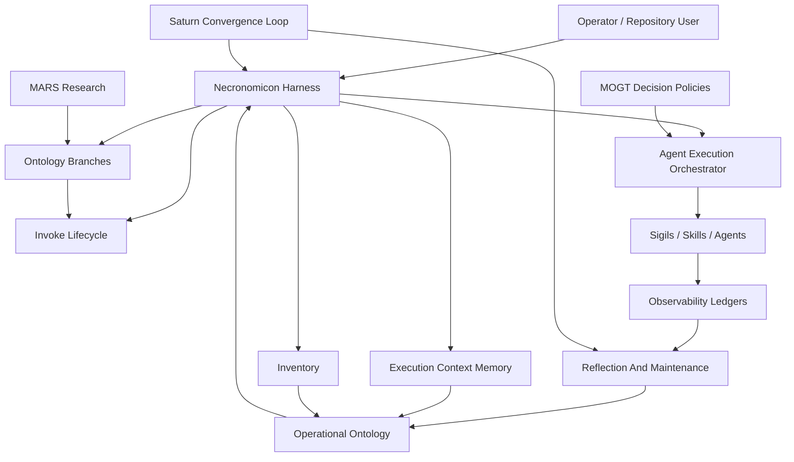
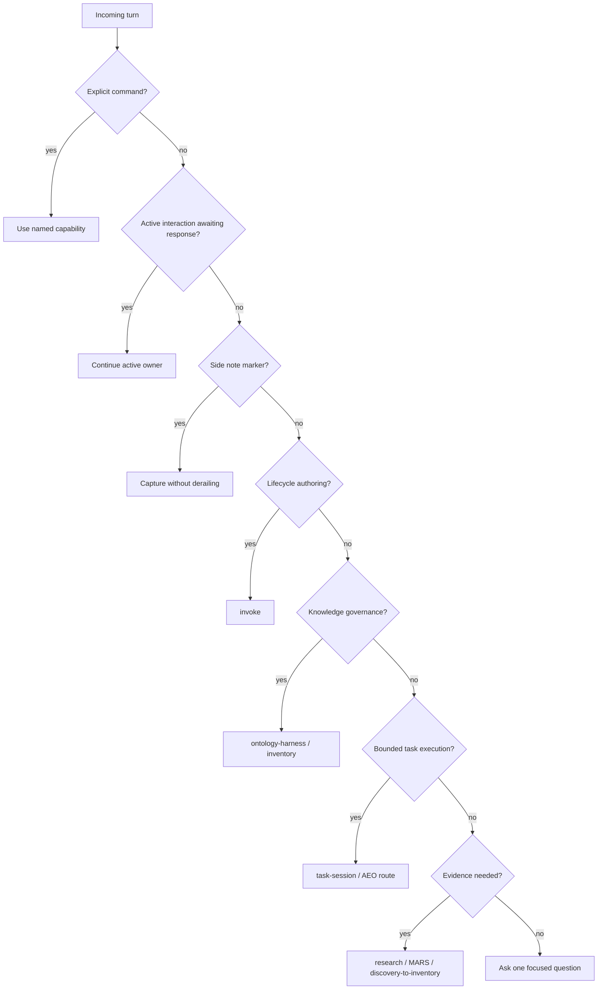

# CyberAlchemy Agentic System Architecture

Status: discovery-mode invoke design
Date: 2026-05-19
Owner: CyberAlchemy AI
Navigation: [agentic-system-navigation.md](agentic-system-navigation.md)
Definition baseline: [agentic-system-definition.md](agentic-system-definition.md)
Knowledge map: [agentic-system-knowledge-map.md](agentic-system-knowledge-map.md)

## Design Intent

Design the CyberAlchemy agentic system as a cybernetic knowledge and execution stack that reduces residue between two layers:

1. Schema layer: ontologies, definitions, contracts, policies, skills, sigils, spells, routes, templates, axioms, and meta-models.
2. Data/evidence layer: sessions, code, tests, telemetry, run logs, route outcomes, user behavior, experiment data, and runtime observations.

The system should chase symmetry between those layers. It should notice when intent lacks realization, when realization lacks intent, when agent behavior repeats a useful pattern, and when repeated execution creates new knowledge that deserves promotion.

This design was produced in discovery mode before the current define baseline. Use [agentic-system-definition.md](agentic-system-definition.md) and [agentic-system-glossary.md](agentic-system-glossary.md) as the current vocabulary authority until this design is reconciled in a follow-up `invoke design` pass.

## Foundational Principles

| Principle                            | Meaning                                                                                                                                        | Repository anchor                                                                                                                                                      |
| ------------------------------------ | ---------------------------------------------------------------------------------------------------------------------------------------------- | ---------------------------------------------------------------------------------------------------------------------------------------------------------------------- |
| Symmetry pursuit                     | Keep intent and reality mutually traceable; use drift as the signal of lost symmetry.                                                          | [saturn-research-presentation.md](saturn-research-presentation.md), [DRIFT-CONVERGENCE.md](../implementation/domainspec/DRIFT-CONVERGENCE.md)                          |
| Residue reduction                    | Translation gaps are first-class objects: bridge gaps, route misses, validation gaps, orphan behavior, unresolved premises, and user friction. | [Ontology Vault](../arcanum/arcana/ontology-vault/README.md), [Residuality Spec](../arcanum/arcana/residuality-spec/README.md)                                         |
| Candidate before canon               | Session memory and synthesis may create candidates, but promotion belongs to inventory, ontology, decision gates, and lifecycle owners.        | [KNOWLEDGE-SUBSTRATE-FLOW.md](../arcanum/spells/necronomicon/development/KNOWLEDGE-SUBSTRATE-FLOW.md)                                                                  |
| Evidence and commitment are separate | A claim can be well-supported but not strategically important, or strategically important but weakly supported.                                | [ontology-conventions.md](../implementation/domainspec/vault/ontology-conventions.md), [confidence-levels.md](../implementation/domainspec/vault/confidence-levels.md) |
| Govern the governor                  | Capabilities, routes, and governance rules must emit signals and improve from reflection, not from memory alone.                               | [TUNING-LOOP.md](../implementation/domainspec/TUNING-LOOP.md), [Observed Invocation Loop](../arcanum/spells/observed-invocation-loop/README.md)                        |
| Local-first context                  | Use repository memory, inventory, ontology, docs, code, and telemetry before broader research.                                                 | [Necronomicon README](../arcanum/spells/necronomicon/README.md)                                                                                                        |
| Bounded action                       | Agent work should be staged through route artifacts, stage contracts, terminal outcomes, and verification evidence.                            | [Agent Execution Orchestrator](../implementation/domainspec/docs/features/agent-execution-orchestrator/SPEC.md)                                                        |

## View 1: Context



The harness coordinates work but does not own every truth. Ontology owns governed meaning, inventory owns reusable source-grounded knowledge, execution owns stage outcomes, observability owns run evidence, and research owns empirical claim updates.

## View 2: High-Level Structure

```text
CyberAlchemy Agentic System
  1. Philosophy and intent plane
     - Cybernetics^2
     - Saturn drift/convergence
     - symmetry and residue reduction

  2. Knowledge governance plane
     - business ontology
     - system ontology
     - bridge ontology
     - operational ontology
     - research/methodology projection

  3. Memory and context plane
     - active interaction
     - session memory
     - route ledger
     - side notes
     - user workflow model
     - context solution cards

  4. Execution plane
     - Necronomicon route selection
     - invoke define/design/plan
     - task-session
     - agent execution orchestrator
     - skills, sigils, spells, agents

  5. Observability and learning plane
     - invocation telemetry
     - delegation and terminal guard ledgers
     - DomainSpec pipeline signals
     - MARS telemetry
     - workflow reflection
     - maintenance proposals

  6. Research and meta-model plane
     - MARS research lifecycle
     - MOGT decision policy experiments
     - DomainSpec evidence program
     - concept-layer optimizer
     - reusable meta-model registry candidates
```

## View 3: Low-Level Components

### Knowledge Governance Plane

| Component            | Responsibility                                                                                                    | Existing source                                                                                   |
| -------------------- | ----------------------------------------------------------------------------------------------------------------- | ------------------------------------------------------------------------------------------------- |
| Business Ontology    | Domain intent, rules, policies, actors, value, outcomes.                                                          | [BUSINESS-ONTOLOGY.md](../arcanum/BUSINESS-ONTOLOGY.md)                                           |
| System Ontology      | Code, services, APIs, data flow, tests, metrics, runtime facts.                                                   | [Ontology Vault](../arcanum/arcana/ontology-vault/README.md)                                      |
| Bridge Ontology      | Traceability edges and drift between business and system branches.                                                | [business-system-bridge.md](../arcanum/arcana/ontology-vault/templates/business-system-bridge.md) |
| Operational Ontology | Accumulated knowledge of agent operation, contexts, route patterns, lessons, failures, and maintenance proposals. | New branch proposed here.                                                                         |
| Research Projection  | Claims, hypotheses, protocols, references, inventory, run data, evidence status.                                  | [MARS Research Taxonomy](../research/projects/mars/definitions/RESEARCH-TAXONOMY.md)              |

### Memory And Context Plane

| Component              | Responsibility                                                                                | Promotion boundary                                                                    |
| ---------------------- | --------------------------------------------------------------------------------------------- | ------------------------------------------------------------------------------------- |
| Active Interaction     | Knows whether the next user turn continues an existing flow.                                  | Stays session-local unless it reveals a durable routing rule.                         |
| Session Memory         | Compact continuity summary for current objective, facts, decisions, next route.               | Can distill into inventory or ontology candidates.                                    |
| Route Ledger           | Records selected route, confidence, result, validation, misses.                               | Repeated route patterns become Operational Ontology candidates.                       |
| Side Notes             | Captures facts, research seeds, unblockers, contradictions, reminders without derailment.     | Durable facts become inventory candidates; contradictions become ontology candidates. |
| User Workflow Model    | Tracks user preferences, recurring mental models, ergonomics, and preferred work cadence.     | Requires privacy policy and explicit promotion gate before ontology use.              |
| Context Solution Cards | Reusable retrieval cards mapping execution context to known route/context/evidence solutions. | Candidate operational knowledge until validated across runs.                          |

### Execution Plane

| Component                         | Responsibility                                                                                      | Evidence                                             |
| --------------------------------- | --------------------------------------------------------------------------------------------------- | ---------------------------------------------------- |
| Necronomicon                      | Repository-local memory, selected capability routing, fallback discovery, checkpoints, maintenance. | session files, routes, gaps, handoffs                |
| Invoke                            | Governed define, design, plan, full, validate lifecycle authoring.                                  | define/design/plan artifacts and gap ledgers         |
| Task Session                      | One bounded task with scope, gates, validation, and completion evidence.                            | task result and verification                         |
| Agent Execution Orchestrator      | Route templates, stage contracts, run states, leases, stageRunId pairing, telemetry envelopes.      | route artifacts, stage outcomes, telemetry envelopes |
| Skills / Sigils / Spells / Agents | Reusable units of action and reasoning.                                                             | Quality bars, output contracts, invocation telemetry |

### Observability And Learning Plane

| Component                | Responsibility                                                                               | Output                                                   |
| ------------------------ | -------------------------------------------------------------------------------------------- | -------------------------------------------------------- |
| Observed Invocation Loop | Appends one telemetry signal and evaluates reflection triggers after managed invocations.    | `.arcanum/observability/signals/sigil-invocations.jsonl` |
| Signal Observer          | Converts completed invocation envelopes into behavior-level signals.                         | signal counts and ledger append                          |
| Workflow Reflect         | Detects repeated gaps, output drift, useful patterns, and proposes improvements.             | reflection report                                        |
| Sigil Maintenance Loop   | Composes observe -> reflect -> approved sigil update.                                        | maintenance report and changed capability when approved  |
| DomainSpec Tuning        | Reads pipeline signals, thresholds repeated patterns, proposes skill/agent/template updates. | tuning report, issue, PR candidate                       |
| MARS Evidence Loop       | Moves research evidence into claim status updates.                                           | evidence-status updates and experiment priorities        |

## View 4: Workflow Process

### Normal Repository Work

```text
user intent
  -> Necronomicon loads active interaction, memory, routes, gaps
  -> classify: command, continuation, side note, handoff, or fresh route
  -> retrieve local memory/inventory/ontology context
  -> select owner capability
  -> execute through invoke, task-session, ontology-harness, or other selected route
  -> collect output, validation, route result, telemetry
  -> checkpoint facts, decisions, gaps, candidates, next route
  -> feed repeated signals to Operational Ontology candidates
```

### Knowledge Promotion

```text
session fact or repeated route pattern
  -> memory checkpoint
  -> inventory candidate when source-grounded or reusable
  -> operational ontology candidate when it concerns agent operation
  -> premise review when it is a working bet
  -> confidence review when the system wants to rely on it
  -> decision gate when commitment changes behavior or architecture
  -> skill/sigil/spell/agent update when approved
  -> observed in later runs
```

### Execution Learning

```text
stage run starts
  -> started telemetry row
  -> guarded execution
  -> terminal outcome: completed, blocked, failed, canceled
  -> terminal telemetry row
  -> signal observer appends invocation signal
  -> threshold or manual reflection
  -> workflow reflect report
  -> operational ontology lesson candidate
  -> maintenance proposal
  -> approved capability update
```

### Research Learning

```text
research question
  -> MARS foundations and definitions
  -> protocol and source gates
  -> inventory readiness
  -> append-only run data
  -> integrity and analysis
  -> claim adjudication
  -> evidence-status update
  -> operational or domain ontology candidate if it affects system behavior
```

## View 5: Decision Flow

### Route Selection



### Promotion Decision

| Candidate                | Promote when                                                                                        | Gate                                                |
| ------------------------ | --------------------------------------------------------------------------------------------------- | --------------------------------------------------- |
| Memory shortcut          | Repeats across contexts and reduces execution cost without hiding evidence.                         | Inventory or Operational Ontology candidate review. |
| Operational pattern      | At least several non-duplicate runs support the pattern and failure modes are named.                | Operational premise review and confidence split.    |
| Skill/sigil update       | Reflection shows repeated gap, output drift, or reusable pattern and user approves mutation scope.  | Sigil Maintenance Loop or Sigil Development.        |
| Spell update             | Multiple sigils need shared state, gates, or handoff changes.                                       | Spellcraft.                                         |
| Operational constitution | Repeated operating rule affects route, safety, privacy, or capability behavior.                     | Decision Gate plus ontology convention update.      |
| Operational axiom        | Load-bearing principle justifies many downstream operating rules and survived contradiction review. | Highest ontology promotion bar.                     |

### MOGT Decision Policy Hook

MOGT should become the decision-policy layer for contested route choices, not a generic prompt flourish.

Use objective vectors when a route or agent decision trades off:

```text
quality
cost
latency
safety
escalation risk
user cognitive load
evidence completeness
maintenance impact
```

Possible policy regimes:

| Regime              | Use when                                                                               |
| ------------------- | -------------------------------------------------------------------------------------- |
| Heuristic baseline  | Low-risk routine route choice.                                                         |
| Weighted-sum        | Objectives are measurable and one scalar decision is acceptable.                       |
| Pareto-guided       | Several options have competing strengths and dominated options should be eliminated.   |
| Negotiation-enabled | Multiple roles or agents disagree and bounded dialogue may reduce unresolved conflict. |

References: [MOGT README](../research/projects/mogt-agentic-conversation/README.md), [MOGT methodology](../research/projects/mogt-agentic-conversation/foundations/METHODOLOGY-AND-THEORY.md).

## View 6: Dependency Interface

| Dependency                     | Interface needed by system                                                            | Contract                                                                                         |
| ------------------------------ | ------------------------------------------------------------------------------------- | ------------------------------------------------------------------------------------------------ |
| Arcanum command surface        | Resolve and invoke installed sigils/spells.                                           | Command resolves to canonical adapter and preserves observed invocation closeout when available. |
| Necronomicon state             | Read/write session memory, active interaction, routes, gaps, side notes, checkpoints. | Memory is continuity, not authority.                                                             |
| Inventory                      | Lookup, ingest, lint, validate reusable source-grounded knowledge.                    | Raw sources remain immutable; entries are reusable maps.                                         |
| Ontology Vault                 | Map branches, distill sessions, review premises, promote confidence, validate bridge. | Promotion requires evidence and gates.                                                           |
| Invoke                         | Define/design/plan lifecycle authoring.                                               | Six design views for design mode; no silent upstream mutation.                                   |
| Agent Execution Orchestrator   | Route templates, stage contracts, run state, telemetry envelope.                      | Every started stage reaches terminal outcome.                                                    |
| Observability ledgers          | Append invocation, delegation, terminal guard, pipeline, and research signals.        | Append-only; no silent rewrite.                                                                  |
| Workflow Reflect / Maintenance | Reflect on repeated signals and propose updates.                                      | Reflection proposes; lifecycle owner mutates after approval.                                     |
| MARS                           | Research claims, protocols, run data, analysis, evidence status.                      | Hard gates G0-G4 and traceable evidence.                                                         |
| MOGT                           | Conversation decision policy experiments and objective-vector evidence.               | Policy improvements must be measured against quality, traceability, overhead.                    |

## Operational Ontology Model

Operational Ontology is a proposed fourth ontology branch:

```text
Business Ontology: what should be true in the domain.
System Ontology: what is true in the implementation/runtime.
Operational Ontology: what is true about agent operation.
Bridge Ontology: how these branches are aligned, tested, observed, constrained, or drifting.
```

### Purpose

Operational Ontology accumulates verified knowledge about how agents, skills, sigils, spells, routes, memories, prompts, and user workflows behave in practice.

It should answer:

- Which route works for this execution context?
- Which capability should receive this kind of task?
- What lessons were learned from past optimization of sigils, spells, skills, and agents?
- Which user workflow patterns matter for ergonomic routing?
- Which operational premises are still unverified?
- Which memory shortcuts deserve promotion into reusable process or capability definitions?
- Which meta-models generalize across domains and tasks?

### Node Types

| Node type             | Meaning                                                          | Example                                                                |
| --------------------- | ---------------------------------------------------------------- | ---------------------------------------------------------------------- |
| `Capability`          | Skill, sigil, spell, agent, or command surface.                  | `invoke`, `ontology-vault`, `domainspec-orchestrator`.                 |
| `InvocationPattern`   | Reusable route or stage sequence.                                | `context-builder -> implement -> tag-code -> audit -> verify`.         |
| `ExecutionContext`    | Task setting where a pattern applies.                            | "design-mode architecture without approved define outputs".            |
| `OperationalLesson`   | Evidence-backed lesson from prior runs.                          | "Define prompt schema and invalid examples before runner design."      |
| `OperationalPremise`  | Working bet about agent behavior.                                | "Parallelization requires independent tasks."                          |
| `ContextSolution`     | Retrieved shortcut for a recognized execution context.           | "For sigil design, run invoke define/design, then sigil-development."  |
| `UserWorkflowModel`   | User preference, mental model, cadence, or ergonomic constraint. | "User prefers architecture maps before implementation packs."          |
| `FailureMode`         | Repeated operational risk or anti-pattern.                       | "Route artifacts without terminal telemetry create orphan stage runs." |
| `MaintenanceProposal` | Proposed skill/sigil/spell/agent update.                         | "Add a route preset after repeated route miss."                        |
| `MetaModelCandidate`  | Generalizable concept/layer/model discovered through work.       | "Schema/data residue lens."                                            |
| `EvaluationSignal`    | Telemetry or metric used to validate operational claims.         | `suspected_stuck_rate`, route miss count, reflection threshold.        |

### Edge Types

| Edge              | Meaning                                                                               |
| ----------------- | ------------------------------------------------------------------------------------- |
| `learned_from`    | Lesson or premise is derived from run, telemetry, session, experiment, or review.     |
| `applies_to`      | Pattern or lesson applies to an execution context.                                    |
| `improves`        | Proposal or lesson improves a capability.                                             |
| `avoids`          | Pattern prevents or reduces a failure mode.                                           |
| `observed_by`     | Operational claim is measured by a signal.                                            |
| `tested_by`       | Operational claim is validated by test, dry run, benchmark, or review.                |
| `constrained_by`  | Operational behavior is bounded by policy, privacy, budget, or safety rule.           |
| `routes_to`       | Context solution selects a capability route.                                          |
| `generalizes_to`  | A local lesson becomes a broader meta-model candidate.                                |
| `specializes`     | A generic pattern is adapted to a specific domain/task.                               |
| `contradicted_by` | Evidence challenges an operational premise or pattern.                                |
| `supersedes`      | New operational pattern replaces older guidance.                                      |
| `drifts_from`     | Actual agent operation diverges from the operational contract.                        |
| `promotes_to`     | Candidate becomes premise, constitution, axiom, skill, sigil, spell, or agent update. |

### Confidence Fields

Operational Ontology should reuse the existing split:

| Field                 | Question                                                                        |
| --------------------- | ------------------------------------------------------------------------------- |
| Evidence confidence   | How many and how strong are the observations supporting this operational claim? |
| Commitment confidence | Should the harness route or optimize based on this claim now?                   |
| Scope of validity     | Which repos, task types, stages, users, or capabilities does this apply to?     |
| Expiry condition      | What context change invalidates the claim?                                      |
| Privacy class         | Whether the claim can store user-specific workflow detail.                      |
| Promotion status      | Candidate, premise, reviewed, promoted, retired, or contradicted.               |

### Context Solution Card

Operational Ontology should expose task-shaped retrieval, not a wiki dump.

```yaml
context_solution_id: CS-OP-0001
trigger_fingerprint:
  repo: domainspec-core
  intent_type: architecture-design
  artifact_type: cyberalchemy-agentic-system
  route_pressure: high-research
recommended_route:
  primary: invoke design
  support:
    - ontology-vault
    - context-builder
    - workflow-reflect
required_evidence:
  - source contracts
  - design views
  - unresolved gaps
known_pitfalls:
  - do not promote session memory directly to ontology
  - do not mutate upstream source contracts silently
validation:
  - markdown link check
confidence:
  evidence: medium
  commitment: medium
expiry_condition: approved define baseline replaces discovery-mode assumptions
```

## Memory Architecture

Memory should be optimized for execution context and later promotion.

### Memory Strata

| Stratum               | Role                                                                       | Storage shape                                             |
| --------------------- | -------------------------------------------------------------------------- | --------------------------------------------------------- |
| Working memory        | Active flow and immediate pending prompt.                                  | `active-interaction.json`                                 |
| Episodic memory       | What happened in a session, why, and what remains.                         | `memory.md`, checkpoints                                  |
| Route memory          | Which routes were attempted, selected, missed, and validated.              | `routes.jsonl`                                            |
| Side memory           | Facts, research seeds, reminders, contradictions, unblockers.              | `side-notes.jsonl`                                        |
| Procedural memory     | Repeated shortcuts, task recipes, route presets.                           | inventory + Operational Ontology candidates               |
| User ergonomic memory | User workflow, phrasing, preferred planning depth, recurring mental model. | privacy-scoped memory, promoted only with explicit policy |
| Canonical knowledge   | Reviewed ontology, constitutions, axioms, skill/sigil/spell contracts.     | ontology and canonical artifact folders                   |

### Retrieval Order

```text
active interaction
  -> current session memory
  -> route ledger and side notes
  -> inventory entries
  -> operational ontology context solutions
  -> business/system/research ontology
  -> repository-wide search
  -> external research only when needed and allowed
```

### Promotion Rule

Memory becomes ontology only through a visible path:

```text
memory observation
  -> candidate summary
  -> source/evidence reference
  -> inventory entry or operational candidate
  -> premise review
  -> evidence confidence and commitment confidence
  -> decision gate if behavior changes
  -> capability update or ontology promotion
```

## Translation Residue Model

Translation residue is any meaningful loss, ambiguity, contradiction, or unverified assumption introduced when moving between schema and data.

| Translation                       | Typical residue                                                   | Response                                                      |
| --------------------------------- | ----------------------------------------------------------------- | ------------------------------------------------------------- |
| Business -> System                | Unfulfilled promise, unauthorized scope, missing bridge evidence. | Bridge validation, drift report, task-session.                |
| System -> Business                | Runtime behavior redefines meaning without approval.              | Ontology review, decision gate.                               |
| Capability Contract -> Invocation | Output drift, missing telemetry, anti-pattern hit.                | Signal observer, workflow reflect, maintenance loop.          |
| Session Memory -> Ontology        | Raw conversation treated as authority.                            | Candidate-only promotion and premise review.                  |
| Research Protocol -> Data         | Integrity failure, missing metadata, weak claim support.          | MARS gates and claim adjudication.                            |
| User Workflow -> Agent Route      | Repeated clarification, poor ergonomics, route miss.              | Operational Ontology context solution or user workflow model. |

Residuality Spec can supply the question: what must survive when a translation fails? For example, if a route fails, the system should preserve user intent, route evidence, gap state, and a safe next action.

## Proposed Additions Beyond The User List

| Addition                                 | Why it appears in research                                                                                                                                | Where it should live                                                 |
| ---------------------------------------- | --------------------------------------------------------------------------------------------------------------------------------------------------------- | -------------------------------------------------------------------- |
| Research/Methodology Ontology projection | MARS already models claims, protocols, references, inventory, run data, analysis, evidence status, and paper sections.                                    | Research projection, not necessarily the core operational branch.    |
| Decision Policy Layer                    | MOGT provides objective-vector and negotiation framing for contested agent choices.                                                                       | AEO route policy plus Operational Ontology.                          |
| Residuality/Stress Branch                | Residuality Spec names stressors, residues, degradation, attractors, and recovery. This can model what survives failed schema/data translation.           | Bridge and Operational Ontology.                                     |
| User Ergonomics Model                    | Necronomicon already models side notes and active continuation; user workflow should become explicit but privacy-scoped.                                  | Memory plane and Operational Ontology.                               |
| Context Solution Registry                | The requested "different context solutions" needs a retrieval artifact between memory and ontology.                                                       | Operational Ontology plus inventory selectors.                       |
| Meta-Model Registry                      | The repo has DomainSpec taxonomy, MARS taxonomy, concept-layer optimizer, and ontology conventions but no common promotion lane for reusable meta-models. | Definitions governance plus Operational Ontology.                    |
| Signal Schema Unification                | OIL, DomainSpec, MARS, delegation tuning, and terminal guard ledgers are all append-only signals with overlapping semantics.                              | Observability plane.                                                 |
| Privacy and Redaction Policy             | User mental model memory can be valuable and sensitive. It needs explicit boundaries.                                                                     | Necronomicon setup decisions and Operational Ontology privacy class. |
| Capability Provenance Graph              | Skills, sigils, spells, agents, route adapters, and generated command surfaces need lineage and drift detection.                                          | Operational Ontology and Arcanum registry.                           |

## Decisions

| Decision                                                                                  | Status   | Rationale                                                                                                    |
| ----------------------------------------------------------------------------------------- | -------- | ------------------------------------------------------------------------------------------------------------ |
| Treat this as `invoke design` discovery mode.                                             | selected | The user requested architecture/design and deep repository research without approved define artifacts.       |
| Add Operational Ontology as a branch, not as memory.                                      | selected | Memory is continuity; ontology is governed knowledge. Blending them would violate existing authority ladder. |
| Keep Operational Ontology candidate-only until ontology-harness work approves its schema. | selected | Existing Arcanum rules prohibit silent promotion.                                                            |
| Model user workflow memory separately from public operational knowledge.                  | selected | Ergonomics matter, but personal mental model tracking requires privacy boundaries.                           |
| Use Context Solution Cards as the retrieval interface for past operational knowledge.     | selected | They give agents task-shaped shortcuts without dumping full ontology context.                                |

## Risks And Gaps

| Risk                                                         | Impact | Mitigation                                                                                               |
| ------------------------------------------------------------ | ------ | -------------------------------------------------------------------------------------------------------- |
| Operational Ontology becomes a junk drawer for every lesson. | High   | Require node type, evidence, scope of validity, expiry condition, and promotion status.                  |
| Memory shortcuts bypass evidence.                            | High   | Retrieve shortcuts with confidence and required evidence; never make memory authoritative by itself.     |
| User workflow model becomes invasive.                        | High   | Add privacy classes, redaction rules, explicit opt-in for durable personal memory.                       |
| Signal schemas fragment further.                             | Medium | Create a cross-ledger signal vocabulary before building automated analysis.                              |
| Context Solution Cards overfit one repo or one user.         | Medium | Require scope-of-validity and expiry notes.                                                              |
| Meta-model tower becomes abstract ceremony.                  | Medium | Use Via Negativa: promote only when absence caused measurable harm, drift, or repeated rework.           |
| MOGT adds overhead to simple routes.                         | Medium | Use heuristic baseline for routine choices; invoke objective-vector policy only for contested tradeoffs. |

## Implementation Layering Seed

This is not an execution plan, but the architecture suggests a staged implementation path.

| Layer                   | Question                                                                                                      | Candidate output                                                             |
| ----------------------- | ------------------------------------------------------------------------------------------------------------- | ---------------------------------------------------------------------------- |
| L0: Define baseline     | What is the minimum accepted vocabulary for Operational Ontology, memory, residue, and context solutions?     | `invoke define` artifact with glossary and gaps.                             |
| L1: Ontology schema     | Can Operational Ontology be represented using existing ontology-vault templates plus new branch templates?    | Operational ontology map template, edge catalog, confidence fields.          |
| L2: Memory bridge       | Can Necronomicon checkpoints emit operational candidates without promoting them?                              | Candidate extraction shape and Context Solution Card draft.                  |
| L3: Signal bridge       | Can OIL, AEO, delegation, terminal guard, DomainSpec, and MARS signals map to operational nodes?              | Signal-to-operational mapping table.                                         |
| L4: Retrieval           | Can agents retrieve context solutions at run start and cite their confidence/gaps?                            | Context solution lookup behavior.                                            |
| L5: Maintenance         | Can repeated operational candidates trigger reflection and capability updates?                                | Maintenance routing through workflow-reflect, sigil-development, spellcraft. |
| L6: Research validation | Can MARS validate whether operational ontology improves route quality, cost, latency, safety, or user burden? | MARS experiment bundle and MOGT policy hooks.                                |

## Next Authoring Routes

| Route               | Purpose                                                                                                    |
| ------------------- | ---------------------------------------------------------------------------------------------------------- |
| `invoke define`     | Create an approved definition and glossary baseline for the agentic system and Operational Ontology.       |
| `ontology-harness`  | Turn this design into candidate ontology maps and bridge templates.                                        |
| `decision-gate`     | Decide privacy boundaries for user workflow memory and whether Operational Ontology is a top-level branch. |
| `invoke plan`       | Convert the accepted design into layered implementation artifacts and work-pack.                           |
| `sigil-development` | If needed, create an `operational-ontology` sigil or mode for ontology-vault.                              |
| `spellcraft`        | If multiple sigils must coordinate memory -> ontology -> maintenance, compose a new spell.                 |

## Invoke Result

- Mode: design
- Spell: invoke
- Canonical ID: invoke
- Scope: library
- Phase status: flag
- Mode contract: [arcanum/spells/invoke/design.md](../arcanum/spells/invoke/design.md)
- Outputs: [agentic-system-architecture.md](agentic-system-architecture.md), [agentic-system-knowledge-map.md](agentic-system-knowledge-map.md)
- Design views: context, high-level structure, low-level components, workflow process, decision flow, dependency interface
- Template/profile selection: discovery-mode architecture family with source contracts from CyberAlchemy, Arcanum, DomainSpec, MARS, and MOGT
- Implementation layering: seed emitted in this file
- Work-pack: n/a
- Decisions: Operational Ontology modeled as candidate ontology branch; memory remains continuity layer; context solution cards proposed as retrieval surface
- Unresolved gaps: no approved define baseline; operational ontology schema not yet validated by ontology-harness; privacy policy for user workflow memory unresolved; telemetry recorded only by normal environment hooks if present, not by a deterministic `tools/arcanum --exec` wrapper in this run
- Next route: define
