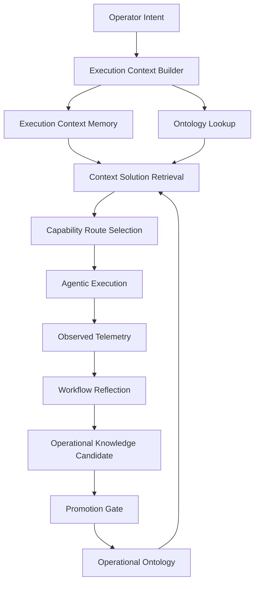

# CyberAlchemy Agentic System Definition

Status: invoke define baseline candidate
Owner: CyberAlchemy AI
Navigation: [agentic-system-navigation.md](agentic-system-navigation.md)
Source map: [agentic-system-knowledge-map.md](agentic-system-knowledge-map.md)
Discovery design: [agentic-system-architecture.md](agentic-system-architecture.md)
Glossary: [agentic-system-glossary.md](agentic-system-glossary.md)
Layering seed: [agentic-system-implementation-layering.md](agentic-system-implementation-layering.md)

## Objective

Define the CyberAlchemy agentic system as a governed knowledge and execution stack that chases symmetry between schema and data, reduces translation residue, and turns repeated agent operation evidence into reusable, reviewable knowledge.

This baseline exists to support downstream architecture, ontology-harness, and implementation planning work. It is not yet a canonical ontology promotion.

## Scope

In scope:

- CyberAlchemy agentic system mission, ownership boundary, and capability map.
- Operational Ontology as a proposed ontology branch for agent operation knowledge.
- Execution-context memory as a continuity and shortcut layer.
- Context Solution Cards as the retrieval surface between memory and Operational Ontology.
- Feedback loops that connect execution, observability, reflection, maintenance, and ontology review.
- Candidate acceptance criteria for the next design and plan stages.

Out of scope:

- Runtime implementation.
- Schema migrations.
- Automatic ontology promotion.
- User-specific memory retention policy beyond the need for a privacy gate.
- Direct mutation of Arcanum, DomainSpec, Necronomicon, MARS, or MOGT source contracts.

Target operator: repository operator building and maintaining agentic workflows inside `domainspec-core`.

## Template Selection Evidence

| Template family | Eligible | Rationale                                                                                                                                  |
| --------------- | -------- | ------------------------------------------------------------------------------------------------------------------------------------------ |
| Module Formulae | yes      | The target is a cross-cutting system module with concepts, capabilities, evidence links, governance boundaries, and downstream plan needs. |
| Generic         | yes      | A neutral fallback would fit, but it would be weaker than the module-first structure.                                                      |
| Architecture    | partial  | Architecture output already exists; define mode now needs the baseline terms and ownership boundary that architecture depends on.          |
| Research        | partial  | MARS and MOGT are evidence sources, but the requested artifact is a system definition rather than a research protocol.                     |
| Spell           | no       | This baseline may later produce a spellcraft handoff, but the target is not yet a spell.                                                   |
| Sigil           | no       | This baseline may later produce a sigil-development handoff, but the target is broader than one sigil.                                     |
| UX plan         | partial  | User ergonomics is in scope, but only as part of memory and routing definition.                                                            |

Selected template: Module Formulae define subset.

Selected outputs:

- module spec: this file
- glossary/ontology: [agentic-system-glossary.md](agentic-system-glossary.md)
- implementation layering seed: [agentic-system-implementation-layering.md](agentic-system-implementation-layering.md)
- transport report: [agentic-system-define-transport.md](agentic-system-define-transport.md)

## Source Evidence

| Evidence ID | Source                                                                                                                                                     | Relevance                                                                                         |
| ----------- | ---------------------------------------------------------------------------------------------------------------------------------------------------------- | ------------------------------------------------------------------------------------------------- |
| E-001       | [main.html](main.html)                                                                                                                                     | CyberAlchemy product philosophy: software as observational probe and cybernetic feedback surface. |
| E-002       | [saturn-research-presentation.md](saturn-research-presentation.md)                                                                                         | Drift/convergence loop; intent flows down and evidence flows up.                                  |
| E-003       | [BUSINESS-ONTOLOGY.md](../arcanum/BUSINESS-ONTOLOGY.md)                                                                                                    | Existing business/system/bridge ontology model and Via Negativa promotion discipline.             |
| E-004       | [Ontology Vault](../arcanum/arcana/ontology-vault/README.md)                                                                                               | Branch-aware knowledge roles, confidence split, evidence and bridge edge discipline.              |
| E-005       | [KNOWLEDGE-SUBSTRATE-FLOW.md](../arcanum/spells/necronomicon/development/KNOWLEDGE-SUBSTRATE-FLOW.md)                                                      | Authority ladder from raw interaction through candidate knowledge to reviewed premise and axiom.  |
| E-006       | [Necronomicon README](../arcanum/spells/necronomicon/README.md)                                                                                            | Repository harness model for memory, routing, checkpoints, and capability selection.              |
| E-007       | [Arcanum README](../arcanum/README.md)                                                                                                                     | Sigil/spell capability model and reusable agent operation framework.                              |
| E-008       | [DomainSpec README](../implementation/domainspec/README.md)                                                                                                | Specification-first method and typed concept graph.                                               |
| E-009       | [DRIFT-CONVERGENCE.md](../implementation/domainspec/DRIFT-CONVERGENCE.md)                                                                                  | Operational definition of drift and convergence.                                                  |
| E-010       | [TUNING-LOOP.md](../implementation/domainspec/TUNING-LOOP.md)                                                                                              | Signal-based framework tuning loop for repeated operational evidence.                             |
| E-011       | [Agent Execution Orchestrator SPEC](../implementation/domainspec/docs/features/agent-execution-orchestrator/SPEC.md)                                       | Route templates, stage contracts, execution runs, and telemetry envelope precedent.               |
| E-012       | [capability-sequence-lessons.md](../implementation/domainspec/docs/features/agent-execution-orchestrator/work-pack/context/capability-sequence-lessons.md) | Existing operational lessons that should become candidate Operational Ontology entries.           |
| E-013       | [MARS README](../research/projects/mars/README.md)                                                                                                         | Research governance and claim-evidence lifecycle.                                                 |
| E-014       | [MOGT README](../research/projects/mogt-agentic-conversation/README.md)                                                                                    | Objective-vector decision policy for contested agent choices.                                     |
| E-015       | [Residuality Spec](../arcanum/arcana/residuality-spec/README.md)                                                                                           | Stressor/residue/degradation model for translation residue and failed operations.                 |

## Mission

CyberAlchemy Agentic System coordinates repository-local agents, skills, sigils, spells, memory, ontology, telemetry, and research loops so that intent and observed operation remain mutually traceable.

The system should make repeated work easier without hiding evidence. It should learn from execution, but it should only promote lessons through explicit evidence, confidence, and governance gates.

## Ownership Boundary

Owns:

- Agent operation knowledge model.
- Operational Ontology candidate branch definition.
- Execution-context memory semantics.
- Context Solution Card retrieval concept.
- Feedback loop integration between memory, telemetry, reflection, maintenance, and ontology review.
- Definition baseline for downstream design and plan work.

Does not own:

- Business Ontology authority.
- System Ontology authority.
- Bridge promotion authority.
- Arcanum capability lifecycle execution.
- DomainSpec method authority.
- MARS research claim adjudication.
- MOGT experiment results.
- Runtime persistence implementation.

## Capability Map

## Capabilities

| Capability                   | Outcome                                                                                                                       | Key Contracts                                                                    | Detail                                                                                |
| ---------------------------- | ----------------------------------------------------------------------------------------------------------------------------- | -------------------------------------------------------------------------------- | ------------------------------------------------------------------------------------- |
| Execution Context Builder    | Converts the current repository task into a bounded context fingerprint.                                                      | source refs, active interaction, task type, risk, stage, user constraints        | The fingerprint decides what memory and ontology are relevant before route selection. |
| Execution Context Memory     | Preserves working continuity and ergonomic shortcuts.                                                                         | session memory, routes, decisions, side notes, checkpoints                       | Memory is not authority; it can emit candidates for review.                           |
| Context Solution Retrieval   | Provides task-shaped shortcuts from prior verified or candidate knowledge.                                                    | trigger fingerprint, recommended route, required evidence, confidence, expiry    | A retrieval layer between raw memory and full ontology context.                       |
| Operational Ontology         | Governs reusable agent operation knowledge.                                                                                   | node types, edge types, confidence split, promotion status, scope of validity    | Proposed fourth ontology branch; candidate until ontology-harness validates schema.   |
| Capability Route Selection   | Chooses skills, sigils, spells, agents, or lifecycle routes for execution.                                                    | Arcanum registry, invoke mode contracts, Necronomicon route rules, AEO contracts | Should cite route rationale and unresolved gaps.                                      |
| Observability And Reflection | Turns execution outcomes into signals, reflection, maintenance proposals, and candidate lessons.                              | OIL, signal-observer, workflow-reflect, DomainSpec tuning, terminal telemetry    | Evidence source for Operational Ontology, not a promotion shortcut.                   |
| Promotion Governance         | Decides when repeated patterns become inventory entries, operational premises, capability updates, or higher authority rules. | ontology-vault, decision-gate, confidence split, Via Negativa                    | Promotion requires evidence and explicit owner decision.                              |
| Meta-Model Discovery         | Detects reusable concepts and layers across domains, routes, and tasks.                                                       | DomainSpec taxonomy, MARS taxonomy, concept-layer optimizer, operational lessons | Candidates must prove reuse value before becoming stable meta-models.                 |

## Concept Model

| Concept               | Type                 | Key Constraints                                                                                                  |
| --------------------- | -------------------- | ---------------------------------------------------------------------------------------------------------------- |
| `AgenticSystem`       | System               | Coordinates knowledge, memory, execution, telemetry, reflection, and governance; does not own all source truths. |
| `SchemaLayer`         | Conceptual Layer     | Includes ontologies, definitions, contracts, routes, prompts, policies, templates, axioms, and meta-models.      |
| `EvidenceLayer`       | Conceptual Layer     | Includes sessions, code, tests, telemetry, route outcomes, user workflow observations, and experiment data.      |
| `TranslationResidue`  | Record               | Must name source layer, target layer, loss/ambiguity/contradiction, evidence, and response route.                |
| `OperationalOntology` | Ontology Branch      | Stores governed knowledge about agent operation; separate from memory and capability registry.                   |
| `OperationalLesson`   | Knowledge Node       | Must include evidence source, scope of validity, failure modes, confidence, and promotion status.                |
| `ExecutionContext`    | Value Type           | Fingerprint over repo, intent, artifact, route pressure, risk, stage, constraints, and prior outcomes.           |
| `ContextSolution`     | Knowledge Node       | Maps an execution context fingerprint to recommended context, route, evidence, pitfalls, confidence, and expiry. |
| `MemoryObservation`   | Evidence Record      | Session-local or repo-local observation; cannot be canonical until promoted through review.                      |
| `UserWorkflowModel`   | Privacy-Scoped Model | Captures ergonomic preferences and mental model patterns only within explicit privacy and promotion boundaries.  |
| `CapabilityRoute`     | Policy Result        | Selects a capability owner and records route confidence, rationale, and fallback.                                |
| `FeedbackLoop`        | Process              | Observes operation, evaluates drift/residue, acts through route or maintenance, and records learning.            |
| `PromotionGate`       | Governance Decision  | Separates candidate, premise, reviewed, promoted, retired, and contradicted states.                              |
| `MetaModelCandidate`  | Knowledge Node       | Generalizes a repeated concept, layer, tactic, or modeling pattern across tasks or domains.                      |

## Concept Index

| Concept              | ID                                                | Type                 | Source    |
| -------------------- | ------------------------------------------------- | -------------------- | --------- |
| Agentic System       | `cyberalchemy.agentic_system.AgenticSystem`       | System               | this file |
| Schema Layer         | `cyberalchemy.agentic_system.SchemaLayer`         | Conceptual Layer     | this file |
| Evidence Layer       | `cyberalchemy.agentic_system.EvidenceLayer`       | Conceptual Layer     | this file |
| Translation Residue  | `cyberalchemy.agentic_system.TranslationResidue`  | Record               | this file |
| Operational Ontology | `cyberalchemy.agentic_system.OperationalOntology` | Ontology Branch      | this file |
| Operational Lesson   | `cyberalchemy.agentic_system.OperationalLesson`   | Knowledge Node       | this file |
| Execution Context    | `cyberalchemy.agentic_system.ExecutionContext`    | Value Type           | this file |
| Context Solution     | `cyberalchemy.agentic_system.ContextSolution`     | Knowledge Node       | this file |
| Memory Observation   | `cyberalchemy.agentic_system.MemoryObservation`   | Evidence Record      | this file |
| User Workflow Model  | `cyberalchemy.agentic_system.UserWorkflowModel`   | Privacy-Scoped Model | this file |
| Capability Route     | `cyberalchemy.agentic_system.CapabilityRoute`     | Policy Result        | this file |
| Feedback Loop        | `cyberalchemy.agentic_system.FeedbackLoop`        | Process              | this file |
| Promotion Gate       | `cyberalchemy.agentic_system.PromotionGate`       | Governance Decision  | this file |
| Meta-Model Candidate | `cyberalchemy.agentic_system.MetaModelCandidate`  | Knowledge Node       | this file |

## Relationship Map

| From                  | Edge           | To                       | Evidence                                                                                              | Notes                                                                |
| --------------------- | -------------- | ------------------------ | ----------------------------------------------------------------------------------------------------- | -------------------------------------------------------------------- |
| `AgenticSystem`       | coordinates    | `ExecutionContextMemory` | [Necronomicon README](../arcanum/spells/necronomicon/README.md)                                       | Harness-local memory supports continuity.                            |
| `AgenticSystem`       | coordinates    | `OperationalOntology`    | [agentic-system-architecture.md](agentic-system-architecture.md)                                      | Proposed branch; candidate status.                                   |
| `OperationalOntology` | governs        | `OperationalLesson`      | [Ontology Vault](../arcanum/arcana/ontology-vault/README.md)                                          | Uses confidence and evidence rules from ontology-vault.              |
| `MemoryObservation`   | may_promote_to | `OperationalLesson`      | [KNOWLEDGE-SUBSTRATE-FLOW.md](../arcanum/spells/necronomicon/development/KNOWLEDGE-SUBSTRATE-FLOW.md) | Requires explicit review.                                            |
| `ExecutionContext`    | retrieves      | `ContextSolution`        | [agentic-system-architecture.md](agentic-system-architecture.md)                                      | Retrieval should be context-shaped, not a full context dump.         |
| `ContextSolution`     | routes_to      | `CapabilityRoute`        | [Arcanum README](../arcanum/README.md)                                                                | Route owner can be sigil, spell, skill, agent, or lifecycle command. |
| `CapabilityRoute`     | produces       | `TelemetrySignal`        | [Observed Invocation Loop](../arcanum/spells/observed-invocation-loop/README.md)                      | Execution should be observable when routed through managed adapters. |
| `TelemetrySignal`     | informs        | `FeedbackLoop`           | [TUNING-LOOP.md](../implementation/domainspec/TUNING-LOOP.md)                                         | Repeated signals feed reflection and tuning.                         |
| `FeedbackLoop`        | proposes       | `PromotionGate`          | [Workflow Reflect](../arcanum/arcana/workflow-reflect/README.md)                                      | Reflection proposes; governance decides.                             |
| `TranslationResidue`  | drifts_from    | `SchemaLayer`            | [DRIFT-CONVERGENCE.md](../implementation/domainspec/DRIFT-CONVERGENCE.md)                             | Residue names lost symmetry.                                         |
| `TranslationResidue`  | observed_by    | `EvidenceLayer`          | [Residuality Spec](../arcanum/arcana/residuality-spec/README.md)                                      | Residuality helps identify what survives failed translation.         |
| `MetaModelCandidate`  | generalizes    | `OperationalLesson`      | [agentic-system-knowledge-map.md](agentic-system-knowledge-map.md)                                    | Generalization must preserve scope and evidence.                     |

## Acceptance Criteria

| Criterion                                                                                                        | Evidence                                                                                |
| ---------------------------------------------------------------------------------------------------------------- | --------------------------------------------------------------------------------------- |
| The system definition names the mission, scope, ownership boundary, capabilities, concepts, and source evidence. | This file.                                                                              |
| Operational Ontology is defined as a candidate branch separate from memory and capability registry.              | `OperationalOntology` concept and ownership boundary sections.                          |
| Memory is defined as execution-context continuity and candidate source, not authority.                           | `Execution Context Memory`, `MemoryObservation`, and promotion rules.                   |
| Context Solution Cards are defined as a retrieval interface.                                                     | `ContextSolution` concept and capability sections.                                      |
| Glossary terms have deterministic link statuses.                                                                 | [agentic-system-glossary.md](agentic-system-glossary.md).                               |
| Implementation layering seed records L0 and downstream gates.                                                    | [agentic-system-implementation-layering.md](agentic-system-implementation-layering.md). |
| No upstream source contracts are mutated by this define pass.                                                    | [agentic-system-define-transport.md](agentic-system-define-transport.md).               |

## Decisions

| Decision                                                                                         | Status   | Rationale                                                                                                                           |
| ------------------------------------------------------------------------------------------------ | -------- | ----------------------------------------------------------------------------------------------------------------------------------- |
| Treat the request as `invoke define` for the existing CyberAlchemy agentic system design thread. | selected | The previous architecture result recommended this route and the user invoked `define` without changing scope.                       |
| Use Module Formulae define subset.                                                               | selected | The target has module-like boundaries and downstream lifecycle needs.                                                               |
| Make Operational Ontology a candidate branch.                                                    | selected | The repository has Business/System/Bridge ontology authority, but not a formally accepted operational branch yet.                   |
| Keep memory and ontology distinct.                                                               | selected | Necronomicon and ontology-vault both separate continuity from governed authority.                                                   |
| Add Context Solution as a candidate retrieval concept.                                           | selected | It satisfies the requested ability to give agents different context solutions from past iterations while preserving evidence gates. |
| Flag privacy policy as unresolved.                                                               | selected | User workflow and mental model memory is useful and sensitive.                                                                      |

## Open Gaps

| Gap ID | Description                                                           | Severity | Next Action                                                                                                 |
| ------ | --------------------------------------------------------------------- | -------- | ----------------------------------------------------------------------------------------------------------- |
| G-001  | Operational Ontology schema is not yet validated by ontology-harness. | high     | Run `ontology-harness` or `invoke design` against this define baseline.                                     |
| G-002  | Privacy and redaction policy for user workflow memory is not defined. | high     | Route through `decision-gate` before durable user-specific memory is made canonical.                        |
| G-003  | Cross-ledger signal vocabulary is not unified.                        | medium   | Define a mapping from OIL, AEO, terminal guard, DomainSpec tuning, and MARS telemetry to operational nodes. |
| G-004  | Context Solution Card storage and retrieval mechanics are undefined.  | medium   | Plan L1 memory bridge and retrieval behavior.                                                               |
| G-005  | Meta-model promotion criteria are still candidate-level.              | medium   | Use Via Negativa and evidence thresholds in ontology-harness.                                               |
| G-006  | Existing architecture draft was written before this define baseline.  | low      | Re-run `invoke design` or update the architecture artifact after this baseline is accepted.                 |

## Next Route

Recommended route: `invoke design`.

Reason: the define baseline is usable, but the architecture draft should be reconciled against the new glossary and candidate branch boundaries before implementation planning.

Secondary routes:

- `ontology-harness` to produce branch maps and bridge candidates.
- `decision-gate` for privacy boundaries.
- `invoke plan` after design reconciliation.

## Gate Result

Status: flag.

Reason: the define artifact is usable as a baseline, but Operational Ontology, privacy policy, signal mapping, and context-solution mechanics remain unresolved candidate work.
