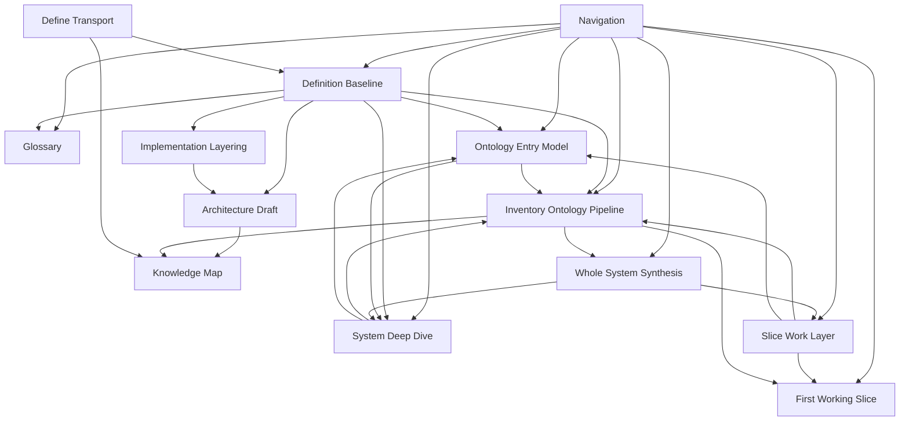

# CyberAlchemy Agentic System Navigation

This is the entrypoint for the CyberAlchemy agentic system artifact pack. It uses progressive disclosure: start with the smallest orientation surface, then open only the next layer needed for your task.

## Level 0: Start Here

Use this level when you need the shortest path through the work.

| Need                                     | Open                                                                         | Why                                                                                                              |
| ---------------------------------------- | ---------------------------------------------------------------------------- | ---------------------------------------------------------------------------------------------------------------- |
| Understand the artifact set              | This navigation file                                                         | Shows the reading order and what each file owns.                                                                 |
| Read the narrative synthesis             | [agentic-system-ontology-synthesis.md](agentic-system-ontology-synthesis.md) | Whole-system article covering Saturn, DomainSpec, Arcanum, inventory, ontology, memory, execution, and feedback. |
| Enter the work slices                    | [agentic-system/README.md](agentic-system/README.md)                         | Self-contained implementation slices with status, next work, links, and compiled concept deep dives.             |
| Go deeper topic by topic                 | [agentic-system-deep-dive.md](agentic-system-deep-dive.md)                   | Compiles scattered system content and details the ontology promotion system.                                     |
| Understand the current accepted baseline | [agentic-system-definition.md](agentic-system-definition.md)                 | Defines mission, scope, ownership, capabilities, concepts, decisions, and gaps.                                  |
| Look up terms                            | [agentic-system-glossary.md](agentic-system-glossary.md)                     | Gives candidate terms, link status, and source authority notes.                                                  |

Minimum read:

1. [agentic-system-definition.md](agentic-system-definition.md) through `Mission`.
2. [agentic-system-glossary.md](agentic-system-glossary.md) through `Plain Language Terms`.
3. Return here and choose a deeper path.

## Level 1: Baseline

Use this level when drafting, reviewing, or changing the system model.

| File                                                                                           | Owns                                                                                                                     | Read when                                                                                   |
| ---------------------------------------------------------------------------------------------- | ------------------------------------------------------------------------------------------------------------------------ | ------------------------------------------------------------------------------------------- |
| [agentic-system-definition.md](agentic-system-definition.md)                                   | Define baseline, scope, source evidence, capabilities, concept model, decisions, and open gaps.                          | You need the current vocabulary and boundaries.                                             |
| [agentic-system-glossary.md](agentic-system-glossary.md)                                       | Terminology authority for this candidate baseline.                                                                       | You need exact meanings or link-status checks.                                              |
| [agentic-system-implementation-layering.md](agentic-system-implementation-layering.md)         | L0-L6 progressive implementation and validation path.                                                                    | You need to decide what can be done next without overbuilding.                              |
| [agentic-system-inventory-ontology-pipeline.md](agentic-system-inventory-ontology-pipeline.md) | Inventory-to-ontology ingestion path, source cohorts, entry types, branches, and promotion rules.                        | You need to centralize scattered knowledge through Arcanum inventory and ontology-harness.  |
| [agentic-system-ontology-entry-model.md](agentic-system-ontology-entry-model.md)               | Thick ontology entry contract: content, context, agent payload, evidence, edges, confidence, and promotion state.        | You need to decide what an ontology entry must contain before it can guide agents.          |
| [agentic-system-ontology-synthesis.md](agentic-system-ontology-synthesis.md)                   | Whole-system article synthesis across Saturn, DomainSpec, Arcanum, inventory, ontology, memory, execution, and feedback. | You need a clear overview of the agentic system.                                            |
| [agentic-system-deep-dive.md](agentic-system-deep-dive.md)                                     | Topic-by-topic deep dive and ontology promotion system: states, gates, confidence, records, and non-promotion rules.     | You need to centralize scattered knowledge into ontology work or define promotion behavior. |
| [agentic-system/README.md](agentic-system/README.md)                                           | Self-contained slice index with per-slice work/status files and compiled concept deep dives.                             | You need to move from concept into implementation slices.                                   |
| [ontology/README.md](ontology/README.md)                                                       | Candidate ontology pack with thick agent-usable entries.                                                                 | You need the actual ontology-owned knowledge entries, not only explanatory docs.            |
| [agentic-system-first-working-slice.md](agentic-system-first-working-slice.md)                 | First adoption slice for proving source -> inventory -> ontology -> context -> execution -> reflection.                  | You need the practical starting sequence.                                                   |

Stop after Level 1 if the question is about meaning, scope, or whether a proposed change belongs in this system.

## Level 2: Design

Use this level when you need architecture, workflows, or component boundaries.

| File                                                                                   | Owns                                                                                                | Read when                                                                 |
| -------------------------------------------------------------------------------------- | --------------------------------------------------------------------------------------------------- | ------------------------------------------------------------------------- |
| [agentic-system-architecture.md](agentic-system-architecture.md)                       | Six-view discovery-mode architecture, Operational Ontology model, memory model, and feedback loops. | You need system structure, workflow, dependency, or decision-flow detail. |
| [agentic-system-implementation-layering.md](agentic-system-implementation-layering.md) | Layer gates and deferred scope.                                                                     | You need to convert architecture into an implementation sequence.         |

Design note: [agentic-system-architecture.md](agentic-system-architecture.md) was produced before the define baseline. Treat [agentic-system-definition.md](agentic-system-definition.md) and [agentic-system-glossary.md](agentic-system-glossary.md) as the current vocabulary authority until the design is reconciled.

## Level 3: Evidence

Use this level when validating claims, tracing sources, or preparing ontology-harness work.

| File                                                                     | Owns                                                                                                 | Read when                                           |
| ------------------------------------------------------------------------ | ---------------------------------------------------------------------------------------------------- | --------------------------------------------------- |
| [agentic-system-knowledge-map.md](agentic-system-knowledge-map.md)       | Repository research map, source contracts, ontology/memory/execution seeds, gaps, and reading order. | You need evidence, prior art, or source references. |
| [agentic-system-define-transport.md](agentic-system-define-transport.md) | Invoke define run summary, template selection, phase results, decisions, and unresolved gaps.        | You need lifecycle provenance or handoff context.   |

Stop after Level 3 if the question is whether a statement is supported by repository evidence.

## Level 4: Next Work Routes

Use this level when deciding the next command or lifecycle pass.

| Route               | Start From                                                                                                                                                  | Purpose                                                                                            |
| ------------------- | ----------------------------------------------------------------------------------------------------------------------------------------------------------- | -------------------------------------------------------------------------------------------------- |
| `invoke design`     | [agentic-system-definition.md](agentic-system-definition.md) and [agentic-system-glossary.md](agentic-system-glossary.md)                                   | Reconcile the discovery architecture against the define baseline.                                  |
| `ontology-harness`  | [agentic-system-knowledge-map.md](agentic-system-knowledge-map.md) and [agentic-system-glossary.md](agentic-system-glossary.md)                             | Produce Operational Ontology branch maps, edge catalogs, and bridge gaps.                          |
| `inventory`         | [agentic-system-inventory-ontology-pipeline.md](agentic-system-inventory-ontology-pipeline.md)                                                              | Install/adapt the compiled knowledge layer and backfill source cohorts.                            |
| work slices         | [agentic-system/README.md](agentic-system/README.md)                                                                                                        | Choose the self-contained slice that owns the next implementation move.                            |
| first working slice | [agentic-system/slices/07-first-working-loop/README.md](agentic-system/slices/07-first-working-loop/README.md)                                              | Prove the loop once before expanding the corpus.                                                   |
| ontology promotion  | [agentic-system-deep-dive.md](agentic-system-deep-dive.md) and [agentic-system-ontology-entry-model.md](agentic-system-ontology-entry-model.md)             | Decide promotion states, gates, confidence, records, and rejection paths before mutating ontology. |
| `decision-gate`     | [agentic-system-definition.md](agentic-system-definition.md)                                                                                                | Decide privacy and redaction boundaries for user workflow memory.                                  |
| `invoke plan`       | [agentic-system-architecture.md](agentic-system-architecture.md) and [agentic-system-implementation-layering.md](agentic-system-implementation-layering.md) | Convert accepted design into implementation slices and work-pack.                                  |

## Role-Based Paths

| Reader                      | Path                                                                                                                                   |
| --------------------------- | -------------------------------------------------------------------------------------------------------------------------------------- |
| First-time reader           | Navigation -> Synthesis -> Work Layer -> slice concepts if needed -> Definition -> Glossary.                                           |
| Ontology worker             | Work Layer -> Promotion Governance slice -> Ontology Entry Contract slice -> Operational Ontology slice -> Inventory Foundation slice. |
| Implementation planner      | Work Layer -> First Working Loop slice -> Implementation Layering -> Define Transport.                                                 |
| Reviewer                    | Define Transport -> Definition decisions/gaps -> Knowledge Map sources.                                                                |
| Agent run preparing context | Work Layer -> Memory And Context slice -> Context Solution and Execution Context terms in Glossary -> Architecture workflow process.   |

## Artifact Dependency Graph

## Maintenance Rule

When adding a new agentic-system artifact:

1. Add it to this navigation file at the shallowest level where a reader would need it.
2. Add a `Navigation: [agentic-system-navigation.md](agentic-system-navigation.md)` backlink near the top of the new file.
3. If the artifact is implementation work, add or update the owning slice under [agentic-system/README.md](agentic-system/README.md).
4. State whether the new artifact is baseline, design, evidence, transport, plan, or execution material.
