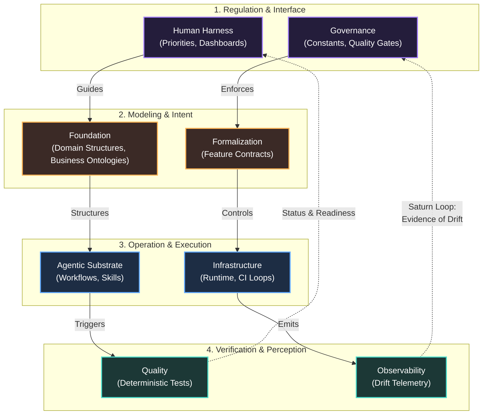

# Project Saturn: Continuous Cybernetic Alignment

**Research Group:** CyberAlchemy AI
**Domain:** Autonomous Systems, Formal Governance, and Cybernetics

---

## The Illusion of the Blueprint

Software projects begin with a shared vision, a blueprint. We map business intent, define domain structures, and write feature contracts. But when code is deployed, decay begins. The system in production diverges from the system on paper. Specifications rot, governance becomes a suggestion, and telemetry throws dashboards at us without offering control.

The force pulling intent and reality apart is **drift**. Traditional engineering treats design and operation as a one-way street: we build it, we ship it, and we watch it. Without a feedback loop, divergence is inevitable.

## Closing the Loop

Within our research portfolio, **Project Saturn** was born from a simple question: _What if a system could defend its own architecture?_

Saturn isn't just a monitoring tool; it is a cybernetic control loop designed to bridge the gap between what we build and what runs. It flips the model by enforcing **convergence**. It treats domain intent (business ontologies, structures, and contracts) as a reference baseline, rather than static documentation. By measuring reality against this baseline, Saturn doesn't just report on drift, it acts on it, turning governance into executable reality.

## The Architecture of Convergence

Think of Saturn as the nervous system for your software. It operates through a lifecycle: observing telemetry, evaluating against contracts, deciding on corrective states, executing routing decisions, and verifying closure.

To make this loop work, Saturn relies on a layered architecture. In this stack, intent flows downward into execution, and truth flows upward to inform governance:

- **Modeling & Intent:** Establishes the vocabulary, structures, and contracts of the domain.
- **Verification & Perception:** Derives validation from intent and generates telemetry to measure drift.
- **Operation & Execution:** Provides the execution engine, prioritizing work based on objectives, managing environments, and routing execution tasks.
- **Regulation & Interface:** Enforces rules, blocks unverified changes, and translates system data into an interface for decision-making.

In this framework, no layer operates in isolation. Saturn is the meta-loop that traverses these layers, reading telemetry from perception layers, evaluating it against intent layers, and triggering responses through execution and regulation layers.

## Software That Defends Itself

Why does this matter? For us at _CyberAlchemy AI_, Saturn represents the leap from describing how an architecture _should_ work to ensuring it _performs_.

Without a loop like Saturn, we rely on heroics to keep systems aligned. Telemetry is noise, and governance is paperwork. Saturn transforms telemetry into sensory input for a governance engine. It allows a system to self-correct based on empirical evidence, reprioritize based on changing context, and block anomalies deterministically.
