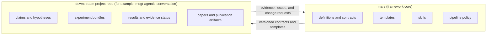

# MARS Canonical Implementation Pack

MARS is a reusable research-orchestration framework for gated, reproducible experiments.
This directory is the canonical source for public MARS assets.

## Public Repository Scope

Use this directory as the canonical core for a public `mars` repository.

It owns reusable, project-agnostic assets:

- governance definitions and contracts
- reusable templates
- reusable Copilot skill assets (`copilot/skills/*`)
- published method exports (`exports/methods/*`)
- implementation scaffolding for MARS-based projects

Do not place project-private datasets, transcripts, or product-specific domain details here.

## MARS Mental Map Model



How to read this map:

1. `mars` defines reusable contracts and lifecycle policy.
2. Each project repo executes experiments using those contracts.
3. Project evidence feeds improvements back into `mars`.

## Two Connected Repositories Model

Recommended public split from this monorepo:

1. Repo 1: `mars` (source root: `implementation/mars`)
2. Repo 2: `mogt-agentic-conversation` (source root: `research/projects/mogt-agentic-conversation`)

Connection contract:

- MOGT pins consumed MARS assets in `deps/DEPENDENCIES.yaml`.
- MOGT consumes only published MARS definitions/templates/method exports.
- Framework fixes discovered in MOGT are proposed upstream through issues and pull requests.

## How People Can Help

Suggested contribution lanes for public collaborators:

1. Improve definitions and contracts clarity without changing semantics.
2. Propose new reusable templates for protocol, analysis, and adjudication.
3. Improve skill docs and execution runbooks for reproducibility.
4. Contribute method exports that downstream projects can consume safely.

## Sync Rule (While Still in Monorepo)

When canonical definitions/templates or canonical Copilot skills are updated, run:

```bash
./tools/sync_mars_canonical_assets.sh
./tools/check_research_structure.sh
```

See [OWNERSHIP-MIGRATION.md](OWNERSHIP-MIGRATION.md) for ownership boundaries and synchronization guardrails.

## Inventory Library Chain

The canonical pack defines an explicit inventory-library pattern for research sources:

- contract: `implementation/mars/definitions/INVENTORY-LIBRARY-CONTRACT.md`
- templates: `implementation/mars/templates/inventory-schema-template.md`, `implementation/mars/templates/inventory-library-entry-template.md`, `implementation/mars/templates/raw-content-note-template.md`

Required chain:

1. source catalog
2. reference ledger
3. inventory index
4. per-source library file
5. raw content provenance

When web retrieval is not possible, user-provided raw files become the provenance base for the library entry.
