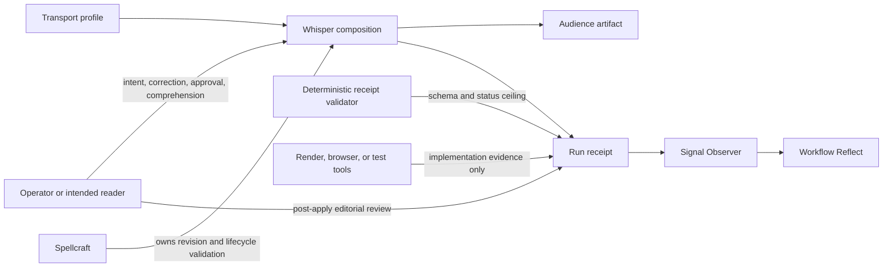
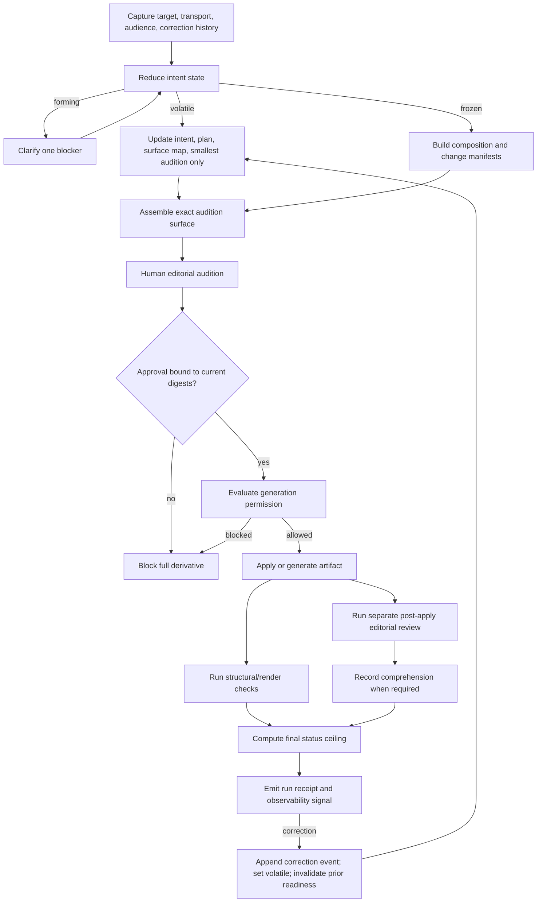

# Design: Whisper Editorial Admission

## Architecture intent

Turn Whisper's editorial guardrails into an enforceable admission path without pretending that deterministic tooling can judge prose. The architecture records separately what a machine checked, what a person reviewed, which exact surface they reviewed, and how those facts constrain generation and final status.

## Source contracts

| Contract | Required behavior carried forward |
| --- | --- |
| `DEFINE.md` | outcomes WEG-R1 through WEG-R10 and public/private boundary |
| `GLOSSARY.md` | package-local meanings; no canonical definition promotion |
| `arcanum/spells/whisper/README.md` | current phases, candidate ceiling, intent state, delivery flow, retell, approval, observability |
| `arcanum/spells/whisper/schemas/text-intent-substrate.schema.yaml` | existing authoring substrate extension point |
| `arcanum/spells/whisper/tools/validate-whisper-draft.py` | conservative structural validator, retained with a narrower claim |
| July 17 and July 22 reflections | observed false-positive pattern and human-gate requirements |

## View 1: Context



Ownership boundaries:

- Spellcraft owns canonical Whisper revision and validation.
- Whisper owns composition state, evidence envelopes, and computed admission status.
- Operators/readers own language and comprehension judgments.
- Deterministic tools own shape, reference, digest, state, and ceiling validation only.
- Experiment Harness owns reusable proof regimes, not spell promotion.
- Generated host skills are derivatives; repository-local presets remain local state.

## View 2: High-level structure

| Component | Responsibility | Does not own |
| --- | --- | --- |
| transport profile | Declares audience, proof status, required surface roles, approval/comprehension gates, and derivative policy. | Runtime promotion. |
| intent state reducer | Applies corrections to `forming`, `volatile`, or `frozen` state. | Editorial judgment. |
| surface assembler | Builds an ordered manifest for the exact auditioned surface and computes digests. | Claiming visual viewport equivalence without render evidence. |
| approval binder | Verifies that an approval kind, prompt, artifact digest, and surface digest match the current run. | Inferring approval from ordinary conversation words. |
| evidence-axis recorder | Stores source/structure, editorial audition, comprehension, and implementation/render results independently. | Cross-axis compensation. |
| admission evaluator | Computes full-derivative permission and the maximum final status. | Raising a human result or promoting a transport. |
| correction ledger | Appends false-positive/correction events and invalidates referenced readiness. | Erasing historical telemetry. |
| local preset resolver | Makes host-local presets discoverable outside the generated skill body. | General-purpose overlay merging. |
| Experiment Harness package | Runs generic red/green fixtures and complex integration witnesses. | Copying private fixture prose to public Arcanum. |

## View 3: Low-level components

### 3.1 Transport profile extension

Each transport profile adds the following generic fields:

```yaml
transport_id: interactive_technical_explainer
proof_status: candidate
audience_mode: newcomer
derivative_policy:
  full_generation_requires: [intent_frozen, editorial_audition_approved]
first_surface:
  selection_kind: source_order_role_set
  required_roles: [context, heading, human_situation, present_capability, missing_capability, human_limit]
  forbidden_shortcuts: [isolated_phrase_sample]
comprehension_gate:
  required: true
  question_ids: [situation, present, missing, human]
post_apply_editorial_verification: required
retell_chain:
  default_surface: validation_only
surface_delta_budget: required
```

`interactive_technical_explainer` remains candidate. The schema proves the contract is present; it does not promote the transport.

### 3.2 Surface manifest

```yaml
surface_id: first-surface
artifact_ref: path/to/artifact
artifact_sha256: <digest>
selection_kind: source_order_role_set
items:
  - block_id: stable-id
    role: human_situation
    source_selector: '#intro > p:nth-of-type(1)'
    text_sha256: <digest>
surface_sha256: <digest over ordered role:block:digest tuples>
```

The validator checks required roles, stable ordering, selector presence, and digest integrity. A browser receipt may separately claim what was visible at a viewport. Without that receipt, the surface is called a source-ordered first surface, not a measured viewport.

### 3.3 Explicit approval record

```yaml
approval_id: <stable id>
approval_kind: editorial_audition
prompt_id: <the exact question/request answered>
approver_kind: operator | intended_reader | editor
transport_id: <id>
audience_mode: <mode>
artifact_sha256: <digest>
surface_sha256: <digest>
decision: approved | rejected
recorded_at: <timestamp>
```

An approval is admissible only for the exact current artifact/surface and required approval kind. Approval of an audit, plan, file application, or architecture is not editorial approval.

### 3.4 Evidence axes

```yaml
evidence_axes:
  source_and_structure_validation:
    status: pass | flag | block | absent
    receipts: []
  editorial_language_audition:
    status: pass | flag | block | absent
    surface_sha256: <digest>
    approval_ref: <id>
  operator_or_reader_comprehension:
    status: pass | flag | block | absent
    surface_sha256: <digest>
    reviewer_kind: operator | intended_reader
    answers: []
  implementation_render_validation:
    status: pass | flag | block | absent
    receipts: []
```

Rules:

- each axis has its own status and evidence;
- `pass` in one axis never fills an absent axis;
- comprehension answer semantics remain human-reviewed;
- a machine validator checks question coverage and digest binding only;
- render evidence must not claim editorial quality.

### 3.5 Run receipt and decisions

The run receipt contains:

- run and target identity;
- intent state and correction references;
- transport profile and proof status;
- composition plan and change-manifest references;
- artifact and surface manifests;
- evidence axes;
- approval and comprehension records;
- requested derivative and requested status;
- computed generation decision, status ceiling, reasons, and final status;
- post-apply verifier identity/stage;
- observability and residue references.

Two decisions are computed independently:

1. `generation_decision`: whether the full derivative may be created or replaced.
2. `final_status`: the strongest readiness label the completed artifact may carry.

### 3.6 Correction event

```yaml
event_id: <stable id>
event_kind: operator_correction | reader_correction | false_positive_readiness
run_id: <current run>
invalidates_receipt: <prior receipt ref>
meaning_core_changed: true | false
related_correction_count: <integer>
affected_surface_sha256: <digest>
new_intent_state: volatile | frozen
next_route: re_audition | workflow_reflect | ordinary_revision
```

The ledger is append-only. The prior receipt remains historical evidence but cannot remain the current readiness source after invalidation.

### 3.7 Change manifest

Every new audience-visible block declares one of:

- `replaces`: block IDs removed or consolidated;
- `distinct_job`: an audience job absent from the existing artifact, with rationale;
- `validation_only`: not rendered to the audience.

For `retell_chain`, the default is `validation_only`. Rendering requires both `distinct_job` and `replaces`; this prevents a retell from becoming a second complete process narrative by default. The record is enforceable; whether two blocks are semantically repetitive remains a human review question.

### 3.8 Local preset resolution

Canonical Whisper declares one generic lookup rule:

```text
Resolve public presets under arcanum/spells/whisper/presets/, then repository-local
presets under .arcanum/spells/whisper/presets/. Local presets extend availability
but do not alter public proof status or canonical documentation.
```

`product_research_blueprint` moves to the repository-local preset root before generated runtime regeneration. No bootstrap merge engine is required in this work pack.

## View 4: Workflow process



Failure and compensation:

- Digest mismatch: reject the evidence record; do not transfer approval.
- Volatile intent with full derivative request: `generation_decision=block`.
- Candidate/unproven transport: permit only contract-allowed trial generation; `status_ceiling=flag`.
- Missing required comprehension or post-apply review: keep final status at `flag` even if all machine axes pass.
- Meaning-core correction: append event, mark volatile, invalidate prior current readiness, route to bounded re-audition.
- Repeated false-positive readiness: emit `reflect-now`; do not silently retry full composition.

## View 5: Decision flow

### Generation decision algorithm

```text
if receipt shape or referenced digests are invalid:
    block("invalid evidence envelope")
else if requested output is a full derivative and intent_state != frozen:
    block("intent not frozen")
else if transport requires editorial approval and no matching approved record exists:
    block("exact surface not approved")
else if change manifest contains an unowned audience block:
    block("surface delta unaccounted")
else:
    allow generation
```

### Final status algorithm

```text
ceiling = pass

if transport.proof_status in {candidate, unproven}:
    ceiling = stricter(ceiling, flag)

if required editorial audition is not pass or does not bind current surface:
    ceiling = stricter(ceiling, flag)

if audience_mode == newcomer and required comprehension is not pass:
    ceiling = stricter(ceiling, flag)

if required post-apply editorial verification is not pass or binds a prior artifact:
    ceiling = stricter(ceiling, flag)

if an open correction invalidates the current receipt:
    ceiling = stricter(ceiling, flag)

if any applicable gate is block or evidence integrity fails:
    ceiling = block

final_status = stricter(requested_status, ceiling)
```

Precedence is fail-closed. `block` is stricter than `flag`, and `flag` is stricter than `pass`. Machine checks may lower the ceiling; they never raise human evidence.

### Correction state reducer

```text
if correction.meaning_core_changed:
    state = volatile
else if related_correction_count >= 2 for the same transport/run family:
    state = volatile
else:
    preserve current state

if event_kind == false_positive_readiness:
    invalidate prior current-status pointer
    recommend workflow-reflect
```

## View 6: Dependency and interface

| Interface | Producer | Consumer | Contract |
| --- | --- | --- | --- |
| transport profile | canonical or local Whisper preset | composer and evaluator | generic schema; proof status cannot be overridden locally upward |
| intent substrate | intake/reducer | planner and evaluator | state plus correction lineage |
| surface manifest | surface assembler | approval, comprehension, post-apply review | stable ordered selectors and digests |
| approval record | operator-facing gate | admission evaluator | explicit kind and exact digest binding |
| run receipt | Whisper | validator, Signal Observer, Experiment Harness | typed evidence axes and computed decisions |
| correction JSONL | operator/reader response stage | reducer and Workflow Reflect | append-only invalidation and next route |
| local preset root | repository owner | Whisper runtime | local availability only; no public promotion |
| validation report | Experiment Harness | Spellcraft | causal fixtures and residue; promotion remains Spellcraft/human authority |

Dependency rules:

1. The receipt validator consumes schemas and manifests; it does not parse prose to decide clarity.
2. The existing Markdown validator remains valid for its structural scope and writes only the structural axis.
3. Browser/Playwright evidence writes only the implementation/render axis unless a human review record is separately supplied.
4. A post-apply review must reference the applied artifact digest, not the draft or proposed phrase digest.
5. Local presets may lower proof/readiness or add constraints but cannot promote themselves or weaken public gates.
6. Public fixtures use generic examples. The private BTE witness is run from the host repository and stores only result references in private evidence.

## Decisions

| ID | Decision | Alternatives | Reason |
| --- | --- | --- | --- |
| D-01 | Add a separate run-receipt validator instead of expanding the Markdown validator into editorial logic. | Extend one validator; rely on prose. | Receipt policy is structured state logic; keeping it separate preserves the conservative claim of the current draft validator. |
| D-02 | Represent human judgments as digest-bound records, not machine scores. | LLM semantic score; no machine envelope. | Enforces scope and replay without claiming semantic authority. |
| D-03 | Separate generation permission from final status. | One final status gate. | Volatile intent must stop generation while candidate proof may allow a trial but cap readiness. |
| D-04 | Define first surface by transport roles and source order; treat viewport proof as separate. | Require browser for all auditions; call source block a viewport. | Catches composition failures from source while preserving honest render claims. |
| D-05 | Keep `retell_chain` validation-only by default. | Always render it; remove it. | Preserves comprehension testing without manufacturing duplicate audience copy. |
| D-06 | Externalize local presets to `.arcanum/spells/whisper/presets/`. | Promote private preset; build a general overlay merger; leave manual generated edits. | Narrowest safe boundary that survives canonical regeneration. |
| D-07 | Candidate transport remains capped at `flag`. | Let a human gate produce `pass`. | Human approval can admit a trial but does not establish reusable transport proof. |

## Risks and controls

| Risk | Control | Owner |
| --- | --- | --- |
| Typed receipts create governance theater without changing runtime behavior. | Red fixtures must demonstrate prior false positives now fail or flag; full experiment is mandatory. | Spellcraft + Experiment Harness |
| Human approvals are captured but applied to different text. | Artifact and surface digest binding; mismatch is blocking. | Whisper evaluator |
| First-surface role set becomes transport-specific bloat. | Generic surface schema plus candidate profile extension; no base promotion from one witness. | Spellcraft |
| Local presets become shadow canonical authority. | Local presets cannot raise proof status or weaken public gates; generated skill remains canonical-derived. | Repository owner + Spellcraft |
| Private BTE text leaks into public fixtures. | Public-safe fixture review and exact path boundary in dispatch. | Spellcraft |
| A machine checklist is mistaken for comprehension. | Schema language and receipts state that semantics are human-reviewed; validator checks only coverage and binding. | Spellcraft |

## Design gate

- Six views: complete.
- Glossary consistency: pass with package-local terms.
- Design-unit Distill verdict: pass. The coherent unit is the editorial admission path from surface assembly through status computation and correction; separating receipt shape from evaluator behavior is done at SWU level, not as competing architectures.
- Status: `pass`.
- Next route: Invoke plan, then Spellcraft.
