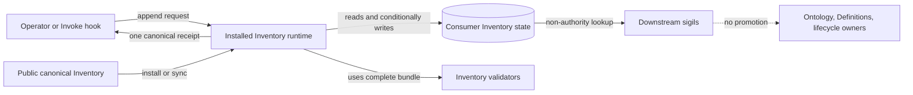
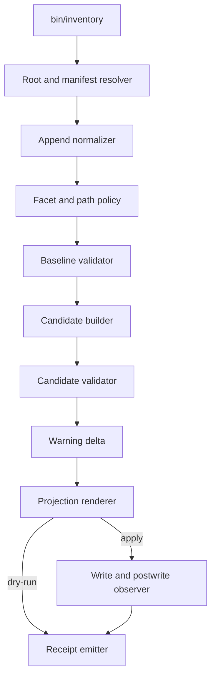
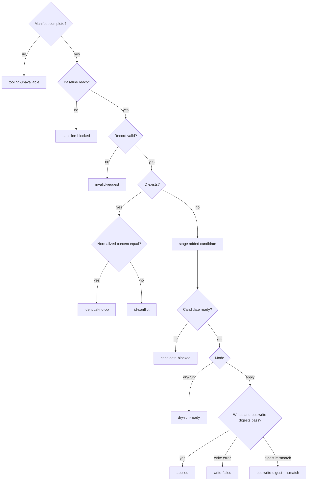

# Architecture: Inventory Runtime And Faceted Entry Layout

## Design Intent

Build one small causal append runtime from existing Inventory updater and
validator ownership, then extend admission for new faceted entries. Preserve
legacy state, non-authority, public/private separation, and explicit
non-atomic failure semantics.

## Source Contracts

- [SPEC.md](SPEC.md)
- [GLOSSARY.md](GLOSSARY.md)
- `ops/development/2026-07-24-inventory-runtime-research/findings.md`
- `arcanum/arcana/inventory/SKILL.md`
- `arcanum/arcana/inventory/development/WORK-PACK.md`
- `.arcanum/inventory/schema.md`
- `.arcanum/inventory/tools/inventory-update.cjs`

## 1. Context View



Boundaries:

- Public canonical source contains only generic code, schemas, fixtures, and
  install/sync rules.
- Installed runtime contains generated executable members and a manifest.
- Consumer state contains local entries, indexes, schema, tags, logs, receipts,
  and source bindings.
- Downstream owners may consume receipts but must not infer truth or currentness.

## 2. High-Level Structure View



Responsibility rule: only the receipt emitter joins all causal facts. Validators
retain conformance ownership; install/sync retains distribution ownership;
Inventory entry content remains consumer-owned.

## 3. Low-Level Component View

| Component | Inputs | Outputs | Failure behavior |
|---|---|---|---|
| CLI parser | command arguments | validated request | `invalid-request`, no write |
| Runtime root resolver | executable path, manifest | root and helper digests | `tooling-unavailable`, no CWD fallback |
| Record normalizer | record JSON, timestamp | canonical normalized record | invalid field/path blocks |
| Facet policy | namespace, record class, concepts, path | admitted metadata/path | legacy bypass or faceted validation |
| Baseline loader | exact projection bytes | baseline digests | read/tooling failure blocks |
| Full validator adapter | index/human bytes, helper bundle | structured report | non-ready baseline/candidate blocks |
| Candidate builder | baseline, normalized record | staged projections, disposition | no filesystem mutation |
| Warning delta | structured baseline/candidate warnings | introduced/resolved/inherited sets | stable identity required |
| Projection renderer | candidate model | canonical JSON and Markdown bytes | render failure blocks |
| Write observer | staged bytes, target paths | actual postwrite digests and changed paths | exposes partial mutation |
| Receipt emitter | all prior outputs | one canonical receipt | excludes implicit wall clock/currentness |
| Runtime sync | canonical runtime payload, consumer manifest | check/apply receipt | generated members only |

### Proposed Public Layout

```text
arcanum/arcana/inventory/
  bin/inventory
  lib/
    inventory-update.cjs
    operation-receipt.cjs
  schemas/
    inventory.operation-receipt.v1.schema.json
  scripts/
    validate-index-json.sh
    validate_projection_conformance.py
    sync-runtime.sh
  test/
    operation-receipt.test.cjs
    append-transition.test.cjs
    fixtures/
  runtime-manifest.json
```

### Installed Layout

The same executable relative paths are projected under
`.arcanum/inventory/`. Consumer-owned files are excluded from the runtime
manifest's managed set.

## 4. Workflow Process View

### Append

```text
parse request
-> resolve installed root and verify manifest
-> read exact baseline bytes
-> run full baseline validation
-> normalize record and validate facet/path policy
-> compare existing ID by normalized content
-> stage candidate JSON and Markdown in memory or temporary files
-> run full candidate validation
-> calculate warning delta
-> if dry-run: emit receipt and stop
-> if apply: write sequentially, observe actual bytes, compare expected digests
-> emit receipt with observed write outcome
```

### Runtime Sync

```text
read canonical manifest
-> compare generated member relative paths and digests
-> sync --check: report exact drift, no writes
-> sync --apply: replace generated members only
-> verify consumer-owned paths unchanged
-> emit sync receipt
```

### Faceted Admission

```text
record has facet schema
-> require namespace + record_class + concepts
-> normalize and validate controlled values
-> require path entries/<namespace>/<record-class>/<stable-id>.md
-> derive namespace/class/concept maps

record is legacy
-> preserve existing path and old required fields
-> do not synthesize facets or move content
```

## 5. Decision Flow View



Decision precedence:

1. Tooling and baseline admission.
2. Input/facet/path admission.
3. Identity/equality conflict.
4. Candidate conformance.
5. Mode-specific mutation.
6. Observed postwrite result.

No later decision can overwrite an earlier block.

## 6. Dependency And Interface View

| Interface | Producer | Consumer | Contract |
|---|---|---|---|
| Append request | operator/other sigil | Inventory CLI | record path, timestamp, exactly one mode |
| Full validation report | validator pair | append engine | structured failures/warnings and readiness |
| Normalized record | normalizer/facet policy | candidate builder | canonical fields and path disposition |
| Candidate projections | candidate builder/renderers | validator/write observer | exact bytes and digests |
| Operation receipt | receipt emitter | operator/observability/Task Session | `inventory.operation-receipt.v1` |
| Runtime manifest | canonical Inventory | installed sync | managed relative paths and digests |
| Logical maps | index derivation | lookup/downstream sigils | by namespace/class/concept; read-model only |
| Currentness result | future separate owner | receipt consumers | excluded from this architecture |

### Dependency Rules

- The shell validator and Python conformance helper are one versioned runtime
  unit.
- The CLI may call sibling helpers only through manifest-relative paths.
- The append engine consumes validator results; it does not redefine
  readiness.
- Facet maps derive from admitted records and cannot become ontology relations.
- Host-native `.agents` and `.claude` skill packages remain separate generated
  surfaces.

## Design Decisions

| ID | Decision | Reason | Rejected alternative |
|---|---|---|---|
| ADR-01 | Build from existing updater and validator ownership. | Avoid duplicate lifecycle/runtime owners. | standalone lifecycle bundle |
| ADR-02 | Start with a pure receipt kernel. | Narrowest reversible trust proof. | runtime-plus-packaging first SWU |
| ADR-03 | Namespace-first physical layout. | Stable owner axis changes less than concepts. | tag-combination folders |
| ADR-04 | Separate `record_class` from existing `type`. | Current `type=synthesis` is too broad to organize provenance/lifecycle. | overload `type` |
| ADR-05 | Concepts remain logical and multi-valued. | One entry may serve several concepts. | duplicate physical copies |
| ADR-06 | Legacy compatibility is asymmetric. | New records improve immediately without 111-file migration. | flag-day migration |
| ADR-07 | Non-atomic apply is visible. | Current projections write sequentially. | imply transaction or rollback |
| ADR-08 | Canonical integration waits for Sigil Development. | Existing active Inventory work-pack selects another first SWU. | competing silent public plan |

## Risks

| Risk | Consequence | Guardrail |
|---|---|---|
| Facets expand Candidate B into taxonomy migration. | Overbuilt first release. | new entries only; migration excluded |
| New map fields break exact derived-map validation. | Lookup blocked. | versioned schema and legacy fixtures |
| Sequential write partially mutates projections. | JSON/Markdown divergence. | staged bytes, postwrite observation, repair-required receipt |
| Runtime sync overwrites consumer state. | Data loss. | managed manifest allowlist plus negative fixture |
| Namespace embeds private project vocabulary in public code. | Public/private leakage. | consumer-configured values; generic fixtures only |
| Existing canonical plan remains active concurrently. | Conflicting first SWU. | Sigil Development integration gate |

## Design Status

- Six views: complete.
- Glossary consistency: pass with local-candidate terms.
- Distill design-unit check: pass; runtime foundation and facet extension are
  separate dependent units.
- Next route: Invoke Plan, then Sigil Development.

