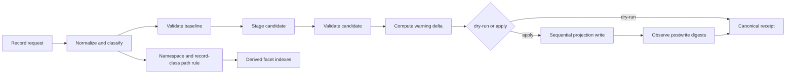

# SPEC: Inventory Append Runtime And Faceted New-Entry Layout

## What This Capability Owns

This capability owns a deterministic, package-local witness of an attempted
Inventory append transition and the admission rules for organizing new entries.
It does not own truth, ontology meaning, canonical definitions, promotion,
currentness, transaction recovery, or legacy entry migration.

## Goal

An operator can run one installed-package append command from any working
directory and receive one canonical receipt that explains the exact baseline,
candidate, warnings, and observed write outcome. New records can use a stable
namespace-first physical path while remaining discoverable through multiple
logical concepts.

## Capability Map



## Capabilities

| Capability | Responsibility | Primary output |
|---|---|---|
| Append Transition Receipt | Join exact inputs, validation, warning delta, candidate disposition, and observed mutation outcome. | `inventory.operation-receipt.v1` |
| Faceted Entry Admission | Validate metadata and physical path for new faceted records without moving legacy entries. | normalized record or `invalid-request` |
| Runtime Distribution | Install and verify a complete package-relative helper bundle without overwriting consumer data. | runtime manifest and sync receipt |

## Command Contract

```text
.arcanum/inventory/bin/inventory append \
  --record <record.json> \
  --timestamp <ISO-8601> \
  (--dry-run | --apply) \
  --json
```

- Stdout is exactly one canonical JSON receipt.
- Diagnostics go to stderr.
- Timestamp is caller input; runtime output contains no implicit wall clock.
- Root and helpers resolve relative to the installed runtime, never caller CWD
  or an upstream checkout.

## Entry Organization Contract

New faceted entries use:

```text
entries/<namespace>/<record-class>/<stable-id>.md
```

Required faceted fields:

```yaml
namespace: domainspec-v2
record_class: research
concepts:
  - bte
  - financial-settlement
  - test-generation
```

Rules:

1. `namespace` is one stable owner/project scope identifier.
2. `record_class` is one controlled lifecycle/artifact family.
3. `concepts` is a sorted, deduplicated list of retrieval labels.
4. Stable ID is independent of path.
5. Concepts never create additional physical directory levels.
6. Legacy records without faceted metadata remain valid at their current paths.
7. New faceted records must have a path consistent with namespace and
   record-class.
8. `index.json` remains the primary machine catalog and derives
   `by_namespace`, `by_record_class`, and `by_concept`.
9. Concept facets remain Inventory read models. Governed meaning and relations
   remain Ontology Vault authority.

Initial record classes:

```text
research | review | invoke | task-session | maintenance | runtime |
decision | evidence | synthesis
```

The consuming repository may extend the controlled list through its local
schema. Public canonical code validates the configured vocabulary but does not
embed private project names.

## State Contract

| State | Meaning | Write attempted |
|---|---|---|
| `dry-run-ready` | Candidate passes and receipt is ready. | no |
| `applied` | Both intended projections were observed at expected digests. | yes |
| `identical-no-op` | Existing ID has identical normalized content. | no |
| `invalid-request` | Input, metadata, path, or command is invalid. | no |
| `id-conflict` | Existing ID differs after normalization. | no |
| `tooling-unavailable` | Required runtime member is absent or mismatched. | no |
| `baseline-blocked` | Live baseline fails full conformance. | no |
| `candidate-blocked` | Staged candidate fails full conformance. | no |
| `write-failed` | A sequential write failed. | possibly |
| `postwrite-digest-mismatch` | Observed postwrite state differs from candidate. | yes |

## Invariants

1. Same canonical inputs produce byte-identical dry-run receipts.
2. Dry-run and all prewrite block states change no filesystem bytes.
3. Same ID plus same normalized content is a no-op.
4. Same ID plus different normalized content is a conflict.
5. Warning identities are stable; introduced, resolved, and inherited sets are
   computed independently.
6. Full validator output continues to expose inherited warnings.
7. `committed=true` means both intended digests were observed; it does not mean
   atomic commit.
8. Write failure reports actual observed paths/digests,
   `possible_partial_mutation`, and `repair_required`.
9. Receipt paths are Inventory-root-relative.
10. No receipt claims currentness.
11. Runtime synchronization never overwrites consumer entries, indexes, tags,
    logs, queries, raw sources, local schema, or receipts.
12. Legacy paths are preserved until a separately approved migration.

## Acceptance Criteria

| ID | Criterion | Required evidence |
|---|---|---|
| AC-01 | Package-relative execution works from unrelated CWD. | named fixture receipt |
| AC-02 | Controlled append over historical debt introduces zero warnings. | warning-delta fixture |
| AC-03 | One new uncontrolled warning yields exactly one introduced warning. | warning-delta fixture |
| AC-04 | Repeated dry runs are byte-identical and mutation-free. | two receipts plus filesystem digests |
| AC-05 | Identical/no-op and conflict are distinguished. | exact state fixtures |
| AC-06 | Failure injection exposes possible partial mutation without atomicity claim. | failure receipt |
| AC-07 | New faceted path and three derived maps validate. | schema/path/projection fixtures |
| AC-08 | Legacy flat records remain valid and unmoved. | legacy compatibility fixture |
| AC-09 | Sync detects drift and modifies generated payload only. | sync check/apply receipt |
| AC-10 | Public artifacts contain no private path or evidence. | boundary scan |

## Included

- Generic public receipt schema, serializer, append engine, CLI, complete
  validator bundle, manifest, sync rules, and fixtures.
- Optional-to-legacy but required-for-new faceted metadata.
- Namespace-first physical paths for new entries.
- Logical indexes by namespace, record class, and concept.
- One additive consumer proof.

## Excluded

- Moving or renaming existing entries.
- Tag cleanup or alias migration.
- Replace/update/delete operations.
- Atomic transaction, lock, journal, rollback, or crash recovery.
- Currentness verifier.
- Search/ranking UI, database, vector index, or broad `doctor`.
- Ontology, definition, promotion, or truth authority.
- Commit, push, publication, or release.

## Ownership

| Surface | Owner | Rule |
|---|---|---|
| This private package | Invoke | Authoring evidence only. |
| `arcanum/arcana/inventory/` | Sigil Development / Inventory lifecycle | Generic canonical source first. |
| `.arcanum/inventory/` runtime payload | Inventory install/sync | Generated runtime members only. |
| `.arcanum/inventory/` entries and projections | Consumer repository | Mutable non-authority state. |
| Currentness verification | unresolved separate owner | No currentness claims until assigned. |

## Define Decisions

- D-01: accept non-atomic, fail-closed MVP for planning; forbid atomicity claim.
- D-02: use namespace-first, record-class-second physical storage.
- D-03: use concepts only as logical multi-valued facets.
- D-04: apply the organization contract only to new faceted entries.
- D-05: preserve stable ID independently from path.
- D-06: route canonical integration through Sigil Development.

## Define Status

`pass` for Design authoring. Runtime readiness remains false.

