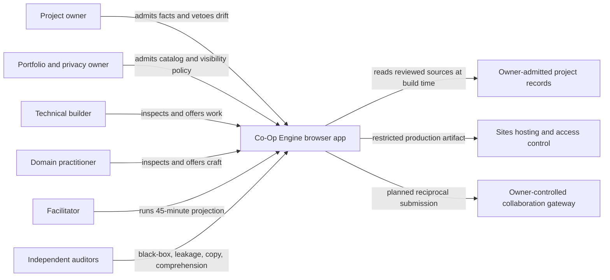
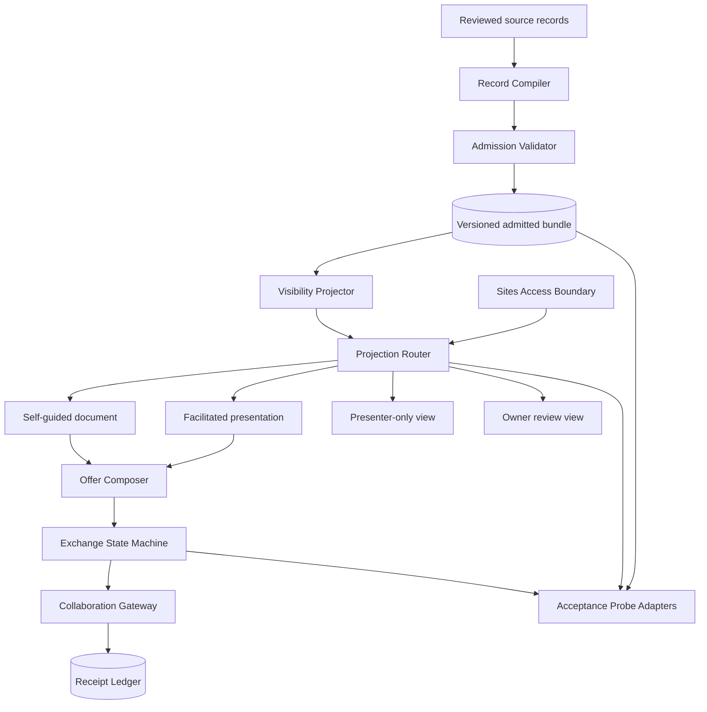
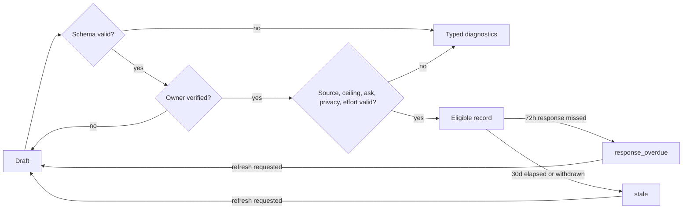
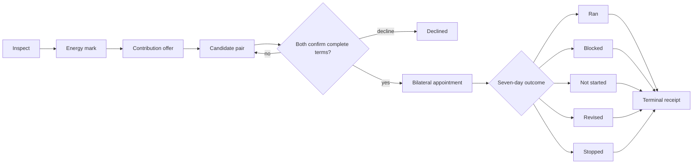
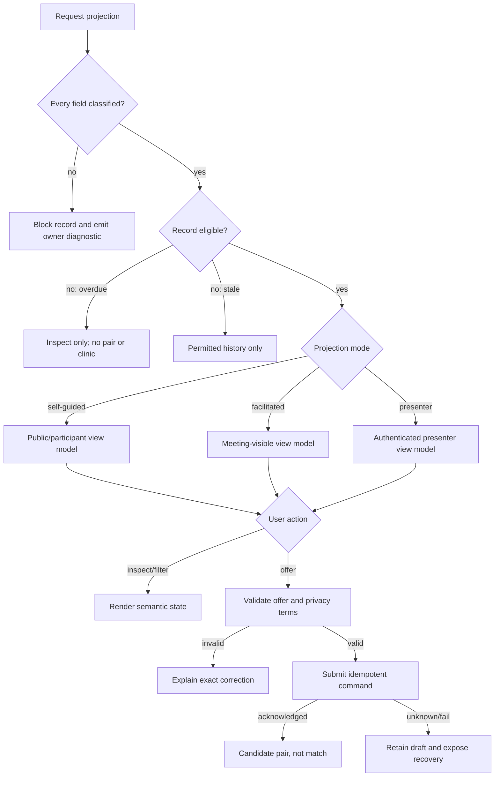

# Architecture Bundle: Co-Op Engine Browser App

## Design Intent

Build one responsive browser application whose self-guided recruitment page
and facilitated 45-minute presentation project the same admitted project
records. The architecture makes truth, reciprocal state, and field visibility
enforceable before UI rendering, while keeping copy, audits, persistence, and
public release as separately owned lifecycles.

## Inputs and Evidence Ceiling

- Approved product contract: `SPEC.md`
- Approved local language: `GLOSSARY.md`
- User decisions: `DECISIONS.md`
- Closed scope: `DESIGN-SCOPE-MANIFEST.json`,
  input digest
  `f2a4f30c2c68f56fe62c2cd3388afd74553f9b07cdebbef8581b336c11ab19e3`
- Denominator: `DESIGN-DENOMINATOR-RECEIPT.json`, receipt digest
  `3c72ded0ee54ebfb22dd4c2780a1c3c3f4bafd601ff26d1ce3d1cb26af746704`
- Selection: `DESIGN-SELECTION-RESULT.json`, result digest
  `741ca6074abbe50afb90018c758560a053be152a8a4aaea298c54126ec5da8cf`
- Selected profile: DomainSpec six-view architecture plus Architecture and UX
  companions

The evidence state is `design-validator-pass`. Every fixture and validator
below remains planned and unexecuted; Plan evidence is pending.

## Local Concept IDs

These IDs label concepts already present in `SPEC.md`; they do not promote new
canonical vocabulary.

| ID | Existing Define concept |
| --- | --- |
| `COOP-C1` | admitted project truth record |
| `COOP-C2` | project-card eligibility and freshness |
| `COOP-C3` | visibility class and permitted projection |
| `COOP-C4` | self-guided recruitment projection |
| `COOP-C5` | facilitated meeting projection |
| `COOP-C6` | energy mark or contribution offer |
| `COOP-C7` | candidate pair |
| `COOP-C8` | bilateral appointment |
| `COOP-C9` | terminal receipt |
| `COOP-C10` | claim ceiling and forbidden wording |
| `COOP-C11` | presenter notes |
| `COOP-C12` | acceptance evidence |

## 1. Context View



Boundary rules:

- `SRC` never admits itself; owner decisions precede compilation.
- self-guided, facilitated, presenter, and interaction surfaces receive
  already-filtered view models, never raw records;
- the browser URL carries navigation state only, never private participant
  fields;
- Sites access restriction is a release control, not proof of safe projection;
- a public deployment is a later D-005 and audit-gated state.

## 2. High-Level Structure View



### Structural decisions

- Application shape: React + TypeScript browser application built with Vite;
  exact dependency versions belong to Plan.
- Truth shape: schema-validated, versioned data modules; no project facts
  embedded in JSX.
- Projection shape: pure field-filtering functions create separate view models
  before route or component rendering.
- State shape: a pure transition function returns accepted transition or typed
  refusal; components cannot set collaboration status directly.
- Persistence shape: reviewed records compile into a versioned bundle; draft
  participant data stays in session memory until explicit submission; receipt
  persistence sits behind an owner-controlled gateway.
- First implementation seam: L0 record validation can run without browser,
  network, or deployment.

## 3. Low-Level Components View

| Component | Owns | Inputs | Outputs | Forbidden responsibility |
| --- | --- | --- | --- | --- |
| `RecordSchema` | field types, required singular fields, policy version | candidate record | typed record or diagnostics | project truth admission |
| `AdmissionValidator` | source, ceiling, owner, freshness, privacy, ask, effort, stop-rule gates | typed record + owner decision | admitted or rejected record | copywriting |
| `RecordCompiler` | deterministic bundle and digest | admitted records | immutable catalog bundle | silently correcting source facts |
| `VisibilityProjector` | deny-by-default field selection | record + audience class | permitted view model | CSS-only hiding |
| `ProjectionRouter` | URL/history to semantic mode | mode, project ID, step | self-guided/live/presenter route state | private data in URL |
| `ProjectCard` | compact problem/witness/limit/act/ask rendering | public/meeting view model | semantic article and CTA | determining claim truth |
| `ProjectDetail` | deeper contribution and source context | permitted view model | dialog or routed detail | presenter/private leakage |
| `MeetingController` | 45-minute timing, clinic cues, read-back | eligible records + facilitator actions | live step and timing state | manufacturing commitment |
| `OfferComposer` | structured contribution proposal | participant input + project ask | local draft or submit intent | calling interest a match |
| `ExchangeStateMachine` | legal/forbidden state transitions | current state + event + terms | next state or typed refusal | rendering or network transport |
| `CollaborationGateway` | idempotent external submission boundary | validated transition command | acknowledgement or recoverable error | changing record truth |
| `ReceiptRepository` | terminal outcome and policy-version history | accepted receipt command | versioned receipt | interpreting efficacy |
| `AcceptanceProbeAdapter` | stable selectors and test-only fixture injection | known fixture | observable evidence | deciding pass without validator |
| `AccessBoundary` | restricted deployment identity and access posture | Sites project/deployment | access-controlled origin | public-release approval |

## 4. Workflow Process View

### 4.1 Record admission



Postconditions:

- only `eligible` records enter new candidate pairs or clinics;
- overdue remains inspectable but not actionable;
- stale leaves eligible and clinic projections while permitted history remains;
- refresh creates a new verification event and never edits historical policy
  meaning.

### 4.2 Browse to reciprocal appointment



Required appointment terms: both parties, who, what, when, where, how, effort,
visibility, stop rule, and receipt date.

### 4.3 Page/presentation projection

1. Resolve route mode and requested project/step.
2. Load the same admitted bundle version.
3. Select the actor's permitted visibility class.
4. Produce a view model with disallowed fields absent.
5. Render semantic document order for the selected mode.
6. Preserve project truth, state labels, and CTA meaning across modes.
7. Change only pacing, density, ordering, clinic controls, and presenter cues.
8. On back, refresh, direct link, or viewport change, reconstruct the same
   permitted semantic state.

### 4.4 Failure and recovery

| Failure | User-visible meaning | Recovery | Forbidden behavior |
| --- | --- | --- | --- |
| invalid or unclassified record | record unavailable with owner-facing diagnostics | correct source and re-admit | partially render |
| stale or overdue card | exact stale/overdue label and disabled new action | owner refreshes through draft | silently treat as eligible |
| incomplete appointment | name missing terms | return to candidate pair | advance to appointment |
| submission timeout | draft retained locally; outcome unknown | retry with same idempotency key or discard | duplicate offer |
| access denied | no content disclosure | request access from owner | fall back to public content |
| unavailable presenter view | audience projection remains usable | facilitator continues without private notes | inject notes into audience DOM |

## 5. Decision Flow View



## 6. Dependency and Interface View

| Interface | Direction | Contract | Failure isolation | Version rule |
| --- | --- | --- | --- | --- |
| reviewed project source → compiler | inbound at build | owner, selector, digest, ceiling, forbidden wording, verification | one invalid record blocks its admission, not source mutation | schema + policy version required |
| URL/history ↔ router | bidirectional local | mode, project ID, presentation step only | invalid values fall to safe orientation route | unknown values ignored with recovery |
| router → projection components | internal | visibility-filtered immutable view model | raw record cannot cross component boundary | view-model schema version |
| offer composer → state machine | internal | typed event and complete terms | typed refusal retains correctable draft | event schema version |
| state machine → collaboration gateway | outbound | idempotency key, permitted payload, expected revision | timeout never implies success | gateway protocol version |
| gateway ↔ receipt ledger | bidirectional | accepted command, revision, terminal outcome, policy version | conflict requires explicit refresh/reconcile | optimistic revision check |
| build output → Sites | outbound privileged | exact source/version and hosting project ID | failed deployment leaves prior saved version unchanged | deploy only saved version |
| Sites access → browser origin | inbound authenticated | access-restricted until release gate | deny without content fallback | access policy version |

See `DEPENDENCY-INTERFACE-MAP.md` for field and owner detail.

## Significant Behavior Scenario

### Poker record rejects a false match and hidden-state leak

- Stimulus: load the exact Poker Agent Arena fixture, emit a unilateral
  `can-help` energy mark, and request a public projection containing an
  owner-private protocol note.
- Preconditions: record schema and policy version are current; only one party
  has confirmed; the field is classified `owner_private`.
- Ordered response:
  1. admission accepts the bounded project facts;
  2. the state machine retains `energy_mark` or `candidate_pair`, never
     `bilateral_appointment`;
  3. the visibility projector removes the owner-private field before creating
     the public view model;
  4. route, DOM, network, storage, export, screenshot, and trace probes find no
     value or key residue;
  5. the UI names the missing reciprocal confirmation without calling the
     parties matched.
- Failure/recovery: a detected hidden field blocks the projection; a detected
  unilateral appointment blocks the transition. The record/source is corrected
  or the event receives the missing confirmation, then validation reruns.
- Observable evidence: record-validator receipt, transition diagnostic, view
  model snapshot, and black-box leakage probes.
- Acceptance owner: `vrondelli`; independent leakage validator must be distinct.

## Concern-to-View Trace

| Concern | Disposition | Primary view/extension | Accountable | Validator |
| --- | --- | --- | --- | --- |
| authority | required | admission rules + authority/trust | `vrondelli` | `invoke-design-selection-validator` |
| security | required | access boundary + security/abuse | `vrondelli` | same |
| state-event | required | workflow + state/event | `vrondelli` | same |
| persistence | required | component/interface + persistence/concurrency | `vrondelli` | same |
| failure | required | workflow recovery + failure/compensation | `vrondelli` | same |
| integration | required | dependency/interface + integration/versioning | `vrondelli` | same |
| rollout | required | deployment states + migration/rollout | `vrondelli` | same |
| privacy-data | required | visibility + data lifecycle | `vrondelli` | same |
| performance | required | quality scenarios | `vrondelli` | same |
| ux | required | `UX-PLAN.md` | `vrondelli` | same |
| validation | required | planned fixture/validator contracts | `vrondelli` | same |

Exact signal bindings and owner sets remain in
`DESIGN-SELECTION-RESULT.json`.

## Planned Witness Contracts

### Fixtures

| ID | Claim | Polarity | Target | Expected result | Execution phase |
| --- | --- | --- | --- | --- | --- |
| `F-REC-POKER-GOOD` | admitted record | positive | Poker fixture | passes exact schema and owner-policy gates | Plan/implementation |
| `F-REC-MATCH-BAD` | reciprocal state | negative | unilateral confirmation | typed refusal; no appointment or `matched` label | Plan/implementation |
| `F-REC-STALE-BAD` | freshness | negative | expired verification | `stale`; absent from eligible/clinic views | Plan/implementation |
| `F-PRIV-KEY-BAD` | deny-by-default | negative | unclassified field | compilation/projection blocks | Plan/implementation |
| `F-PRIV-VALUE-BAD` | no leakage | negative | owner-private sentinel | absent from all observable surfaces | validation |
| `F-PROJ-EQ-GOOD` | one truth/two views | positive | Poker self/live views | truth hashes agree; permitted layout/pacing differs | validation |
| `F-UI-BLACKBOX` | browser semantics | mixed | desktop/mobile/keyboard/history | good path passes; seeded bad path fails for intended reason | validation |
| `F-COPY-TERMS` | conversational language | mixed | offer and status corpus | precise terms pass; autonomous/match/meta-narration claims fail | validation |
| `F-READERS` | understanding/coherence | positive | two reader profiles | both meet retell, action, transfer, and recovery thresholds | validation |

### Validator contracts

| ID | Target contract | Binding | Verdicts | Stale/self-issue rule | Owner |
| --- | --- | --- | --- | --- | --- |
| `V-RECORD` | record schema + policy | exact fixture and schema digest | pass/fail with diagnostic | reject stale; validator distinct from record author | record validator |
| `V-STATE` | legal transition table | state/event/policy digest | pass/fail | reject stale; pure transition owner distinct from receipt | state validator |
| `V-PRIVACY` | observable-surface absence | sentinel set + build/deployment digest | pass/fail | reject stale; independent negative auditor | privacy auditor |
| `V-BROWSER` | route/DOM/keyboard/history/network | build + fixture + browser matrix | pass/fail | reject stale screenshots and traces | black-box owner |
| `V-COPY` | terms, ceiling, bridge, meta-narration corpus | adjudicated corpus digest | pass/fail/needs-human-review | no self-certifying writer | copy reviewer |
| `V-READERS` | comprehension and transfer protocol | script + participant profile + artifact version | pass/fail/inconclusive | author cannot serve as both cold readers | comprehension owner |

## Triggered Extensions

### Authority and trust

- Project owner admits local facts; `vrondelli` admits portfolio labels and
  visibility policy; neither overrides the other's ceiling.
- Admission decisions are explicit inputs to compilation.
- Presenter access and deployment are privileged effects.
- Bypass controls: raw records are not exported from the data module; UI
  components accept only projection types; test fixtures attempt forbidden
  direct imports.

### Security and abuse

- Threats: URL injection of private state, DOM/CSS hiding instead of removal,
  browser-cache leakage, over-broad presenter access, crafted record fields,
  duplicate submissions, screenshots, and telemetry payloads.
- Controls: allowlisted route grammar, structural projection before render,
  content-schema validation, access-restricted origin, no secrets in client
  bundle, idempotency keys, log redaction by construction, and negative
  sentinels.
- Residual risk owner: `vrondelli`; public access remains blocked until an
  independent auditor passes the negative suite.

### State and event

- Card state and collaboration state are separate machines.
- Terminal receipt outcomes never rewrite whether an appointment existed.
- Refresh supersedes eligibility metadata but preserves historical policy
  version.
- Duplicate events are idempotent; out-of-order or stale revision events
  receive typed conflicts.

### Persistence and concurrency

- Compiled records are immutable per build.
- Session drafts are memory-only and explicitly discardable.
- A durable collaboration gateway uses command IDs and expected revisions.
- Concurrent confirmations merge only when they refer to the same candidate
  pair and complete non-conflicting terms; otherwise they require read-back.

### Failure and compensation

- Deployment failure preserves the previous saved version and access policy.
- Submission timeout preserves the local draft and does not report success.
- Duplicate submission reuses the command ID.
- An incorrect receipt is superseded by a correction receipt; history is not
  deleted or silently rewritten.

### Integration and versioning

- Every record, policy, view model, event, and receipt carries a version.
- A consumer rejects unsupported major versions and may accept additive minor
  fields only after classification.
- The browser app never reads arbitrary project roots at runtime; adapters
  compile reviewed source inputs.

### Rollout

```text
local validation
  -> saved Sites version
  -> access-restricted production deployment
  -> independent audits and D-005
  -> explicit public-access decision
```

No stage implies the next. Rollback selects a prior saved version and retains
the audit record for the failed version.

### Data lifecycle

| Data | Purpose | Minimum visibility | Retention | Deletion/correction |
| --- | --- | --- | --- | --- |
| project card | explain and recruit | public or meeting-visible | through verification expiry; history per policy | owner refresh or withdrawal |
| presenter cue | facilitate pacing/boundaries | owner-private | meeting version | owner revises; never audience DOM |
| participant draft | prepare an offer | participant-private | current session | discard immediately |
| candidate pair | negotiate possible work | assigned-collaborator | until declined, appointed, or retention expiry | participant correction; preserve permitted event history |
| receipt | record bounded outcome | assigned-collaborator/owner-private | policy-defined history | superseding correction |
| validation trace | prove behavior | public/owner-private only | validation run | delete with run; private sentinel prohibited |

### Quality

- Semantic correctness outranks screenshot similarity.
- Desktop and mobile must preserve information, actions, reading order, and
  recovery.
- Keyboard, visible focus, Escape, back, refresh, and direct links are required.
- Each project card exposes problem, current witness, limitation, contribution
  act, ask, owner, SLA, expiry, and bounded next action.
- Both reader profiles must retell and transfer the model without internal
  vocabulary.
- Copy review rejects autonomous implications, premature match language,
  voice flattening, unsupported maturity, and unnecessary meta-narration.

## Design Decisions

The detailed decision log is `DESIGN-DECISIONS.md`. No decision changes the
approved Define product frame.

## Risks and Residue

The complete ledger is `DESIGN-RISKS.md`. The material residues are:

- public publication still requires D-005;
- durable collaboration-gateway technology is Plan-layer work after the L0/L1
  trust proof;
- all audits and human trials are planned, not executed;
- final fourteen-project copy remains owned by Whisper plus project-owner
  review.

## Implementation Layering Seed

| Layer | Coherent behavior | Promotion evidence |
| --- | --- | --- |
| L0 | validate one Poker record, state boundaries, and forbidden leakage fields | exact known-good and known-bad deterministic fixtures |
| L1 | render self-guided and facilitated Poker projections | black-box semantic equivalence across routes, DOM, keyboard, history, mobile |
| L2 | enforce reciprocal interaction, private submission, persistence, and receipt | privacy, state, idempotency, failure, and persistence witnesses |
| L3 | admit fourteen cards, final copy, 45-minute meeting, restricted deployment, and release review | card-ceiling, reader, copy, meeting, deployment, and D-005 receipts |

Plan must materialize the full layering artifact and prove the first SWU is the
narrowest reversible trust-building unit.
