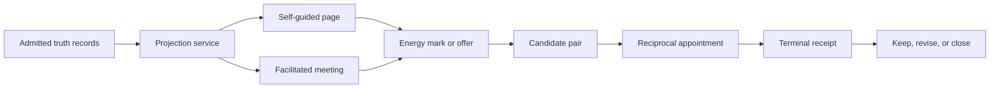

# SPEC: Co-Op Engine Browser Artifact

## What This Product Owns

This product owns one structured record and its browser projections for
self-guided recruitment, a facilitated 45-minute meeting, reciprocal
appointments, and post-meeting receipts. The page and the presentation are the
same artifact.

It does not own the underlying fourteen projects, their canonical truth,
Whisper's spell lifecycle, autonomous matching, public promotion, or proof that
the meeting mechanism works.

## Goal

A capable maker can inspect an evidence-bounded project opportunity, understand
what exists and what does not, offer or request a concrete contribution,
negotiate a reciprocal seven-day appointment, and later record what happened.
The same admitted facts support individual browsing and facilitated use without
truth drift.

## Product Mechanism

Define selects:

**Experiment Exchange with evidence-triggered clinics** — all eligible
experiments are browsable; live clinics occur only when translation, privacy,
access, complementarity, or success-test uncertainty warrants them.

The user selected this research-recommended mechanism in D-001. **Clinic-only
Cohort** remains the genuine comparison and fallback condition, not a second
name for the selected mechanism.

## Actors

| Actor | Needs | Authority |
| --- | --- | --- |
| Technical builder | mechanism, current witness, boundary, exact ask, test surface | may offer work; cannot change project truth |
| Domain practitioner | recognizable craft act, retained judgment, capability and limit | may offer expertise; cannot be reduced to prompting |
| Project owner | truthful card, bounded experiment, response SLA, receipt decision | admits project card and experiment |
| Participant | inspect, offer, negotiate, confirm, decline, or refer | admits own capacity and reciprocal appointment |
| Facilitator | orient, trigger clinics by evidence, read back agreements | cannot manufacture commitment or inflate states |
| Portfolio truth owner | display names, maturity vocabulary, verification and expiry policy | admits cross-project labels |
| Privacy owner | field visibility and leakage policy | blocks unsafe projection or publication |
| Publication owner | names, citations, non-endorsement boundary, final public release | acts only after witnessed audits |

## Define Owner Assignment

For the bounded first proof, the current repository owner/operator,
`vrondelli`, owns both:

- Co-Op product decisions and Design approval; and
- cross-project display names, maturity vocabulary, verification dates, expiry
  labels, and reconciliation of source corrections.

Individual project owners retain veto over their own facts, sources, claim
ceilings, and forbidden wording. Portfolio ownership cannot override local
project authority.

For the same bounded first proof, `vrondelli` owns privacy policy and the
field-level visibility matrix. Every admitted field has exactly one minimum
visibility class: `public`, `meeting_visible`, `assigned_collaborator`,
`participant_private`, or `owner_private`. Unclassified fields fail closed
across rendering, transport, persistence, export, screenshots, and traces.
Initial participant fixtures are synthetic or explicitly consented and
low-risk. An independent negative leakage audit is mandatory before public
use; product ownership cannot waive that gate.

## Capability Map



## Selected Implementation and Deployment Target

The first proof is a dedicated browser application at
`projects/co-op-engine/`. The self-guided recruitment page and facilitated
meeting presentation are projections of one application and one admitted data
model.

Implementation will create a new Sites project and persist its opaque identity
in `projects/co-op-engine/.openai/hosting.json`. The first production
deployment is access-restricted. Public access remains blocked until the
independent negative leakage audit, black-box UI checks, both comprehension
profiles, coherence and conversational-language/copy review, and D-005
publication/naming review pass.

This selection fixes the ownership and verification surface; it does not
authorize implementation, create a deployment, or establish that any audit
passes.

## Capabilities

| Capability | Responsibility | Does not prove |
| --- | --- | --- |
| Truth Record | Preserve project truth, claim ceiling, source selectors, experiment, state, and visibility. | canonical project correctness beyond owner admission |
| Project Orientation | Explain problem, witness, limit, act, ask, and source in project voice. | product maturity or market demand |
| Opportunity Filtering | Filter eligible records by domain, contribution, effort, maturity, and boundary. | fit or commitment |
| Meeting Projection | Present the same records with timing, clinic, and read-back controls. | a separate deck or separate truth |
| Reciprocal Appointment | Require both parties, who/what/when/where/how, privacy, effort, stop rule, and receipt date. | action completed |
| Receipt Capture | Record ran, not-started, blocked, declined, revised, or stopped outcome and owner decision. | general efficacy |
| Visibility Projection | Remove disallowed fields from every observable surface. | privacy safety until witnessed testing |
| Acceptance Evidence | Bind black-box, copy, coherence, and privacy fixtures to later evidence. | an implemented or passing audit |

## Shared Record Contract

```text
project: id, display_name, domain, project_voice, canonical_root,
  authority_status, owner, verification_date, expiry, maturity_class
truth: problem, for_whom, what_exists, witness[], mapping_limit,
  claim_ceiling, forbidden_claims[], source_selectors[]
explanation: resonance, relevance, trajectory, observable_act,
  capability, limitation, human_judgment, term_bridges[]
experiment: id, uncertainty, contribution_options[], skill_ask,
  recruitment_ask, effort_ceiling, stop_rule, expected_witness,
  owner_response_sla, check_in
capacity: participant, offer, evidence, availability, learning_interest,
  privacy_limit, modes[]
surfaces: audience_visible, speaker_notes, interaction_prompts,
  authoring_metadata
state: eligibility, energy_marks[], candidate_pairs[],
  bilateral_appointments[], receipts[]
visibility: public, meeting_visible, assigned_collaborator,
  participant_private, owner_private
```

Required singular fields are project ID, display name, owner, authority,
maturity, problem, claim ceiling, current witness, experiment uncertainty,
owner SLA, expiry, privacy class, and check-in.

## State Contract

```text
draft
  → eligible
  → energy_marked
  → clinic_selected? 
  → candidate_pair
  → bilateral_appointment
  → ran | not_started | blocked | declined | revised | stopped
  → keep | revise | close
```

- Expiry moves a non-terminal record to `stale`.
- Refresh moves `stale` to `draft`, never directly to `eligible`.
- An energy mark is interest, not a match.
- A candidate pair is a proposal, not reciprocal intent.
- An appointment requires confirmations from at least two parties and a receipt
  date.
- A receipt records an outcome under stated boundaries; it does not prove the
  mechanism.

## Surface Contract

| Surface | Audience sees it? | Responsibility |
| --- | ---: | --- |
| Audience-visible | yes | problem, witness, limitation, observable act, bounded ask, safe source |
| Facilitated meeting | in-room | timing, energy marks, clinic queue, negotiation, read-back |
| Presenter notes | no | pacing, evidence boundary, transition cue, operator warning |
| Interaction | as allowed | filters, decisions, reciprocal confirmation, receipt capture |
| Authoring metadata | no | sources, digests, authority, verification, expiry, forbidden claims |
| Privacy projection | by field | public, meeting, assigned, participant-private, owner-private |

Presentation mode may change pacing and disclosure. It may not change truth,
source binding, maturity, claim ceiling, mapping limit, or lifecycle state.

## Project Catalog Boundary

| ID | Define display label | Claim ceiling |
| --- | --- | --- |
| `whisper` | Whisper | governed composition workflow |
| `user-guide` | User Guide / User-Translate-Guide | candidate guided-understanding pattern |
| `agentic-music-studio` | Music Interaction Process Research | interaction-process research |
| `poker-agent-arena` | Poker Agent Arena | runnable Kuhn-poker bot harness |
| `body-war` | TROQAR / Body-War | territorial-running concept |
| `ui-prototyping-studio` | UI Prototyping Studio | runnable governed UI-variant prototype |
| `tower-system-taxonomy` | Sourced Stance-Pair Research Witness | sourced stance-pair research witness |
| `ide-extension` | IDE Extension / Governed Workbench | local governed workbench demo |
| `ide-ergonomics` | IDE Ergonomics | opportunity-routing prototype |
| `x-ray` | X-Ray | seed layered HTML/SVG explainer |
| `arcanum-journey` | Arcanum Journey | unrun course concept |
| `autoads` | Autoads | ad creative learning experiment seed |
| `sonar-loop` | Sonar Loop | docs-first quality-check orchestration specification |
| `ontologize` | Ontologize | candidate metric-trust engagement |

UI Prototyping Studio, Tower/MOGT, cross-project display ownership, and
Ontologize status remain explicitly unresolved. This table does not resolve
their authority.

## Card Admission Rule

A card may become `eligible` only when it has:

- one accountable owner;
- current source selectors and verification date;
- one observable act;
- one current witness;
- one explicit limitation and claim ceiling;
- one bounded contribution option;
- a 72-hour owner response SLA;
- expiry thirty days after owner verification;
- privacy and reuse terms;
- one expected seven-day witness and stop rule.

Every card is reviewed monthly and before any live clinic. A missed response
SLA moves it to `response_overdue`; it remains inspectable but cannot enter a
new candidate pair or clinic. Expiry moves it to `stale` and removes it from
eligible and clinic views while preserving permitted history.

Refresh always returns the card to `draft` and requires owner reconfirmation, a
new verification date, and revalidation of changed source, claim, ask, privacy,
effort, and schedule fields. Cards, appointments, and receipts retain their
governing policy version.

## Selected Meeting Route

- 0–5: orient to one decision—what seven-day experiment, if any, will you help?
- 5–12: silent scan; mark help, learn, clarify, or refer.
- 12–29: two or three evidence-triggered clinics.
- 29–39: negotiate reciprocal who/what/when/where/how, boundary, effort, stop
  rule, and receipt.
- 39–45: reciprocal read-back and receipt date.

If admitted evidence later triggers the Clinic-only fallback, the facilitated
route and asynchronous role must be redefined through a product decision before
implementation changes.

## Explanation and Copy Contract

- Earn technical terms through concrete need and first-use bridges.
- Preserve project voice rather than imposing one AI template.
- Keep human judgment explicit.
- Keep Veritasium-inspired misconception/reveal movement internal-only until
  audience evidence and Whisper's operator audition admit it.
- Reject assistant coaching, canned transitions, praise/reassurance, fake
  intimacy, anthropomorphic partnership, answer-bearing questions, repeated
  `you can`, and unearned agentic/intelligent/copilot/knowledge-graph language.
- Reject meta-narration about what the page, presentation, section, filter, or
  interaction is doing when structure, labels, or content can communicate the
  substance directly.
- Retain necessary orientation, state, accessibility, and recovery instructions
  when they enable a real decision or action.

## Acceptance Contracts

These are proposed obligations, not implemented audits:

1. **Black-box browser:** route, DOM, accessibility tree, keyboard, history,
   interaction, network, storage, screenshots, console, mobile, reduced motion,
   known-good, known-bad, and false-positive fixtures.
2. **Conversational-language and copy:** adjudicated corpus across all project
   voices; automated flags plus human judgment.
3. **Ease and coherence:** first-use and structure proxies plus cold-reader
   retell and transfer for technical-builder and writer/musician profiles.
4. **Privacy:** zero disallowed disclosure across route, DOM, network, storage,
   export, screenshot, and trace.
5. **Writer Story-State:** Mira/Ivo and hooded-traveler fixtures distinguish
   physical meeting from identity knowledge, preserve author canon admission,
   and prevent spoiler leakage.

The exact human threshold remains `5/5 facts + correct transfer + zero forbidden
claims + zero facilitator repairs + zero leakage` for each audience profile.

## Invariants

1. One admitted truth record drives self-guided and live projections.
2. No projection changes a truth or claim-ceiling field.
3. A unilateral signal is never called matched.
4. An appointment requires reciprocal confirmation.
5. A receipt never proves generalized efficacy.
6. Maturity limits claims but does not allocate airtime.
7. Clinic selection requires recorded evidence, not curator preference.
8. Proposed, rejected, private, future, presenter-only, or owner-only data is
   absent from disallowed observable surfaces.
9. Machine extraction may propose story facts; only the author admits canon.
10. Event order and scene order remain distinct.
11. Physical co-presence does not entail identity knowledge.
12. Internal precedent lineage does not imply endorsement or affiliation.
13. Audit specifications are not described as implemented or passing.
14. Research and Define do not become public copy.

## Included

- one browser artifact and truth model;
- self-guided and facilitated projections;
- all fourteen bounded project records;
- experiment, reciprocal appointment, and receipt lifecycle;
- proposed acceptance contracts;
- Whisper composition handoff after witnessed evidence.

## Excluded

- autonomous or AI matching;
- a separate slide deck;
- public collaboration marketplace;
- unrestricted participant profiling;
- silent canon mutation;
- public Veritasium branding;
- implemented-audit, privacy-safe, comprehension-validated, or recruitment-
  proven claims;
- implementation stack, hosting, deployment, or source mutation;
- final marketing copy.

## Define Decisions

- D-001: Experiment Exchange with evidence-triggered clinics — resolved by user.
- D-002: `vrondelli` owns product and portfolio truth for the first proof;
  project-owner veto preserved — resolved by user.
- D-003: 72-hour response SLA, 30-day expiry, monthly and pre-clinic review,
  fail-closed overdue/stale states, and re-admission through draft — resolved
  by user.
- D-004: `vrondelli` owns deny-by-default field visibility for the first proof;
  independent negative leakage audit remains mandatory — resolved by user.
- D-005: public naming and precedent boundary — provisional policy above;
  publication owner remains unassigned.
- D-006: dedicated `projects/co-op-engine/` app with restricted first
  deployment — resolved by user.

## Define Status

Define authoring is `pass`. D-001 through D-004 are resolved. Design activation
inputs are closed by D-006. Invoke Design may begin. No implementation or
public copy is authorized.
