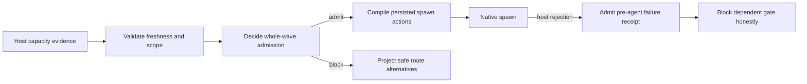

# Orchestrate Capacity-Aware Admission

## What This Module Owns

This update makes Orchestrate decide whether a complete native-agent wave is
admissible before it emits spawnable actions. It owns a neutral capacity
evidence boundary, a deterministic whole-wave decision, honest blocked-spawn
normalization, and route alternatives; the host remains capacity authority and
the user remains topology-change authority.

It does not own the host scheduler, agent-thread limit, session store, queue,
consumer UI, or capability promotion.

## Module Map

## Capabilities

| Capability | What | Key aspects | Detail |
| --- | --- | --- | --- |
| CapacityEvidenceAdmission | Validates one immutable host-supplied evidence record for the exact run and wave. | interface, mapping, query | Missing, stale, scoped-wrong, advisory, or insufficient evidence cannot authorize a strict whole-wave spawn. |
| WholeWaveAdmission | Returns one deterministic admit/block decision before action emission. | operation, state, event | Admission is all-or-zero for the requested wave; it never silently slices or serializes an approved topology. |
| CapacityRouteProjection | Returns safe alternative route handles when admission blocks. | query, interface | Alternatives are offers; material topology or session changes require new route validation and approval. |
| PreAgentFailureNormalization | Represents a failed native spawn without fabricating an agent identity. | operation, event, mapping | A blocked action can satisfy gate evidence completeness while still forcing `gate_block`. |
| SlotLifecycleReconciliation | Distinguishes logical close, retained terminal thread, reusable thread, and physical release. | query, state | Contract only in this package; live reservation/release support is deferred to the host owner. |

## Domain Concepts

| Concept | Type | Key constraints |
| --- | --- | --- |
| [HostCapacityEvidence](interfaces.md#hostcapacityevidence) | Evidence | Immutable, host-owned, run/wave scoped, freshness-bound; may be exact, advisory, or unknown. |
| [CapacityAdmissionDecision](states.md#capacityadmissiondecision) | State | Exactly one of admitted, blocked-missing, blocked-stale, blocked-insufficient, blocked-unreserved, or blocked-unknown. |
| [CapacityRouteOption](queries.md#capacityrouteoptions) | Value Object | Feasible offer with authority owner and reapproval requirement; never an implicit execution route. |
| [PreAgentFailureReceipt](events.md#preagentfailurereceiptadmitted) | Evidence | Binds an attempted action to host failure with `agent_id: null`; cannot pass a gate. |
| [SlotLifecycleObservation](states.md#slotlifecycleobservation) | Evidence | Separates logical lifecycle state from physical capacity state. |

## Concept Registry

| Concept | ID | Type |
| --- | --- | --- |
| HostCapacityEvidence | orchestrateCapacity.HostCapacityEvidence | Evidence |
| ObserveCapacityEvidence | orchestrateCapacity.ObserveCapacityEvidence | Query |
| EvaluateWholeWaveAdmission | orchestrateCapacity.EvaluateWholeWaveAdmission | Operation |
| CapacityAdmissionPolicy | orchestrateCapacity.CapacityAdmissionPolicy | Policy |
| CapacityAdmissionDecision | orchestrateCapacity.CapacityAdmissionDecision | State |
| CapacityRouteOptions | orchestrateCapacity.CapacityRouteOptions | Query |
| CapacityEvidenceProvider | orchestrateCapacity.CapacityEvidenceProvider | Interface |
| PreAgentFailureReceiptAdmitted | orchestrateCapacity.PreAgentFailureReceiptAdmitted | Event |
| SlotLifecycleObservation | orchestrateCapacity.SlotLifecycleObservation | Evidence |

## Feature Concept Graph

| From | Edge | To | Evidence | Notes |
| --- | --- | --- | --- | --- |
| orchestrateCapacity.CapacityEvidenceProvider | exposes | orchestrateCapacity.ObserveCapacityEvidence | `interfaces.md#capacityevidenceprovider` | Host owns evidence truth. |
| orchestrateCapacity.ObserveCapacityEvidence | queries | orchestrateCapacity.HostCapacityEvidence | `queries.md#observecapacityevidence` | Observation is not admission. |
| orchestrateCapacity.EvaluateWholeWaveAdmission | produces | orchestrateCapacity.CapacityAdmissionDecision | `operations.md#evaluatewholewaveadmission` | Deterministic and all-or-zero. |
| orchestrateCapacity.CapacityAdmissionPolicy | enforces | orchestrateCapacity.EvaluateWholeWaveAdmission | `operations.md#whole-wave-policy` | No silent topology change. |
| orchestrateCapacity.AdmitPreAgentFailure | produces | orchestrateCapacity.PreAgentFailureReceiptAdmitted | `events.md#preagentfailurereceiptadmitted` | No fabricated native identity. |

## Aspect Docs

| Aspect | Contains | Key concepts |
| --- | --- | --- |
| [Operations](operations.md) | admission, failure normalization, route projection | whole-wave decision |
| [Queries](queries.md) | capacity observation, alternatives, lifecycle status | non-authority reads |
| [Interfaces](interfaces.md) | host provider and result contracts | versioned boundaries |
| [States](states.md) | admission and slot-lifecycle states | logical vs physical |
| [Events](events.md) | capacity and failed-spawn causal evidence | honest terminal branch |
| [Mappings](mappings.md) | host evidence and consumer projection rules | no inferred limits |
| [Glossary](GLOSSARY.md) | local candidate vocabulary | no canonical definition effect |

## Cross-Feature Dependencies

| Capability | Depends On | Via | Why |
| --- | --- | --- | --- |
| WholeWaveAdmission | Dispatch Spec validated topology | dispatch handle | Capacity cannot redefine the approved role/wave semantics. |
| CapacityEvidenceAdmission | native host profile | versioned evidence provider | Only the host can make capacity facts authoritative. |
| PreAgentFailureNormalization | native spawn and evidence validation | events and receipts | A blocked spawn must close evidence without becoming success. |

## Produces For

| Consumer | Consumes capability | Via | What |
| --- | --- | --- | --- |
| Orchestrate preflight | WholeWaveAdmission | capacity admission receipt | `wave_ready` or zero-action block. |
| DomainSpec/Subagent Strategy | CapacityRouteProjection | neutral route-option handles | Feasible revision choices before confirmation or reconfirmation. |
| Augmentor/agent shell | CapacityRouteProjection | consumer-owned projection | Plain-language choices without host-private details. |
| causal evidence validator | PreAgentFailureNormalization | event and receipt | Valid blocked action branch. |

## Invariants

- A strict wave emits zero spawn actions unless one current evidence record
  covers its complete requested width.
- Advisory or inferred capacity cannot authorize execution.
- A capacity block cannot silently change fan-out, ordering, session, owner, or
  capability semantics.
- A failed spawn never receives a fabricated agent identity.
- A logical `agent_closed` event never proves physical slot release.
- Inventory, events, and route projections remain evidence/read models; none
  becomes host scheduling authority.

## Non-goals

- hard-code a numeric Codex limit;
- infer capacity from retained-agent counts or error strings;
- create an Arcanum queue or scheduler;
- reuse completed agent context without an explicit isolation contract;
- implement Augmentor UI, Task Session, or DomainSpec routing changes;
- publish private incident or product prose in Arcanum.

## References

- [Context pack](../CONTEXT-PACK.md)
- [Architecture bundle](../design/ARCHITECTURE.md)
- [Work Pack](../planning/WORK-PACK.md)
