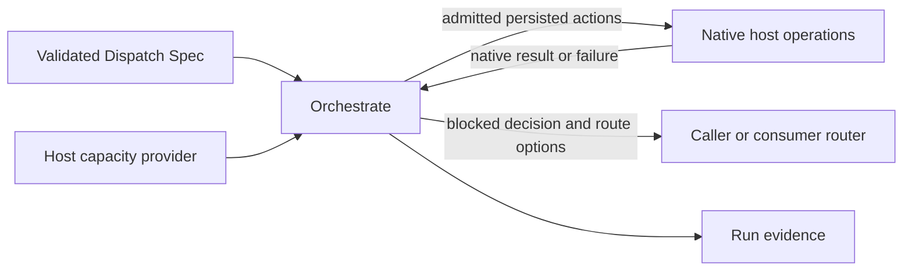
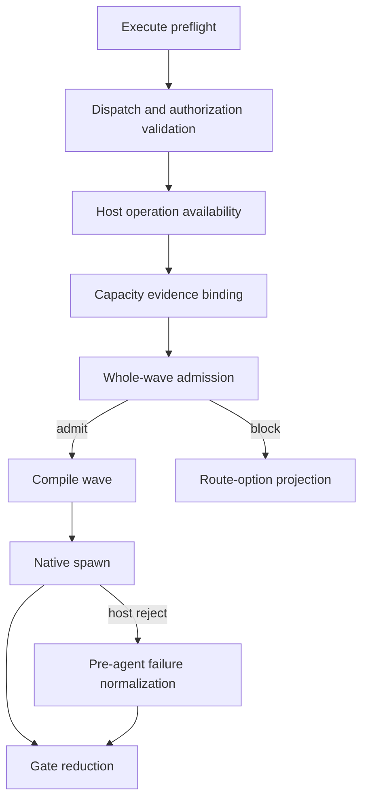
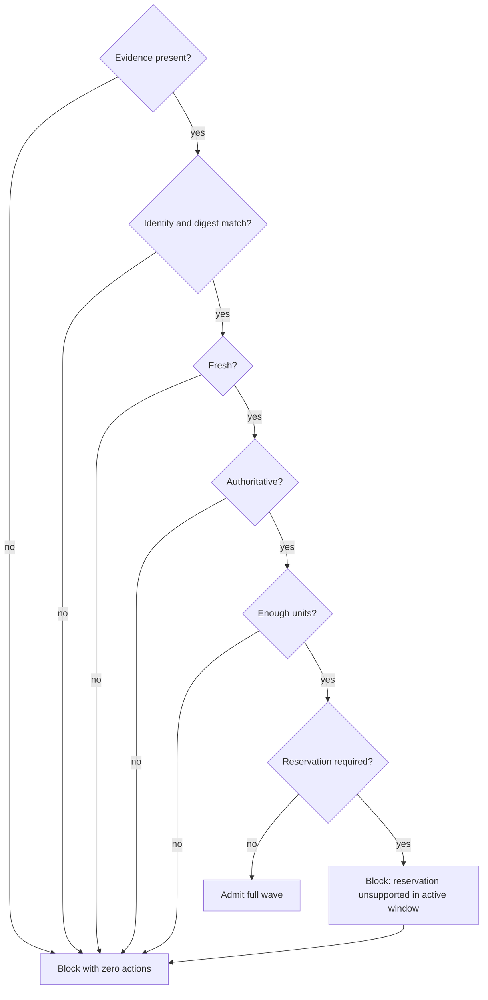

# Architecture Bundle: Capacity-Aware Orchestrate Admission

## Design intent

Insert a host-owned evidence boundary and deterministic all-or-zero admission
decision between validated dispatch topology and native spawn actions. Preserve
the current post-failure recovery path, but stop treating it as prevention and
repair its no-agent failure evidence branch.

## Inputs and source contracts

- [Define specification](../define/SPEC.md)
- [Host interface contract](../define/interfaces.md)
- [Operations](../define/operations.md)
- canonical `arcanum/runtime/orchestrate/SKILL.md`
- canonical `arcanum/runtime/orchestrate/hosts/codex-native.md`
- canonical coordinator and evidence validator
- exact failed preflight, event stream, and validation receipt in the context
  pack
- closed Design scope and deterministic selection receipts in this directory

## Deterministic Design validation receipt

- Rerun: `2026-08-03T20:01:11Z`
- Scope manifest: `DESIGN-SCOPE-MANIFEST.json`, input digest
  `9529eb27331203cfa0c21dd36311b9348345ac33ae5f99af4cc6260b3fac3d48`
- Denominator: `DESIGN-DENOMINATOR-RECEIPT.json`, verdict `pass`, receipt digest
  `fd1424a7ab62c242202271146de98795cf8f297a8daa4c8c06a39511d751d83c`
- Selection: `DESIGN-SELECTION-RESULT.json`, evidence state
  `design-validator-pass`, verdict `pass`, fixed point `true`, result digest
  `f1ac2c8335335691d4d0087696ca593a22cd2ddbb1e40c6edd60d8a53cd2a336`
- Commands: `.agents/skills/invoke/scripts/design_scope_extractor.py` followed
  by `.agents/skills/invoke/scripts/design_selection_validator.py`, using the
  manifest, authored concerns, planned witnesses, and generated denominator.

## 1. Context view



Ownership:

- Dispatch Spec owns topology validity.
- The native host owns capacity facts, reservations, and physical release.
- Orchestrate owns evidence validation, whole-wave policy, action compilation,
  native reconciliation, and causal run evidence.
- The caller/router owns presenting alternatives and obtaining renewed
  confirmation for material changes.

## 2. High-level structure view



The capacity provider is not embedded in the deterministic coordinator. It
produces an immutable input. The coordinator validates and consumes that input
without discovering or guessing capacity.

## 3. Low-level components view

| Component | Owns | Input | Output | Failure rule |
| --- | --- | --- | --- | --- |
| `HostCapacityEvidenceProvider` | current host facts | run/wave demand | immutable capacity evidence | unknown/unsupported is explicit |
| `CapacityEvidenceValidator` | schema, digest, scope, freshness | evidence handle | valid record or blockers | fail closed |
| `WholeWaveAdmissionEvaluator` | deterministic all-or-zero policy | requested width + record | admission receipt | zero actions on block |
| `WaveCompiler` | persisted action documents | admitted exact wave | action set | unchanged current action semantics |
| `CapacityRouteProjector` | neutral alternatives | blocked decision + owner capabilities | route option handles | no automatic topology change |
| `PreAgentFailureNormalizer` | no-agent blocked receipt | attempted action + failed host result | block receipt | never fabricate `agent_id` |
| `CausalEvidenceValidator` | event ordering and completeness | run events | pass/block validation | failed spawn branch may complete only as block |
| `SlotLifecycleReconciler` | logical/physical distinction | host lifecycle evidence | physical state observation | deferred when provider absent |

### Data contracts

`HostCapacityEvidence`:

```json
{
  "schema_version": "arcanum.orchestrate.host-capacity-evidence.v0.1",
  "evidence_id": "opaque",
  "host_id": "codex",
  "capacity_scope_id": "opaque",
  "run_id": "run-id",
  "wave_id": "wave-id",
  "observed_at": "ISO-8601",
  "expires_at": "ISO-8601",
  "authority": "authoritative | advisory | unknown | unsupported",
  "requested_units": 3,
  "spawnable_units": 2,
  "reservation_supported": false,
  "reservation_ref": null,
  "source_ref": "opaque-host-handle",
  "residue": []
}
```

`CapacityAdmissionReceipt` adds evidence digest, policy, admitted units, action
emission count, claim ceiling, and blockers. Route option handles are absent in
OCA-001 and may be projected later by OCA-004 from the persisted block.

## 4. Workflow process view

### Normal strict path

1. Validate dispatch and authorization.
2. Verify required host operations without spawning.
3. Obtain or receive one immutable capacity evidence record.
4. Validate its host/run/wave identity, digest, scope, and freshness.
5. Evaluate the complete requested width.
6. If admitted, persist the decision and compile exactly the full action set.
7. Spawn later from persisted actions under existing exactly-once rules.
8. Join and gate under current lifecycle rules.

### Capacity block path

1. Persist the blocked decision with zero action emission and zero spawn
   attempts.
2. Project only owner-backed alternatives.
3. Return control to the caller.
4. Any selected topology/session change creates new route bytes, validation,
   and approval as required.

### Residual late failure path

1. Persist `action_attempted`.
2. Host spawn fails before returning an agent ID.
3. Persist `host_spawn_failed` with safe cause and private diagnostic handle.
4. Normalize a `PreAgentFailureReceipt` with `agent_id: null`.
5. Persist `pre_agent_failure_receipt_admitted`.
6. Clean up any successful siblings through current bounded recovery.
7. Persist `gate_block` with all required actions accounted for.

## 5. Decision flow view



Policy decisions:

- `strict_whole_wave` is the default for parallel governed dispatch.
- A snapshot-only admit must say `claim_ceiling: snapshot-only`; it cannot
  claim race-free allocation.
- Reservation-bound admission is a deferred L2 extension. In the active L0/L1
  window, any reservation-required input blocks as unsupported. A future
  extension may claim held units only when a separately admitted host receipt
  contract says so.
- Unknown provider capability is a block, not a numeric guess.

## 6. Dependency/interface view

| Boundary | Producer | Consumer | Compatibility rule | Failure behavior |
| --- | --- | --- | --- | --- |
| validated route | Dispatch Spec | Orchestrate | exact dispatch digest and approval | block before capacity |
| capacity evidence | host profile/provider | preflight/evaluator | version, host, scope, run, wave, freshness | zero-action block |
| admission receipt | evaluator | wave compiler/router | exact evidence digest and requested width | no compile on non-admit |
| persisted actions | coordinator | native driver | existing action schema plus admission reference | block replay/mismatch |
| failed spawn | native host | failure normalizer | attempted action and null agent identity | block dependents |
| route options | Orchestrate | consumer router | neutral handles; no private host detail | explicit unavailable/approval state |
| canonical source | `arcanum/runtime/orchestrate` | generated skill surfaces | generate from manifest; byte parity for support paths | parity validation blocks closeout |

## Significant behavior scenario

Stimulus: a validated three-action wave is submitted while authoritative
evidence says only two fresh-spawn units are available.

Preconditions: dispatch validation passes; execution authorization is approved;
evidence matches host/run/wave and is current.

Ordered response:

1. evaluator compares requested 3 with available 2;
2. it emits `blocked-insufficient`;
3. preflight persists zero actions and reports zero spawn attempts;
4. route projection offers only feasible revisions;
5. no child agent or dependent gate starts.

Failure/recovery: if the evidence is missing, stale, advisory, or malformed, the
same zero-action invariant holds with a different blocker class. If a spawn
still fails after an admit, the no-agent failure branch closes causally and the
wave blocks.

Observable evidence: capacity input digest, admission receipt, preflight
receipt, absent actions directory for a block, event stream, failure receipt
when applicable, and validator receipt.

Acceptance owner: Arcanum Orchestrate lifecycle owner; the native host owner
must separately accept any provider/reservation mapping.

## Concern-to-view trace

| Concern | Primary view/extension | Owner | Planned evidence |
| --- | --- | --- | --- |
| authority/trust | decision flow + authority extension | authority owner | forged/stale evidence rejects |
| state/event | workflow + state/event extension | workflow owner | blocked branches validate causally |
| persistence/concurrency | low-level + persistence extension | persistence owner | immutable evidence/action binding; replay blocks |
| failure/compensation | residual late failure path | workflow owner | partial wave cleanup plus no-agent receipt |
| integration/versioning | dependency/interface view | interface owner | old/new schema fixture matrix |
| data lifecycle | data lifecycle extension | data owner | safe diagnostic projection and retention fields |
| quality | significant scenario + quality extension | service owner | zero-action and bounded deterministic fixture checks |
| validation | planned witnesses | design/plan owners | positive and negative fixture matrix |

## Triggered architecture extensions

### Authority and trust

- Only host-owned evidence can claim authoritative capacity.
- Evidence identity, digest, scope, and freshness are enforced before policy.
- Events, Inventory, errors, and historical counts cannot promote capacity
  truth.
- User approval for the old topology does not approve a revised topology.

### State and event lifecycle

- Capacity decision is immutable per evidence/policy/wave identity.
- Blocked preflight precedes action compilation.
- `pre_agent_failure_receipt_admitted` is terminal for the action and forces a
  blocking gate.
- Logical agent lifecycle and physical slot lifecycle are non-collapsing state
  machines.

### Persistence and concurrency

- Persist the evidence digest and decision before actions.
- Reject changed evidence after admission unless a new decision is created.
- A reservation is the only planned race-safe multi-slot mechanism; snapshots
  expose their race ceiling.
- Action replay remains blocked.

### Failure and compensation

- No implicit spawn retry.
- After a late failure, stop unattempted actions and reconcile known siblings.
- A completed sibling may remain a valid independent result, but the wave gate
  blocks unless the route explicitly defines another policy.
- Cleanup does not imply capacity release.

### Integration and versioning

- Add new versioned capacity evidence/admission contracts.
- Version strict preflight/action/receipt/event schemas rather than adding
  undeclared fields to v0.1.
- Old v0.1 fixtures remain valid under their old validator; candidate v0.2
  fixtures prove new semantics.

### Data lifecycle

- Public evidence stores only generic counts/classifications and opaque handles.
- Raw account quotas, provider tier, secrets, and unrelated agent content never
  enter public Arcanum fixtures.
- Retention follows the existing run-evidence owner until separately changed.

### Quality

- A blocked admission produces no action documents and zero spawn attempts.
- The deterministic evaluator is side-effect free and fixture-testable.
- Capacity acquisition is at most one provider observation per preflight
  attempt unless a new attempt ID is created.
- No throughput or latency claim is made until measured.

### Validation contracts

See [planned witnesses](PLANNED-WITNESSES.json) and the Plan validation
strategy. These are authored contracts, not executed implementation evidence.

## Recomposition and evolution

The smallest coherent unit is the whole-wave admission seam: versioned capacity
input, deterministic decision, and zero-action preflight behavior. It
recomposes into Orchestrate without changing spawn/join semantics. Failure
normalization is the next independent unit because it repairs evidence after a
host rejection but does not prevent that rejection.

Natural evolution is provider diversity and concurrent allocation. The
extension boundary is a host-profile provider plus optional reservation lease;
no general scheduler or queue is justified now.
