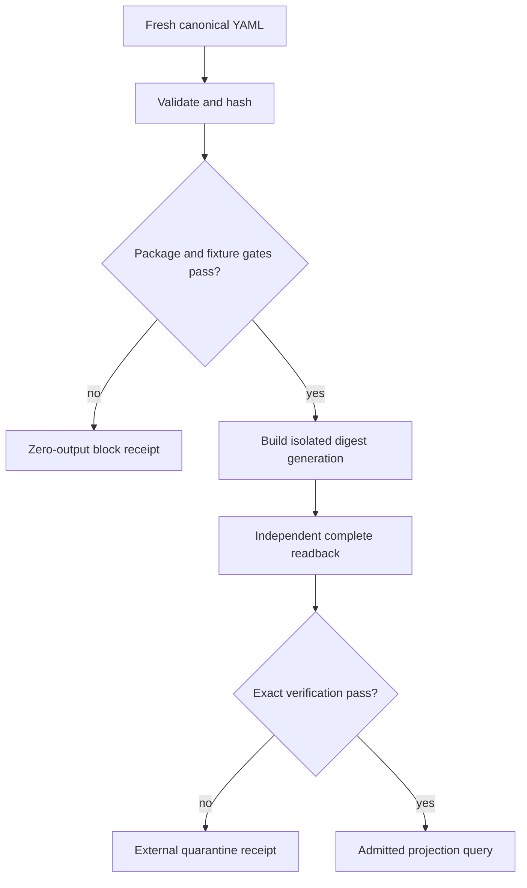

# WaveDB Craft Projection Experiment

## What This Module Owns

This candidate-local module owns a finite experiment that compiles one frozen
Craft YAML ledger into a completely enumerated, digest-addressed WaveDB
projection and tests its admission and failure behavior. Craft retains all
source authority; the experiment owns only isolated evidence and a stop/advance
recommendation.

## Module Map

## Capabilities

| Capability | What | Key aspects | Detail |
| --- | --- | --- | --- |
| InputFreeze | Bind exact experiment inputs | provenance, parser/serializer, fixture constants | [Define](DEFINE.md) |
| ProjectionBuild | Create one unserved generation | closed codec, batch, independent readback | [Operations](operations.md) |
| ProjectionAdmission | Decide whether output is legal | fresh YAML digest, full key verification, stable errors | [Queries](queries.md) |
| FailureObservation | Run bounded negative controls | isolated copies, barriers, zero-output oracles | [States](states.md) |
| ExperimentCloseout | Preserve evidence and residue | BOUND/HOLD/KILL, owner routes, no promotion | [Events](events.md) |

## Domain Concepts

| Concept | Type | Key constraints |
| --- | --- | --- |
| CanonicalLedgerBytes | Value object | Exact bytes; only Craft authority |
| LedgerDigest | Value object | Lowercase SHA-256 of exact ledger bytes |
| ProjectionGeneration | Entity | Addressed only by workspace ID and ledger digest |
| ProjectionManifest | Entity | Enumerates and digests every non-manifest key/value |
| AdmissionResult | Enum | `admitted` or stable zero-output failure |
| ObservationReceipt | Evidence | Filesystem-owned, never stored inside WaveDB |

## Concept Registry

| Concept | ID | Type |
| --- | --- | --- |
| CanonicalLedgerBytes | `wcp.CanonicalLedgerBytes` | ValueObject |
| ProjectionGeneration | `wcp.ProjectionGeneration` | Entity |
| BuildGeneration | `wcp.BuildGeneration` | Operation |
| VerifyGeneration | `wcp.VerifyGeneration` | Operation |
| QueryGeneration | `wcp.QueryGeneration` | Query |
| AdmissionResult | `wcp.AdmissionResult` | Type |

## Feature Concept Graph

| From | Edge | To | Evidence | Notes |
| --- | --- | --- | --- | --- |
| `wcp.BuildGeneration` | consumes | `wcp.CanonicalLedgerBytes` | `operations.md#buildgeneration` | Fresh read only |
| `wcp.BuildGeneration` | produces | `wcp.ProjectionGeneration` | `operations.md#buildgeneration` | Initially unserved |
| `wcp.VerifyGeneration` | enforces | `wcp.ProjectionManifest` | `operations.md#verifygeneration` | Complete keyspace check |
| `wcp.QueryGeneration` | queries | `wcp.ProjectionGeneration` | `queries.md#querygeneration` | Only after fresh admission |
| `wcp.QueryGeneration` | produces | `wcp.AdmissionResult` | `queries.md#querygeneration` | Failure emits zero rows |

## Aspect Docs

| Aspect | Contains | Key concepts |
| --- | --- | --- |
| [Architecture](../design/ARCHITECTURE.md) | Six-view boundary and selected extensions | authority, persistence, failure |
| [Glossary](GLOSSARY.md) | Invoke-local terms | provenance, generation, quarantine |
| [Operations](operations.md) | Candidate mutations | build, verify, quarantine, rebuild |
| [Interfaces](interfaces.md) | Adapter surface | bounded Node interface |
| [Queries](queries.md) | Admitted reads | generation and index queries |
| [Mappings](mappings.md) | YAML-to-projection codec | keys, values, manifest |
| [States](states.md) | Run and generation states | fail-closed transitions |
| [Events](events.md) | Observation evidence | gate, build, verification, stop |

## Cross-Feature Dependencies

| Capability | Depends On | Via | Why |
| --- | --- | --- | --- |
| InputFreeze | Craft canonical contract | exact source selectors | Preserve YAML authority |
| ProjectionBuild | WaveDB Node binding | exact pinned package/source | Exercise reviewed primitives |
| ExperimentCloseout | Invoke and Task Session | Work Pack and terminal receipts | Separate planning from execution proof |

## Produces For

| Consumer | Consumes capability | Via | What |
| --- | --- | --- | --- |
| Craft owner | ExperimentCloseout | closeout receipt | Bounded adoption/stop evidence |
| Adapter owner | FailureObservation | exact run receipts | Codec and recovery gaps |
| Package/security owner | InputFreeze | WP-0 receipt | Provenance and build decision |

## Change History

| Date | Change |
| --- | --- |
| 2026-08-04 | Initial candidate-local Define baseline |

## References

- Research verdict: `../../findings.md`
- Execution plan: `../plan/WORK-PACK.md`
