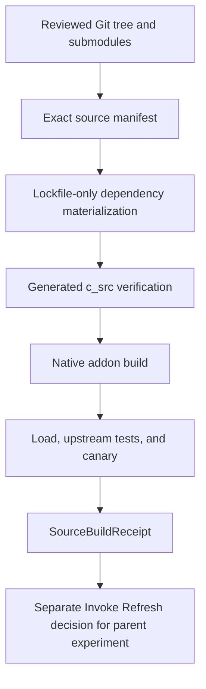

# WaveDB Reviewed-Source Build

## What This Module Owns

This candidate-local module owns one isolated, reproducible-attempt build of
WaveDB's reviewed Node binding from Git commit
`01c77e8b70f71de9b72480e73a3a179f6e93a009` and its pinned submodules. It
produces a platform-specific addon plus a receipt binding source, dependencies,
toolchain, build commands, tests, and output hashes.

It does not repair or replace npm provenance. It creates a distinct local
artifact whose use is confined to the already-approved disposable Craft
projection experiment.

## Authorization And Discovery

- User authorization: `Authorize source build` in the current chat.
- Resolved option: `OPT-REDESIGN-SOURCE-BUILD` from the parent experiment's
  package-provenance decision.
- Discovery sources: `../../../findings.md`, `../../../research.md`, the parent
  experiment's provenance reconstruction, and the reviewed WaveDB source.
- Discovery waiver: none.

## Module Map

## Capabilities

| Capability | What | Key constraints |
| --- | --- | --- |
| SourceClosure | Bind the root commit, submodule commits, tracked bytes, lockfile, and build scripts | Clean checkout; no branch or moving tag |
| DependencyClosure | Materialize only the lockfile dependency graph | `npm ci`; scripts disabled during dependency materialization |
| NativeBuild | Generate `c_src` and build one addon | Isolated ignored work area; exact toolchain and OpenSSL mode recorded |
| BuildVerification | Load the addon and run upstream tests plus a minimal canary | Temporary stores only; no Craft ledger reads or writes |
| ArtifactBinding | Hash outputs and emit a terminal receipt | Local evidence only; no registry/package/publication claim |

## Domain Concepts

| Concept | Type | Key constraints |
| --- | --- | --- |
| ReviewedSourceIdentity | Value object | Root commit plus complete recursive submodule identities |
| SourceManifest | Evidence | Sorted tracked path, mode, byte digest, and aggregate digest |
| DependencyLockIdentity | Value object | Exact `package-lock.json` SHA-256 and lockfile version |
| ToolchainIdentity | Value object | Node, npm, Python, compiler, linker, make, OpenSSL, OS, architecture |
| SourceBuiltAddon | Artifact | Platform-specific `.node` bytes generated only from admitted inputs |
| SourceBuildReceipt | Evidence | Commands, inputs, outputs, tests, side effects, residue, and claim ceiling |

## Invariants

1. The source checkout resolves exactly to the reviewed commit and has no
   tracked modifications before dependency materialization.
2. Every recursive submodule resolves to its superproject-pinned commit.
3. Dependency materialization uses the reviewed `package-lock.json` through
   `npm ci --ignore-scripts`; no semver-only install is admitted.
4. `copy-sources.js` runs before build, and the generated `c_src` manifest is
   bound into the receipt.
5. Build runs with an explicit OpenSSL mode and records the exact environment.
6. Tests and canaries operate only on temporary isolated stores.
7. No real `.craft/ledger.yml`, canonical Craft source, registry package,
   publication surface, or Git history is mutated.
8. A failed source, dependency, build, load, or test check returns `BLOCK`; no
   partial addon becomes admissible evidence.

## Interface

The execution owner receives one selected SWU and returns:

- `execution/source-build-receipt.json`;
- `execution/source-manifest.json`;
- `execution/dependency-manifest.json`;
- `execution/build-manifest.json`;
- `execution/test-result.json`;
- an ignored local work area under `source-build/.work/`.

The receipt may be consumed only by an Invoke Refresh of the parent experiment.
It cannot directly mark the blocked registry SWU as passing.

## Explicit Exclusions

- rebuilding or publishing an npm tarball;
- claiming correspondence with the existing npm `0.15.8` artifact;
- supporting platforms other than the observed local Linux x86_64 environment;
- dependency license/SBOM closure;
- crash, power-loss, encryption, multi-writer, migration, or performance proof;
- modifying either `arcanum/arcana/craft/` or `arcanum/development/craft/`;
- reading or writing a real Craft ledger.

## References

- Parent decision: `../../execution/decisions/PACKAGE-PROVENANCE.md`
- Complete package reconstruction: `../../execution/wp0-provenance/HISTORY-RECONSTRUCTION.md`
- Parent research: `../../../findings.md`
- Reviewed upstream package: WaveDB `bindings/nodejs/` at commit `01c77e8b...`
