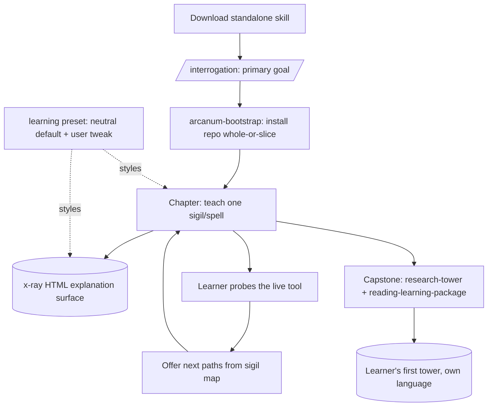

# Arcanum Journey

> Invoke **define** artifact. Source context: `projects/arcanum-journey/.craft/`
> (`ledger.yml`, `artifacts/vision-brief.md`, `artifacts/DECISIONS.md`). All four
> scoping decisions are closed; this spec encodes them, it does not reopen them.

## What This Module Owns

The Arcanum Journey is a **standalone, downloadable learning skill** that teaches
what Arcanum is by **constructing it piece by piece** — each sigil/spell is a
chapter — while it **installs** the framework into the learner's repo. It owns the
learner-facing curriculum, the goal-based routing into a first tool, the
user-tweakable explanation preset, and the capstone where the learner builds
their **own first research tower**. It does **not** own the underlying sigils,
spells, or the installer — it composes them.

## Module Map

## Capabilities

| Capability | What | Key Aspects | Detail |
| --- | --- | --- | --- |
| Onboard & Route | Interrogate the learner's primary goal and recommend a first tool, then let them pick or probe | `/interrogation` one-question cadence; goal→tool map; full sigil map fallback | DEC-AJ-ROUTING-001 |
| Install-While-Teaching | Install Arcanum (whole repo or a picked slice) as the lesson proceeds | composes `arcanum-bootstrap`; teach-while-install; learn by probing | DEC-AJ-SURFACE-001 |
| Chapter Delivery | Teach one sigil/spell per chapter, building on prior chapters | authored stable content; inherit/build-on/integrate framing; Craft as control surface | DEC-AJ-PACKAGE-MODE-001 |
| Explanation Surface | Render each chapter as an agent-generated HTML page | composes `x-ray`; Veritasium novice style; analogies + simplicity | DEC-AJ-SURFACE-001, GAP-AJ-PERSONA-001 |
| Learning Preset | Configure explanation style with neutral defaults the learner can tweak | schema modeled on `goal/decision-profile.schema` + user-guide | GAP-AJ-PRESET-SCHEMA-001 |
| Path Offering | After each session, offer coherent next chapters | driven by the sigil/spell route map | GAP-AJ-SIGIL-MAP-001 |
| Tower Capstone | Help the learner produce their own first research tower in their own language | composes `research-tower` → `reading-learning-package` | DEC-AJ-PACKAGE-MODE-001 |

### Onboard & Route (inline)

Interrogation infers the learner's primary goal (creative / automation /
knowledge / unsure), recommends a first chapter-tool (e.g. creative → **Whisper**;
automation → **Craft + goal/task-session**), then shows the full sigil map so the
learner can override or freely probe.

### Chapter Delivery (inline)

A **chapter** introduces exactly one sigil or spell as a tutorial step that builds
on the chapters before it. Every chapter answers: what this tool is, what it
**inherits** from earlier concepts, what it lets you **build**, and how it
**integrates** with the others. Craft is reintroduced in each chapter as the
**control surface** where that tool has its place.

## Domain Concepts

| Concept | Type | Key Constraints |
| --- | --- | --- |
| Chapter | Entity | One sigil/spell; ordered; declares inherits/builds/integrates edges |
| Learning Preset | Config | Neutral default required; user-tweakable; public schema only (no private data) |
| Route Map | Entity | Nodes = sigils/spells; typed edges inherit/build-on/integrate |
| Starting Point | Value | One of the route-map nodes selected by goal or by learner pick |
| Explanation Surface | Artifact | Agent-generated HTML; one per chapter; x-ray-style |
| Tower (capstone) | Artifact | Per-learner research-tower output; the learner's own language |
| Install Slice | Value | whole-repo \| picked-subset; produced by arcanum-bootstrap |

## Concept Registry

| Concept | ID | Type |
| --- | --- | --- |
| Chapter | arcanum-journey.Chapter | Entity |
| LearningPreset | arcanum-journey.LearningPreset | Config |
| RouteMap | arcanum-journey.RouteMap | Entity |
| StartingPoint | arcanum-journey.StartingPoint | Value |
| ExplanationSurface | arcanum-journey.ExplanationSurface | Artifact |
| Onboard | arcanum-journey.Onboard | Operation |
| OfferNextPaths | arcanum-journey.OfferNextPaths | Query |

## Constraints & Boundaries

- **Public boundary (DEC-AJ-HOME-001):** the shipped deliverable lives in the
  public `arcanum/` submodule. It must contain **no private operator data**.
  Cyber Alchemy is taught only at the level already public in arcanum
  (`development/cyberalchemy-ontology-lifecycle/`, `ARCANUM-MANUAL.md`, README);
  deeper `cyberAlchemy-v2/` specifics and engine/proprietary detail are excluded.
  The explainer persona is **anonymized** before it enters the public package.
- **Composition, not ownership:** the journey references the sigils/spells it
  teaches and composes `arcanum-bootstrap`, `x-ray`, `interrogation`,
  `research-tower`, and `reading-learning-package`. It does not fork or mutate
  their contracts.
- **Hybrid package (DEC-AJ-PACKAGE-MODE-001):** chapters are authored and stable;
  the per-learner tower is generated at runtime at the capstone.

## Open Gaps (carried into design/plan)

| Gap | Summary | Owner route |
| --- | --- | --- |
| GAP-AJ-SIGIL-MAP-001 | Map all sigils/spells with inherit/build-on/integrate edges | dispatch-spec fan-out + inventory |
| GAP-AJ-PRESET-SCHEMA-001 | Define user-tweakable learning preset schema | design |
| GAP-AJ-PERSONA-001 | Extract + anonymize Veritasium explainer persona | design |
| GAP-AJ-CYBERALCHEMY-001 | Include public-level Cyber Alchemy method in exploration | dispatch-spec fan-out |
| GAP-AJ-CHAPTER-ORDER-001 | Define chapter sequence (depends on sigil map) | design (draft) → finalize after map |
