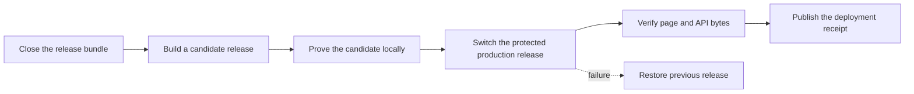

# Augmentor Rich Consultation Publication

## What this work owns

This work owns one versioned release of the already implemented rich
consultation page, its agent-facing document, and API family `1.1.0` to the
existing protected Augmentor site. It owns release closure, candidate proof,
the production switch, verification, and rollback evidence.

It does not redesign the ontology, change answer truth, create a reasoning
engine, replace authentication, expose credentials, grant authority, or make
the API writable.

## Capability map

## Capabilities

| Capability | Outcome | Main constraint |
| --- | --- | --- |
| `augpub.ReleaseClosure` | One candidate contains every file required by the `1.1.0` loader. | Missing, mixed-version, or digest-mismatched files block before upload. |
| `augpub.CandidateProof` | The exact candidate passes producer, consumer, page, packaging, and rollback checks. | Local proof does not claim production. |
| `augpub.ProtectedPublication` | The existing protected route switches to the exact candidate. | Reuse the existing Basic Auth hash and isolated container topology. |
| `augpub.ProductionVerification` | Deployed page/API hashes, health, contract response, denial, restart, and homepage isolation are observed. | No plaintext password is requested or stored. |
| `augpub.ReleaseCloseout` | A receipt binds inputs, deployed generation, validation, rollback, and residue. | Receipt cannot promote ontology claims or hide untested public browser auth. |

## Concept registry

| Concept | ID | Type |
| --- | --- | --- |
| Release bundle | `augpub.ReleaseBundle` | Entity |
| Release closure | `augpub.ReleaseClosure` | Rule |
| Candidate release | `augpub.CandidateRelease` | Entity |
| Production switch | `augpub.ProductionSwitch` | Operation |
| Rollback | `augpub.Rollback` | Operation |
| Deployment receipt | `augpub.DeploymentReceipt` | Evidence |
| Rich consultation contract | `augpub.RichConsultationContract` | Interface |
| Protected page | `augpub.ProtectedPage` | Interface |

## Feature concept graph

| From | Edge | To | Evidence |
| --- | --- | --- | --- |
| `augpub.ReleaseClosure` | validates | `augpub.ReleaseBundle` | `deployment/deploy-static-vps.sh` |
| `augpub.ReleaseBundle` | contains | `augpub.RichConsultationContract` | consumer bundle manifest |
| `augpub.CandidateRelease` | packages | `augpub.ReleaseBundle` | release script |
| `augpub.ProductionSwitch` | activates | `augpub.CandidateRelease` | `current` symlink switch |
| `augpub.Rollback` | restores | `augpub.CandidateRelease` | `previous` symlink |
| `augpub.DeploymentReceipt` | evidences | `augpub.ProductionSwitch` | deployed hashes and checks |

## Required behavior

1. The release packager must include `projection.json`, `glossary.json`,
   `projection-manifest.json`, and all four schemas named by the manifest.
2. The candidate must fail before upload when any required input is absent,
   mixed-version, stale, or digest-invalid.
3. The candidate must contain the current generated page including `#agent-api`
   and `window.augmentorConsultationPage`.
4. The internal smoke request must use query family `1.1.0`, request guided
   explanation support, and require the expected bundle digest plus the
   non-authority boundary.
5. The production switch must reuse `/srv/augmentor-ontology`, preserve the
   current password hash when no replacement password is supplied, retain the
   prior generation, and roll back on start or acceptance failure.
6. Verification must distinguish exact deployed bytes, internal authenticated
   API behavior, public anonymous denial, and public authenticated browser
   replay. A missing replay remains explicit residue.
7. The deployment receipt must contain no password, token, raw private ontology
   path, or authority claim.

## Acceptance

- The complete rich bundle is packaged and verified before external transport.
- The exact local page and bundle digests equal the deployed digests.
- The internal production API accepts a `1.1.0` guided query and returns
  evidence-bearing `ok` or `partial`, answer action `answer` or `qualify`,
  structured explanation support, and `authorityEffect: none`.
- Anonymous page and API requests return `401`; unrelated paths remain `404`;
  the root site remains unchanged.
- Both containers recover after restart.
- Failure after the switch restores the previous complete generation.
- A new dated deployment receipt records the evidence and any residue.

## Claim ceiling

Success establishes that the protected page and consultation API family `1.1.0`
were deployed and observed through the declared checks. It does not establish a
working integrated reasoning engine, ontology authority, public availability
without authentication, general production readiness for ResonantOS, or human
comprehension.

