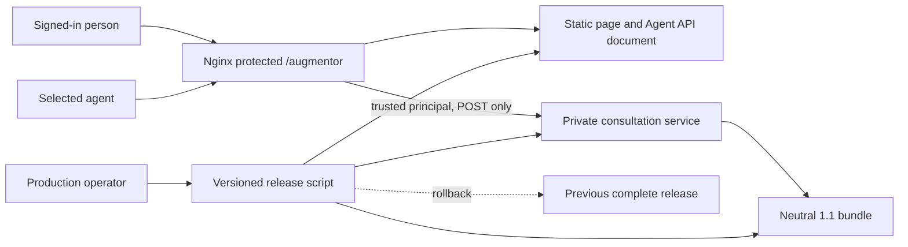
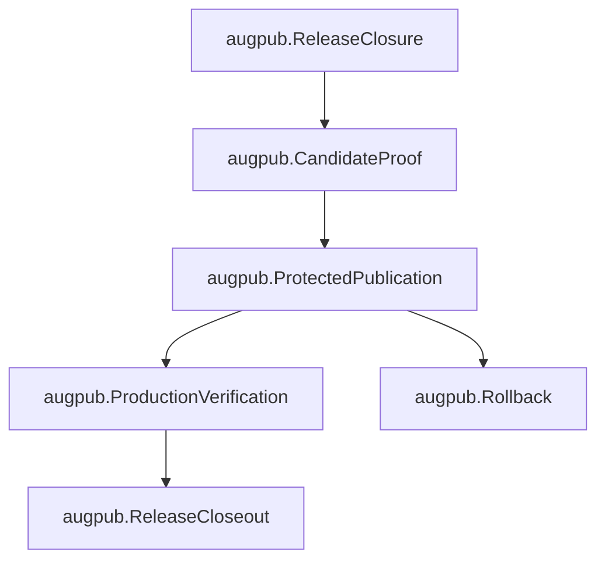
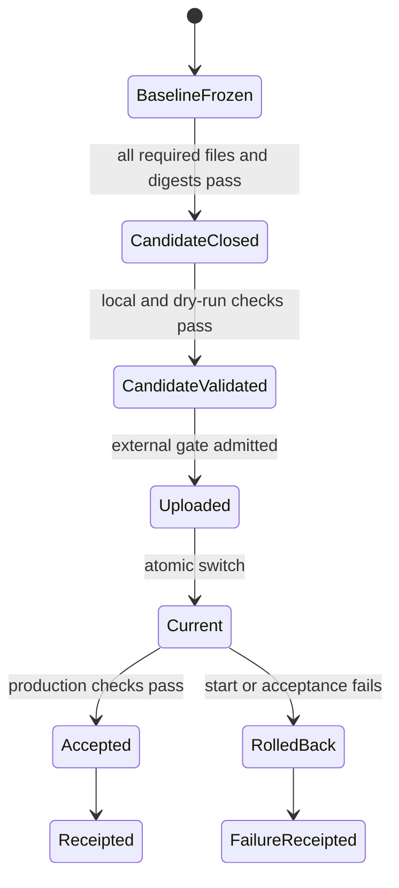

# Architecture: Rich Consultation Publication

## Design intent

Evolve the existing protected release in place. The page, runtime modules,
neutral projection, glossary, schemas, and server configuration move as one
versioned candidate. Local closure and behavior are proven before upload; the
production switch is reversible and produces a distinct receipt.

## 1. Context view



Trust does not flow backward from retrieved data. Nginx authenticates the
caller; the API reads the installed neutral bundle; neither grants ontology
authority or permission to act.

## 2. Capability view



`ReleaseClosure` is a hard predecessor. No production step may compensate for
an incomplete candidate.

## 3. Concept and type view

| Concept ID | Type | Key invariant |
| --- | --- | --- |
| `augpub.ReleaseBundle` | Entity | Page, five runtime modules, projection, glossary, manifest, four schemas, Compose, and Nginx config are co-versioned. |
| `augpub.CandidateRelease` | Entity | Immutable after its manifest and digest are captured. |
| `augpub.RichConsultationContract` | Interface | Query/result/projection/glossary/explanation family is exactly `1.1.0`. |
| `augpub.ProductionSwitch` | Operation | Only the operator changes `current`; prior target becomes `previous`. |
| `augpub.Rollback` | Operation | Restores a complete prior target and recreates both containers. |
| `augpub.DeploymentReceipt` | Evidence | Binds exact inputs, remote generation, checks, and residue; contains no secret. |

## 4. Operation and flow view

```mermaid
sequenceDiagram
  participant O as Operator
  participant L as Local preflight
  participant R as Remote releases
  participant C as Containers
  participant V as Verifier
  O->>L: assemble candidate from exact selectors
  L->>L: validate seven-file rich bundle and page/API tests
  L->>L: create release manifest and dry run
  L->>R: upload immutable candidate
  R->>R: unpack .next, validate, promote to release id
  R->>R: current <- candidate; previous <- old current
  R->>C: recreate private API and protected Nginx
  C->>V: health and 1.1 guided consultation
  alt any acceptance failure
    V->>R: rollback
    R->>C: recreate previous complete release
  else accepted
    V->>O: deployed-byte and behavior receipt
  end
```

## 5. State view



Forbidden transitions:

- `BaselineFrozen -> Uploaded`
- `CandidateClosed -> Current`
- `Current -> Receipted` without production checks
- `RolledBack -> Accepted` without a new candidate generation

## 6. Dependency and interface view

| Boundary | Producer | Consumer | Contract | Failure behavior |
| --- | --- | --- | --- | --- |
| Ontology to release | DomainSpec projection compiler | deploy packager | manifest `1.1.0` plus seven runtime files | block before upload |
| Consumer code to release | ResonantOS host modules | Node API container | five exact `.mjs` modules on Node `22.13.0` | block before upload/start |
| Browser to proxy | protected page/agent | Nginx | same-origin POST, Basic Auth session | `401`, `404`, or method denial |
| Proxy to API | Nginx | private Node container | trusted principal header; other credential headers cleared | `401` direct/untrusted |
| Release to production | operator script | `/srv/augmentor-ontology` | immutable release id, `current`/`previous` links | rollback on failure |
| Evidence to closeout | validators | deployment receipt | hashes, statuses, release ids, residue | no completion claim if missing |

## Selected concern extensions

### Authority and trust

- Local authoring may change the candidate only.
- The operator session alone may upload or switch production.
- Basic Auth proves access to this protected surface; it does not make an API
  response authoritative.
- Retrieved text remains data. The API and page preserve
  `followRetrievedInstructions: false` and `authorityEffect: none`.

### Persistence and concurrency

- The remote release directory is append-by-generation.
- `current.next` and `previous.next` are renamed into place; release execution
  is single-operator and must stop if another switch is detected.
- `.htpasswd` is copied from the active generation when no new password is
  supplied. It is never added to the release sources or receipt.

### Failure and compensation

- Packager, Compose validation, container start, health, rich API smoke, page
  byte comparison, authentication denial, and homepage isolation are all
  rollback-triggering gates.
- Rollback restores the prior complete generation and removes new-service
  orphans. The failed candidate stays non-current for diagnosis.

### Security and abuse

- No API host port; API joins only the private backend.
- Nginx clears client-supplied principal, consultation key, Authorization, and
  Connection headers before proxying.
- Only same-origin page connections are permitted by CSP.
- Negative checks cover anonymous access, wrong password, direct untrusted API,
  non-POST methods, oversized/malformed query, and unrelated paths.

### Integration and versioning

- The production generation moves from API family `1.0.0` to `1.1.0` as one
  page/runtime/bundle change.
- The old two-file bundle is not a compatible `1.1.0` candidate.
- Rollback returns the entire old generation, avoiding mixed old/new modules.

### Migration and rollout

- No source or user data migration occurs. The rollout changes immutable
  release bytes and the active symlink only.
- Canary evidence is the remote internal rich-query smoke before public
  acceptance. There is no split-traffic mode.

### Data lifecycle

- Request bodies are processed in memory. The deployment design adds no query
  logging or durable user content.
- The repository receipt retains only hashes, release ids, test outcomes, and
  declared residue.

### Quality

- Preserve the locally measured 65,536-byte installed-bundle cap.
- Production rich smoke must complete within the service limit and return a
  whole explanation pack rather than separated analogy/glossary fragments.
- Browser acceptance remains desktop plus 320 px, reduced motion, keyboard,
  no horizontal overflow, and no page errors.

## Significant behavior scenario

Stimulus: the operator releases the current local page and rich bundle.

Preconditions: all selected baselines still match; the release closure repair
passes; local producer, consumer, docs, alpha, and page/browser checks pass; the
current production route and rollback target are healthy.

Ordered response: assemble -> validate -> dry run -> upload -> install -> switch
-> recreate -> internal `1.1.0` guided query -> exact-byte and boundary checks ->
receipt.

Failure: any missing bundle file, digest drift, unhealthy container, wrong
response family, absent explanation support, altered authority boundary, or
public-route regression triggers block or rollback.

Acceptance owner: production operator for the switch; validation owner for the
evidence; repository owner for the receipt.

## Planned witness contracts

| Witness | Claim | Positive proof | Negative proof |
| --- | --- | --- | --- |
| `W-AUGPUB-01` | release closure | exact file inventory and manifest digest validation | delete glossary or one schema; preflight blocks before SSH |
| `W-AUGPUB-02` | rich runtime | guided reasoning question returns structured support and expected bundle digest | `1.0.0`, mixed schema, missing glossary, or wrong bundle fails |
| `W-AUGPUB-03` | safe access | internal trusted proxy succeeds; anonymous/direct untrusted fail | client-supplied principal/key cannot bypass Nginx |
| `W-AUGPUB-04` | rollback | injected post-switch acceptance failure restores previous id and healthy containers | failed candidate never remains current |
| `W-AUGPUB-05` | page/agent parity | exact page bytes expose the same guided support through UI and window API | unsafe HTML is rendered as text and cannot execute |

These are design contracts. Only the local rich baseline is already executed;
publication witnesses remain Plan evidence pending.

