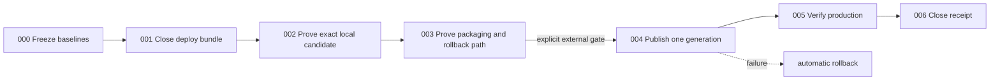

# Implementation Plan: Publish Rich Consultation

## Outcome

Release the current locally validated `1.1.0` page, agent document, API runtime,
glossary, and explanation bundle to the existing protected Augmentor route and
produce exact production evidence with a live rollback generation.

## Planning status

| Field | Value |
| --- | --- |
| Complexity | high: two repositories, production transport, privileged switch, human UI, API version transition |
| Current state | brownfield and partially deployed; rich generation local only |
| Design evidence | `design-validator-pass` |
| First unit | `SWU-AUGPUB-000` baseline and closure preflight |
| Mutation authority | not granted by this Plan |
| External deployment authority | separate explicit operator gate required |
| Execution order | serial; stop at the first failed gate |
| Runtime | Node `22.13.0`; shared Playwright runtime for browser proof |

## Work graph



## Waves

| Wave | Layer | Units | Exit evidence |
| --- | --- | --- | --- |
| W0 Trust | L0 | 000-001 | Exact baseline plus a packager that closes the seven-file runtime bundle and uses `1.1.0` smoke semantics. |
| W1 Candidate | L1 | 002-003 | Rebuilt candidate, all local suites, dry-run release manifest, negative missing-file proof, rollback rehearsal. |
| W2 Publication | L2 | 004-005 | One external release switch plus deployed hashes, rich internal consultation, denial, restart, and isolation proof. |
| W3 Closeout | L3 | 006 | Dated deployment receipt, rollback locator, residue, and deterministic next route. |

## Global gates

1. Baseline gate: every write target and consumer input matches the admitted
   digest; user-owned drift blocks.
2. Closure gate: all seven bundle files validate against the manifest before
   any SSH command.
3. Local behavior gate: producer, consumer, page, docs, and alpha checks pass
   under Node `22.13.0`.
4. External-effect gate: the operator explicitly authorizes the exact release
   generation after reviewing W1 evidence.
5. Production gate: health, rich query, bytes, auth denial, topology, restart,
   and unrelated homepage isolation pass; otherwise rollback.
6. Closeout gate: receipt distinguishes local, remote-internal, public denial,
   exact-byte, and any human authenticated-browser evidence.

## Exact validation commands

From DomainSpec:

```bash
node projects/augmentor/ontology/unified-agent/development/consultation-api/scripts/build-consumer-projection.mjs --check
node projects/augmentor/ontology/unified-agent/development/consultation-api/scripts/validate-contract.mjs --scope query
node projects/augmentor/ontology/unified-agent/development/consultation-api/scripts/validate-contract.mjs --scope result
node projects/augmentor/ontology/unified-agent/development/consultation-api/scripts/validate-contract.mjs --scope projection
node projects/augmentor/ontology/unified-agent/development/consultation-api/scripts/validate-projection-leakage.mjs
node --test projects/augmentor/ontology/unified-agent/development/consultation-api/tests/*.test.mjs
node projects/augmentor/ontology/unified-agent/scripts/build-visualization.mjs --check
node --test projects/augmentor/ontology/unified-agent/tests/visualization.test.mjs
node projects/augmentor/ontology/unified-agent/tests/agent-api.browser.mjs "$(npm root -g)/playwright"
sh -n projects/augmentor/ontology/unified-agent/deployment/deploy-static-vps.sh
CONSUMER_ROOT=/home/vrondelli/projects/workspace-resonant/2.0.0-alpha DRY_RUN=1 sh projects/augmentor/ontology/unified-agent/deployment/deploy-static-vps.sh
```

From ResonantOS under Node `22.13.0`:

```bash
node --test --test-concurrency=1 browser-first/test/augmentor-consultation.test.mjs browser-first/test/augmentor-consultation-deployment.test.mjs browser-first/test/augmentor-consultation-agent-context.test.mjs
npm run test:module-ownership
npm run docs:check
npm run test:docs
npm run verify:alpha
```

The production command is deliberately not part of the automatic local chain.
After W1 and a separate external-effect authorization, Task Session may run the
owned release script with `CONSUMER_ROOT` fixed to the verified checkout and no
password environment value. The script must preserve the existing remote hash.

## Claim boundaries

- W0-W1 establish a release candidate, not deployment.
- W2 establishes the exact production generation only through its observed
  checks.
- Public authenticated browser replay is not inferred from internal API proof
  or deployed byte identity. If the operator does not provide that human proof,
  it remains named residue.
- No layer establishes an integrated reasoning engine or authority effect.

## Next route

Run one Task Session for `SWU-AUGPUB-000`. Continue automatically through 003
only while each local receipt passes. Stop before 004 for exact external-effect
authorization naming the candidate release manifest and rollback target.

