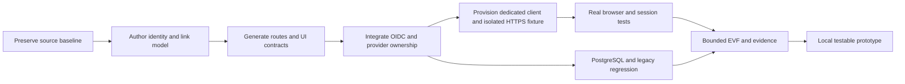

# Body War v2 identity prototype

Body War is a second application using the running self-hosted Auth Foundation Keycloak issuer. The dedicated fixture is https://body-war.localhost:14443. The existing Auth Foundation application stays at https://localhost:13443.

## Test locally

With the existing Auth Foundation HTTPS issuer running, use `npm run oidc:setup`, `npm run build:model`, `npm run build`, then `npm run oidc:start` from this project. Open the Body War URL, select **Entrar**, and sign in as **alice** with the HTTPS demo password in [the private credential handoff](../auth-foundation/implementation/authentication-https/.runtime/TEST-LOGIN.txt). After login, select **Conectar Strava**. This fixture uses synthetic Strava data only.

Keycloak remains responsible for collecting credentials. Body War creates its own application session and maps the verified `(issuer, subject)` pair to a local principal; email, display name and Strava athlete ID cannot merge identities. Linking Strava requires an authenticated POST, matching Origin/CSRF, single-use OAuth state and the same live session at completion. The callback never creates primary identity in OIDC mode. Existing local permissions, ownership checks and evidence consent still apply.

## Dependency DAG and implementation

The original sources were preserved before implementation in [the baseline manifest](../auth-foundation/development/authentication-v1/history/body-war-v2-before-oidc/manifest.json). The approved scope is in [the integration plan](../auth-foundation/development/authentication-v1/BODY-WAR-V2-INTEGRATION-PLAN.md).

Canonical route and storage changes live in `model/identity.alch` and `model/infrastructure.alch`; UI source lives in `app/ui`. Generated application code and static assets are projections, rebuilt with `build:model`.

## Session and isolation policy

The confidential client is `body-war-v2-browser`; access tokens must be signed for issuer `https://localhost:18443/realms/auth-https`, API audience `body-war-v2-api`, and authorized client `body-war-v2-browser`. The backend is also an explicit audience so it can perform authenticated introspection. [Keycloak's audience requirement](https://www.keycloak.org/docs/26.7.2/upgrading/) is enforced; no compatibility bypass is enabled.

Tokens remain server-side. The `__Host-bw_session` cookie is Secure, HttpOnly, SameSite=Lax, host-only and scoped to `/`. Body War uses a separate hostname so cookie names and sessions cannot collide with the Auth Foundation app. Its server accepts only the fixed host and rejects forwarded host headers.

An active application session renews five-minute tokens through a real OIDC authorization-code/PKCE flow, rotating its local cookie. Renewal preserves the 15-minute idle deadline and eight-hour absolute deadline. Successful foreground protected operations count as activity; status polling and identity callbacks do not. Expiry requires fresh password authentication even if Keycloak still has an SSO session. Logout revokes Body War locally and cancels pending linked transactions; it does not globally log out the issuer. Missing-cookie first arrival intentionally requires fresh login.

## Validation commands and evidence

- `npm test`: signed-token profile negatives, freshness/deadline checks, ownership regression and existing unit suite.
- `npm run test:oidc`: real Keycloak, trusted TLS, browser session isolation, separate fake provider link, second-user takeover denial and local logout. Requires the fixture running.
- `npm run test:oidc-session`: starts its own server on port 14443, so stop only Body War first. Uses an in-process clock dependency with real Keycloak; there is no clock-control HTTP endpoint or environment variable.
- `npm run validate:pilot`: model/compiler/generated-contract checks, legacy browser suite, disposable PostgreSQL tests and existing finite EVF witnesses.
- `npm run assurance:oidc`: independent freeze/run/verify for twelve compiled session/freshness policy cases, including a rejected deadline-equality mutation.

Machine-readable results: [live OIDC](evidence/oidc-live.json), [session behavior](evidence/oidc-session.json), [pilot validation](evidence/validation.json), [PostgreSQL integrity](evidence/critical-postgres.json), [pilot EVF](evidence/evf.json), [OIDC policy EVF](evidence/oidc-evf.json). EVF policy witnesses do not certify the OIDC protocol or whole auth implementation. Real-browser tests cover those separate bounded integration claims.

## Open Questions

This is a local prototype with memory-resident OIDC session state and isolated synthetic data. Restarting Body War requires signing in again. Durable distributed session storage, issuer outage policy, operational rate controls, production certificate/secret management, global logout requirements and real Strava registration/consent remain later work. Existing legacy pilot mode is retained explicitly for regression and is not a fallback from failed OIDC. Full ORODI readiness, general formal discharge, public deployment and production qualification are not claimed.
