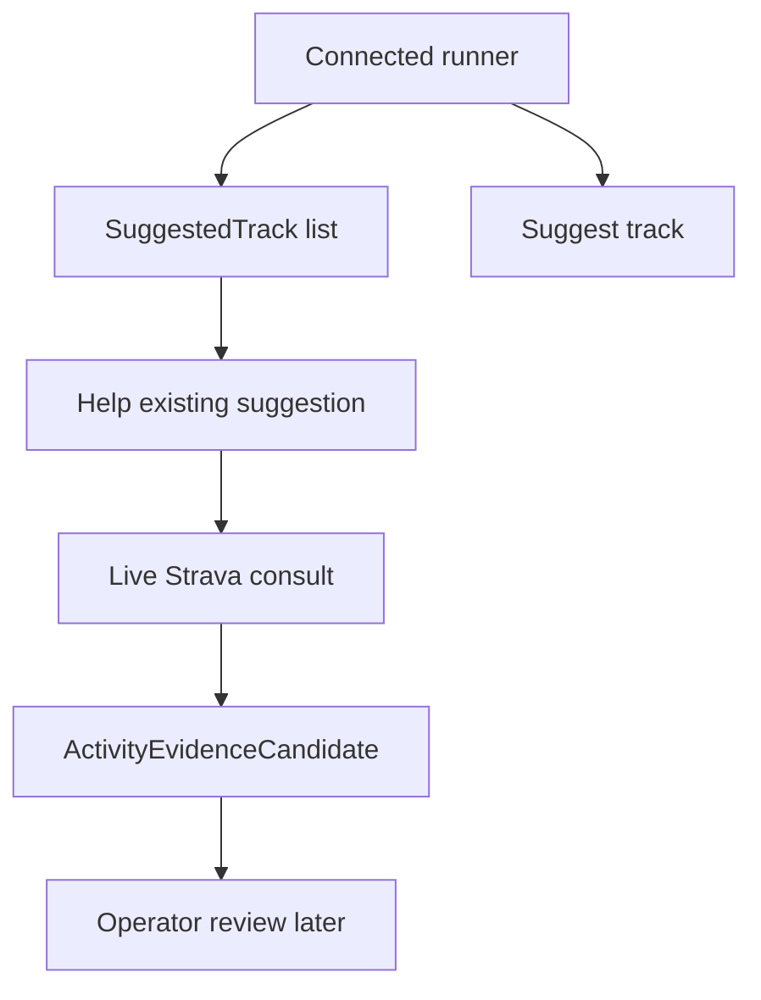

# SuggestedTrack Route Expansion

## What This Module Owns

SuggestedTrack owns the connected-runner loop for proposing new runnable routes
and attaching consenting Strava activity summaries as candidate evidence. It
does not own source-backed geometry, scoring, or pilot-ready promotion.

## Module Map

## Capabilities

| Capability | What | Key Aspects | Detail |
| --- | --- | --- | --- |
| SuggestedTrack discovery | Show connected runners route suggestions that need evidence. | `ListSuggestedTracks`, `GET /api/suggested-tracks`, `SuggestedTrackStatus` | Connected-runner only in L0. |
| SuggestedTrack creation | Let a connected runner propose a new route candidate. | `CreateSuggestedTrack`, `POST /api/suggested-tracks` | Login required; starts as `needs_evidence`. |
| Evidence candidate attach | Attach one redacted Strava activity summary with explicit consent. | `AttachActivityEvidenceCandidate`, `POST /api/suggested-tracks/{id}/evidence-candidates` | Stores redacted summary and consent metadata only. |

## Domain Concepts

| Concept | Type | Key Constraints |
| --- | --- | --- |
| [SuggestedTrack](domain.md#suggestedtrack) | Entity | Unique slug; starts `needs_evidence`; no geometry claim by default. |
| [ActivityEvidenceCandidate](domain.md#activityevidencecandidate) | Entity | Redacted summary plus consent; no raw provider payload. |
| [SuggestedTrackStatus](domain.md#suggestedtrackstatus) | Enum | `source_backed` is operator-only and out of this build. |

## Concept Registry

| Concept | ID | Type |
| --- | --- | --- |
| [SuggestedTrack](domain.md#suggestedtrack) | parque-taquaral-online-mvp.SuggestedTrack | Entity |
| [ActivityEvidenceCandidate](domain.md#activityevidencecandidate) | parque-taquaral-online-mvp.ActivityEvidenceCandidate | Entity |
| [CreateSuggestedTrack](operations.md#createsuggestedtrack) | parque-taquaral-online-mvp.CreateSuggestedTrack | Operation |
| [AttachActivityEvidenceCandidate](operations.md#attachactivityevidencecandidate) | parque-taquaral-online-mvp.AttachActivityEvidenceCandidate | Operation |
| [ListSuggestedTracks](queries.md#listsuggestedtracks) | parque-taquaral-online-mvp.ListSuggestedTracks | Query |
| [SuggestedTrackApi](interfaces.md#suggestedtrack-api-http) | parque-taquaral-online-mvp.SuggestedTrackApi | Interface |

## Feature Concept Graph

| From | Edge | To | Evidence | Notes |
| --- | --- | --- | --- | --- |
| SuggestedTrackApi | exposes | CreateSuggestedTrack | interfaces.md#post-apisuggested-tracks | Login required. |
| CreateSuggestedTrack | produces | SuggestedTrack | operations.md#createsuggestedtrack | Starts `needs_evidence`. |
| AttachActivityEvidenceCandidate | produces | ActivityEvidenceCandidate | operations.md#attachactivityevidencecandidate | Consent and redaction required. |
| ListSuggestedTracks | queries | SuggestedTrack | queries.md#listsuggestedtracks | Connected-runner visibility. |

## Aspect Docs

| Aspect | Contains | Key Concepts |
| --- | --- | --- |
| [Domain](domain.md) | Entities, statuses, invariants | SuggestedTrack, ActivityEvidenceCandidate |
| [Operations](operations.md) | Mutations and validation rules | Create, attach evidence |
| [Interfaces](interfaces.md) | HTTP contracts | SuggestedTrack API |
| [Queries](queries.md) | Read models | list/detail |
| [States](states.md) | Lifecycle states | needs evidence to review |
| [UI Spec](ui-spec.md) | Connected-runner UI | suggestion and help flow |
| [Test Spec](TEST-SPEC.md) | Required verification | API, UI, privacy, authority |

## Cross-Feature Dependencies

| Capability | Depends On | Via | Why |
| --- | --- | --- | --- |
| Evidence candidate attach | Strava-linked pilot | Existing activity consult | Uses live activity summaries without persisting raw provider payloads. |
| SuggestedTrack persistence | Body War auth store | Drizzle/Postgres | Uses the existing Body War persistence path. |

## Non-Goals

- Source-backed Parque Taquaral geometry.
- Verified scoring or ranked control.
- Pilot-ready route promotion.
- Reusing legacy JSON-file `/api/submissions` as the evidence store.

## References

- Refine handoff: `projects/body-war/development/refinement-runs/20260629T050046Z-suggested-track-decision-build-route/RUNTIME-HANDOFF.md`
- Test specification: `TEST-SPEC.md`
