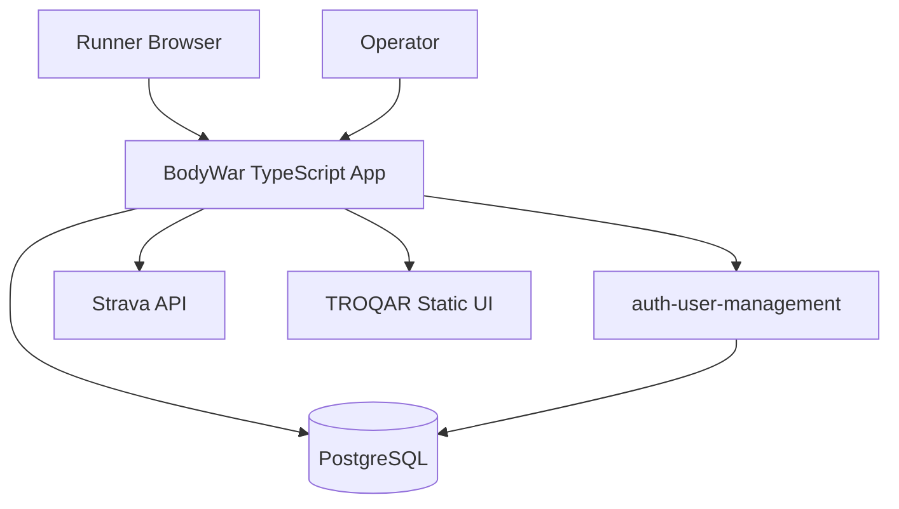
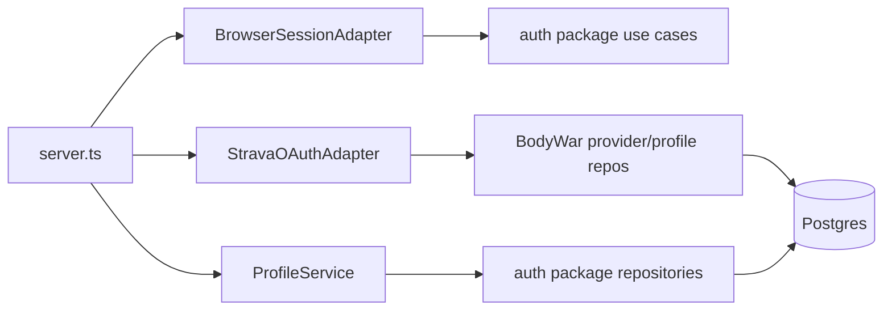

# BodyWar Auth Integration Design

Status: `invoke-design-pass`
Architecture profile: DomainSpec six-view Functional TypeScript

## 1. Context View



BodyWar is the product/runtime owner. The shared auth package is a reusable
domain/application/infrastructure dependency for core auth records and
permission checks.

## 2. High-Level Structure View

```text
projects/body-war/app/
  server.ts                       HTTP composition root
  src/auth/
    auth-adapter.ts               BodyWar auth facade around package use cases
    browser-session.ts            cookie, CSRF, origin, route guard
    strava-oauth.ts               OAuth start/callback and Strava gateway
    auth-errors.ts                package error to HTTP mapping
  src/profile/
    profile-service.ts            runner profile projection
  src/infrastructure/postgres/
    schema.ts                     BodyWar-owned Drizzle tables
    migrations.ts                 apply auth package and BodyWar migrations
    database.ts                   postgres/drizzle connection factory
  drizzle.config.ts
  drizzle/
```

Low-complexity follow-up may keep modules near `server.ts`, but the first
implementation should split `src/auth` and `src/infrastructure/postgres` because
the current single-file server is already hiding contract drift.

## 3. Low-Level Component View

| Component | Layer | Responsibility |
| --- | --- | --- |
| `createTrustedSessionUseCase` | auth package application | Create auth session/token for an existing active principal after external identity proof. |
| `createBodyWarAuthAdapter` | BodyWar application | Compose repositories, token codec, profile repository, provider repository, session creation, and route guards. |
| `BrowserSessionAdapter` | BodyWar interface/application | Convert cookies and CSRF headers into package bearer-auth calls. |
| `StravaOAuthAdapter` | BodyWar infrastructure | OAuth state, token exchange, provider account/token persistence, redacted activity summaries. |
| `BodyWarAuthSchema` | BodyWar infrastructure | Provider accounts, OAuth state, encrypted token metadata, runner profile. |
| `MigrationRunner` | BodyWar infrastructure | Apply auth package generated migrations then BodyWar generated migrations. |
| `ProfileService` | BodyWar application | Merge auth principal, provider account, and runner profile into safe response. |
| `server.ts` | BodyWar interface | Route parsing, adapter calls, static file fallback. |

## 4. Workflow Process View

### Connect And Create Session

```text
GET /api/auth/strava/start
  -> create oauth state
  -> set short-lived bw_state cookie
  -> redirect to Strava

GET /api/auth/strava/callback
  -> validate state cookie and row
  -> exchange code with Strava
  -> upsert auth principal as strava:<athlete-id>
  -> upsert BodyWar provider account and encrypted token
  -> create trusted auth session through auth package
  -> set bw_session and bw_csrf cookies
  -> redirect to profile/home
```

### Authenticate Protected Route

```text
request cookies
  -> parse bw_session
  -> call authenticateRequestUseCase with Bearer token
  -> check CSRF for unsafe methods
  -> optional authorizeRequestUseCase for required permission
  -> return AuthContext to route handler
```

### Activity Import

```text
session auth
  -> load provider account/token
  -> refresh token if needed
  -> call Strava activities API
  -> redact activity summary fields
  -> return receipt with route_geometry=not_claimed
```

## 5. Decision Flow View

| Decision | Rule | Result |
| --- | --- | --- |
| Where do browser cookies live? | BodyWar owns cookie and CSRF policy because the package boundary excludes HTTP/browser transport. | BodyWar adapter. |
| Where does Strava OAuth live? | BodyWar owns provider-specific OAuth and profile semantics. | BodyWar adapter and tables. |
| How does OAuth create an auth session? | Add package use case for trusted session after external identity proof. | Package extension, no Strava logic. |
| Where are auth tables migrated? | Auth package migrations are applied before BodyWar migrations. | Migration runner and compose/E2E receipts. |
| Can deployment proceed? | Requires public origin, VPS access, Strava credentials, and consent decisions. | Block real deploy, proceed local integration. |

## 6. Dependency Interface View



## Interface Contracts

| Route | Auth | Uses |
| --- | --- | --- |
| `GET /api/status` | optional | browser session adapter, provider status. |
| `GET /api/auth/strava/start` | optional | Strava OAuth adapter. |
| `GET /api/auth/strava/callback` | state cookie | Strava OAuth adapter, trusted session use case. |
| `POST /api/auth/logout` | session plus CSRF where possible | package logout use case, cookie clear. |
| `GET /api/profile` | session | profile service. |
| `GET /api/activities` | session plus `body-war.activity.read` | Strava gateway and redaction receipt. |
| `POST /api/submissions` | session plus CSRF plus `body-war.submission.create` | existing evidence submission path. |

## Design Risks

| Risk | Mitigation |
| --- | --- |
| Shared auth package grows product-specific Strava/browser code. | Only add generic trusted-session use case; BodyWar owns adapters. |
| BodyWar duplicates auth package session logic. | Use package session/token repositories and use cases; keep cookie wrapper thin. |
| Drizzle migration ownership drifts. | Apply generated auth package migrations and generated BodyWar migrations in E2E/deploy. |
| OAuth tokens leak into tests/docs/logs. | Redaction tests, secret scans, and no raw private provider payloads in tracked receipts. |
| Existing docs remain stale. | Include doc patch SWU after executable integration passes. |

## Glossary Consistency

| Term | Status | Note |
| --- | --- | --- |
| Runner principal | pass | Auth package principal id used as BodyWar runner identity root. |
| Provider account | pass with correction | BodyWar-owned table links principal to Strava athlete; auth package does not own Strava adapter. |
| Browser session | pass with correction | BodyWar-owned cookie binding wraps auth package access token/session record. |
| Trusted session | new local term | Generic package use case for externally proven identity. |
| Strava profile link | pass | Derived from provider user id only, not a credential. |

## Recomposition Path

The L0 local integration proves BodyWar can compile, create sessions, guard
routes, render profile state, and apply generated migrations. It recomposes into
the online preview only after VPS/domain/Strava/consent decisions are resolved.
