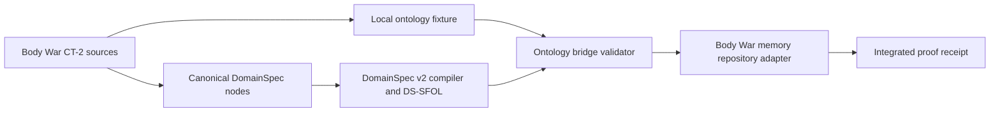
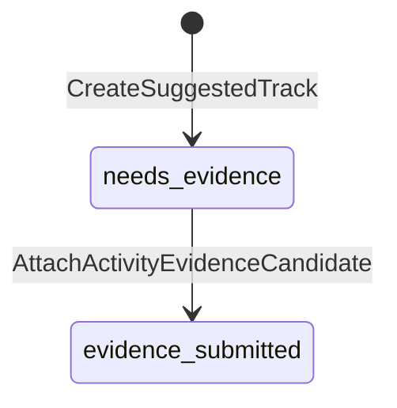
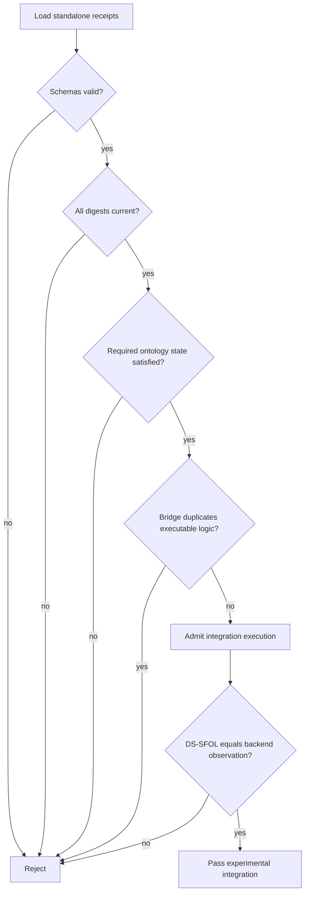

# Architecture: SuggestedTrack Ontology and DomainSpec Proof Track

## Design Intent

Prove one existing rule without creating two executable authorities. Body War
owns local ontology meaning and its canonical DomainSpec nodes; the bridge
admits their composition only when exact digests and declared ontology state
match.

## 1. Context View



The CyberAlchemy ontology pack is precedent for entry shape and authority
ceilings. It is not mutated or treated as the owner of Body War concepts.

## 2. High-Level Structure View

| Component | Input | Output | Independent verdict |
| --- | --- | --- | --- |
| Ontology validator | local entry set and transition fixture | ontology validation receipt | T-ONTOLOGY-001 |
| DomainSpec builder/prover | minted project and canonical `body.logic` | graph, manifest, build, projection and proof receipts | T-DOMAINSPEC-001 |
| Bridge validator | both receipts plus bridge manifest | bridge admission receipt | part of T-INTEGRATION-001 |
| Backend adapter | generated input case | observed `SuggestedTrack` result | part of T-DOMAINSPEC-001 and integration |
| Integration runner | admitted bridge plus existing DS case | integrated proof receipt | T-INTEGRATION-001 |

Standalone receipts remain valid evidence within their own boundaries when
integration fails.

## 3. Low-Level Component View

### Ontology entry set

Minimum entries:

- `body-war.ontology.SuggestedTrack`;
- `body-war.ontology.CreateSuggestedTrack`;
- `body-war.ontology.SuggestedTrackStatus.needs_evidence`.

Every entry carries type, branch, status, owner, evidence confidence,
commitment confidence, source references, next gate, contradiction path, and
edges. The ontology test also carries an allowed-transition set.

### Canonical DomainSpec project

Minimum minted nodes:

- `body-war.NewSuggestionNeedsEvidence`, kind `Rule`;
- `body-war.CreateSuggestedTrack`, kind `Operation`, with canonical
  `body.logic`;
- `body-war.SuggestedTrackCreated`, kind `Event`.

Admitted graph edges:

- Rule `enforces` Operation;
- Operation `produces` Event.

The CT-2 clause returns the creation result needed by the backend comparison:

```text
status = needs_evidence
geometryAuthority = needs_evidence
sourceBacked = false
pilotReady = false
```

### Bridge manifest

```json
{
  "schema_version": "body-war-ontology-bridge/v1",
  "feature_id": "body-war-suggested-track",
  "ontology_context": {
    "validation_receipt_digest": "<sha256>",
    "entries": [
      {
        "entry_id": "body-war.ontology.SuggestedTrackStatus.needs_evidence",
        "entry_digest": "<sha256>",
        "observed_state": "candidate"
      }
    ]
  },
  "domainspec_context": {
    "profile_digest": "<sha256>",
    "graph_digest": "<sha256>",
    "source_manifest_digest": "<sha256>",
    "build_receipt_digest": "<sha256>"
  },
  "bindings": [
    {
      "node_id": "body-war.CreateSuggestedTrack",
      "node_digest": "<sha256>",
      "module_id": "body-war.create-suggested-track",
      "module_digest": "<sha256>",
      "clause_id": "body-war.CT-2",
      "clause_digest": "<sha256>",
      "interprets": [
        "body-war.ontology.SuggestedTrackStatus.needs_evidence"
      ],
      "required_ontology_state": "candidate"
    }
  ],
  "authority_effect": "none",
  "release_admission": "not-granted",
  "bridge_digest": "<sha256>"
}
```

Executable logic fields are forbidden in the bridge.

## 4. Workflow Process View

```text
1. Validate local ontology entry schema and semantic links.
2. Emit ontology receipt with exact entry digests and observed promotion state.
3. Compile the canonical Body War minted project twice.
4. Verify byte-identical graph, manifest, build, and projected logic.
5. Derive the CT-2 input case from the canonical clause.
6. Evaluate the DS-SFOL expected observation.
7. Execute createMemoryBodyWarAuthRepository().createSuggestedTrack(input).
8. Compare the backend observation with the DS-SFOL observation.
9. Validate bridge schema and recompute every declared digest.
10. Enforce required ontology state without changing it.
11. Reuse the accepted DomainSpec case and backend adapter.
12. Emit an integration receipt that links, rather than copies, standalone receipts.
```

Failure order is deterministic: malformed contract, missing handle, stale
digest, insufficient ontology state, forbidden executable duplication,
DomainSpec proof failure, then backend observation mismatch.

## 5. Decision and State View

### SuggestedTrack transition



Only the first transition is in this proof track.

### Bridge decision flow



Candidate-state admission is legal only for this experimental profile. A
future formal profile may require `promoted`; the same candidate fixture must
then reject.

## 6. Dependency and Interface View

| Boundary | Contract | Direction | Version rule | Failure rule |
| --- | --- | --- | --- | --- |
| Body War -> DomainSpec compiler | current minted project profile and node logic v1 | outbound local | exact profile/schema digest | reject unsupported or stale profile |
| DomainSpec proof -> Body War adapter | CT-2 generated input and normalized observation | outbound local | adapter contract version in receipt | reject missing or extra observation fields |
| Ontology receipt -> bridge | entry IDs, digests, status and validation verdict | inbound local | exact receipt and entry digests | reject missing/stale entry |
| Bridge -> integration runner | admission receipt | inbound local | exact bridge digest | no execution without pass |

No network, production database, Strava, deployment, or UI boundary is needed.

## Significant Behavior Scenario

Stimulus: a generated case requests creation of a SuggestedTrack named
`Lago Norte`, at `Taquaral`, `Campinas`.

Preconditions:

- ontology fixture passes at candidate state;
- canonical DomainSpec build passes;
- bridge requires candidate-or-higher for this experimental lane.

Ordered response:

1. bridge verifies exact inputs;
2. DS-SFOL evaluates CT-2;
3. memory repository creates the track;
4. normalized observation contains `needs_evidence` for status and geometry
   authority, with no stronger claim;
5. integrated receipt records all source and result digests.

Recovery: any mismatch returns a typed rejection and emits no passing
integration receipt.

Acceptance owner: Body War SuggestedTrack lifecycle owner.

## Selected Architecture Extensions

### Authority and Trust

- Body War owns local domain meaning and nodes.
- DomainSpec v2 owns compiler/profile semantics.
- Ontology state is read, never written, by validation.
- The bridge owns only composition admission.
- Test execution cannot promote ontology, release DomainSpec, or close Craft
  product blockers.

### State and Event

The proof covers only `none -> needs_evidence`. Later transitions remain
outside the test denominator.

### Integration and Versioning

The bridge is a sidecar so node-logic v1 remains unchanged. Any future native
ontology field requires a new profile/schema decision; it cannot be inferred
from this experiment.

### Quality

Two unchanged runs must produce byte-identical canonical receipts. Time,
temporary paths, and random IDs are excluded or normalized from proof
digests.

### Validation Contracts

| Witness | Positive | Required negative control |
| --- | --- | --- |
| T-ONTOLOGY-001 | coherent entry set and legal creation transition | illegal direct promotion transition |
| T-DOMAINSPEC-001 | DS-SFOL and backend observation agree | mutated backend observation |
| T-INTEGRATION-001 | exact candidate-lane binding passes | stale digest and promoted-required/candidate-observed |

These are planned Design witnesses, not executed Plan evidence.

## Concern-to-View Trace

| Concern | Signals | Disposition | Output |
| --- | --- | --- | --- |
| `concern:authority` | bridge admission rule | required | Authority and Trust |
| `concern:state-event` | CT-2 state-transition rule | required | Decision and State |
| `concern:integration` | compiler, adapter, bridge compatibility | required | Dependency and Interface |
| `concern:performance` | deterministic rebuild claim | required | Quality |
| `concern:validation` | three acceptance claims and canonical-source rule | required | Validation Contracts |

## Risks and Residue

| ID | Risk or gap | Effect | Owner route |
| --- | --- | --- | --- |
| GAP-BWOI-001 | Current end-to-end SFOL adoption scripts are Financial Settlement-specific. | Body War must use generic library APIs or a consumer-local runner; no copy of the FS business runner. | DomainSpec engine owner during SWU-BWOI-002 |
| GAP-BWOI-002 | No promoted Body War ontology package exists. | Formal promoted-state integration must reject; experimental candidate lane may proceed with `authority_effect: none`. | Body War ontology owner |
| GAP-BWOI-003 | Current minted profile admits only a bounded kind/edge set. | The first proof stays with Rule, Operation, and Event. | DomainSpec profile owner |

