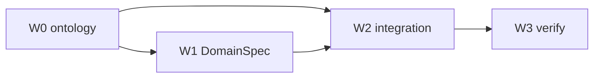

# Execution Pack

## Control

| Field | Value |
| --- | --- |
| planningGateStatus | pass |
| complexity | medium |
| baselineWave | W0 |
| activePlanRef | `WORK-PACK.md` |
| workPackManifest | `WORK-PACK.md` |
| layeringArtifact | `IMPLEMENTATION-LAYERING.md` |
| specRef | `SPEC.md` |
| activeLayerWindow | L0 |
| readinessProfile | experimental |

## Wave Order

W0 and W1 are semantically independent, but execution is serial so the work
pack retains one selected SWU and one closeout at a time.

| Wave | Layer question | Task | Entry gate | Exit evidence |
| --- | --- | --- | --- | --- |
| W0 | Can local ontology express CT-2 coherently? | TASK-BWOI-ONTOLOGY | selected SWU-BWOI-001 | ontology receipt |
| W1 | Can canonical DS logic prove backend CT-2? | TASK-BWOI-DOMAINSPEC | W0 closeout synchronized | DomainSpec receipt |
| W2 | Can exact outputs compose without duplicate authority? | TASK-BWOI-INTEGRATION | W0 and W1 receipts pass and are current | integration receipt |
| W3 | Are receipts reproducible and claims bounded? | TASK-BWOI-VERIFY | W2 pass | verification report |

## Execution Rules

- Execute one SWU per Task Session.
- Rebuild execution-time Context Builder packs; do not reuse this authoring
  context as runtime evidence.
- Stop on stale source or receipt digest.
- Do not advance successors until Refresh synchronizes the completed SWU.
- Preserve failed receipts and negative controls as residue.
- Never mutate CyberAlchemy ontology or DomainSpec v2 canonical sources in this
  Body War package.

