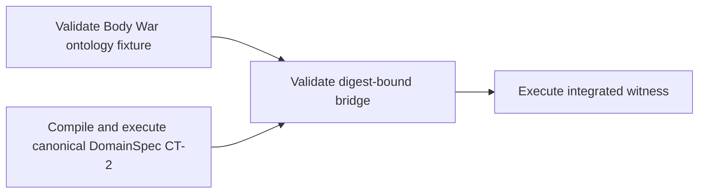

# SuggestedTrack Ontology and DomainSpec Proof Track

## What This Module Owns

This track proves one existing Body War rule through three separable evidence
lanes. It owns local experimental ontology fixtures, a Body War canonical
DomainSpec node set, and a digest-bound bridge between them.

It does not promote CyberAlchemy ontology, alter DomainSpec v2 release
admission, or claim complete SuggestedTrack behavior.

## Rule Under Test

`CT-2`: a newly created `SuggestedTrack` starts with status
`needs_evidence`.

The same creation result must also preserve CT-3 and CT-4:

- `geometryAuthority = needs_evidence`;
- no `source_backed` or `pilot_ready` claim is produced.

## Capability Map

## Witness Capabilities

| Capability | Independent question | Required evidence |
| --- | --- | --- |
| Ontology witness | Is the meaning and transition of `needs_evidence` internally coherent? | positive ontology validation plus one invalid-transition rejection |
| DomainSpec witness | Does canonical `body.logic` derive and check CT-2 without ontology input? | deterministic graph/manifest/build, derived case, backend observation |
| Integration witness | Does the bridge bind exact ontology and clause bytes before execution? | positive composition plus stale-digest and insufficient-state rejections |

## Canonical Source Boundary

| Artifact | Owns | Must not own |
| --- | --- | --- |
| Body War ontology fixture | concept meaning, relationship, evidence and promotion state | executable DS-SFOL AST |
| DomainSpec node `body.logic` | executable CT-2 rule | ontology promotion |
| Ontology bridge | exact IDs, digests, required state, clause bindings | duplicated rule body |
| Test fixture | input only | expected-value oracle |
| Proof receipt | observed result and exact source bindings | promotion or release |

`body.logic` is the sole executable rule source. The integration bridge may
reject a rule, but it cannot rewrite or reinterpret it.

## Concept Registry

| Concept | ID | Type | Admission |
| --- | --- | --- | --- |
| Create Suggested Track | `body-war.CreateSuggestedTrack` | Operation | current development profile |
| Suggested Track Created | `body-war.SuggestedTrackCreated` | Event | current development profile |
| New Suggestion Needs Evidence | `body-war.NewSuggestionNeedsEvidence` | Rule | current development profile |
| Suggested Track | `body-war.ontology.SuggestedTrack` | Ontology entity | candidate-local sidecar |
| Needs Evidence | `body-war.ontology.SuggestedTrackStatus.needs_evidence` | Ontology state | candidate-local sidecar |
| Ontology Bridge | `body-war.ontology-bridge.suggested-track-ct2` | Binding artifact | planned local contract |

## Feature Concept Graph

| From | Edge | To | Evidence | Notes |
| --- | --- | --- | --- | --- |
| `body-war.NewSuggestionNeedsEvidence` | enforces | `body-war.CreateSuggestedTrack` | CT-2 | semantic rule ownership |
| `body-war.CreateSuggestedTrack` | produces | `body-war.SuggestedTrackCreated` | CT-2 through CT-4 | admitted profile edge |
| `body-war.ontology-bridge.suggested-track-ct2` | binds | `body-war.CreateSuggestedTrack` | planned bridge contract | sidecar, not a minted graph edge |

## Test Contracts

### T-ONTOLOGY-001

Validate the local ontology entry set without loading DomainSpec. Pass only
when:

- `SuggestedTrack`, `CreateSuggestedTrack`, and `needs_evidence` resolve;
- the creation relation and `none -> needs_evidence` transition are legal;
- evidence, confidence, promotion state, next gate, and contradiction path are
  present;
- an invalid `needs_evidence -> source_backed` direct transition is rejected.

### T-DOMAINSPEC-001

Compile the Body War minted project without loading ontology. Project
`body.logic`, derive a CT-2 case from the clause, invoke the Body War backend
adapter, and compare the observation to the DS-SFOL evaluation. Fixtures
provide inputs only.

### T-INTEGRATION-001

Load both accepted standalone outputs and validate the ontology bridge. Pass
only when exact ontology-entry, node, module, clause, and bridge digests match.
Then execute the DomainSpec case. A stale ontology digest and a bridge that
requires `promoted` while receiving `candidate` must fail closed.

## Acceptance Boundary

All three test contracts must be runnable separately. Integration failure must
not erase a passing standalone ontology or DomainSpec result.

The strongest allowed completion claim is:

> Body War has an experimental, digest-bound proof for SuggestedTrack CT-2
> across local ontology meaning, canonical DomainSpec logic, and the current
> backend adapter.

## Non-Goals

- Complete SuggestedTrack lifecycle coverage.
- Source-backed geometry or pilot-ready promotion.
- CyberAlchemy ontology-pack promotion.
- DomainSpec v2 registry release or production admission.
- Automatic mutation of ontology entries from runtime evidence.
- Replacing the current Body War application tests.

## Source Contracts

- `projects/body-war/docs/features/parque-taquaral-online-mvp/operations.md`
- `projects/body-war/docs/features/parque-taquaral-online-mvp/states.md`
- `projects/body-war/app/src/auth/memory-repository.ts`
- `projects/body-war/app/src/auth/drizzle-repository.ts`
- `cyberAlchemy/ontology/README.md`
- `projects/domainspec-v2/impl/spec/sfol-profile/node-logic-envelope.schema.json`
- `projects/domainspec-v2/impl/spec/sfol-profile/minted-project-profile.json`

