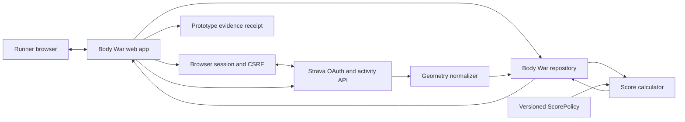
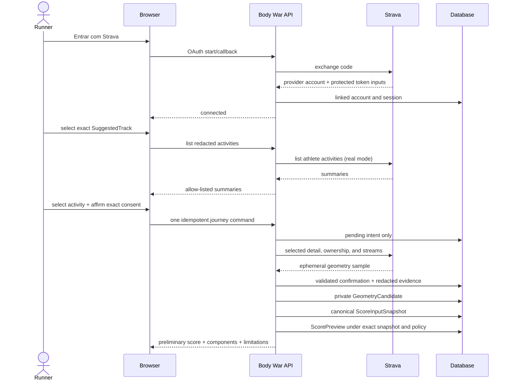
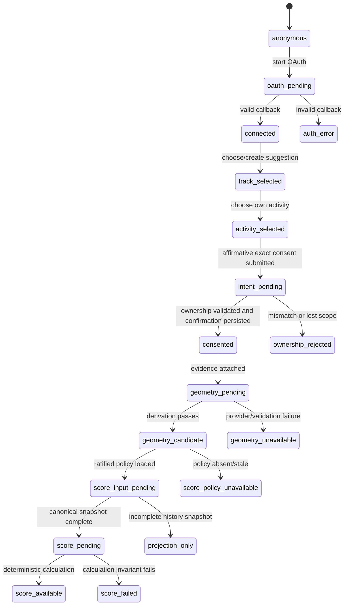

# Architecture: Login to Score Preview

## Design Intent

Extend the current Body War app along one honest end-to-end path while keeping
four authorities separate:

1. the runner authorizes use of their selected provider activity;
2. the application derives private candidate geometry;
3. the product owner supplies the versioned score policy;
4. the existing track lifecycle owner alone can later promote source backing.

The new orchestration may calculate and display a preview. It may not turn
candidate data into official geometry or territory control.

## 1. Context View



Trust boundaries:

- the browser never receives provider tokens or raw geometry streams;
- Strava supplies provider facts, not Body War track or score authority;
- candidate geometry is principal-private;
- ScorePolicy bytes are source-owned and digest-bound;
- the public app projection carries an explicit preview ceiling.

## 2. High-Level Structure View

| Component | Responsibility | Input | Output |
| --- | --- | --- | --- |
| Session boundary | OAuth state, linked principal, session, CSRF, permission checks. | callback/browser request | authenticated principal |
| Activity summary gateway | List redacted activities. | principal, pagination | `ActivitySummary[]` |
| Selected activity gateway | Read/decrypt/refresh token and fetch detail/streams for one owned activity. | principal, activity ID | ephemeral `ActivityGeometrySample` |
| Confirmation service | Hold the submitted intent, validate exact track/activity/consent identity and gateway ownership, then attach evidence idempotently. | pending `RunnerConfirmation` command | evidence candidate + confirmation receipt |
| Geometry normalizer | Validate, normalize, privacy-filter, simplify, and digest selected streams. | ephemeral sample | private `GeometryCandidate` |
| Score policy registry | Load one ratified immutable policy and expose ID/digest. | policy selector | `ScorePolicy` |
| Score-input assembler | Build a canonical policy-window snapshot from privacy-safe derived fixture or provider metrics. | candidate, qualifying evidence/history, policy | `ScoreInputSnapshot` |
| Score calculator | Calculate explained components deterministically without acquiring implicit inputs. | `ScoreInputSnapshot` | `ScorePreview` |
| Journey orchestrator | Coordinate durable effects and resumable partial-success semantics. | confirmation request | stable journey result |
| Score projection | Return the current runner's preview and limitations. | authenticated query | UI read model |
| Evidence emitter | Emit redacted execution identity and validation results. | normalized selectors/digests | receipt |

## 3. Low-Level Component View

### Provider token access

Extend `BodyWarAuthRepository` with server-only operations:

```ts
findProviderTokenByAccountId(accountId): ProviderTokenRecord | null
replaceProviderTokenIfVersion(input, expectedVersion): ProviderTokenRecord | conflict
```

Add an unprotect operation paired with the current AES-256-GCM protect
operation. The OAuth callback validates that returned accepted scopes satisfy
the selected prototype contract before linking the account. Refresh is
singleflight per account or uses row-versioned compare-and-swap; on conflict it
rereads the newest record and performs at most one bounded retry. Refresh
updates both ciphertexts, expiry, and row version atomically. Token values must
never appear in returned errors, structured logs, test snapshots, or receipts.

### Strava gateway split

```ts
interface StravaActivityGateway {
  listActivitySummaries(principalId, page, perPage): Promise<ActivitySummary[]>
  getActivityGeometrySample(
    principalId,
    providerActivityId,
  ): Promise<ActivityGeometrySample>
}
```

Real mode:

1. resolve the linked account and protected token record;
2. refresh when expired;
3. call `GET /athlete/activities` for summaries;
4. revalidate selected activity ownership with `GET /activities/{id}`;
5. call `GET /activities/{id}/streams` for `latlng,distance,time`;
6. normalize provider faults into typed Body War errors.

Fake mode implements the same interface with deterministic fixtures that
include valid owned/unowned, complete-window history, missing-geometry,
misaligned-stream, and provider-failure cases.

### Confirmation and orchestration

The browser submits one command and reads one journey selector. Internal stage
identities are independent:

```text
confirmation_key = sha256(
  principalId + suggestedTrackId + providerActivityId + consentDigest
)
geometry_key = sha256(
  confirmation_key + derivationVersion + geometryPolicyDigest
)
score_key = sha256(
  geometryDigest + scorePolicyDigest + scoreInputSnapshotDigest
)
```

The orchestrator records stage outcomes:

```text
intent_accepted
ownership_validated
confirmation_recorded
evidence_attached
geometry_derived
score_input_snapshotted
score_calculated
projection_ready
```

Retry resumes from the first incomplete stage. A completed key returns the
existing result. A key collision with different canonical bytes rejects. The
public path is one resumable POST command, not three independently mutable
browser operations.

### Persistence model

| Table or artifact | Key | Data | Authority |
| --- | --- | --- | --- |
| `body_war_journey_intents` | UUID; unique confirmation key | exact submitted selectors and consent digest; no evidence authority | pending command only |
| `body_war_runner_confirmations` | UUID; unique validated confirmation key | exact selectors, consent version/text/digest, ownership receipt, timestamps, stage | runner authorization evidence |
| existing activity evidence table | existing key plus uniqueness | redacted summary only | candidate evidence |
| `body_war_geometry_candidates` | UUID; unique geometry key | private normalized polyline, derived metrics, source digest | candidate only |
| `body_war_score_input_snapshots` | UUID; unique geometry + policy + canonical evidence-set digest | window/timezone, derived activity metrics, aggregation and provenance | calculation input only |
| `body_war_score_previews` | UUID; unique score key | components, nullable total, comparison class, limitations, mode | preview only |
| `score-policy-v0.json` | source-controlled version | complete formula and parameters | product policy after ratification |

Raw activity streams have no table, file, cache, application/error/access log,
trace, test snapshot, or receipt sink. The sink allow-list names every active
sink and sentinel tests scan them independently.

### Geometry normalizer

Algorithm contract:

1. require aligned `latlng`, `distance`, and `time` arrays;
2. reject non-finite/out-of-range coordinates and non-monotonic time/distance;
3. remove consecutive coordinate duplicates;
4. enforce a minimum sample count and plausible distance/time bounds;
5. apply the ratified private-geometry filter and simplification tolerance;
6. encode a normalized line, not a polygon or official boundary;
7. calculate normalized distance, closure distance, bounding metadata, and
   sample count;
8. compute a digest over canonical normalized inputs and derivation version;
9. discard raw arrays before persistence/logging.

For the first prototype, the activity must be explicitly presented as the
track traversal the runner wants to suggest. Warm-up, commute, or unrelated
segments are not inferred away.

### Score calculator

The calculator accepts no implicit defaults. A complete ScorePolicy includes:

```text
window:
  duration_days = 14
  anchor_rule
  timezone
eligibility:
  activity_types
  visibility
  geometry_membership_rule
  geometry_seed_activity_rule
pace:
  max_points = 220
  target_pace_seconds_per_km
  floor_pace_seconds_per_km
  aggregation_rule
distance:
  max_points = 192.5
  cap_meters
  geometry_membership_tolerance_meters
  aggregation_rule
frequency:
  max_points = 137.5
  window_days = 14
  unique_day_cap = 14
rounding:
  component_decimals
  total_decimals
```

Recommended candidate functions for the decision gate:

```text
pace_ratio =
  clamp((floor_pace - observed_pace) / (floor_pace - target_pace), 0, 1)
pace_points = 220 * pace_ratio

distance_points = 192.5 * clamp(distance_inside / cap_meters, 0, 1)

frequency_points = 137.5 * clamp(unique_qualifying_days / 14, 0, 1)

total = clamp(round(pace_points + distance_points + frequency_points), 0, 550)
```

The calculator consumes a `ScoreInputSnapshot` and never fetches history
itself. A complete L0 fixture window may produce all components and a total. A
single-activity snapshot produces only supported components, with null
frequency/total and `non_comparable_single_activity`. This design makes the
missing choices visible; it does not ratify parameter values or make this
formula authoritative.

## 4. Workflow Process View



Compensation:

- if ownership validation fails, retain at most the pending non-evidence intent
  and return a typed rejection;
- if ownership succeeds but geometry is unavailable, confirmation/evidence may
  be retained with `geometry_unavailable`;
- if geometry succeeds but policy is unavailable, retain the candidate and
  return `score_policy_unavailable`;
- if score persists but the browser refresh fails, replaying the idempotency
  key returns the existing preview;
- no failure path weakens authority or makes geometry public.

## 5. Decision and State View

### Journey state



### Independent authority states

| Aggregate | Allowed prototype terminal | Forbidden implicit transition |
| --- | --- | --- |
| SuggestedTrack | `evidence_submitted` | `source_backed` |
| Geometry | `candidate_from_activity` | `source_backed` or public |
| Score | `preview_only` | verified controller/conquest verdict |
| Deployment | supervised witness admitted | production or unmoderated |
| Ontology | candidate map | promoted |

### Blocking decisions

| ID | Decision | Owner | Blocks |
| --- | --- | --- | --- |
| `DEC-JSP-001` | Ratify or replace ScorePolicy V0 formula, numeric parameters, window anchor/timezone, eligibility/aggregation, bootstrap self-sample rule, and history/consent scope. | Body War score-policy owner | numeric score SWU |
| `DEC-JSP-002` | Ratify private geometry filter, precision, retention, and deletion behavior. | Body War data/privacy owner | participant and real-provider geometry |
| `DEC-JSP-003` | Decide whether the first real witness excludes Only Me activities (`activity:read`) or requests broader `activity:read_all`. | product/privacy owner | OAuth scope implementation |

Recommended defaults:

- DEC-JSP-001: use the candidate bounded-linear formula for prototype evidence
  only, with explicit target/floor pace, distance cap, São Paulo timezone,
  complete-window fixture, and null total for incomplete history;
- DEC-JSP-002: principal-private derived polyline, no raw streams, explicit
  consent, bounded prototype retention, and user-triggered deletion;
- DEC-JSP-003: retain `activity:read` and exclude Only Me activities.

## 6. Dependency and Interface View

| Boundary | Contract | Version rule | Failure rule |
| --- | --- | --- | --- |
| Browser -> API | one exact track/activity/consent command plus journey read selector | consent digest required | reject mismatched binding before evidence mutation |
| API -> Strava | OAuth, activities, selected detail, streams | official endpoint contract; explicit scope | typed retryable/non-retryable provider errors |
| API -> repository | pending intent, validated confirmation, candidate, snapshot, preview transactions | migration version | rollback current stage or resume from prior durable stage |
| Geometry/history -> snapshot | candidate plus canonical derived activity metrics | derivation/aggregation versions required | reject incomplete, stale, or tampered input |
| Snapshot -> score | exact snapshot bytes/digest | immutable version/digest | reject implicit input acquisition |
| Policy -> snapshot/score | full policy bytes and digest | exact version/digest | refuse implicit or partial policy |
| API -> UI | ScorePreview read model | response contract version | show preserved progress and honest error |
| Runtime -> receipt | redacted evidence envelope | schema version | no pass if provider mode or digests missing |

The official Strava reference confirms activity list, detailed activity, and
activity stream endpoints under activity read scopes. This is interface-shape
evidence only; it does not prove Body War credentials, live responses, rate
limits, or participant consent.

## Authority and Trust

- Body War owns its session, data model, geometry derivation contract, and
  preview projection.
- Strava owns provider data and scope enforcement.
- The runner owns the consent act over their data.
- Product owners ratify score and retention policies.
- Operators own hosted admission and supervised witness execution.
- Track lifecycle owners alone admit `source_backed`.
- Receipts report observed facts; they do not grant promotion.

## Security and Abuse

- OAuth state and CSRF remain mandatory.
- OAuth callback rejects accepted scopes that do not satisfy the selected
  least-privilege contract.
- Selected activity must belong to the authenticated provider account.
- SSRF is avoided by fixed official Strava origins and endpoint constructors.
- Tokens are decrypted only immediately before provider calls.
- Errors and logs use stable codes and never provider payload fragments.
- Geometry endpoints are authenticated and principal-scoped.
- Rate-limit responses are surfaced without uncontrolled retry.
- Idempotency prevents duplicate evidence/geometry/preview records.

## Persistence and Concurrency

- Pending intent, validated confirmation/evidence, geometry, score-input
  snapshot, and preview are separate durable stages.
- Unique constraints enforce the confirmation, geometry, and score keys plus
  each canonical input digest.
- Concurrent identical requests return the same stable result.
- Concurrent changed inputs for the same key reject as
  `idempotency_conflict`.
- Provider-token refresh is serialized per account or row-versioned with
  compare-and-swap, reread, and one bounded retry.
- A read-after-write failure never tells the browser the mutation failed; the
  response identifies accepted stage and recovery selector.

## Data Lifecycle

| Data | Collection | Retention | Visibility | Deletion |
| --- | --- | --- | --- | --- |
| OAuth tokens | callback | provider link lifetime, encrypted | server-only | disconnect/revoke |
| Activity summaries | list fetch | ephemeral; redacted candidate only after consent | runner/private operator | candidate deletion policy |
| Raw activity streams | selected fetch | operation memory only | server operation | discard before response |
| GeometryCandidate | after consent/derivation | bounded prototype policy | principal-private | user/operator deletion route |
| ScoreInputSnapshot | before calculation | tied to geometry/evidence retention | principal-private | cascade/supersede |
| ScorePreview | after calculation | tied to geometry/evidence retention | principal-private | cascade/supersede |
| Receipts | validation | redacted, bounded evidence retention | development/operator | evidence policy |

## Migration and Rollout

1. Add schema and repository contracts with no UI exposure.
2. Implement fixture gateway with a complete scoring window, geometry
   normalizer, snapshot assembler, and score calculator behind explicit fake
   mode.
3. Add confirmation orchestration and score UI; run local code/browser gates.
4. Admit three moderated fake-provider sessions only after consent/binding
   browser witnesses pass.
5. Implement accepted-scope validation, race-safe token refresh, real activity
   and qualifying-history gateway.
6. Complete HOST-01 admission and record an explicit parent admit/reject gate.
7. Separately authorize and run one supervised real-provider witness.
8. Do not enable public geometry, repeat/unmoderated testing, or promotion
   without later gates.

Rollback disables the new journey projection and leaves the existing
SuggestedTrack evidence records readable. Database migrations require an
explicit down/forward repair strategy before execution.

## Quality

- identical canonical ScoreInputSnapshot + policy digest produces identical
  score bytes;
- geometry normalization is deterministic for identical streams;
- browser critical path passes at 320px/390px plus declared height, 200% text,
  long-content, and orientation stressors;
- raw stream and token canaries are absent from every enumerated active sink;
- provider timeouts and rate limits do not duplicate writes;
- local fixture, moderated usability, and real-provider verdicts stay separate.

## Validation Contracts

| Witness | Positive | Required negative controls | Evidence ceiling |
| --- | --- | --- | --- |
| `T-JSP-LOCAL-001` | login-to-score complete-window fixture journey | unchecked consent, wrong/owned binding, missing geometry, incomplete snapshot, stale policy, sink canaries | local code path |
| `T-JSP-UX-002` | non-first track at 320/390 plus height/text/long-copy/orientation stress | hidden control, lost context, ambiguous copy | formative usability only |
| `T-JSP-STRAVA-003` | one real selected activity and geometry | expired token, insufficient scope, provider error, leakage | one supervised real-provider witness |
| `T-JSP-SCORE-004` | deterministic components and total | missing policy, tampered digest, cap/rounding edge | policy version only |
| `T-JSP-AUTHORITY-005` | candidate and preview states remain bounded | attempted source-backed/public/controller mutation | lifecycle non-inflation |

These witnesses are planned Design contracts, not execution evidence.

## Concern-to-Output Trace

| Selected output | Design section |
| --- | --- |
| `architecture` | six numbered views |
| `architecture:authority-trust` | Authority and Trust |
| `architecture:security-abuse` | Security and Abuse |
| `architecture:persistence-concurrency` | Persistence and Concurrency |
| `architecture:data-lifecycle` | Data Lifecycle |
| `architecture:integration-versioning` | Dependency and Interface View |
| `architecture:migration-rollout` | Migration and Rollout |
| `architecture:quality` | Quality |
| `ux-plan` | `UX-PLAN.md` |
| `validation-contracts` | Validation Contracts |

## Risks and Residue

| ID | Risk | Consequence | Owner route |
| --- | --- | --- | --- |
| `GAP-JSP-001` | Score normalizers are not ratified. | Numeric implementation must block. | `decision-gate` DEC-JSP-001 |
| `GAP-JSP-002` | Geometry privacy/retention policy is unratified. | No participant or real geometry persistence. | `decision-gate` DEC-JSP-002 |
| `GAP-JSP-003` | Current adapter never performs real activity calls or token refresh. | Fake path cannot prove Strava. | implementation SWU plus supervised witness |
| `GAP-JSP-004` | One activity may contain extra approach/exit segments. | Candidate geometry may be a poor track proposal. | UX instruction now; later cropping/review route |
| `GAP-JSP-005` | Existing geometry/source promotion remains operator-only and undefined. | Candidate cannot become source-backed in this plan. | later operator-policy route |
| `GAP-JSP-006` | Real history acquisition and its consent scope are unimplemented. | L0 may show a complete fixture score, but real-mode total remains unproven. | DEC-JSP-001 plus real-provider gateway |
