# Body War Login-to-Score-Preview Journey

## Outcome

A runner can enter through Strava, create or choose one SuggestedTrack, select
one of their activities, affirm exactly what route data Body War may use,
derive a private GeometryCandidate, and see an explained ScorePreview in the
web page.

The prototype must make its evidence lane visible:

- `fixture` for deterministic local/fake-provider execution;
- `real_strava` only when a non-fake gateway and supervised receipt prove it.

Neither lane promotes the SuggestedTrack to `source_backed`, grants territory
control, or establishes production readiness.

## Actors

| Actor | Goal | Authority |
| --- | --- | --- |
| Anonymous Visitor | Understand the entry point and connect Strava. | May start OAuth only. |
| Connected Runner | Suggest/select a track, choose an activity, consent, and see a preview. | Own session and own provider data only. |
| Prototype Operator | Configure policy and run supervised receipts. | Cannot silently promote geometry or game authority. |
| Track/Policy Owner | Ratify score normalization and later promotion rules. | Required for ScorePolicy V0 and source-backed promotion. |
| Strava | Provide identity, activity summaries, detailed activity, and selected streams under granted scope. | External data provider, not Body War lifecycle authority. |

## End-to-End Capability Map

```mermaid
flowchart LR
  A[Anonymous page] --> B[Strava OAuth]
  B --> C[Connected runner session]
  C --> D[Create or select SuggestedTrack]
  D --> E[Select activity]
  E --> F[Affirm exact evidence and geometry consent]
  F --> G[Attach ActivityEvidenceCandidate]
  G --> H[Fetch selected activity geometry]
  H --> I[Derive private GeometryCandidate]
  I --> J[Calculate versioned ScorePreview]
  J --> K[Project score and explanation in web page]
```

## Domain Objects

### RunnerConfirmation

| Field | Type | Rule |
| --- | --- | --- |
| `principalId` | uuid | Must equal the authenticated principal. |
| `suggestedTrackId` | uuid | Exact selected track; no implicit first-item default. |
| `providerActivityId` | string | Exact activity selected from the runner's current list. |
| `consentVersion` | string | Versioned contract. |
| `consentText` | string | Canonically equal across display, affirmation, request, and persistence. |
| `geometryUseAcknowledged` | boolean | Must be affirmatively true; unchecked by default. |
| `confirmedAt` | timestamp | Server recorded. |

### ActivityGeometrySample

Ephemeral provider data for one confirmed activity.

| Field | Type | Persistence |
| --- | --- | --- |
| `latlng[]` | pair[] | Never retain as raw provider payload. |
| `distance[]` | number[] | Never retain as raw provider payload. |
| `time[]` | number[] | Never retain as raw provider payload. |
| `sourceActivityId` | string | Retain in candidate binding. |
| `sourceVisibility` | enum | Retain only as coarse policy label. |
| `fetchedAt` | timestamp | Retain in derivation receipt. |

### GeometryCandidate

| Field | Type | Rule |
| --- | --- | --- |
| `id` | uuid | Stable local ID. |
| `suggestedTrackId` | uuid | Exact track binding. |
| `principalId` | uuid | Private owner in prototype. |
| `sourceActivityId` | string | Exact activity binding. |
| `normalizedPolyline` | encoded polyline | Privacy-filtered and simplified, never raw streams. |
| `distanceMeters` | integer | Derived from aligned stream or validated geometry. |
| `closedLoop` | boolean | Deterministic closure check. |
| `sampleCount` | integer | Post-filter sample count. |
| `sourceDigest` | sha256 | Digest of normalized derivation input, not a secret. |
| `derivationVersion` | string | Exact algorithm version. |
| `authority` | enum | `candidate_from_activity` only in this prototype. |
| `visibility` | enum | `principal_private` in this prototype. |
| `createdAt` | timestamp | Server recorded. |

### ScorePolicy

The policy must bind:

- maximum component points;
- input normalization functions and parameters;
- scoring-window duration, anchor, and timezone;
- eligible activity types and provider-data fields;
- distance-inside-geometry rule;
- unique-day collapse rule;
- pace and distance aggregation rules;
- whether the geometry-seeding activity is eligible for score input;
- rounding;
- missing-data behavior;
- policy version and digest.

The existing evidence only binds weights of pace 40%, distance 35%, frequency
25%, a 14-day window, and displayed cap 550. It does not bind the normalizers.

### ScoreInputSnapshot

A canonical, immutable calculation input assembled before any numeric output.

| Field | Type | Rule |
| --- | --- | --- |
| `id` | uuid | Stable local ID. |
| `principalId` | uuid | Authenticated runner only. |
| `suggestedTrackId` | uuid | Exact track binding. |
| `geometryCandidateId` / `geometryDigest` | uuid / sha256 | Exact candidate geometry and bytes. |
| `policyId` / `policyDigest` | string / sha256 | Exact ratified policy bytes. |
| `windowStart` / `windowEnd` / `timezone` | timestamp / timestamp / IANA zone | Canonical policy-window identity. |
| `eligibilityRulesDigest` | sha256 | Sport, visibility, geometry-membership, and self-sample rules. |
| `activityMetrics[]` | derived record[] | Activity ID, local day, qualifying distance, qualifying elapsed time, and source provenance; no raw streams. |
| `evidenceSetDigest` | sha256 | Digest over canonical ordered derived activity metrics. |
| `aggregationVersion` | string | Exact pace, distance, frequency, missing-data, and rounding implementation. |
| `historyState` | enum | `complete_window` or `single_activity_projection`. |
| `createdAt` | timestamp | Server recorded. |

### ScorePreview

| Field | Type | Rule |
| --- | --- | --- |
| `id` | uuid | Stable result ID. |
| `principalId` | uuid | Authenticated runner only. |
| `suggestedTrackId` | uuid | Exact track binding. |
| `geometryCandidateId` | uuid | Exact candidate geometry binding. |
| `policyId` / `policyDigest` | string / sha256 | Required and versioned. |
| `scoreInputSnapshotId` / `scoreInputSnapshotDigest` | uuid / sha256 | Exact canonical input and provenance binding. |
| `pacePoints` | decimal or null | Explained component; null when its evidence contract is incomplete. |
| `distancePoints` | decimal or null | Explained component; null when its evidence contract is incomplete. |
| `frequencyPoints` | decimal or null | Explained component; null for a single-activity projection. |
| `totalPoints` | decimal or null | Sum after policy rounding and cap; null unless required inputs are complete. |
| `evidenceMode` | enum | `fixture` or `real_strava`. |
| `comparisonClass` | enum | `complete_window_preview` or `non_comparable_single_activity`. |
| `limitations[]` | string[] | Must disclose candidate geometry, history completeness, and missing components. |
| `calculatedAt` | timestamp | Server recorded. |
| `authority` | enum | `preview_only`. |

## Operations and Rules

### AuthenticateViaStrava

- Preserve OAuth state, server-only protected tokens, session binding, and CSRF.
- Request `read,activity:read` for the first prototype.
- Inspect the callback's accepted scopes and refuse account admission when the
  selected prototype contract is not satisfied.
- Exclude Only Me activities unless a later owner decision explicitly broadens
  consent to `activity:read_all`.

### SelectSuggestedTrack

- A connected runner may create or select a suggestion.
- New tracks remain `needs_evidence` and geometry authority
  `needs_evidence`.
- UI intent must carry the exact track ID into activity selection and consent.

### ConfirmTrackWithActivity

- Require visible unchecked affirmative control.
- Bind one principal, one SuggestedTrack, one current activity, one consent
  version, and the exact consent text.
- Treat the submitted command as a pending intent until fake or live gateway
  ownership validation succeeds.
- Only then attach one ActivityEvidenceCandidate using the current redacted
  summary and transition `needs_evidence -> evidence_submitted`.
- On ownership mismatch, persist neither confirmation evidence nor a track
  transition.
- Do not set `operator_review`, `source_backed`, `pilot_ready`, control, or
  verified scoring.

### FetchSelectedActivityGeometry

- Authenticate the activity as owned by the current provider account.
- In real mode, use Strava detailed activity or
  `/activities/{id}/streams?keys=latlng,distance,time&key_by_type=true`.
- Refresh an expired token server-side; never expose it to the browser or logs.
- Fail closed on ownership mismatch, insufficient scope, missing `latlng`,
  misaligned streams, provider rate limit, or provider error.
- Return the raw sample only inside the application operation; do not store or
  log raw streams.

### DeriveGeometryCandidate

- Validate finite coordinates, aligned lengths, monotonic time/distance, minimum
  sample count, and plausible movement.
- Apply a declared privacy filter before encoding or persistence.
- Compute normalized polyline, length, closure, bounding metadata suitable for
  private rendering, and a source digest.
- Persist the derived candidate and receipt only after consent.
- Never change SuggestedTrack geometry authority to `source_backed`.

### BuildScoreInputSnapshot

- Load the exact ratified policy before acquiring calculation inputs.
- For L0, use a deterministic fixture containing a complete policy window and
  prequalified, privacy-safe derived metrics.
- For real-provider mode, process only policy-eligible history under the
  owner-ratified history/consent contract; raw streams remain ephemeral.
- Canonically order derived activity metrics, bind the geometry and policy
  digests, and persist one `ScoreInputSnapshot`.
- If only the geometry-seeding activity is available, record
  `single_activity_projection`; do not imply a complete historical score.

### CalculateScorePreview

- Refuse calculation until a ScorePolicy has owner-ratified normalizers and a
  stable version/digest.
- Consume one canonical `ScoreInputSnapshot`; never rebuild implicit inputs
  inside the calculator.
- Collapse same-day duplicates according to the snapshot's timezone and policy.
- Emit a comparable total and all components only for `complete_window`.
- For `single_activity_projection`, emit only components whose evidence
  contracts are satisfied, set frequency and total to null, and label the
  result non-comparable.
- `ScorePreview` is not a conquest or controller verdict.

### ProjectScorePreview

- Authenticated runner only.
- Show total, component breakdown, policy version, evidence mode, geometry
  authority, and limitations.
- Use Portuguese copy equivalent to “Pontuação preliminar” and
  “não define controle da pista”.
- A calculation error must preserve the confirmed evidence and offer a safe
  retry only after idempotency is implemented.

## State and Decision Rules

| Decision | Selected behavior |
| --- | --- |
| What does runner confirmation mean? | `ActivityEvidenceCandidate` submitted; no operator acceptance. |
| Is activity-derived geometry official? | No; private `candidate_from_activity`. |
| Can a candidate geometry produce a display? | Yes, if privacy-filtered, consented, and labelled. |
| Can current weights produce a numeric score? | No; a versioned normalization policy must be ratified first. |
| Does score preview decide track control? | No. |
| Can fake-provider evidence start formative UI testing? | Only after affirmative consent and exact Help-to-track binding pass. |
| Does fake-provider evidence prove Strava integration? | No. |

## Proposed ScorePolicy V0 Decision Shape

This is a decision input, not an adopted rule:

- component maxima: pace `220`, distance `192.5`, frequency `137.5`;
- window identity: duration `14` days plus owner-selected anchor rule and IANA
  timezone;
- eligibility: owner-selected sport/activity types, visibility, and
  geometry-membership rule;
- pace normalization: owner-selected track target pace and floor pace;
- distance normalization: meters inside candidate geometry divided by an
  owner-selected distance cap;
- frequency normalization: unique qualifying days divided by `14`;
- aggregation: owner-selected pace and distance aggregation across qualifying
  activities;
- bootstrap rule: explicitly allow or reject the geometry-seeding activity as
  a score input;
- total: rounded sum, clamped to `0..550`;
- incomplete history: non-comparable component projection with null frequency
  and total.

The policy owner must ratify target/floor pace, distance cap, geometry
membership tolerance, window anchor/timezone, eligibility, aggregation,
bootstrap rule, history/consent scope, and rounding before implementation of
numeric output.

## API Surface

| Route | Method | Purpose | State effect |
| --- | --- | --- | --- |
| `/api/auth/strava/start` | GET | Begin OAuth. | pending state |
| `/api/auth/strava/callback` | GET | Link account and create session. | connected |
| `/api/activities` | GET | List redacted summaries. | none |
| `/api/suggested-tracks` | GET/POST | List/create suggestions. | create only |
| `/api/suggested-tracks/{id}/score-preview-journeys` | POST | Submit one exact track/activity/consent command and resume its validated stages idempotently. | accepted stage through preview result |
| `/api/score-preview-journeys/{journeyId}` | GET | Read accepted stage, recovery state, candidate, and preview for the current runner. | none |
| `/api/suggested-tracks/{id}/score-preview` | GET | Read current runner's latest completed or partial preview projection. | none |

Confirmation, geometry, snapshot, and calculation functions remain internal
stage services, not independently mutable browser endpoints. The current
evidence-candidate endpoint may be wrapped for compatibility, but the browser
must see one durable command/read boundary so partial success cannot masquerade
as total failure.

## Significant Behavior Scenario

1. Anonymous visitor sees the Strava login page.
2. OAuth callback establishes a Body War session.
3. Runner selects a non-first SuggestedTrack.
4. Help preserves that track ID and focuses the activity chooser.
5. Runner selects an activity and reads an exact consent statement covering
   redacted summary retention, ephemeral raw geometry use, derived private
   geometry retention, and excluded fields.
6. Unchecked submission sends zero requests.
7. Checked submission binds the same displayed track/activity/text.
8. Server validates fake or live activity ownership before attaching evidence.
9. Server derives or idempotently reuses a GeometryCandidate and canonical
   ScoreInputSnapshot.
10. If ScorePolicy V0 is ratified and the fixture/history contract is complete,
    server calculates a comparable ScorePreview; otherwise it returns an
    explicitly non-comparable partial projection.
11. Web page displays the preliminary total, components, limitations, and
    evidence mode.

Negative controls must cover wrong activity owner, stale track/activity
binding, consent-text mismatch, missing/misaligned streams, stale policy
digest, incomplete snapshot, duplicate request, accepted mutation followed by
read failure, every active raw-stream sink, and attempted automatic
source-backed promotion.

## Acceptance Claims

| ID | Claim | Required witness |
| --- | --- | --- |
| `AC-JSP-001` | Local end-to-end code works with deterministic Strava-shaped geometry plus a complete-window score fixture and closed active-sink scan. | unit + repository + API + browser receipt |
| `AC-JSP-002` | Moderated local participants can complete the exact track/consent/score journey under width, height, 200% text, long-content, and orientation stress. | three supervised fake-provider sessions after LP-01 |
| `AC-JSP-003` | A non-fake adapter can fetch one consenting runner's activity, geometry, and eligible history with accepted-scope/race-safe refresh and no token/raw-stream leakage. | separate HOST admission, explicit parent admit, supervised hosted real-provider receipt |
| `AC-JSP-004` | Numeric preview is deterministic and explained for one policy plus canonical ScoreInputSnapshot; incomplete history has no comparable total. | positive and negative snapshot/calculator fixtures |
| `AC-JSP-005` | The journey never promotes route geometry or territory authority. | lifecycle and API negative controls |

## Non-Goals

- Official/source-backed route publication.
- Automatic operator review or promotion.
- Verified territory control, conquest, anti-cheat, XP, clans, economy, or
  rankings.
- Private-activity scope in the first prototype.
- Production, pilot-ready, release, or unmoderated-participant claims.
- CyberAlchemy ontology promotion or DomainSpec v2 release admission.

## Claim Ceiling

The highest planned L0 claim is a working local prototype with a
Strava-shaped complete-window fixture, private GeometryCandidate, canonical
ScoreInputSnapshot, and explained ScorePreview. The real-provider code claim
is L2; one hosted path requires separate HOST admission, explicit parent
admit, and a supervised L3 witness. Neither claim establishes source-backed
geometry, game authority, or production readiness.
