# Body War Business Ontology Views

Status: `generated-projection`

This document instantiates the CyberAlchemy v2 branch-as-view pattern for the
Body War `business` meaning branch. It is generated from validated nodes,
relations, and lifecycle policies. It is navigation and explanation, not a
definition store, promotion decision, DomainSpec graph, or runtime proof.

## Which CAV2 view exists here?

| CAV2 view role | Body War state | What it can answer |
| --- | --- | --- |
| Ontology / meaning view | **Instantiated here** as the `business` branch. | What the business concepts mean, how they relate, their confidence/status, and which owner gate remains. |
| System view | **Not yet modeled.** | Would require typed components, services, endpoints, schemas, tests, telemetry, and runtime constraints with current evidence. |
| Business-system bridge view | **Not yet modeled.** | Would require evidence-backed `realized_by`, `tested_by`, `observed_by`, `constrained_by`, `drifts_from`, or `traced_to` edges on both sides. |

The absence of system and bridge views is deliberate. Existing application code
must not be inferred into ontology alignment without a separate source-bound map
and bridge validation.

## How to read the diagrams

- Boxes are candidate ontology nodes. The second line is `business_kind · candidate_status`.
- Solid arrows are admitted non-blocked relations.
- Dotted arrows are blocked, projection-only, or explicit `does_not_promote` relations.
- Green means `reviewed-candidate`; amber means `candidate`; red means `blocked`; gray means `deferred`; blue means `projected`.
- An arrow states business meaning only. It does not prove implementation or runtime behavior.

A [print-friendly HTML gallery](BUSINESS-VIEWS.html) contains the same relation
sentences as individually paginating rows.

For a progressive-disclosure review, open the
[interactive journey experiment](BUSINESS-JOURNEY-EXPERIMENT.html). It begins
with ordinary-language stories and reveals ontology metadata on request.

## Relation sentence example

The visible phrase makes the business meaning readable; the predicate under the
arrow preserves the exact typed relation.

- [Import Activities](nodes/operation.import-activities.json) **uses as input** [ProviderAccount](nodes/entity.provider-account.json). Typed predicate: `consumes`; relation: `body-war.relation.operation-7`.
- [Import Activities](nodes/operation.import-activities.json) **creates or emits** [RunActivity](nodes/entity.run-activity.json). Typed predicate: `produces`; relation: `body-war.relation.operation-8`.

**Boundary:** This projection does not prove that provider authorization, activity import, persistence, or live Strava data works.

## Business view map

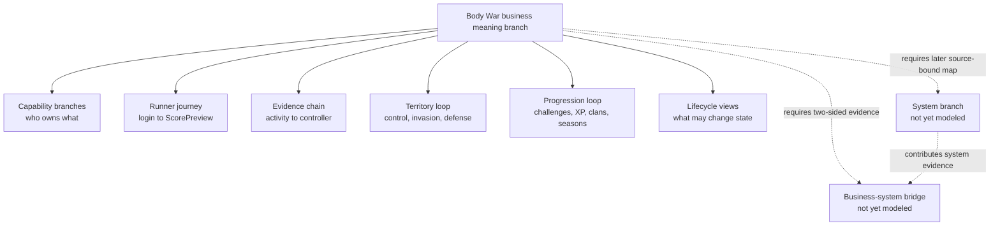

The business branch explains **what Body War means**. A future system branch
would explain **what software exists**. A future bridge would show **which
software realizes, constrains, observes, or tests which business meaning**.

## Business capability branches

**Question:** Which business contexts own which capabilities, and what must exist before the prototype score path can work?

**Represents:** A business-responsibility map. Contexts own capabilities; dependency arrows state prerequisite meaning, not module imports or runtime calls.

Open Mermaid network projection

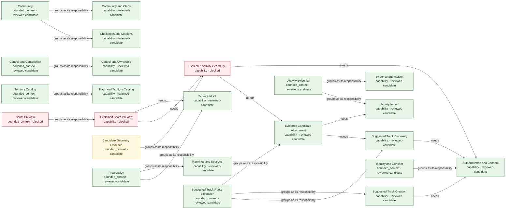

### Read the arrows as sentences

- [Identity and Consent](nodes/context.identity-consent.json) **groups as its responsibility** [Authentication and Consent](nodes/capability.auth-consent.json). Typed predicate: `owns`; relation: `body-war.relation.context-1`.
- [Activity Evidence](nodes/context.activity-evidence.json) **groups as its responsibility** [Activity Import](nodes/capability.activity-import.json). Typed predicate: `owns`; relation: `body-war.relation.context-2`.
- [Activity Evidence](nodes/context.activity-evidence.json) **groups as its responsibility** [Evidence Submission](nodes/capability.evidence-submission.json). Typed predicate: `owns`; relation: `body-war.relation.context-3`.
- [Suggested Track Route Expansion](nodes/context.route-expansion.json) **groups as its responsibility** [Suggested Track Discovery](nodes/capability.suggested-track-discovery.json). Typed predicate: `owns`; relation: `body-war.relation.context-14`.
- [Suggested Track Route Expansion](nodes/context.route-expansion.json) **groups as its responsibility** [Suggested Track Creation](nodes/capability.suggested-track-creation.json). Typed predicate: `owns`; relation: `body-war.relation.context-15`.
- [Suggested Track Route Expansion](nodes/context.route-expansion.json) **groups as its responsibility** [Evidence Candidate Attachment](nodes/capability.evidence-candidate-attach.json). Typed predicate: `owns`; relation: `body-war.relation.context-16`.
- [Candidate Geometry Evidence](nodes/context.geometry-evidence.json) **groups as its responsibility** [Selected Activity Geometry](nodes/capability.activity-geometry.json). Typed predicate: `owns`; relation: `body-war.relation.context-17`.
- [Score Preview](nodes/context.score-preview.json) **groups as its responsibility** [Explained Score Preview](nodes/capability.score-preview.json). Typed predicate: `owns`; relation: `body-war.relation.context-18`.
- [Territory Catalog](nodes/context.territory-catalog.json) **groups as its responsibility** [Track and Territory Catalog](nodes/capability.track-territory-catalog.json). Typed predicate: `owns`; relation: `body-war.relation.context-4`.
- [Control and Competition](nodes/context.control-competition.json) **groups as its responsibility** [Control and Ownership](nodes/capability.control-ownership.json). Typed predicate: `owns`; relation: `body-war.relation.context-5`.
- [Progression](nodes/context.progression.json) **groups as its responsibility** [Score and XP](nodes/capability.score-xp.json). Typed predicate: `owns`; relation: `body-war.relation.context-6`.
- [Progression](nodes/context.progression.json) **groups as its responsibility** [Rankings and Seasons](nodes/capability.rankings-seasons.json). Typed predicate: `owns`; relation: `body-war.relation.context-7`.
- [Community](nodes/context.community.json) **groups as its responsibility** [Challenges and Missions](nodes/capability.challenges-missions.json). Typed predicate: `owns`; relation: `body-war.relation.context-8`.
- [Community](nodes/context.community.json) **groups as its responsibility** [Community and Clans](nodes/capability.community-clans.json). Typed predicate: `owns`; relation: `body-war.relation.context-9`.
- [Suggested Track Discovery](nodes/capability.suggested-track-discovery.json) **needs** [Authentication and Consent](nodes/capability.auth-consent.json). Typed predicate: `depends_on`; relation: `body-war.relation.capability-dependency-9`.
- [Suggested Track Creation](nodes/capability.suggested-track-creation.json) **needs** [Authentication and Consent](nodes/capability.auth-consent.json). Typed predicate: `depends_on`; relation: `body-war.relation.capability-dependency-10`.
- [Evidence Candidate Attachment](nodes/capability.evidence-candidate-attach.json) **needs** [Suggested Track Discovery](nodes/capability.suggested-track-discovery.json). Typed predicate: `depends_on`; relation: `body-war.relation.capability-dependency-11`.
- [Evidence Candidate Attachment](nodes/capability.evidence-candidate-attach.json) **needs** [Activity Import](nodes/capability.activity-import.json). Typed predicate: `depends_on`; relation: `body-war.relation.capability-dependency-12`.
- [Selected Activity Geometry](nodes/capability.activity-geometry.json) **needs** [Evidence Candidate Attachment](nodes/capability.evidence-candidate-attach.json). Typed predicate: `depends_on`; relation: `body-war.relation.capability-dependency-13`.
- [Selected Activity Geometry](nodes/capability.activity-geometry.json) **needs** [Authentication and Consent](nodes/capability.auth-consent.json). Typed predicate: `depends_on`; relation: `body-war.relation.capability-dependency-14`.
- [Explained Score Preview](nodes/capability.score-preview.json) **needs** [Selected Activity Geometry](nodes/capability.activity-geometry.json). Typed predicate: `depends_on`; relation: `body-war.relation.capability-dependency-15`.
- [Explained Score Preview](nodes/capability.score-preview.json) **needs** [Score and XP](nodes/capability.score-xp.json). Typed predicate: `depends_on`; relation: `body-war.relation.capability-dependency-16`.

**Boundary:** This view does not prove that a capability is implemented, tested, deployed, or promoted.

## Runner intent: login to candidate evidence

**Question:** How does an anonymous visit become one exact track, activity, consent, and evidence binding?

**Represents:** The runner-intent half of the candidate journey. It shows authentication meaning, the connected-runner role, SuggestedTrack proposal, and explicit consented evidence.

Open Mermaid network projection

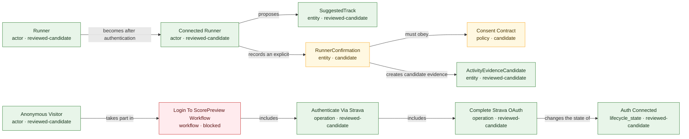

### Read the arrows as sentences

- [Anonymous Visitor](nodes/actor.anonymous-visitor.json) **takes part in** [Login To ScorePreview Workflow](nodes/workflow.login-to-score-preview.json). Typed predicate: `participates_in`; relation: `body-war.relation.visitor-authenticates`.
- [Login To ScorePreview Workflow](nodes/workflow.login-to-score-preview.json) **includes** [Authenticate Via Strava](nodes/operation.authenticate-via-strava.json). Typed predicate: `contains`; relation: `body-war.relation.workflow-13`.
- [Authenticate Via Strava](nodes/operation.authenticate-via-strava.json) **includes** [Complete Strava OAuth](nodes/operation.complete-strava-oauth.json). Typed predicate: `contains`; relation: `body-war.relation.authenticate-contains-callback`.
- [Complete Strava OAuth](nodes/operation.complete-strava-oauth.json) **changes the state of** [Auth Connected](nodes/state.auth.connected.json). Typed predicate: `changes_state_of`; relation: `body-war.relation.operation-5`.
- [Runner](nodes/actor.runner.json) **becomes after authentication** [Connected Runner](nodes/actor.connected-runner.json). Typed predicate: `becomes`; relation: `body-war.relation.runner-becomes-connected`.
- [Connected Runner](nodes/actor.connected-runner.json) **proposes** [SuggestedTrack](nodes/entity.suggested-track.json). Typed predicate: `produces`; relation: `body-war.relation.connected-proposes-track`.
- [Connected Runner](nodes/actor.connected-runner.json) **records an explicit** [RunnerConfirmation](nodes/entity.runner-confirmation.json). Typed predicate: `produces`; relation: `body-war.relation.connected-confirms`.
- [RunnerConfirmation](nodes/entity.runner-confirmation.json) **must obey** [Consent Contract](nodes/policy.consent-contract.json). Typed predicate: `governed_by`; relation: `body-war.relation.confirmation-governed-consent`.
- [RunnerConfirmation](nodes/entity.runner-confirmation.json) **creates candidate evidence** [ActivityEvidenceCandidate](nodes/entity.activity-evidence-candidate.json). Typed predicate: `produces`; relation: `body-war.relation.confirmation-produces-candidate`.

**Boundary:** These arrows are typed business statements, not an operation sequence or proof that OAuth, ownership validation, consent UI, or persistence works.

## Candidate calculation: geometry to ScorePreview

**Question:** How does confirmed evidence support private geometry, canonical score input, and an explained preliminary score?

**Represents:** A relation-local geometry and calculation view. Operations point to declared inputs and candidate outputs; residue annotations expose unresolved owner routes.

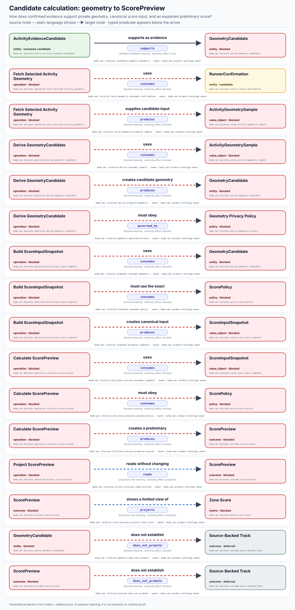

Open Mermaid network projection

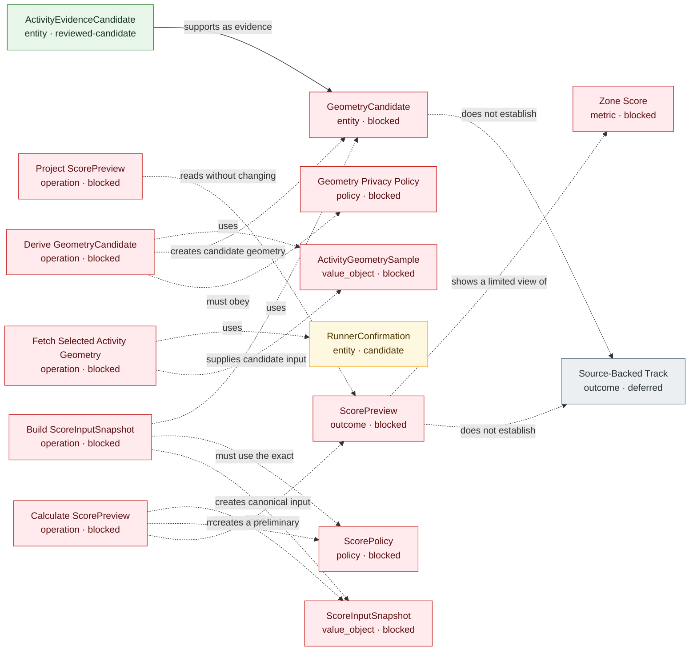

### Read the arrows as sentences

- [ActivityEvidenceCandidate](nodes/entity.activity-evidence-candidate.json) **supports as evidence** [GeometryCandidate](nodes/entity.geometry-candidate.json). Typed predicate: `supports`; relation: `body-war.relation.candidate-supports-geometry`.
- [Fetch Selected Activity Geometry](nodes/operation.fetch-selected-activity-geometry.json) **uses** [RunnerConfirmation](nodes/entity.runner-confirmation.json). Typed predicate: `consumes`; relation: `body-war.relation.fetch-geometry-consumes-confirmation`.
- [Fetch Selected Activity Geometry](nodes/operation.fetch-selected-activity-geometry.json) **supplies candidate input** [ActivityGeometrySample](nodes/value.activity-geometry-sample.json). Typed predicate: `produces`; relation: `body-war.relation.fetch-geometry-produces-sample`.
- [Derive GeometryCandidate](nodes/operation.derive-geometry-candidate.json) **uses** [ActivityGeometrySample](nodes/value.activity-geometry-sample.json). Typed predicate: `consumes`; relation: `body-war.relation.derive-consumes-sample`.
- [Derive GeometryCandidate](nodes/operation.derive-geometry-candidate.json) **creates candidate geometry** [GeometryCandidate](nodes/entity.geometry-candidate.json). Typed predicate: `produces`; relation: `body-war.relation.derive-produces-geometry`.
- [Derive GeometryCandidate](nodes/operation.derive-geometry-candidate.json) **must obey** [Geometry Privacy Policy](nodes/policy.geometry-privacy.json). Typed predicate: `governed_by`; relation: `body-war.relation.geometry-governed-privacy`.
- [Build ScoreInputSnapshot](nodes/operation.build-score-input-snapshot.json) **uses** [GeometryCandidate](nodes/entity.geometry-candidate.json). Typed predicate: `consumes`; relation: `body-war.relation.snapshot-consumes-geometry`.
- [Build ScoreInputSnapshot](nodes/operation.build-score-input-snapshot.json) **must use the exact** [ScorePolicy](nodes/policy.score-policy.json). Typed predicate: `consumes`; relation: `body-war.relation.snapshot-consumes-policy`.
- [Build ScoreInputSnapshot](nodes/operation.build-score-input-snapshot.json) **creates canonical input** [ScoreInputSnapshot](nodes/value.score-input-snapshot.json). Typed predicate: `produces`; relation: `body-war.relation.snapshot-produces-snapshot`.
- [Calculate ScorePreview](nodes/operation.calculate-score-preview.json) **uses** [ScoreInputSnapshot](nodes/value.score-input-snapshot.json). Typed predicate: `consumes`; relation: `body-war.relation.calculate-preview-consumes-snapshot`.
- [Calculate ScorePreview](nodes/operation.calculate-score-preview.json) **must obey** [ScorePolicy](nodes/policy.score-policy.json). Typed predicate: `consumes`; relation: `body-war.relation.calculate-preview-consumes-policy`.
- [Calculate ScorePreview](nodes/operation.calculate-score-preview.json) **creates a preliminary** [ScorePreview](nodes/outcome.score-preview.json). Typed predicate: `produces`; relation: `body-war.relation.calculate-preview-produces-preview`.
- [Project ScorePreview](nodes/operation.project-score-preview.json) **reads without changing** [ScorePreview](nodes/outcome.score-preview.json). Typed predicate: `reads`; relation: `body-war.relation.project-preview-reads-preview`.
- [ScorePreview](nodes/outcome.score-preview.json) **shows a limited view of** [Zone Score](nodes/metric.zone-score.json). Typed predicate: `projects`; relation: `body-war.relation.score-preview-projects-zone-score`.
- [GeometryCandidate](nodes/entity.geometry-candidate.json) **does not establish** [Source-Backed Track](nodes/outcome.source-backed-track.json). Typed predicate: `does_not_promote`; relation: `body-war.relation.geometry-does-not-promote`.
- [ScorePreview](nodes/outcome.score-preview.json) **does not establish** [Source-Backed Track](nodes/outcome.source-backed-track.json). Typed predicate: `does_not_promote`; relation: `body-war.relation.preview-does-not-promote`.

**Boundary:** The graph is not a completed runtime sequence. Candidate geometry and ScorePreview remain non-promoting; displayed score and privacy residue remains unresolved.

## Activity evidence to controller projection

**Question:** Which relations connect one runner activity, preview evidence, and a controller read model?

**Represents:** A relation-local evidence-submission and preview-controller view. Operations point to declared inputs and the evidence, events, or projections they produce.

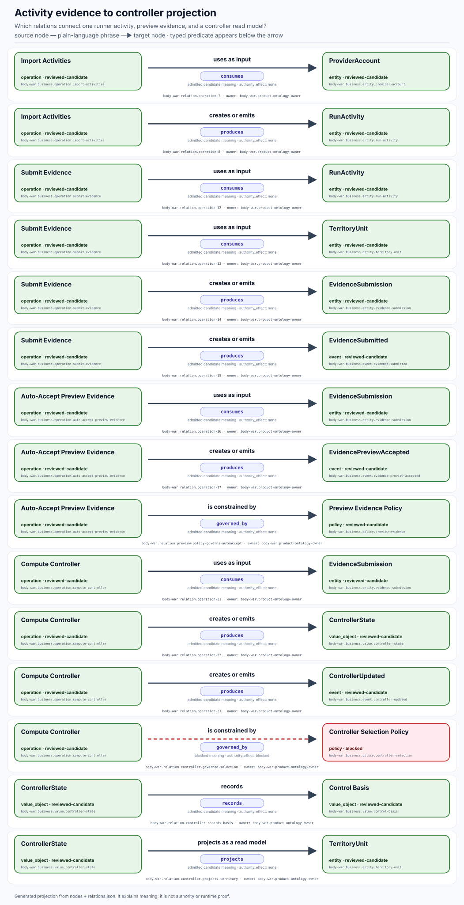

Open Mermaid network projection

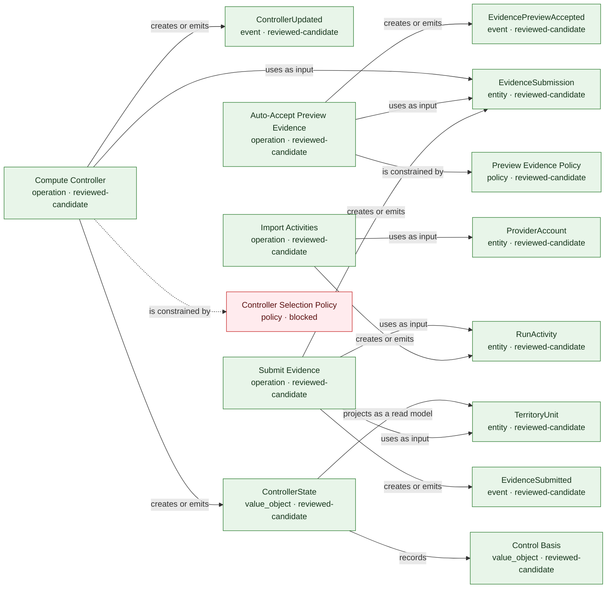

### Read the arrows as sentences

- [Import Activities](nodes/operation.import-activities.json) **uses as input** [ProviderAccount](nodes/entity.provider-account.json). Typed predicate: `consumes`; relation: `body-war.relation.operation-7`.
- [Import Activities](nodes/operation.import-activities.json) **creates or emits** [RunActivity](nodes/entity.run-activity.json). Typed predicate: `produces`; relation: `body-war.relation.operation-8`.
- [Submit Evidence](nodes/operation.submit-evidence.json) **uses as input** [RunActivity](nodes/entity.run-activity.json). Typed predicate: `consumes`; relation: `body-war.relation.operation-12`.
- [Submit Evidence](nodes/operation.submit-evidence.json) **uses as input** [TerritoryUnit](nodes/entity.territory-unit.json). Typed predicate: `consumes`; relation: `body-war.relation.operation-13`.
- [Submit Evidence](nodes/operation.submit-evidence.json) **creates or emits** [EvidenceSubmission](nodes/entity.evidence-submission.json). Typed predicate: `produces`; relation: `body-war.relation.operation-14`.
- [Submit Evidence](nodes/operation.submit-evidence.json) **creates or emits** [EvidenceSubmitted](nodes/event.evidence-submitted.json). Typed predicate: `produces`; relation: `body-war.relation.operation-15`.
- [Auto-Accept Preview Evidence](nodes/operation.auto-accept-preview-evidence.json) **uses as input** [EvidenceSubmission](nodes/entity.evidence-submission.json). Typed predicate: `consumes`; relation: `body-war.relation.operation-16`.
- [Auto-Accept Preview Evidence](nodes/operation.auto-accept-preview-evidence.json) **creates or emits** [EvidencePreviewAccepted](nodes/event.evidence-preview-accepted.json). Typed predicate: `produces`; relation: `body-war.relation.operation-17`.
- [Auto-Accept Preview Evidence](nodes/operation.auto-accept-preview-evidence.json) **is constrained by** [Preview Evidence Policy](nodes/policy.preview-evidence.json). Typed predicate: `governed_by`; relation: `body-war.relation.preview-policy-governs-autoaccept`.
- [Compute Controller](nodes/operation.compute-controller.json) **uses as input** [EvidenceSubmission](nodes/entity.evidence-submission.json). Typed predicate: `consumes`; relation: `body-war.relation.operation-21`.
- [Compute Controller](nodes/operation.compute-controller.json) **creates or emits** [ControllerState](nodes/value.controller-state.json). Typed predicate: `produces`; relation: `body-war.relation.operation-22`.
- [Compute Controller](nodes/operation.compute-controller.json) **creates or emits** [ControllerUpdated](nodes/event.controller-updated.json). Typed predicate: `produces`; relation: `body-war.relation.operation-23`.
- [Compute Controller](nodes/operation.compute-controller.json) **is constrained by** [Controller Selection Policy](nodes/policy.controller-selection.json). Typed predicate: `governed_by`; relation: `body-war.relation.controller-governed-selection`.
- [ControllerState](nodes/value.controller-state.json) **records** [Control Basis](nodes/value.control-basis.json). Typed predicate: `records`; relation: `body-war.relation.controller-records-basis`.
- [ControllerState](nodes/value.controller-state.json) **projects as a read model** [TerritoryUnit](nodes/entity.territory-unit.json). Typed predicate: `projects`; relation: `body-war.relation.controller-projects-territory`.

**Boundary:** Preview-accepted evidence and preview-controlled state are not verified evidence or verified territory control.

## Territory competition loop

**Question:** What does controlling, invading, defending, and expiring territory mean?

**Represents:** The business loop around territory control. It separates actors, the invasion episode, owner eligibility, defense time, controller projection, and ownership evidence.

Open Mermaid network projection

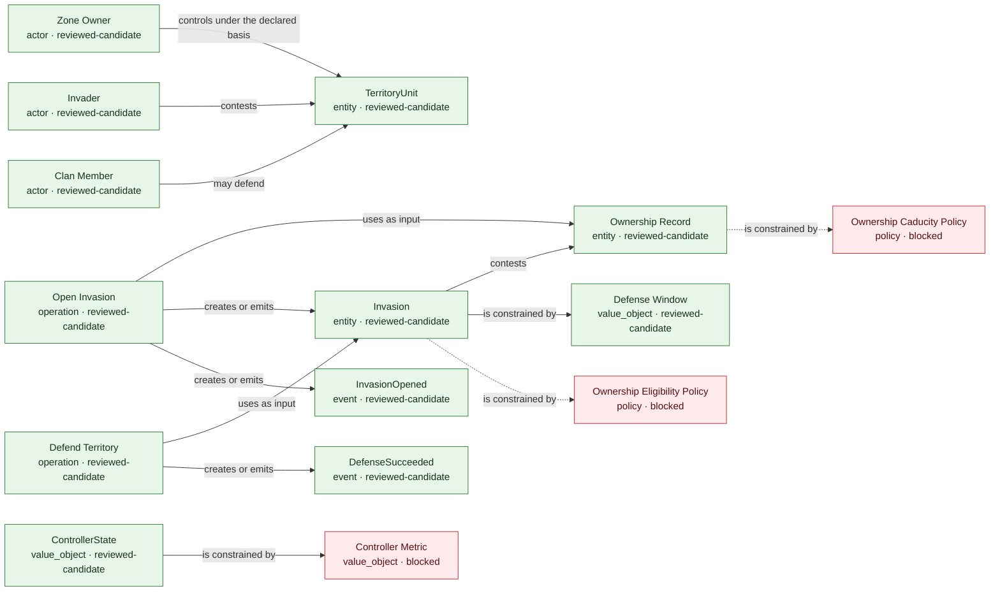

### Read the arrows as sentences

- [Zone Owner](nodes/actor.zone-owner.json) **controls under the declared basis** [TerritoryUnit](nodes/entity.territory-unit.json). Typed predicate: `controls`; relation: `body-war.relation.owner-controls-territory`.
- [Invader](nodes/actor.invader.json) **contests** [TerritoryUnit](nodes/entity.territory-unit.json). Typed predicate: `contests`; relation: `body-war.relation.invader-contests-territory`.
- [Clan Member](nodes/actor.clan-member.json) **may defend** [TerritoryUnit](nodes/entity.territory-unit.json). Typed predicate: `defends`; relation: `body-war.relation.clan-member-defends`.
- [Open Invasion](nodes/operation.open-invasion.json) **uses as input** [Ownership Record](nodes/entity.ownership-record.json). Typed predicate: `consumes`; relation: `body-war.relation.operation-24`.
- [Open Invasion](nodes/operation.open-invasion.json) **creates or emits** [Invasion](nodes/entity.invasion.json). Typed predicate: `produces`; relation: `body-war.relation.operation-25`.
- [Open Invasion](nodes/operation.open-invasion.json) **creates or emits** [InvasionOpened](nodes/event.invasion-opened.json). Typed predicate: `produces`; relation: `body-war.relation.operation-26`.
- [Invasion](nodes/entity.invasion.json) **contests** [Ownership Record](nodes/entity.ownership-record.json). Typed predicate: `contests`; relation: `body-war.relation.invasion-contests-ownership`.
- [Invasion](nodes/entity.invasion.json) **is constrained by** [Defense Window](nodes/value.defense-window.json). Typed predicate: `governed_by`; relation: `body-war.relation.invasion-governed-defense-window`.
- [Invasion](nodes/entity.invasion.json) **is constrained by** [Ownership Eligibility Policy](nodes/policy.ownership-eligibility.json). Typed predicate: `governed_by`; relation: `body-war.relation.invasion-governed-eligibility`.
- [Defend Territory](nodes/operation.defend-territory.json) **uses as input** [Invasion](nodes/entity.invasion.json). Typed predicate: `consumes`; relation: `body-war.relation.operation-27`.
- [Defend Territory](nodes/operation.defend-territory.json) **creates or emits** [DefenseSucceeded](nodes/event.defense-succeeded.json). Typed predicate: `produces`; relation: `body-war.relation.operation-28`.
- [Ownership Record](nodes/entity.ownership-record.json) **is constrained by** [Ownership Caducity Policy](nodes/policy.caducity.json). Typed predicate: `governed_by`; relation: `body-war.relation.ownership-governed-caducity`.
- [ControllerState](nodes/value.controller-state.json) **is constrained by** [Controller Metric](nodes/value.controller-metric.json). Typed predicate: `governed_by`; relation: `body-war.relation.controller-governed-metric`.

**Boundary:** The loop does not choose the controller metric, anti-cheat strictness, caducity interval, or clan eligibility policy.

## Community and progression loop

**Question:** How do challenges, clans, XP, seasons, and rankings relate?

**Represents:** The declared social and progression meanings: challenges can award profile XP, the ledger records XP, clans contain members, and seasons contain ranking projections.

Open Mermaid network projection

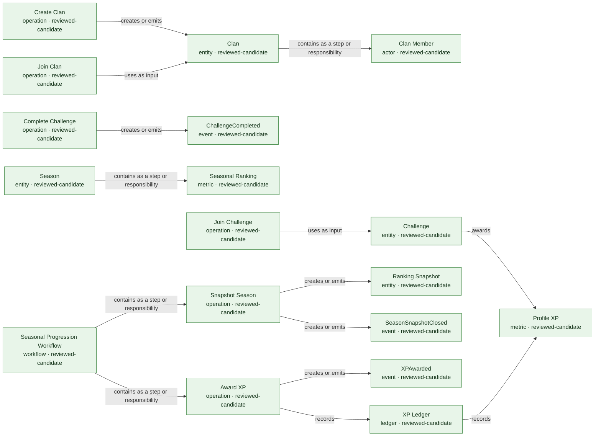

### Read the arrows as sentences

- [Challenge](nodes/entity.challenge.json) **awards** [Profile XP](nodes/metric.profile-xp.json). Typed predicate: `awards`; relation: `body-war.relation.challenge-awards-xp`.
- [XP Ledger](nodes/ledger.xp-ledger.json) **records** [Profile XP](nodes/metric.profile-xp.json). Typed predicate: `records`; relation: `body-war.relation.xp-ledger-records-xp`.
- [Clan](nodes/entity.clan.json) **contains as a step or responsibility** [Clan Member](nodes/actor.clan-member.json). Typed predicate: `contains`; relation: `body-war.relation.clan-contains-member`.
- [Season](nodes/entity.season.json) **contains as a step or responsibility** [Seasonal Ranking](nodes/metric.seasonal-ranking.json). Typed predicate: `contains`; relation: `body-war.relation.season-contains-ranking`.
- [Seasonal Progression Workflow](nodes/workflow.seasonal-progression.json) **contains as a step or responsibility** [Award XP](nodes/operation.award-xp.json). Typed predicate: `contains`; relation: `body-war.relation.workflow-9`.
- [Seasonal Progression Workflow](nodes/workflow.seasonal-progression.json) **contains as a step or responsibility** [Snapshot Season](nodes/operation.snapshot-season.json). Typed predicate: `contains`; relation: `body-war.relation.workflow-10`.
- [Award XP](nodes/operation.award-xp.json) **creates or emits** [XPAwarded](nodes/event.xp-awarded.json). Typed predicate: `produces`; relation: `body-war.relation.operation-31`.
- [Award XP](nodes/operation.award-xp.json) **records** [XP Ledger](nodes/ledger.xp-ledger.json). Typed predicate: `records`; relation: `body-war.relation.operation-32`.
- [Join Challenge](nodes/operation.join-challenge.json) **uses as input** [Challenge](nodes/entity.challenge.json). Typed predicate: `consumes`; relation: `body-war.relation.operation-33`.
- [Complete Challenge](nodes/operation.complete-challenge.json) **creates or emits** [ChallengeCompleted](nodes/event.challenge-completed.json). Typed predicate: `produces`; relation: `body-war.relation.operation-34`.
- [Create Clan](nodes/operation.create-clan.json) **creates or emits** [Clan](nodes/entity.clan.json). Typed predicate: `produces`; relation: `body-war.relation.operation-35`.
- [Join Clan](nodes/operation.join-clan.json) **uses as input** [Clan](nodes/entity.clan.json). Typed predicate: `consumes`; relation: `body-war.relation.operation-36`.
- [Snapshot Season](nodes/operation.snapshot-season.json) **creates or emits** [Ranking Snapshot](nodes/entity.ranking-snapshot.json). Typed predicate: `produces`; relation: `body-war.relation.operation-37`.
- [Snapshot Season](nodes/operation.snapshot-season.json) **creates or emits** [SeasonSnapshotClosed](nodes/event.season-snapshot-closed.json). Typed predicate: `produces`; relation: `body-war.relation.operation-38`.

**Boundary:** These relations do not prove retention, fairness, reward correctness, or implemented seasonal behavior; related premises remain hypotheses.

## Lifecycle views

Lifecycle status is independent from ontology `candidate_status`. These diagrams
show what a business object may transition through; they do not promote the node
record itself.

### SuggestedTrack

Owner route: `body-war.route-expansion-owner` · Authority effect: `none`

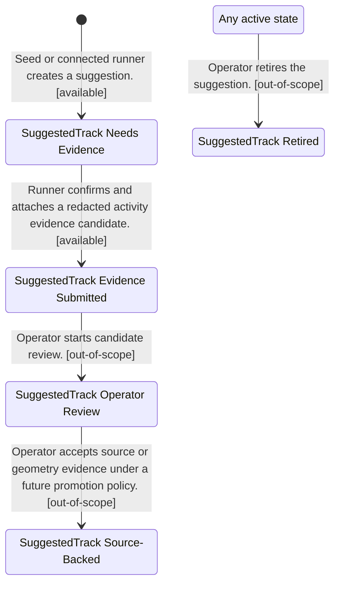

Transition phrases:

- `none -> needs-evidence`: Seed or connected runner creates a suggestion. Availability: `available`.
- `needs-evidence -> evidence-submitted`: Runner confirms and attaches a redacted activity evidence candidate. Availability: `available`.
- `evidence-submitted -> operator-review`: Operator starts candidate review. Availability: `out-of-scope`.
- `operator-review -> source-backed`: Operator accepts source or geometry evidence under a future promotion policy. Availability: `out-of-scope`.
- `any-active-state -> retired`: Operator retires the suggestion. Availability: `out-of-scope`.

Boundary: Runner confirmation, candidate evidence, GeometryCandidate, or ScorePreview cannot skip operator-review and create source-backed state.

### GeometryCandidate

Owner route: `body-war.data-privacy-owner` · Authority effect: `none`

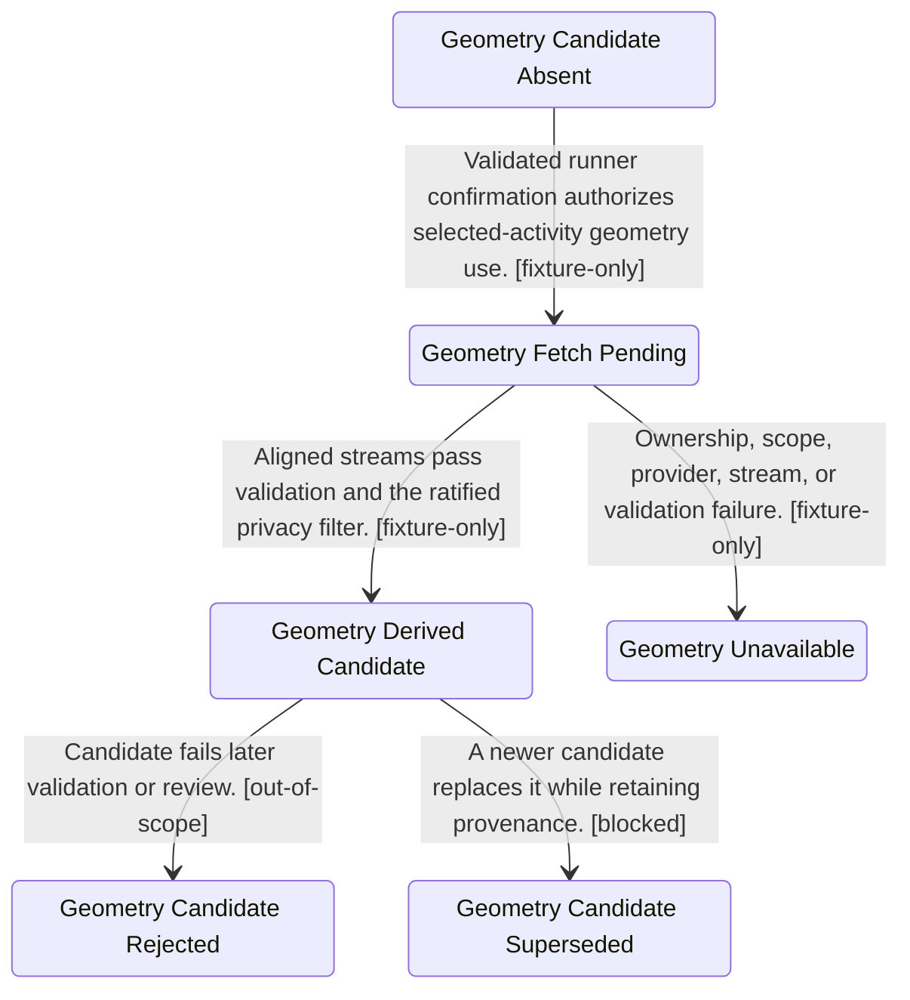

Transition phrases:

- `absent -> fetch-pending`: Validated runner confirmation authorizes selected-activity geometry use. Availability: `fixture-only`.
- `fetch-pending -> derived-candidate`: Aligned streams pass validation and the ratified privacy filter. Availability: `fixture-only`.
- `fetch-pending -> unavailable`: Ownership, scope, provider, stream, or validation failure. Availability: `fixture-only`.
- `derived-candidate -> rejected`: Candidate fails later validation or review. Availability: `out-of-scope`.
- `derived-candidate -> superseded`: A newer candidate replaces it while retaining provenance. Availability: `blocked`.

Boundary: derived-candidate is principal-private candidate evidence, not source-backed or public geometry.

### ScorePreview

Owner route: `body-war.score-policy-owner` · Authority effect: `none`

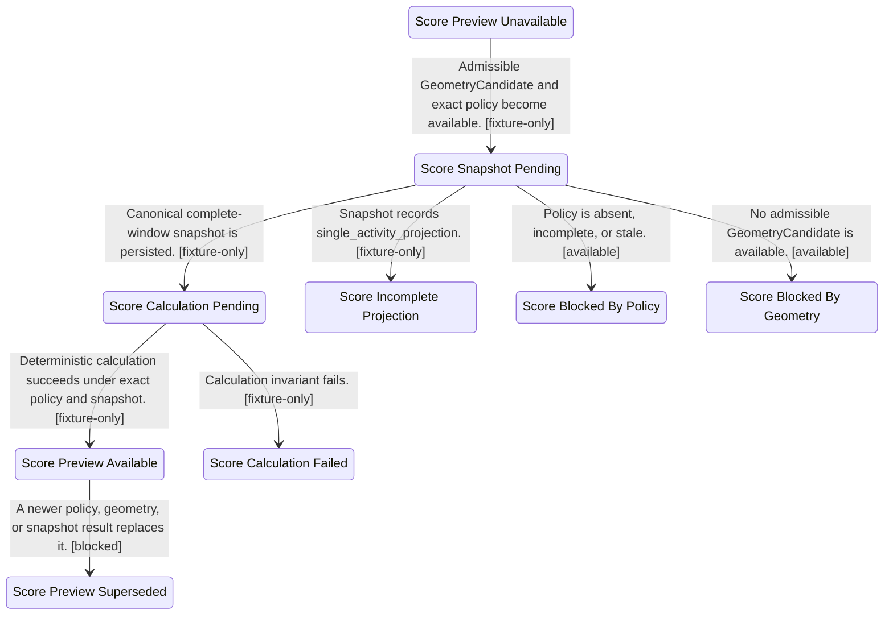

Transition phrases:

- `unavailable -> snapshot-pending`: Admissible GeometryCandidate and exact policy become available. Availability: `fixture-only`.
- `snapshot-pending -> calculation-pending`: Canonical complete-window snapshot is persisted. Availability: `fixture-only`.
- `snapshot-pending -> incomplete-projection`: Snapshot records single_activity_projection. Availability: `fixture-only`.
- `snapshot-pending -> blocked-policy`: Policy is absent, incomplete, or stale. Availability: `available`.
- `snapshot-pending -> blocked-geometry`: No admissible GeometryCandidate is available. Availability: `available`.
- `calculation-pending -> available`: Deterministic calculation succeeds under exact policy and snapshot. Availability: `fixture-only`.
- `calculation-pending -> failed`: Calculation invariant fails. Availability: `fixture-only`.
- `available -> superseded`: A newer policy, geometry, or snapshot result replaces it. Availability: `blocked`.

Boundary: available means preview_only; it does not establish Zone Score, controller, conquest, source-backed route, or production authority.

### EvidenceSubmission

Owner route: `body-war.activity-evidence-owner` · Authority effect: `none`

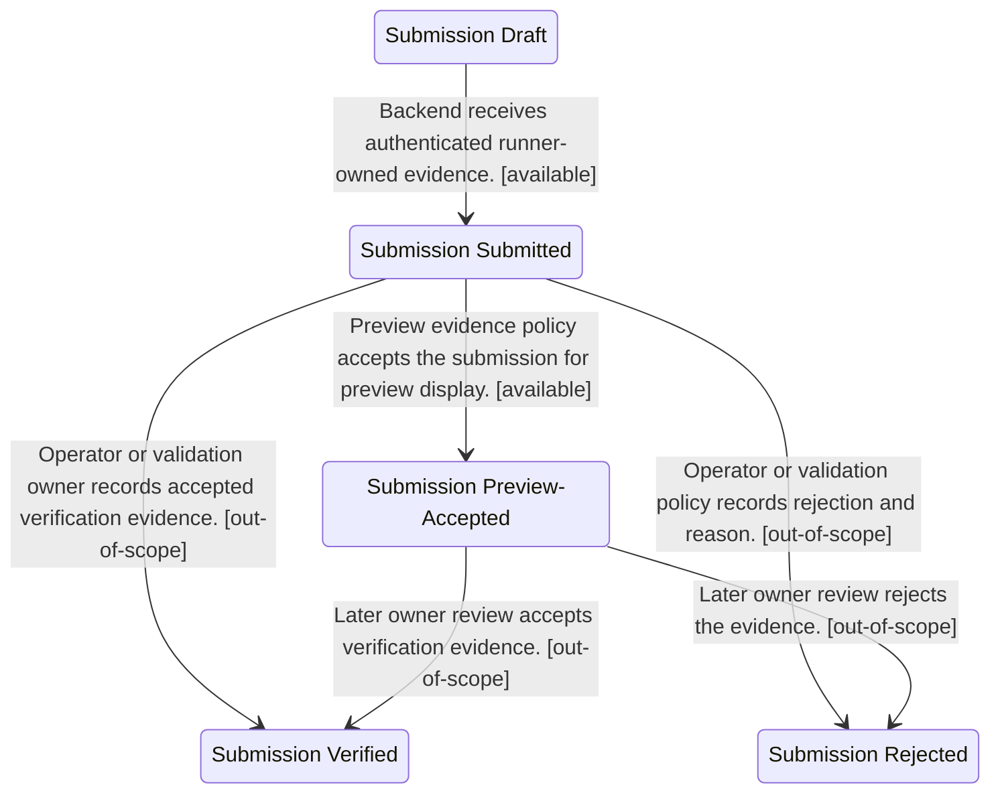

Transition phrases:

- `draft -> submitted`: Backend receives authenticated runner-owned evidence. Availability: `available`.
- `submitted -> preview-accepted`: Preview evidence policy accepts the submission for preview display. Availability: `available`.
- `submitted -> verified`: Operator or validation owner records accepted verification evidence. Availability: `out-of-scope`.
- `submitted -> rejected`: Operator or validation policy records rejection and reason. Availability: `out-of-scope`.
- `preview-accepted -> verified`: Later owner review accepts verification evidence. Availability: `out-of-scope`.
- `preview-accepted -> rejected`: Later owner review rejects the evidence. Availability: `out-of-scope`.

Boundary: preview-accepted must never be displayed or interpreted as verified.

### ControllerState

Owner route: `body-war.control-competition-owner` · Authority effect: `none`

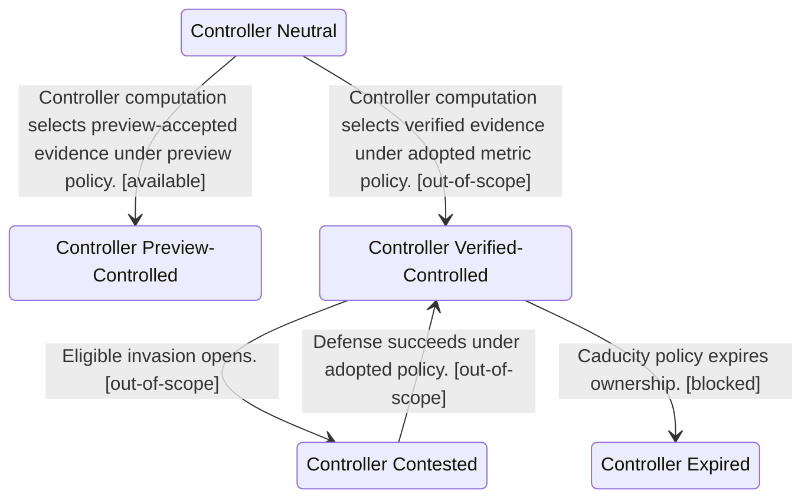

Transition phrases:

- `neutral -> preview-controlled`: Controller computation selects preview-accepted evidence under preview policy. Availability: `available`.
- `neutral -> verified-controlled`: Controller computation selects verified evidence under adopted metric policy. Availability: `out-of-scope`.
- `verified-controlled -> contested`: Eligible invasion opens. Availability: `out-of-scope`.
- `contested -> verified-controlled`: Defense succeeds under adopted policy. Availability: `out-of-scope`.
- `verified-controlled -> expired`: Caducity policy expires ownership. Availability: `blocked`.

Boundary: A controller projection must retain basis and metric and must not convert preview evidence into verified control.

## Arrow phrase glossary

These phrases translate the project-local predicates into ordinary sentences.
They explain graph edges; they do not redefine the relation schema.

| Predicate | Read the arrow as | Example relation |
| --- | --- | --- |
| `awards` | awards | `body-war.relation.challenge-awards-xp` |
| `becomes` | becomes after the required transition | `body-war.relation.runner-becomes-connected` |
| `changes_state_of` | changes the state of | `body-war.relation.operation-5` |
| `consumes` | uses as input | `body-war.relation.attach-candidate-consumes-track` |
| `contains` | contains as a step or responsibility | `body-war.relation.authenticate-contains-callback` |
| `contests` | contests | `body-war.relation.invader-contests-territory` |
| `controls` | controls under the declared basis | `body-war.relation.owner-controls-territory` |
| `defends` | may defend | `body-war.relation.clan-member-defends` |
| `depends_on` | depends on | `body-war.relation.capability-dependency-1` |
| `does_not_promote` | does not promote | `body-war.relation.geometry-does-not-promote` |
| `exposes` | exposes | `body-war.relation.http-exposes-auth-query` |
| `governed_by` | is constrained by | `body-war.relation.confirm-operation-governed-consent` |
| `maps_to` | maps to | `body-war.relation.activity-maps-redacted` |
| `owns` | owns this business responsibility | `body-war.relation.context-1` |
| `participates_in` | participates in | `body-war.relation.operator-reviews-evidence` |
| `produces` | creates or emits | `body-war.relation.attach-candidate-produces-candidate` |
| `projects` | projects as a read model | `body-war.relation.controller-projects-territory` |
| `provides` | provides source data for | `body-war.relation.strava-provides-activity` |
| `reads` | reads without changing | `body-war.relation.detail-suggested-reads-candidate` |
| `records` | records | `body-war.relation.controller-records-basis` |
| `supports` | supports without promoting | `body-war.relation.candidate-supports-geometry` |
| `transitions_to` | may transition to | `body-war.relation.auth-anonymous-connected` |
| `validates` | reviews or validates | `body-war.relation.reviewer-validates-submission` |

## Authority and next-view boundary

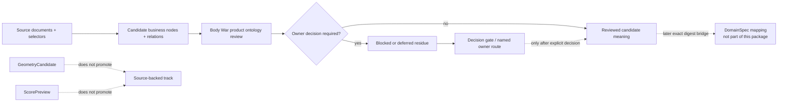

Next view work should be a separate system-branch inventory of the Body War app,
followed by a two-sided bridge validation. That future work must not be generated
from business intent alone.
