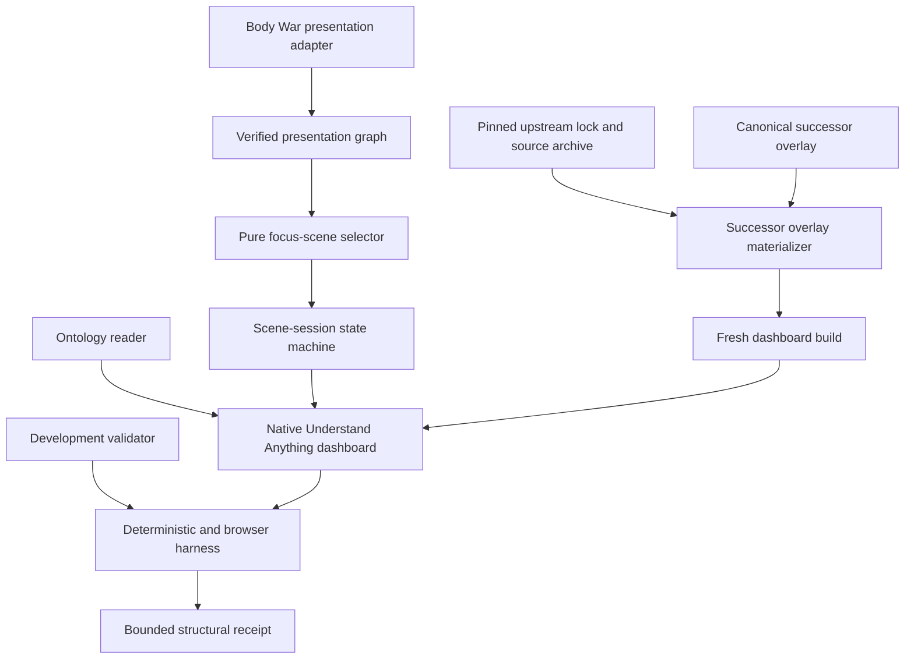
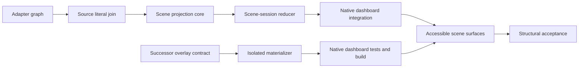
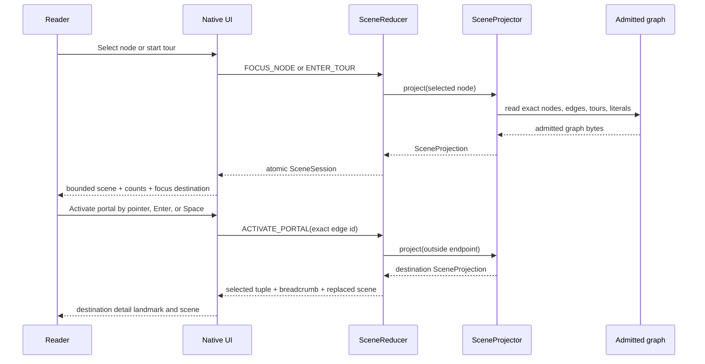
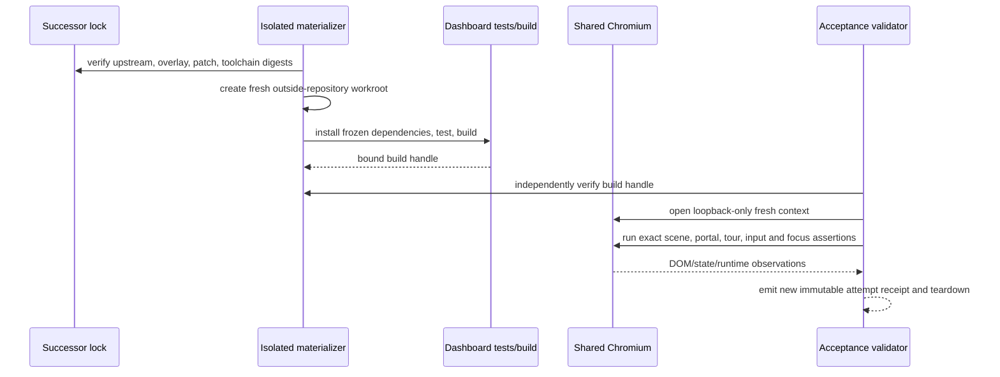
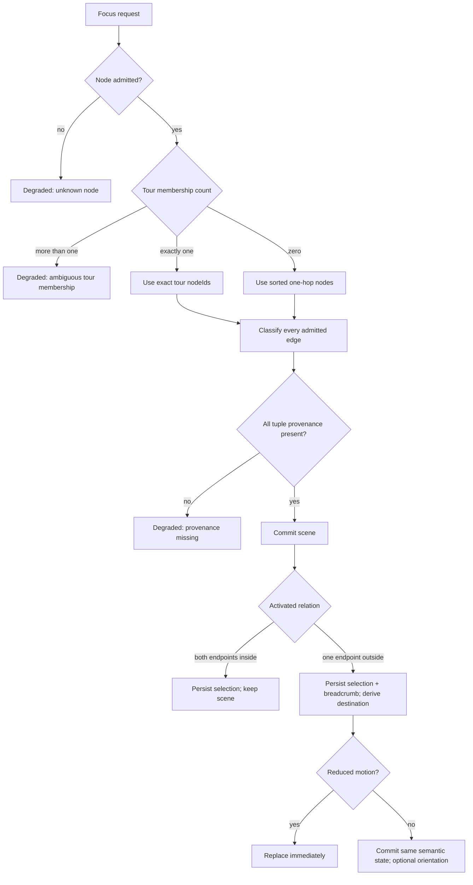
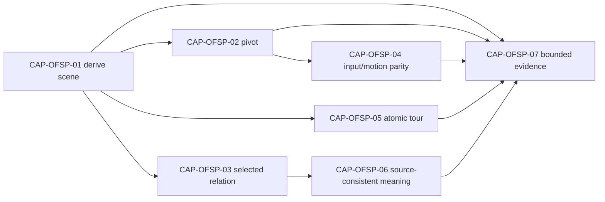
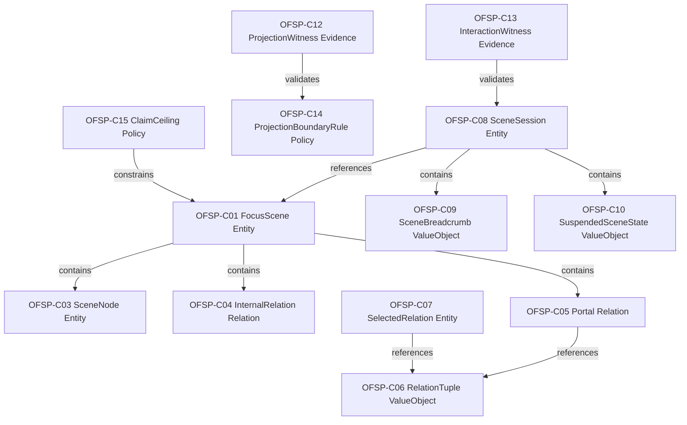

# Architecture: Body War Ontology Focus Scene And Portal Pivot

## Design Intent

Replace visual dimming of the complete Body War graph with a deterministic
scene projection that filters before layout, treats admitted boundary-crossing
relations as portals, and commits navigation through one explicit scene-session
state machine.

The implementation remains a local successor overlay over the pinned Understand
Anything commit. It preserves adapter data and candidate-local authority and
does not edit generated upstream or dashboard artifacts.

## Bound Inputs

- system of interest: `body-war-ontology-focus-scene-pivot`
- `SPEC.md` SHA-256:
  `4c3a89f1154489459ec486846d2ae65e101b1ceba9711703d791ffe82339b6aa`
- Design scope input digest:
  `5995482d6ecd22368463516807d588d5950ed133a4ed8e5648b5465c92580569`
- denominator receipt: `DESIGN-DENOMINATOR-RECEIPT.json`
- selection result: `DESIGN-SELECTION-RESULT.json`
- selection result digest:
  `0afabc8ac5c1e2a8cf849b5ef3d7fa9c34c03eeb1c1661309fd3982ee635884c`
- frozen graph SHA-256:
  `e8f754e6aed7b05759439df82db421eb51fa050c78b86b37d5d689e89a751433`
- pinned upstream commit:
  `2cda14e89535049e49120198886bc0b82e9e630f`

## Ownership Correction

The reviewed Body War UI uses native dashboard components inside the pinned
Understand Anything source archive. The checked-in
`upstream/overlay/packages/dashboard/src/oew/**` files implement a separate
`?oew=1` evidence workspace and are architectural precedent, not the direct
mutation target.

Implementation therefore needs a successor, digest-bound native overlay:

```text
frozen upstream archive (read-only)
  + successor focus-scene overlay/patches (canonical local changes)
  + frozen Body War adapter run (read-only input)
  -> fresh isolated materialized workroot
  -> tested dashboard build
  -> new generated acceptance attempt (evidence only)
```

Historical overlay manifests, locks, build handles, receipts, and dashboard
bundles remain immutable. The existing workbench `package.json` also remains
unchanged; its absent historical L1 build scripts are not treated as a working
route.

## 1. Context View



Trust boundary:

- the adapter and upstream archive are admitted read inputs;
- the successor overlay is the only feature source mutation;
- a materialized workroot and generated build are disposable;
- a browser receipt proves only the structural claims it records.

## 2. High-Level Structure



| Component | Responsibility | Forbidden responsibility |
| --- | --- | --- |
| `SourceLiteralJoin` | Join exact node and edge fields from the verified presentation graph into relation tuples | Infer missing kind, status, direction, or authority |
| `SceneProjector` | Derive ordered node, internal-relation, and portal arrays | DOM, layout, state mutation, or tour narration |
| `SceneReducer` | Commit focus, selection, portal, breadcrumb, tour, and restoration transitions | Reclassify graph membership |
| `NativeDashboardBridge` | Connect native store/components to projector and reducer | Mutate adapter bytes or render the complete graph behind a focused state |
| `SceneRenderer` | Render only the active projection and expose semantic controls | Independently filter the full graph |
| `FocusCoordinator` | Move focus after state commit and restore focus on Back/exit | Encode domain meaning in focus order |
| `SuccessorOverlayContract` | Bind new modules and patched upstream pre/post images | Rewrite historical locks or generated source archives |
| `AcceptanceHarness` | Compare independent fixtures and browser state; emit receipts | Claim comprehension, promotion, release, or production readiness |

## 3. Low-Level Component View

### Proposed canonical overlay shape

Paths are prospective write targets for future SWUs; this Design does not create
them.

```text
upstream/
  FOCUS-SCENE-OVERLAY.lock.json
  FOCUS-SCENE-BUILD.lock.json
  overlay/
    focus-scene-overlay-manifest.json
    packages/dashboard/src/focus-scene/
      types.ts
      sourceLiterals.ts
      projectScene.ts
      sceneReducer.ts
      serializeSemanticState.ts
      fixtures/body-war-focus-scenes.json
      *.test.ts
  patches/
    0002-focus-scene-store.patch
    0003-focus-scene-renderer.patch
    0004-focus-scene-detail-landmark.patch
    0005-focus-scene-relation-controls.patch
    0006-focus-scene-focus-motion.patch
    0007-focus-scene-tour.patch
    0008-focus-scene-literals.patch
    0009-focus-scene-forced-colors.patch
    0010-focus-scene-degraded-state.patch
scripts/
  materialize-focus-scene-build.mjs
  verify-focus-scene-build.mjs
  validate-body-war-focus-scene.mjs
test/
  focus-scene-overlay.test.mjs
  focus-scene-build.test.mjs
  body-war-focus-scene-browser.test.mjs
```

The exact successor lock may split overlay admission and build admission, but it
must never overload or silently revise `UPSTREAM.lock.json`,
`L1-BUILD.lock.json`, or the historical overlay manifests.

Every patch binds its upstream preimage and postimage. When ordered patches
touch the same native file, the later preimage must equal the immediately prior
postimage. Reapplication must fail.

The test-owned fixture remains at
`test/fixtures/body-war-focus-scenes.json`. The successor manifest declares a
test-only copy into the isolated dashboard test tree; a negative import test
proves production focus-scene modules never import it.

### Data contracts

```ts
type RelationTuple = {
  edgeId: string
  sourceId: string
  targetId: string
  direction: string
  type: string
  description: string
  sourceFilePath: string
  targetFilePath: string
  sourceBusinessKind: string
  targetBusinessKind: string
  sourceCandidateStatus?: string
  targetCandidateStatus?: string
  sourceAuthority: "none"
  targetAuthority: "none"
}

type SceneProjection = {
  sceneKey: string
  sceneKind: "tour" | "one-hop"
  title: string
  sourceDigest: string
  nodeIds: readonly string[]
  internalRelations: readonly RelationTuple[]
  portals: readonly RelationTuple[]
  authorityEffect: "none"
}

type SceneSession = {
  mode: "overview" | "focused" | "tour" | "degraded"
  activeScene: SceneProjection | null
  activeNodeId: string | null
  selectedRelation: RelationTuple | null
  breadcrumbs: readonly BreadcrumbEntry[]
  suspendedPreTour: SuspendedSceneState | null
  error: SceneError | null
}
```

### Projection algorithm

```text
project(graph, selectedNodeId):
  require selectedNodeId in graph.nodes
  tours = every tour whose nodeIds contains selectedNodeId
  require tours.length <= 1

  if tours.length == 1:
    memberIds = preserve source-declared tour node order
    sceneKey = "tour:" + stable tour order/id
  else:
    memberIds = sort(selectedNodeId plus every incident edge endpoint)
    sceneKey = "one-hop:" + selectedNodeId

  members = Set(memberIds)
  for each admitted edge sorted by stable tuple identity:
    if members has source and target: internal += exactTuple(edge)
    else if members has source xor target: portals += exactTuple(edge)

  require every tuple endpoint and required provenance resolves
  return canonical projection with authorityEffect "none"
```

The independent expected-fixture generator must not import `projectScene`,
`sourceLiterals`, or the production tuple builder. It reads the pinned JSON
bytes and implements the expectation independently.

### Native dashboard integration points

| Frozen logical upstream path | Existing behavior | Successor change |
| --- | --- | --- |
| `packages/dashboard/src/store.ts` | `focusNodeId`, `nodeHistory`, tour highlight state | Bridge native actions to `SceneReducer`; add active projection, exact selected relation, breadcrumb, suspended pre-tour state |
| `components/KnowledgeGraphView.tsx` | Maps all filtered nodes/edges and dims non-neighbors | Consume projected nodes/relations before layout; render portal controls; dispatch relation/portal actions |
| `components/NodeInfo.tsx` | Clickable `DIV` connection rows; inspector-local navigation | Render semantic relation controls, exact tuple fields, selected state, Back behavior |
| `components/LearnPanel.tsx` | Tour step/highlight control | Dispatch atomic tour enter/change/exit and announce scene counts |
| `components/SearchBar.tsx` | Native result selection and inconsistent kind label | Reuse `SourceLiteralSet`; commit focus scene and focus destination |
| `components/CustomNode.tsx` | Visual selected/focused states | Add non-color kind/status/selection cues and keyboard activation contract |
| `App.tsx` | Native graph/sidebar composition | Add skip route and named detail landmark |
| `index.css` | Native presentation | Add visible focus, forced-colors, and reduced-motion rules |

No adapter mutation is in the initial route. The verified presentation graph
alone supplies L0 runtime fields: tour membership, node paths/tags, and edge
source/target/direction/type/description. The sidecar remains adapter-
verification evidence, not a runtime UI dependency. Adapter work is admitted
only if an independent failing fixture proves a required field is absent.

## 4. Workflow Process View

### Focus and pivot



### Build and acceptance



## 5. Decision Flow



Precedence:

1. source admission and provenance;
2. deterministic membership;
3. exact relation tuple;
4. atomic state commit;
5. focus transfer;
6. optional visual motion.

Motion, layout, and color can never change the semantic result.

## 6. Dependency And Interface View

| Boundary | Producer | Consumer | Version/binding | Failure rule |
| --- | --- | --- | --- | --- |
| Presentation graph | Body War adapter run | `SourceLiteralJoin`, `SceneProjector` | graph digest `e8f754…` for L0 fixture | reject stale or unverifiable bytes |
| Upstream native source | frozen archive | successor overlay materializer | commit `2cda14…`, archive digest `1e00e5…` | reject commit/archive/preimage mismatch |
| Successor overlay | future canonical manifest/patches | materializer | every file/patch digest and destination | reject unbound or extra feature file |
| Scene projection | pure selector | reducer and renderer | `SceneProjection/v1` | degrade; never fall back silently to full graph |
| Scene session | reducer | native UI | `SceneSession/v1` | reject illegal/stale event without partial mutation |
| Semantic serialization | reducer/query | unit and browser validator | canonical sorted JSON bytes | parity fails on any byte difference |
| Build handle | isolated materializer | independent verifier/browser validator | exact inputs, commands, outputs, teardown | no browser acceptance on stale or self-issued handle |
| Browser runtime | global Playwright/Chromium | acceptance validator | resolved version, executable, revision, hashes | fail closed; no repository package addition |

## Capability View



## Concept/Type View



## State/Event Extension

| Event | Preconditions | Atomic mutations | Forbidden residue |
| --- | --- | --- | --- |
| `FOCUS_NODE` | admitted node | derive scene, set active node, clear invalid relation | full-graph focused scene |
| `SELECT_INTERNAL_RELATION` | both endpoints in active scene | set exact selected tuple | breadcrumb or scene change |
| `ACTIVATE_PORTAL` | exact portal in active scene | select tuple, push breadcrumb, derive destination, replace scene/node | old scene active with new inspector |
| `BACK` | breadcrumb non-empty | pop and restore exact prior active state | recomputed history with changed literals |
| `ENTER_TOUR` | valid tour step | suspend complete pre-tour state, clear active selection, set tour scene | mixed pre-tour and tour active state |
| `CHANGE_TOUR_STEP` | tour active | replace scene and clear out-of-scene active selection | stale `Authentication and Consent` active in step two |
| `EXIT_TOUR` | tour active | restore suspension or deterministic overview; clear suspension | retained tour-only selection |
| `SOURCE_INVALID` | any source/provenance failure | enter degraded state without partial projection | silent complete-graph fallback |

Event replay is deterministic for the same initial state and graph digest.
`ACTIVATE_PORTAL` is idempotent only when event identity and initial state digest
match; duplicate UI events must not duplicate breadcrumbs.

## Authority/Trust Extension

| Trust decision | Enforcement placement | Negative control |
| --- | --- | --- |
| Only verified adapter bytes enter projection | loader/adapter receipt gate before selector | changed graph or sidecar digest rejected |
| Only exact source literals are displayed | tuple/literal join | missing candidate status remains absent; no fabricated lifecycle |
| UI projection has no authority effect | type contract, visible authority surface, receipt ceiling | no event or receipt contains promotion/release decision |
| Only successor overlay bytes change native UI | overlay lock/materializer | generated archive/bundle edits and unbound files rejected |
| Browser receipt is bounded evidence | validator schema and claim ceiling | no comprehension/production field or conclusion |

Bypass controls:

- no selector fallback to complete graph;
- no direct native archive or generated bundle mutation;
- no adapter mutation without a separately admitted failing source-field
  witness;
- no acceptance run from an unverified build handle;
- no token persistence in receipts, screenshots, URLs, or logs.

## Integration/Versioning Extension

Versioned contracts:

- `focus-scene-overlay/v1`
- `SceneProjection/v1`
- `SceneSession/v1`
- `focus-scene-build-handle/v1`
- `body-war-focus-scene-acceptance/v1`

Compatibility rules:

1. the native dashboard without focus action may retain its overview entry
   surface;
2. once focused or in tour mode, the full-graph/dimming behavior is rejected;
3. unknown future graph fields may be ignored only if exact required tuple and
   authority fields remain total;
4. a source schema or upstream preimage change requires a new overlay/contract
   version and fixture regeneration;
5. old browser receipts remain historical evidence and are never rewritten.

## Data Lifecycle Extension

| Data/evidence | Purpose | Access | Retention | Disclosure/deletion |
| --- | --- | --- | --- | --- |
| Source graph/sidecar digests | bind fixture and run | developers/validators | retained with run | digest only in summary |
| Canonical semantic states | prove input/motion parity | developers/validators | retained as test/receipt evidence | candidate-local literals only |
| Screenshots | structural review aid | internal development | per existing generated-run policy | must not expose access token |
| Browser/runtime identity | reproducibility | internal development | retained with receipt | executable/hash/version permitted |
| Loopback access token | local access control | current process only | memory until teardown | never persisted |

No new user, provider, activity, geometry, credential, or personal data is
introduced by this feature.

## Quality Extension

| Scenario | Stimulus | Required response | Measure | Owner |
| --- | --- | --- | --- | --- |
| Determinism | same graph digest + selection repeated | same canonical projection bytes | exact SHA-256 equality | projection owner |
| Input parity | pointer/Enter/Space activate same portal | same canonical semantic state | byte equality | state owner |
| Reduced motion | reduced-motion context activates portal | same state, no orientation animation | state equality + active animation count | UX owner |
| Bounded render | start named tour scene | exact test-owned arrays; unrelated node absent | DOM/state array equality | renderer owner |
| Focus visibility | keyboard traverse controls under forced colors | visible nonzero outline/border geometry | computed geometry, not unmeasured contrast | UX owner |
| Source consistency | render `SuggestedTrack` on each surface | same admitted literals | exact string equality | literal owner |
| Isolation | build and browser attempt ends | clean workroot/context/server/port teardown | receipt booleans | harness owner |

No latency, scale, contrast-compliance, or human-comprehension threshold is
claimed.

## Concern-To-View Trace

| Concern | Disposition | Accountable owner | Artifact owner | Validator owner | Design output |
| --- | --- | --- | --- | --- | --- |
| `concern:authority` | required | authority owner | architecture owner | `invoke-design-selection-validator` | Authority/Trust extension |
| `concern:state-event` | required | workflow owner | architecture owner | `invoke-design-selection-validator` | State/Event extension |
| `concern:integration` | required | interface owner | architecture owner | `invoke-design-selection-validator` | Dependency view + Integration/Versioning |
| `concern:privacy-data` | required | data owner | architecture owner | `invoke-design-selection-validator` | Data Lifecycle extension |
| `concern:performance` | required | service owner | architecture owner | `invoke-design-selection-validator` | Quality extension |
| `concern:ux` | required | UX plan owner | UX plan owner | `invoke-design-selection-validator` | `UX-PLAN.md` |
| `concern:validation` | required | design owner | plan/work-pack owner | `invoke-design-selection-validator` | Planned witness and validator contracts |

## Planned Witness Contracts

| Fixture | Claim | Polarity | Expected result | Execution phase |
| --- | --- | --- | --- | --- |
| `T-OFSP-PROJECTION-001` | `AC-OFSP-001` | baseline + positive + negative | current 237/231 fails; exact four-node arrays pass; unrelated node absent | implementation |
| `T-OFSP-ONE-HOP-002` | `AC-OFSP-002` | positive + invalid endpoints | sorted one-hop and portal arrays or explicit degraded error | implementation |
| `T-OFSP-PORTAL-003` | `AC-OFSP-003` | exact literal tuple | source `Identity and Consent`, target `Authentication and Consent`, `direction:forward`, `type:related`, `description:owns`, endpoint paths/status/authority retained | implementation |
| `T-OFSP-PARITY-004` | `AC-OFSP-004` | pointer/Enter/Space/reduced-motion | byte-equivalent canonical semantic state | validation |
| `T-OFSP-TOUR-005` | `AC-OFSP-005` | enter/change/exit/stale negative | exact state fixtures pass; stale active step-two selection fails | implementation |
| `T-OFSP-LITERALS-006` | `AC-OFSP-006` | candidate + absent-status | exact literals on all surfaces; absent status not fabricated | validation |
| `T-OFSP-BROWSER-007` | `AC-OFSP-007` | default/grayscale/forced-colors/reduced-motion | focus and operation assertions pass without contrast claim | validation |
| `T-OFSP-RECEIPT-008` | `AC-OFSP-008` | valid/stale/self-issued | exact binding passes; stale or self-issued evidence rejected | validation |

All witnesses are planned and not run.

## Validator Contracts

| Contract | Target | Binding | Verdicts | Stale/self-issue rule |
| --- | --- | --- | --- | --- |
| `VC-OFSP-PROJECTION-01` | projection fixtures | frozen graph digest + independent generator digest | pass/fail | reject stale fixture; production selector cannot issue expectation |
| `VC-OFSP-OVERLAY-02` | successor overlay | upstream commit/archive + manifest + every patch/file digest | pass/fail | reject missing/extra/stale file |
| `VC-OFSP-BUILD-03` | isolated build | overlay lock + toolchain + command/output tree | pass/fail | verifier distinct from producer |
| `VC-OFSP-BROWSER-04` | browser acceptance | build handle + adapter receipt + shared runtime identity + exact assertions | pass/fail | new attempt only; reject stale/self-issued handle |

## Significant Behavior Scenario

Precondition: the frozen graph is verified; `Business capability map` step one
is active; `Identity and Consent` is inside the four-node scene;
`Authentication and Consent` is outside and connected by the exact admitted
forward edge whose generic type is `related` and description is `owns`.

Stimulus: the reader activates that portal with Enter.

Ordered response:

1. the UI resolves the exact portal and persists its complete tuple;
2. the source scene is pushed to the breadcrumb;
3. the destination one-hop scene is derived;
4. active scene and node are atomically replaced;
5. selected relation remains visible and programmatically selected;
6. focus moves to the destination detail landmark;
7. `authority:none`, statuses, and endpoint paths remain exposed;
8. Back restores the exact source scene and selection context.

Failure/recovery:

- missing provenance blocks pivot and keeps the prior truthful scene;
- a stale graph digest blocks acceptance;
- reduced motion commits the same state immediately without rotation.

Observable evidence:

- independent expected arrays;
- canonical semantic state digest;
- programmatic selected state;
- focus destination and focus geometry;
- exact source literal assertions;
- clean browser/runtime receipt.

Acceptance owner: Body War product-ontology owner for semantic ceiling, OEW
overlay owner for implementation bytes, independent validator for receipt.

## Design Gate

- closed scope manifest: pass
- independent denominator extraction: pass
- fixed-point selection: pass
- six baseline views: complete
- selected extensions: complete
- UX companion: required
- planned witnesses: not run
- unresolved design blocker: none
- implementation caveat: successor native overlay/build contract must precede
  native UI mutation
- result: `design-validator-pass`
