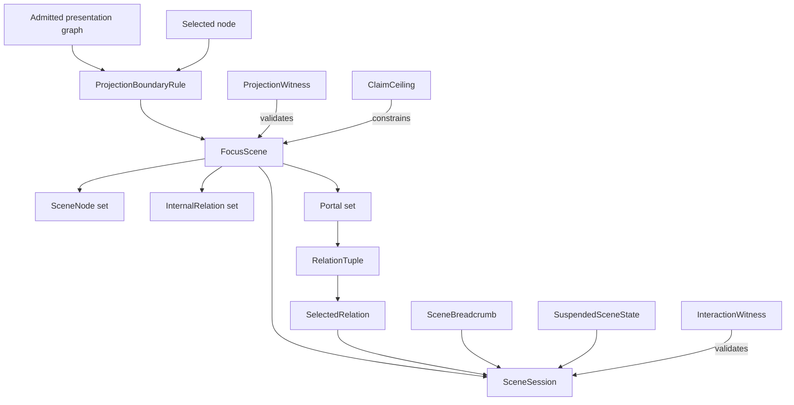

# UI Concept Map

This map describes removable OEW presentation concepts. It is not a Body War
ontology mutation or a promotion proposal.



## Layering Seed

| Boundary | Owns | Must not own |
| --- | --- | --- |
| Adapter admission | Exact presentation graph and sidecar fields | UI scene membership or interaction state |
| Pure projection core | Tour/one-hop membership and internal/portal classification | DOM, layout, browser focus, ontology mutation |
| Scene-session state | Active scene, selected relation, breadcrumb, tour suspension | Source rewriting or layout-derived meaning |
| OEW renderer | Visible scene, controls, focus destination, redundant semantic cues | Independent projection logic over the full graph |
| Acceptance harness | Test-owned fixtures, serialized state, browser/runtime receipt | Product authority or human-comprehension claims |
| Generated build | Materialized viewer bytes for validation | Canonical source ownership |

## Direction Rule

```text
admitted graph
  -> pure projection
    -> scene-session reducer
      -> renderer
        -> structural acceptance evidence
```

No reverse edge may mutate admitted graph meaning.

