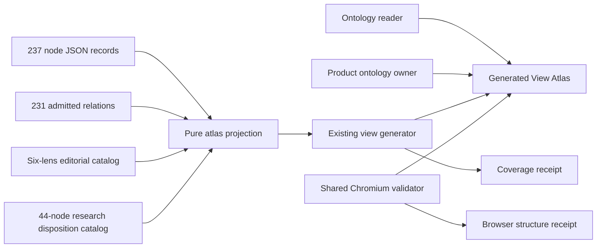
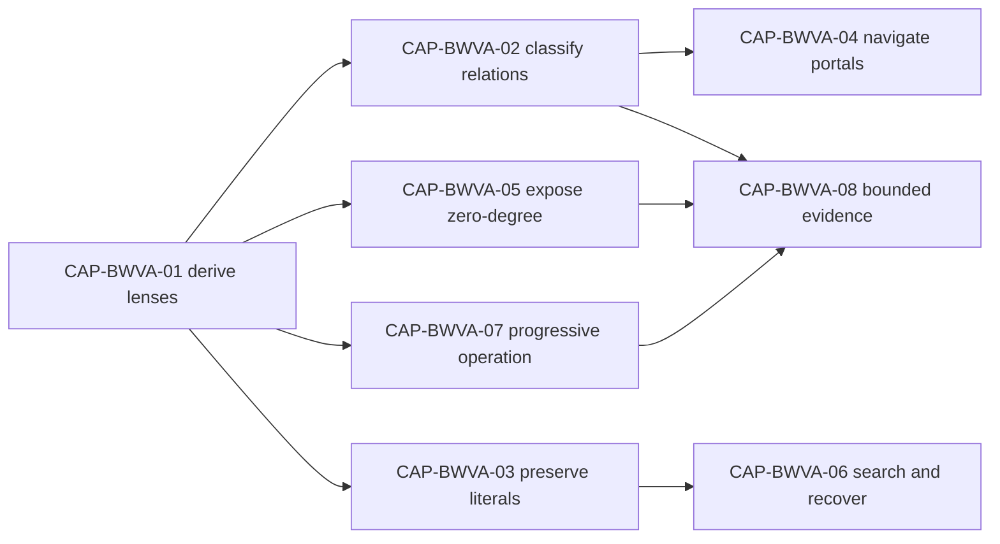
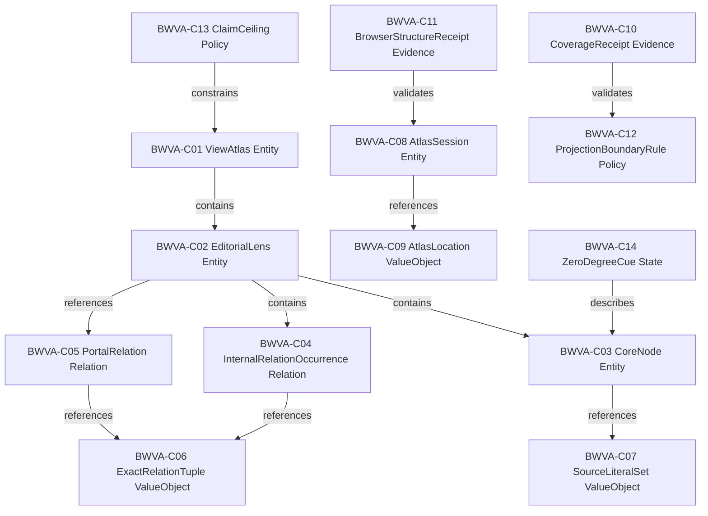
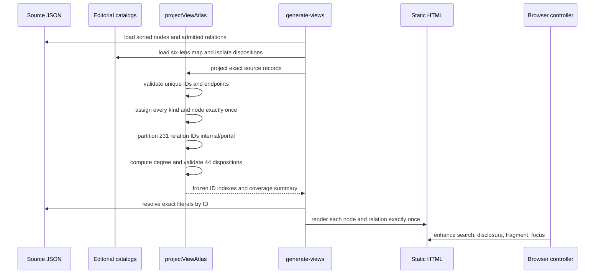
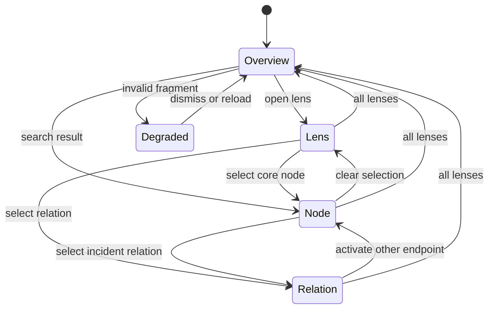

# Architecture Bundle: Body War Business Ontology View Atlas

## Design intent

Add one deterministic, static-first view atlas to the existing Body War
business-view generator. A pure projection partitions current source IDs into
six editorial lenses; the renderer resolves those IDs against the unchanged
source records and emits accessible HTML plus bounded evidence.

The selected architecture does not add ontology classes or relations. Lens
catalogs and isolate dispositions are navigation/review metadata with no
authority effect.

## Inputs and selection

- approved Define: `SPEC.md`
- closed scope: `DESIGN-SCOPE-MANIFEST.json`
  (`input_digest: ecd5cef44d10d2fad3f640ad23e292b0cb418e802e1a26678633251dbf127d77`)
- denominator: `DESIGN-DENOMINATOR-RECEIPT.json`
  (`receipt_digest: 72b36c30e38e1c6b272016272461a03c777c5a2c71284e0cfc6d3d083c508e06`)
- selection: `DESIGN-SELECTION-RESULT.json`
  (`result_digest: 695a94ffd9d0b841cc6f2af9f82584953efcbbe3fbf57baf687815837f10439b`)
- selected extensions: authority/trust, persistence/concurrency,
  integration/versioning, data lifecycle, quality, UX, validation

## 1. Context view



The source package points into the projection. Nothing flows back into nodes,
relations, lifecycle policies, profile, residue, or `views/business.json`.

## 2. Capability view



## 3. Concept/type view



All edges use the Define registry. The diagram types presentation concepts, not
business ontology records.

## Lens catalog

| Lens ID | Reader question | Literal kinds, in order | Current nodes | Current internal relations | Current outbound portals | Current zero-degree |
| --- | --- | --- | ---: | ---: | ---: | ---: |
| `participants-boundaries` | Who participates, and through which external or interface boundary? | `actor`, `external_system`, `interface` | 17 | 1 | 25 | 2 |
| `responsibilities` | Which contexts group which capabilities? | `bounded_context`, `capability` | 30 | 34 | 0 | 1 |
| `behavior` | What can happen, be requested, be answered, or be observed? | `workflow`, `operation`, `query`, `event` | 72 | 40 | 74 | 0 |
| `business-objects` | What information, records, values, and measures are carried? | `entity`, `value_object`, `ledger`, `metric` | 37 | 20 | 8 | 7 |
| `governance-lifecycle` | What constrains behavior and names lifecycle postures? | `policy`, `lifecycle_state` | 69 | 26 | 0 | 24 |
| `hypotheses-outcomes` | What is believed or sought? | `premise`, `outcome` | 12 | 1 | 2 | 10 |

Counts are pre-implementation source evidence. The runtime projection recomputes
and validates them; the catalog must not hard-code them as authority.

## 4. Operation/flow view



### Pure projection contract

```js
projectViewAtlas({ nodes, relations, lenses, isolateDispositions })
  -> {
    lenses: [{
      id,
      kinds,
      coreNodeIds,
      internalRelationIds,
      outboundPortalIds,
      inboundPortalIds,
      zeroDegreeNodeIds
    }],
    portals: [{ relationId, sourceLensId, targetLensId }],
    zeroDegreeNodeIds,
    coverage,
    authorityEffect: "none"
  }
```

The pure module accepts in-memory records and contains no file, HTML, DOM,
browser, or receipt writer. It does not enrich source records.

### Relation classification

```text
for relation in stable relation-id order:
  sourceNode = exact node by relation.source_concept
  targetNode = exact node by relation.target_concept
  sourceLens = unique lens mapped from sourceNode.business_kind
  targetLens = unique lens mapped from targetNode.business_kind

  if sourceLens == targetLens:
    sourceLens.internalRelationIds += relation.id
  else:
    portals += (relation.id, sourceLens.id, targetLens.id)
    sourceLens.outboundPortalIds += relation.id
    targetLens.inboundPortalIds += relation.id
```

Target-lens navigation still renders and announces the original source,
predicate, and target. No reverse tuple is constructed.

## 5. State view



The complete semantic content exists outside this controller state. State
controls reveal, focus, filter, and URL history only.

## 6. Dependency/interface view

| Boundary | Producer | Consumer | Binding | Failure behavior |
| --- | --- | --- | --- | --- |
| Candidate nodes | node JSON files | pure projection and renderer | concept ID, kind, label, status, authority, path | duplicate/missing literal blocks generation |
| Admitted relations | `relations.json` | pure projection and renderer | relation ID, endpoints, predicate, description, direction, owner, effects | duplicate or dangling endpoint blocks generation |
| Editorial lenses | `view-catalog.mjs` | pure projection | six IDs and closed ordered kind sets | missing or duplicate kind blocks generation |
| Isolate dispositions | `view-catalog.mjs` | pure projection and renderer | exact 44 IDs and research-only labels | missing/extra/non-isolate entry blocks generation |
| Atlas projection | pure module | generator/tests | stable ID indexes, no copied records | invariant failure produces no HTML |
| Static atlas | generator | browser/reader | one stable DOM ID per concept/relation; ordinary anchors | stale bytes fail `--check` |
| Progressive controller | inline generated JS | browser | data attributes and fragment grammar | invalid fragment falls back with error; static content remains |
| Coverage receipt | deterministic validator | reviewer | exact source/output digests and invariant results | no receipt on failed invariant |
| Browser receipt | browser harness | reviewer | exact HTML/runtime/assertions/screenshots | structural admission fails; no comprehension inference |

## Significant behavior scenario

Stimulus: a reader opens “Participants and boundaries”, selects an actor, then
activates an outbound portal into “Business objects”.

Preconditions:

- all source digests match the generation input;
- actor and relation IDs exist;
- source and target kinds map to exactly one lens each;
- relation tuple resolves every required field.

Ordered response:

1. static HTML exposes the actor, exact outgoing relation sentence, other lens,
   and target anchor;
2. activation updates the fragment to the target node's canonical location;
3. the business-object lens opens;
4. the exact target core node receives focus;
5. an announcement names the destination lens and node;
6. the relation detail keeps its original source -> target direction.

Failure/recovery:

- unknown IDs produce an overview error without hiding static content;
- a projection invariant blocks generation;
- Back restores the previous fragment and focus context.

Observable evidence: unit fixture, HTML anchor integrity test, keyboard/browser
assertion, no-JavaScript assertion, and receipt digests.

Acceptance owner: Body War product ontology owner for semantic-source
preservation; view validator for structural behavior.

## Concern-to-view trace

| Concern class | Source signals | Selected output | Architecture response | Owner |
| --- | --- | --- | --- | --- |
| authority | `rule:authority-none` | `architecture:authority-trust` | read-only source boundary and no write-back path | authority owner |
| persistence | `writer:atlas-generator` | `architecture:persistence-concurrency` | one deterministic writer, atomic complete-content generation, `--check` | persistence owner |
| integration | two interfaces and additive compatibility boundary | `architecture:integration-versioning` | pure projection v1 and additive existing-view contract | interface owner |
| privacy-data | validation receipt sink | `architecture:data-lifecycle` | local structural facts only; no reader analytics | data owner |
| performance | deterministic completeness claim | `architecture:quality` | exact cardinality and browser-structure thresholds | service owner |
| ux | natural reader and new rendered surface | `ux-plan` | static-first lens navigation and progressive enhancement | UX plan owner |
| validation | three rules, effect, eight acceptance claims | `validation-contracts` | independent projection, HTML, browser, digest witnesses | design owner |

## Authority/trust extension

### Authority decisions

- Node and relation JSON remain semantic inputs.
- The lens catalog owns editorial navigation only.
- The isolate-disposition catalog repeats accepted research classifications;
  it cannot admit them as profile policy.
- The generator owns generated bytes only.
- Coverage and browser validators own evidence verdicts only.

### Enforcement

- source inputs are excluded from task write scope and digest-guarded;
- projection returns IDs, not mutated node/relation copies;
- exact source tuples are resolved at render time;
- tests assert semantic-input digests do not change;
- every visible lens/disposition area states the projection/research ceiling.

### Bypass/forgery controls

- unknown, duplicated, or multiply mapped IDs fail generation;
- no generated output is read as ontology input;
- a portal references an existing relation ID and cannot supply its own
  predicate/direction;
- receipts bind the current source and output digests and cannot self-issue
  ontology acceptance.

## Persistence/concurrency extension

`generate-views.mjs` remains the sole generated-view writer. Atlas generation
is part of the same single-process render transaction as current outputs.
`--check` renders in memory and byte-compares every declared artifact. There is
no runtime mutable store, concurrent writer, database, queue, or user data.

Interrupted generation may leave a stale local artifact, but the subsequent
`--check` detects it. Task Session receipts record exact changed files and
validation commands; no watcher or parallel generator is admitted.

## Integration/versioning extension

- `AtlasProjection/v1` is internal to the business-view package.
- Existing exported catalog values and existing generated artifacts retain
  their contracts.
- The new catalog exports and projection module are additive.
- `BUSINESS-VIEWS.md` may add one ordinary link to the atlas; current sections
  and counts remain.
- The HTML fragment grammar is local and versioned by stable lens, node, and
  relation IDs.
- A catalog/source shape incompatibility blocks generation rather than silently
  dropping a kind or relation.

## Data lifecycle extension

Receipts contain repository paths/digests, cardinalities, local runtime facts,
assertion results, timestamps, and screenshots. They contain no credentials,
provider data, activity data, personal account data, browser analytics, or
reader interaction logs. Evidence stays repository-local under
`ontology/business/receipts/`; deletion/retention remains the repository
owner's normal evidence policy.

## Quality extension

| Scenario | Threshold | Measurement | Owner |
| --- | --- | --- | --- |
| Complete source projection | 237 unique nodes, 17 kinds, six lenses, 231 unique relations, 122 internal, 109 portals, 44 zero-degree | independent Node assertions | projection validator |
| Stable generation | second render equals checked-in bytes | generator `--check` | generator owner |
| Static accessibility | all nodes/relations and destinations available without JS | HTML structure tests and no-JS browser context | UX validator |
| Interactive structure | search, portal, history, keyboard, focus, narrow, reduced motion, print, zero console errors | pinned Chromium assertions | browser validator |
| Authority honesty | source digests unchanged; projection/research ceilings visible | digest and content assertions | authority owner |

These are structural quality thresholds. They do not prove human comprehension,
accessibility conformance, application performance, release, or production
fitness.

## Planned witness contracts

| Witness | Claim | Positive and negative boundary | Execution phase |
| --- | --- | --- | --- |
| `T-BWVA-PARTITION-001` | lens/kind/node conservation | exact totals; missing/duplicate kind rejects | SWU-BWVA-001 |
| `T-BWVA-RELATIONS-002` | relation conservation | 122/109; duplicate/dangling rejects; parallel pair preserved | SWU-BWVA-001 |
| `T-BWVA-TUPLE-003` | tuple/direction preservation | exact tuple; target navigation does not reverse | SWU-BWVA-001/002 |
| `T-BWVA-ISOLATES-004` | 44-node honesty | exact set; no synthesized relation | SWU-BWVA-001/002 |
| `T-BWVA-STATIC-005` | static HTML | JS-disabled content and anchor integrity | SWU-BWVA-002 |
| `T-BWVA-BROWSER-006` | interactive browser structure | exact keyboard/focus/viewport/motion/print assertions | SWU-BWVA-003 |
| `T-BWVA-NONREGRESSION-007` | existing package safety | generator/tests/package validation and digest guard | every SWU |
| `T-BWVA-RECEIPT-008` | evidence binding | exact source/output/runtime/claim-ceiling fields | SWU-BWVA-001/003 |

Planned witness rows are contracts only. No implementation or browser evidence
is claimed by this Design.

## Design gate

- all six baseline views: complete
- selected architecture extensions: complete
- significant behavior and recovery: complete
- concern ownership and evidence contracts: complete
- planned evidence represented as executed: no
- authority or release promotion: none
- result: `pass`

