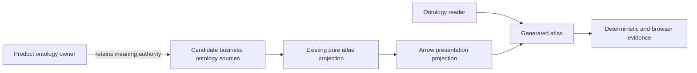
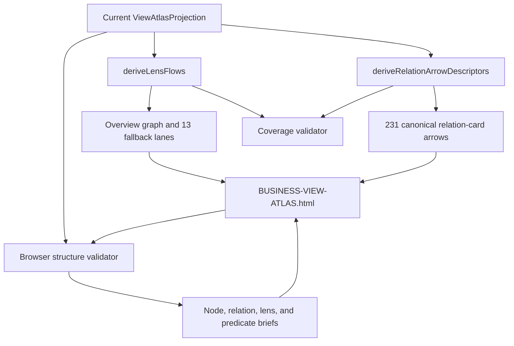
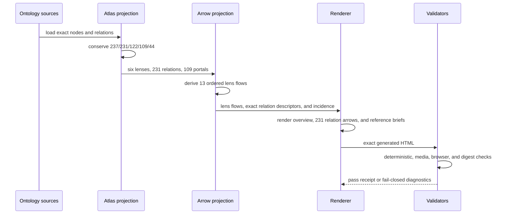
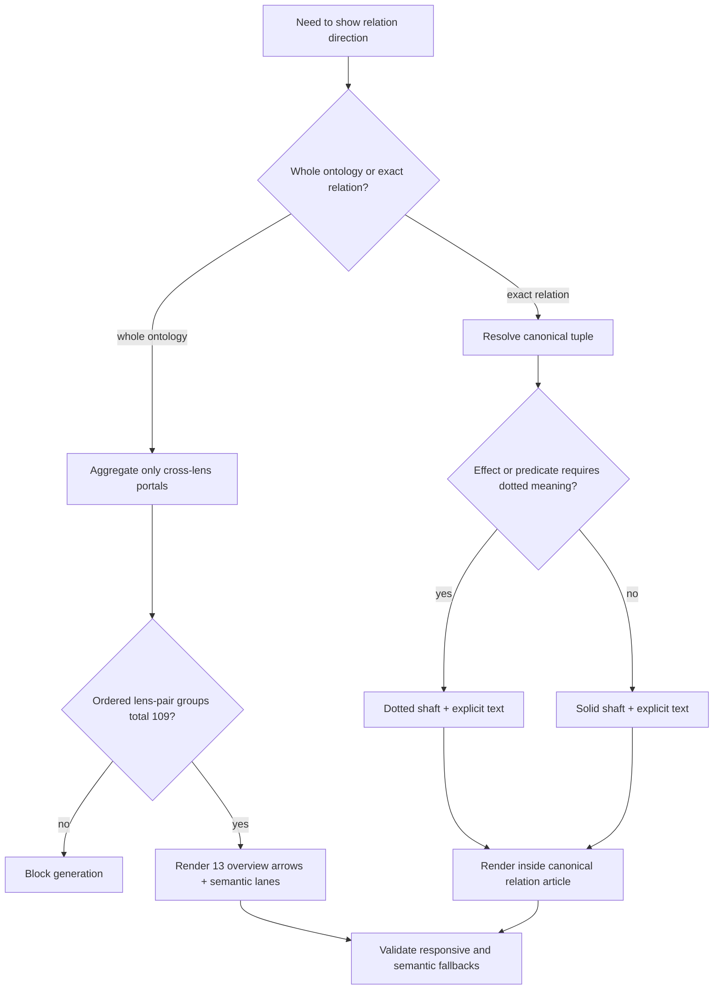

# Architecture Bundle — Body War Ontology Atlas Arrows

## Design intent

Restore visible arrows as a removable presentation layer over the completed
atlas. Use bounded aggregation at the whole-ontology level, exact relation
arrows at the detail level, and source-backed reference briefs at each point
of reading, while HTML—not SVG geometry—carries accessible meaning and
navigation.

## Inputs and evidence state

- Define contract: `SPEC.md`
- glossary: `GLOSSARY.md`
- prior atlas architecture:
  `../20260730T051037Z-business-ontology-view-atlas/ARCHITECTURE.md`
- closed scope: `DESIGN-SCOPE-MANIFEST.json`
  (`8a12442d6ba2daf076a0386893ce5525439a38b5442733d4b4f03338c6b0baf7`)
- denominator: `DESIGN-DENOMINATOR-RECEIPT.json`
  (`b2f68688dc2465104aebf21e1e28e48c38ca252a08ef430e1f3ccc3c44b5e4ac`)
- selection: `DESIGN-SELECTION-RESULT.json`
  (`46977cf9b30a59ba048b2623c17cf6d1f2e78a437a0cbd22df63f95217ce135f`)
- Design evidence: `design-validator-pass`
- Plan evidence: `plan-evidence-pending`

## 1. Context view



The arrow projection reads existing relation and lens references. It cannot
write ontology nodes, relations, lifecycle policies, profile state, residue,
or branch definitions.

## 2. High-level structure view



### Capability allocation

| Capability | Owning component | Output |
| --- | --- | --- |
| `CAP-BWAA-01` | `view-atlas-projection.mjs` | 13 ordered `lens_flows` with 109 exact portal IDs |
| `CAP-BWAA-02` | `render-view-atlas.mjs` | desktop overview graph plus responsive semantic lanes |
| `CAP-BWAA-03` | `render-view-atlas.mjs` | one arrow presentation inside each canonical relation article |
| `CAP-BWAA-04` | renderer CSS and existing controller | static-first, mobile, print, focus, no-JS preservation |
| `CAP-BWAA-05` | projection/render/browser validators | deterministic receipts and screenshots |
| `CAP-BWAA-06` | projection incidence index plus renderer semantic disclosures | 237 node, 231 relation, six lens, and 23 predicate source-backed briefs |

## 3. Low-level component view

### Pure arrow projection

```text
deriveLensFlows(projection):
  require six unique ordered lens IDs
  initialize ordered groups by (sourceLensId, targetLensId)
  for each portal in projection.portals:
    require known source and target lenses
    require referenced canonical relation
    append relationId to the ordered pair group
  sort relation IDs within every group
  require no duplicate represented relation ID
  require represented total == projection.coverage.portal_relation_count
  emit groups in source catalog order, then target catalog order
```

Current output:

- six lens nodes;
- 13 ordered directed groups;
- 109 represented portal relation IDs;
- reciprocal pairs preserved as distinct ordered groups.

The output is navigation metadata with `authority_effect: none`. It never
emits an ontology predicate between lenses.

### Presentation classification

```text
arrowPresentation(relation):
  if predicate == does_not_promote:
    line = dotted
    text = explicit non-promotion
  else if authority_effect == blocked:
    line = dotted
    text = blocked meaning
  else if authority_effect == projection:
    line = dotted
    text = projection-only meaning
  else:
    line = solid
    text = admitted candidate meaning
```

Portal status is a separate text badge and border treatment. It never changes
solid/dotted semantics.

### Exact relation arrow component

```html
<article id="relation-{canonical-id}">
  <div class="relation-arrow" data-arrow-presentation="relation">
    <a class="arrow-node source">Source label</a>
    <div class="arrow-reading">
      <strong>plain-language phrase</strong>
      <svg aria-hidden="true">shaft + marker arrowhead</svg>
      <span>typed predicate · explicit effect text</span>
    </div>
    <a class="arrow-node target">Target label</a>
  </div>
  existing portal actions
  existing exact metadata disclosure
</article>
```

The HTML source order is source, reading, target. SVG supplies only the visual
shaft and arrowhead, preventing duplicated or shrunken assistive text.

### Whole-ontology overview

Desktop contains:

- the existing six unique lens cards;
- one fixed, source-bound six-lens SVG map with 13 directed paths and count
  labels;
- an always-available semantic lane list of the same 13 ordered groups.

The SVG uses renderer-owned fixed coordinates for the current six lens IDs and
fails closed if a lens is missing or added without layout data. The semantic
lane list is the accessible and responsive authority; the SVG is
`aria-hidden="true"`.

At narrow width, CSS hides the compressed map but retains the 13 lane rows.
Each row still draws a visible vertical arrow between real HTML source and
target links.

### Source-backed reference brief component

The projection provides exact node definitions, node lifecycle fields,
relation tuples/effects, lens descriptions, predicate projection phrases, and
relation incidence. The renderer transforms those values into escaped
semantic HTML:

```html
<details class="reference-brief">
  <summary>Referenced label</summary>
  <div class="reference-brief__body">
    source-backed description, status, blocker, and related-link rows
  </div>
</details>
```

The exact element arrangement may be adapted to the existing card/link
structure, but the disclosure and its text must remain in the no-JavaScript
DOM. CSS hover/focus-within can reveal a compact preview. The native summary
activation provides keyboard and touch/click persistence. Print expands the
content. No JavaScript is required for meaning.

Data selection is fail-closed:

```text
nodeBrief(node, incidence):
  require label and canonical definition
  emit kind/role, status, owner or resolution gate
  emit every recorded blocking question
  if blocked and questions are empty:
    emit "No blocking question recorded"
  emit every recorded residue item, or explicit/omitted empty state
  emit exact outgoing and incoming relation links and counts
  if total incidence == 0:
    emit "No admitted explicit relation"

relationBrief(relation):
  require exact source, target, predicate, direction, relation ID
  emit source → projection wording → target
  label wording "Projection wording", never "Definition"
  emit authority effect, value effect, and forbidden collapse
  optionally emit endpoint definitions

lensBrief(lens):
  emit title, question, description, exact counts, directed flow summary

predicateBrief(predicate):
  emit token, projection wording, exact count, bounded examples
  do not invent or claim a canonical definition
```

Source omissions remain omissions. They are never repaired in the renderer.
The current sources contain definitions for all 237 nodes and projection
phrases for all 231 relations, while relation records own no definition field.
The renderer therefore distinguishes canonical node definition from relation
projection wording.

## 4. Workflow process view



Generation is still one local deterministic writer. No queue, store, remote
asset, asynchronous layout, or network call is introduced.

## 5. Decision flow view



## 6. Dependency and interface view

| Boundary | Producer | Consumer | Contract | Failure behavior |
| --- | --- | --- | --- | --- |
| ontology → atlas projection | existing loaders | `projectViewAtlas` | exact current source digests | existing validator blocks |
| atlas → arrow projection | `projectViewAtlas` | `deriveLensFlows` | known lens IDs and portal relation IDs | reject missing, duplicate, or non-conserving input |
| arrow projection → renderer | pure arrow values | `renderViewAtlasHtml` | ordered groups and exact descriptors | generation blocks; no partial atlas |
| source data → reference briefs | projected nodes, relations, lenses, predicates, incidence | `renderViewAtlasHtml` | source-only data hierarchy and explicit missing-field policy | reject malformed required data; never synthesize definitions |
| renderer → browser | generated HTML | local browser | static semantic HTML plus decorative SVG | no-JS content remains readable |
| browser → receipts | pinned Playwright/Chromium | product ontology owner | exact URL, bytes, modes, assertions, screenshots | failing receipt; no closeout |

No new dependency is selected. The current generator and shared Playwright
runtime remain the integration contracts.

## Significant behavior scenario

Stimulus: a reader opens the atlas and wants to understand why Behavior points
to Business objects.

Preconditions:

- the exact current projection has 55 portals from `behavior` to
  `business-objects`;
- source digests match the coverage receipt;
- generated bytes are current.

Ordered response:

1. The overview shows a directed Behavior → Business objects arrow labelled
   `55 cross-lens relations`.
2. The semantic lane exposes the same source, target, count, and destination
   link without relying on the SVG.
3. Opening Behavior reveals each outbound portal as an exact source → phrase →
   target arrow.
4. The reader can open either endpoint and exact metadata.
5. The target-side context continues to display the original tuple direction.

Failure/recovery:

- if 55 no longer matches current portal grouping, generation fails before
  output;
- if the fixed six-lens map no longer covers the lens catalog, generation
  fails and the prior atlas remains the review baseline;
- if JavaScript is unavailable, ordinary anchors and all arrow content remain.

Observable evidence: pure grouping tests, generated DOM assertions, browser
screenshots, responsive overflow measurements, and digest receipts.

Acceptance owner: `body-war.product-ontology-owner`.

## Design decisions

| ID | Decision | Rationale | Rejected alternative |
| --- | --- | --- | --- |
| `ADR-BWAA-01` | Three-level progressive arrows: overview aggregate, exact relation arrow, metadata. | Restores visual direction without a 231-edge hairball. | One full ontology canvas. |
| `ADR-BWAA-02` | Real HTML carries labels and meaning; SVG draws only geometry at relation level. | Stable reflow, links, selection, and assistive reading. | All text inside fixed SVG. |
| `ADR-BWAA-03` | Overview SVG is paired with 13 semantic lanes and hidden at narrow width. | Preserves a true visual map on desktop and readable arrows on mobile. | Shrinking the desktop graph until labels become illegible. |
| `ADR-BWAA-04` | Extend the current pure projection with ordered lens flows. | Makes counts and conservation independently testable. | Recompute groups ad hoc in the renderer. |
| `ADR-BWAA-05` | Portal styling and effect styling remain orthogonal. | Cross-lens does not mean blocked or projected. | Reuse dotted lines for portals. |
| `ADR-BWAA-06` | Preserve one canonical relation article and add arrows within it. | Avoids duplicate relation identities or anchors. | Separate arrow and metadata copies. |
| `ADR-BWAA-07` | Use source-backed native semantic disclosures for reference briefs. | One HTML source supports hover, focus, touch/click, no-JS, and print without duplicating authority. | Pointer-only custom tooltip. |
| `ADR-BWAA-08` | Distinguish node definitions from relation/predicate projection wording. | The relation schema has no definition field; naming the phrase precisely prevents invented authority. | Treat every display phrase as a definition. |
| `ADR-BWAA-09` | Surface missing blocker and isolate data explicitly. | Blockers and absences remain reviewable instead of disappearing from the interface. | Hide empty or unresolved fields. |

## Selected architecture extensions

### Authority and trust

- `projectViewAtlas` remains the source-bound read model.
- Lens flows are derived counts, not ontology edges.
- Fixed overview coordinates carry no semantic ordering.
- All artifacts retain `authority_effect: none` and
  `release_admission: not-granted`.
- Semantic-source digest changes block execution.

### Data lifecycle

Only local digests, assertion results, runtime facts, and screenshots are
written. No participant data or external provider data is introduced.
Receipts remain repository-local candidate evidence.

### Integration and versioning

`generate-views.mjs` continues to call the renderer and must not change its
external invocation. The arrow projection is additive to the current
projection object. Existing generated sibling digests remain protected.

### Persistence and concurrency

Generation and validation have one local writer. Material admission and Task
Session scopes must prevent concurrent writes to the renderer, generated
atlas, and receipts. No durable runtime state is added.

### Quality scenario

| Stimulus | Required response | Threshold | Measurement |
| --- | --- | --- | --- |
| current 109 portals | group into bounded overview direction | 13 groups, 109 IDs exactly once | pure tests |
| current 231 relations | show exact visual direction | 231 relation arrow presentations | DOM tests |
| current source-backed concepts | expose concise context in place | 237 node, 231 relation, six lens, and 23 predicate briefs | projection/DOM tests |
| blocked node or blocked relation | retain status and recorded questions/effects | no blocker filtered; missing question stated | fixture and DOM assertions |
| 390 CSS-pixel viewport | preserve source-before-target reading | vertical arrows, no document overflow | pinned browser |
| print media | retain every relation and arrow sentence | all six lenses visible; no split relation diagram where avoidable | print browser assertions |
| no JavaScript | preserve arrows and ordinary links | complete static DOM | JS-disabled browser |

Performance is bounded by one generated static document. No runtime graph
layout is allowed.

## Concern-to-view trace

| Concern | Disposition | Selected output | Primary coverage |
| --- | --- | --- | --- |
| authority | required | `architecture:authority-trust` | authority extension and digest guards |
| persistence | required | `architecture:persistence-concurrency` | single-writer boundary |
| integration | required | `architecture:integration-versioning` | generator and browser interfaces |
| privacy-data | required | `architecture:data-lifecycle` | local receipt and screenshot classes |
| performance | required | `architecture:quality` | 13/231 and responsive thresholds |
| ux | required | `ux-plan` | `UX-PLAN.md` |
| validation | required | `validation-contracts` | planned witnesses below |

## Planned witness contracts

The nine contracts in `PLANNED-WITNESSES.json` bind:

- exact 13/109 overview aggregation;
- exact 231 relation arrows;
- tuple/direction equality;
- text-carried effect meaning;
- desktop/mobile/no-JS/reduced-motion/200%-text/print behavior;
- atlas non-regression;
- semantic-source digest locks;
- pinned receipts and screenshots.
- complete source-backed reference-brief coverage and multi-input access.

They are planned contracts, not executed Plan or implementation evidence.

## Risks and residue

| Risk | Mitigation | Residue |
| --- | --- | --- |
| Desktop overview becomes visually dense. | Fixed six-node layout, separated reciprocal paths, count labels, semantic lanes. | Visual quality requires a browser screenshot review. |
| SVG text shrinks or duplicates screen-reader output. | Use HTML for meaning; relation SVG is geometry-only. | Formal accessibility conformance remains unclaimed. |
| Aggregate arrows look like ontology relations. | Label the section “navigation summary”; expose counts and forbidden-collapse text. | Human interpretation must be evaluated separately. |
| New arrows increase page height. | Exact arrows live inside existing relation cards; no separate duplicate section. | Print page count may grow and is accepted for completeness. |
| Hover details obscure content or vanish for non-pointer readers. | One native semantic disclosure supports hover/focus preview plus persistent activation and print expansion. | Formal usability and accessibility conformance remain unclaimed. |
| Presentation wording is mistaken for ontology authority. | Label node text as definition and relation/predicate phrases as projection wording. | Human interpretation still requires testing. |

## Evidence ceiling

This design proves a fixed-point, source-bound architecture selection only.
It does not prove the planned tests, visual quality, human comprehension,
accessibility conformance, ontology promotion, release, deployment, or
production readiness.
