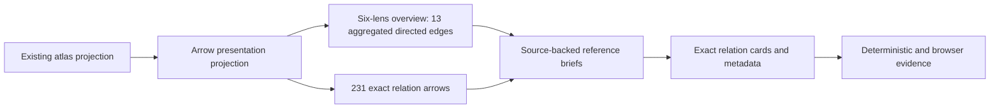

# Body War Business Ontology Atlas Arrows

## What This Module Owns

This feature restores the graphical arrow language to the completed Body War
business ontology atlas and adds source-backed reference briefs at the point
of reading. It derives bounded lens-flow summaries, renders each canonical
relation as a visual source → phrase → target sentence, and exposes the
available ontology definition, status, blockers, and related incidence without
changing ontology inputs, relation identity, or authority.

## Module Map

## Capabilities

| Capability | What | Key aspects |
| --- | --- | --- |
| `CAP-BWAA-01` Derive lens flow | Group the 109 cross-lens portals into ordered source-lens/target-lens pairs. | stable grouping, counts, represented relation IDs |
| `CAP-BWAA-02` Render overview arrows | Show six lens nodes and 13 aggregated directed edges without implying new ontology relations. | fixed deterministic geometry, reciprocal-edge separation, text fallback |
| `CAP-BWAA-03` Render relation arrows | Render every canonical relation card as source → phrase → target. | exact tuple, readable phrase, predicate/effect label, stable anchors |
| `CAP-BWAA-04` Preserve progressive access | Keep exact content available without JavaScript and preserve mobile, print, keyboard, and focus behavior. | static SVG, semantic text, responsive reflow, no interaction dependency |
| `CAP-BWAA-05` Verify arrow parity | Bind generated bytes and browser observations to the exact source projection. | deterministic tests, source digests, screenshots, pinned runtime |
| `CAP-BWAA-06` Expose source-backed reference briefs | Reveal concise node, relation, lens, and predicate context on hover, keyboard focus, touch/click, no-JS, and print paths. | canonical definitions, projection wording, status, blockers, residue, related incidence, explicit missing-data language |

## Actors

| Actor | Goal | Constraint |
| --- | --- | --- |
| Ontology reader | See direction before opening exact metadata. | Must not infer ontology meaning from layout alone. |
| Keyboard or assistive-technology reader | Read the same source, phrase, target, predicate, effect, and count in document order. | Meaning cannot depend on color, pointer input, or SVG geometry. |
| Product ontology owner | Review that presentation changed without semantic source mutation. | Projection has no promotion authority. |

## Domain Concepts

| Concept | Type | Key constraints |
| --- | --- | --- |
| `ArrowDescriptor` | projection value | references one canonical relation; never copies or changes its tuple |
| `LensFlowGroup` | projection value | one ordered lens pair, positive count, exact sorted portal IDs |
| `ArrowPresentation` | rendered projection | line style plus explicit textual meaning; color is supplementary |
| `ArrowDiagram` | interface surface | static SVG plus adjacent or embedded accessible sentence |
| `ReferenceBrief` | rendered projection | concise semantic HTML derived only from fields present in the admitted projection |
| `RelatedIncidence` | projection value | exact incoming/outgoing relation references for a node; never a new relation |

## Concept Registry

| Concept | ID | Type |
| --- | --- | --- |
| Arrow descriptor | `body-war.atlas-arrow.arrow-descriptor` | Mapping |
| Lens-flow group | `body-war.atlas-arrow.lens-flow-group` | Mapping |
| Overview arrow diagram | `body-war.atlas-arrow.overview-diagram` | Interface |
| Relation arrow diagram | `body-war.atlas-arrow.relation-diagram` | Interface |
| Arrow presentation policy | `body-war.atlas-arrow.presentation-policy` | Policy |
| Arrow parity validator | `body-war.atlas-arrow.parity-validator` | Operation |
| Source-backed reference brief | `body-war.atlas-arrow.reference-brief` | Interface |
| Related incidence | `body-war.atlas-arrow.related-incidence` | Mapping |

## Feature Concept Graph

| From | Edge | To | Evidence |
| --- | --- | --- | --- |
| `body-war.atlas-arrow.lens-flow-group` | projects | canonical cross-lens portal relations | `view-atlas-projection.mjs` |
| `body-war.atlas-arrow.overview-diagram` | renders | `body-war.atlas-arrow.lens-flow-group` | `render-view-atlas.mjs` |
| `body-war.atlas-arrow.relation-diagram` | renders | `body-war.atlas-arrow.arrow-descriptor` | `render-view-atlas.mjs` |
| `body-war.atlas-arrow.presentation-policy` | governs | both arrow diagrams | this specification |
| `body-war.atlas-arrow.parity-validator` | validates | both arrow diagrams | planned tests and browser receipt |
| `body-war.atlas-arrow.reference-brief` | presents | canonical node fields, relation projection wording, lenses, and predicate usage | `render-view-atlas.mjs` |
| `body-war.atlas-arrow.related-incidence` | indexes | existing canonical relation IDs by endpoint | `view-atlas-projection.mjs` |

These are DomainSpec feature concepts for a removable projection. They are not
new Body War business-ontology nodes or relations.

## Projection Rules

### Lens flow

Input: the six existing lens records and the 109 existing portal records.

1. Group portals by the ordered tuple
   `(source_lens_id, target_lens_id)`.
2. Preserve every canonical `relation_id` inside exactly one group.
3. Sort groups by source-lens catalog order, then target-lens catalog order.
4. Sort each group's relation IDs lexically.
5. Emit one overview edge with the exact count and relation-ID references.
6. Reject unknown lenses, missing relation IDs, zero-count groups, duplicated
   relation IDs, or a total other than 109.

Current denominator: six lens nodes, 13 directed groups, and 109 represented
portal relation IDs.

### Relation arrow

For each of the 231 existing canonical relations:

1. Resolve the canonical source and target nodes.
2. Render source label, plain-language phrase, arrowhead, and target label.
3. Render the typed predicate and authority-effect class in text.
4. Use a solid line for ordinary admitted candidate meaning.
5. Use a dotted line plus explicit text for `authority_effect: blocked`,
   `authority_effect: projection`, or predicate `does_not_promote`.
6. Keep the canonical relation article and fragment ID as the only relation
   identity target.
7. Never reverse the tuple when a portal is viewed from its target lens.

### Source-backed reference brief

Reference briefs are semantic HTML disclosures attached to node, relation,
lens, and predicate references. They follow this data hierarchy:

1. Node brief: label and canonical definition; kind/role and lifecycle status;
   owner or resolution gate; every recorded blocking question; every recorded
   residue item; exact incoming/outgoing relation references and counts; exact
   source metadata.
2. Relation brief: source label → projection wording → target label; typed
   predicate, direction, authority effect, value effect, relation ID, and
   forbidden-collapse text. Endpoint definitions may be shown, but the
   projection wording must never be called a relation definition.
3. Lens brief: title, question, description, exact counts, and directed-flow
   summary.
4. Predicate brief: predicate token, projection wording, exact usage count,
   and bounded examples. A predicate brief does not claim a canonical
   predicate definition unless one exists in an admitted source.

Missing-data behavior is explicit and non-inventive:

- a blocked item without a blocking question reads
  `No blocking question recorded`;
- empty residue is omitted or reads `No residue recorded`;
- a zero-incidence node reads `No admitted explicit relation`;
- no brief synthesizes a relation definition from its label or projection
  wording.

Brief content is real escaped HTML in source order. A native semantic
disclosure remains available without JavaScript and in print. CSS may reveal
the brief on pointer hover or focus-within; keyboard focus, touch/click, and
ordinary disclosure controls expose the same data. A `title` attribute, SVG
text, color, or opaque `data-*` value cannot be the sole carrier of meaning.

## Interface Contracts

### Overview diagram

- Static inline SVG with six stable lens targets.
- Thirteen directed paths, including visibly separated reciprocal directions.
- Each edge has an accessible source-lens → target-lens sentence, portal count,
  and link to the destination lens.
- An adjacent semantic list exposes the same 13 groups without requiring SVG
  interpretation.

### Relation diagram

- Static inline SVG inside the existing relation card.
- `role="img"` and an accessible sentence name the exact source, phrase,
  target, predicate, authority effect, and relation ID.
- Existing plain-language sentence, endpoint links, portal actions, and exact
  metadata remain available.

### Reference brief

- Each node, relation, lens, and predicate reference has one discoverable
  semantic disclosure sourced from the admitted projection.
- Hover and focus reveal a concise preview; activating the disclosure keeps it
  open for touch and keyboard review.
- The disclosure is present in the no-JavaScript DOM and expanded or otherwise
  readable in print.
- Blocked status, recorded blocking questions, and residue remain visible and
  are never filtered from the brief.
- Exact links lead to the existing canonical node or relation anchors; the
  brief creates no duplicate identity target.

### Responsive and print

- At narrow widths, the source/target layout stacks and the arrow turns
  vertical while the semantic source-before-target order remains unchanged.
- Print shows all lenses, all relation arrows, and text fallbacks.
- Reduced-motion behavior remains static; arrows do not animate.

## Non-Goals

- No edits to `nodes/`, `relations/`, `lifecycle-policies/`, `profile.json`,
  `residue.json`, or `views/business.json`.
- No force-directed layout, graph-layout dependency, Canvas-only rendering,
  zoom/pan workspace, animation, or remote asset.
- No attempt to draw 237 nodes and 231 relations on one overview canvas.
- No change to lens classification, isolate disposition, search, focus,
  history, or portal semantics.
- No invented relation, predicate, or blocker definition; no tooltip-only
  meaning and no runtime request for descriptive content.
- No human-comprehension, accessibility-conformance, promotion, release,
  deployment, or production claim.

## Acceptance Criteria

| ID | Criterion |
| --- | --- |
| `AC-BWAA-001` | The overview renders six lens nodes and exactly 13 directed aggregate arrows representing all and only the 109 portal relation IDs. |
| `AC-BWAA-002` | All 231 canonical relation articles contain one graphical source → phrase → target arrow while each relation ID remains a single canonical DOM target. |
| `AC-BWAA-003` | Every arrow preserves canonical source, target, direction, predicate, authority effect, owner, and relation ID; reciprocal lens directions remain distinguishable. |
| `AC-BWAA-004` | Solid/dotted meaning is stated in text and does not rely on color; blocked, projection, and `does_not_promote` relations remain present. |
| `AC-BWAA-005` | Overview groups and exact relation arrows remain readable and navigable without JavaScript, at 390 CSS pixels, with reduced motion, and in print. |
| `AC-BWAA-006` | Existing 237/231/122/109/44 conservation, anchors, portal behavior, search/focus, and protected generated-view digests do not regress. |
| `AC-BWAA-007` | Semantic-source digests remain unchanged and receipts retain `authority_effect: none` and `release_admission: not-granted`. |
| `AC-BWAA-008` | Deterministic tests and pinned-browser assertions bind the exact generated atlas bytes, arrow counts, accessible sentences, responsive structure, screenshots, and zero unexpected console/page errors. |
| `AC-BWAA-009` | All 237 node, 231 relation, six lens, and 23 predicate reference briefs expose their available source-backed data through hover, keyboard focus, touch/click, no-JS, and print paths; blockers and residue are retained, missing fields are stated without invention, and relation projection wording is never mislabeled as a definition. |

## Validation Strategy

- Pure tests for ordered lens-flow grouping, total conservation, duplicates,
  reciprocal directions, and unknown endpoints.
- Renderer tests for markers, arrow labels, relation-card count, exact
  sentences, solid/dotted text, ordinary fragments, no-JavaScript content, and
  print/mobile CSS.
- Renderer tests for reference-brief coverage, source-field parity, escaped
  semantic HTML, blocker/question/residue preservation, zero-incidence
  language, and projection-wording labels.
- Existing atlas projection, renderer, view-generator, and package validators.
- Pinned Chromium checks at desktop and 390-pixel mobile, JavaScript disabled,
  reduced motion, and print media.
- Exact pre/post digests for the six semantic-source classes and protected
  generated siblings.

## Authority Boundary

Status: `candidate-local`  
Authority effect: `none`  
Release admission: `not-granted`

The arrow layer is a generated presentation projection. It cannot admit,
remove, reverse, promote, or otherwise change ontology meaning.
