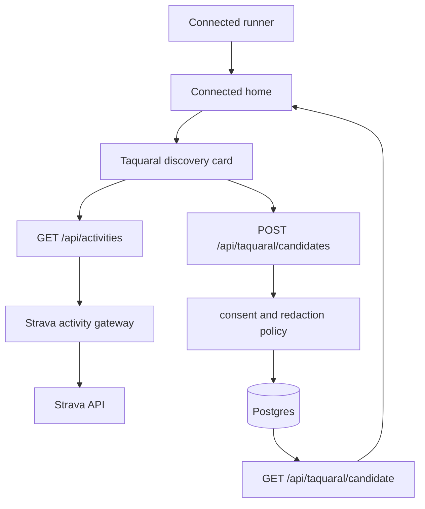

# Architecture And Plan: Taquaral Circuit Discovery

## Product Shape

After Strava login, the home page should show a compact card:

```text
Ajude a mapear o circuito do Taquaral
Precisamos encontrar a atividade no seu Strava que contem a volta do parque.
Selecione uma corrida recente, confirme que ela e o circuito, e envie como
evidencia de preview.
```

The card asks for only what the app needs now:

- activity selection from recent Strava runs,
- optional approximate date hint if the list is large,
- visible distance, moving time, pace, and start date,
- explicit checkbox-style consent text for using the selected activity as
  Taquaral preview evidence,
- submit action: `Enviar circuito do Taquaral`.

## Architecture View



## Domain Model

| Concept | Meaning | Source |
| --- | --- | --- |
| `TaquaralCircuitRequest` | The home prompt asking for one source activity. | TROQAR UI |
| `StravaRunSummary` | Redacted candidate activity shown to the runner. | Strava activity list |
| `TaquaralActivityCandidate` | Runner-selected activity submitted as protected evidence. | Body War backend |
| `CandidateConsent` | Consent receipt captured at submit time. | Runner action |
| `RouteGeometryEvidence` | Future source-backed geometry artifact. | Deferred |

## New States

| State | UI meaning | Backend condition |
| --- | --- | --- |
| `needs_connection` | Runner must connect Strava. | no authenticated Strava account |
| `needs_activity_selection` | Runner is connected; no candidate exists. | no candidate row |
| `candidate_submitted` | Runner selected an activity. | candidate row exists |
| `operator_review` | Candidate is available for manual review. | candidate row has redacted evidence |
| `source_backed` | Future geometry artifact accepted. | approved geometry reference exists |

## Backend Design

### Existing Behavior To Preserve

- Strava OAuth remains the only login method.
- Provider tokens stay encrypted server-side.
- Browser only receives redacted activity summaries.
- CSRF remains required for unsafe methods.

### Required Additions

1. Token read path:
   - Add repository method to read latest provider token by account id.
   - Decrypt access token only inside the Strava gateway.
   - Refresh token only if expired, and persist replacement token server-side.

2. Real activity listing:
   - Replace placeholder repository summaries with Strava-backed summaries.
   - Query recent activities with server-side `page`, `per_page`, and optional
     `after` date filters.
   - Keep only run-like sport types in the UI and backend eligibility checks.

3. Candidate persistence:
   - Add `body_war_taquaral_activity_candidates`.
   - Store principal id, provider activity id, redacted summary fields, consent
     receipt, submitted timestamp, and status.
   - Do not store raw tokens or raw full activity JSON.

4. Future geometry import:
   - Treat Strava streams or map polyline as protected evidence.
   - Store only a redacted geometry artifact after explicit operator acceptance.
   - Keep `route_geometry=not_claimed` until this is done.

## API Plan

| Method | Route | Purpose |
| --- | --- | --- |
| `GET` | `/api/taquaral/candidate` | Return current candidate status for the runner. |
| `POST` | `/api/taquaral/candidates` | Submit selected activity as Taquaral preview evidence. |
| `GET` | `/api/activities?after=&page=&per_page=` | Return real redacted Strava run summaries. |

`POST /api/taquaral/candidates` body:

```json
{
  "activity_id": "123",
  "consent": true,
  "claim": "taquaral_circuit"
}
```

Response:

```json
{
  "candidate": {
    "status": "candidate_submitted",
    "activity_id": "123",
    "activity_name": "Morning Run",
    "distance": 6400,
    "moving_time": 2100,
    "route_geometry": "not_claimed"
  }
}
```

## UI Plan

Home order after connection:

1. Connection status.
2. Taquaral discovery card.
3. Recent runs.
4. Profile/privacy.
5. Preview evidence.

Discovery card states:

- Not connected: hidden because login screen already owns connection.
- Loading: "Buscando corridas recentes..."
- Empty: "Nao encontramos corridas recentes. Tente atualizar ou ajuste o periodo."
- Ready: activity picker plus consent checkbox and submit button.
- Submitted: "Circuito enviado para review de preview."
- Error: safe, specific copy for no Strava scope, expired token, no activity, or
  submit failure.

## Security And Privacy Rules

- Do not render or log access tokens, refresh tokens, client secret, or full raw
  activity payload.
- Consent is required before storing candidate evidence.
- Activity candidate data is preview evidence, not public verified geometry.
- Route geometry is a separate promotion step.
- If the activity is private and current scope cannot access it, show a
  permission/scope blocker instead of asking for broader scope silently.

## Implementation Plan

### Slice 1: Spec And Data Contract

- Update feature docs with `TaquaralActivityCandidate`, consent states, API
  routes, and test cases.
- Add Drizzle schema for candidate rows.
- Generate SQL with `drizzle-kit generate`.

### Slice 2: Strava Gateway

- Add token read/decrypt/refresh support.
- Implement `listLiveActivitySummaries`.
- Preserve fake gateway fixtures for tests.

### Slice 3: Candidate API

- Add `GET /api/taquaral/candidate`.
- Add `POST /api/taquaral/candidates` with CSRF and permission checks.
- Enforce run-like activity and consent.

### Slice 4: Home UI

- Add the connected-home Taquaral discovery card.
- Reuse existing activity formatting.
- Add candidate state rendering and specific errors.

### Slice 5: Validation

- Unit test token redaction and candidate state.
- E2E test fake Strava connection, activity selection, consent required, submit,
  and no-secret leakage.
- Hosted smoke checks after deploy.

## Open Questions

1. Should the first real runner select from recent activities only, or do we
   need a date range input immediately?
2. Do we need `activity:read_all` for the friend activity, or is the activity
   visible enough under current `activity:read` scope?
3. Should operator review be a file-backed/admin-only view for now, or a direct
   database query/manual receipt?

## Recommended Next Route

Run `task-session` on Slice 1 first. Do not implement route geometry extraction
until the candidate submission flow is proven and consented.
