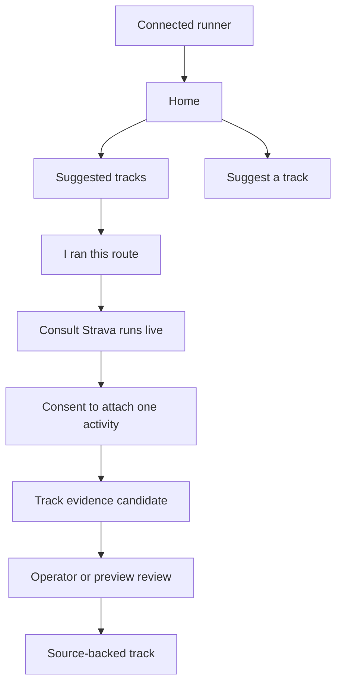

# Architecture And Plan: Suggested Track Expansion Route

## Route Thesis

Track expansion should be native to TROQAR:

```text
I want this place in the game -> suggest a track -> gather evidence -> promote.
```

This turns Taquaral from a one-off operator request into the first instance of a
repeatable loop.

## Product Flow



## Domain Model

| Concept | Meaning | Persistence |
| --- | --- | --- |
| `SuggestedTrack` | A route/place users want TROQAR to support. | saved |
| `TrackEvidenceRequest` | A visible request for evidence for a suggestion. | derived/read model |
| `StravaActivityConsult` | Live redacted activity summaries for the connected runner. | not saved |
| `TrackEvidenceCandidate` | One activity attached with consent as evidence. | saved |
| `SourceBackedTrack` | A suggested track promoted with accepted geometry/source. | saved |

## Status Model

| Status | Meaning | User copy |
| --- | --- | --- |
| `suggested` | Track idea exists. | "Pista sugerida" |
| `needs_evidence` | Needs at least one activity or source. | "Precisamos de uma corrida" |
| `evidence_submitted` | One or more candidates exist. | "Evidencia enviada" |
| `operator_review` | Candidate needs review/promotion. | "Em review" |
| `source_backed` | Geometry/source accepted. | "Fonte confirmada" |
| `pilot_ready` | Can appear as a pilot route. | "Pronta para piloto" |
| `archived` | Suggestion closed without promotion. | "Arquivada" |

## Data Ownership

Suggested track data is low sensitivity and can be persisted immediately:

- name,
- place/city,
- optional public note,
- suggested-by principal id,
- status,
- counters.

Strava activity data stays private until consent:

- live consult uses access token server-side,
- browser receives redacted summaries only,
- no activity is saved during browsing/filtering,
- one selected activity becomes `TrackEvidenceCandidate` only after consent.

## API Plan

| Method | Route | Purpose |
| --- | --- | --- |
| `GET` | `/api/suggested-tracks` | List suggestions, including Taquaral seed. |
| `POST` | `/api/suggested-tracks` | Create a new suggested track. |
| `GET` | `/api/suggested-tracks/:id` | Show suggestion detail and evidence state. |
| `GET` | `/api/activities?track_suggestion_id=:id` | Consult Strava activities live for evidence selection. |
| `POST` | `/api/suggested-tracks/:id/evidence-candidates` | Attach one activity with consent. |

For the current UI, `/api/tracks` can remain as a compatibility read model that
returns pilot tracks plus suggested tracks. Future UI can split into `/routes`
and `/suggestions`.

## UI Plan

Connected home should show:

1. Strava status.
2. "Pistas sugeridas" list.
3. Taquaral suggestion card:
   - title: "Volta do Taquaral"
   - status: "Precisamos de uma corrida"
   - actions: "Tenho essa corrida" and "Sugerir outra pista"
4. When "Tenho essa corrida" opens:
   - recent run summaries from Strava,
   - optional date/distance filters,
   - consent checkbox,
   - submit as evidence.

Suggested track form fields:

- track name,
- place/neighborhood/city,
- short public note,
- optional distance hint.

## Persistence Plan

Use Drizzle with Postgres. Generate migrations with `drizzle-kit generate`.

Suggested tables:

```text
body_war_suggested_tracks
body_war_track_evidence_candidates
```

`body_war_suggested_tracks` fields:

- `id`
- `slug`
- `name`
- `place_label`
- `city`
- `country`
- `suggested_by_principal_id`
- `status`
- `public_note`
- `distance_hint_meters`
- `created_at`
- `updated_at`

`body_war_track_evidence_candidates` fields:

- `id`
- `suggested_track_id`
- `principal_id`
- `provider`
- `provider_activity_id`
- `redacted_summary`
- `consent_text`
- `consented_at`
- `status`
- `created_at`

## Seed Policy

Seed Taquaral as data, not code:

```json
{
  "slug": "volta-do-taquaral",
  "name": "Volta do Taquaral",
  "place_label": "Parque Portugal / Lagoa do Taquaral",
  "city": "Campinas",
  "country": "BR",
  "status": "needs_evidence"
}
```

## Privacy Rules

- Track suggestions may be visible to all connected runners.
- Evidence candidates are visible only as redacted summaries.
- Full activity details, streams, and geometry remain protected backend data
  until source-backed promotion.
- The UI must say "preview evidence", not "verified".
- Deletion/removal path is required before wider pilot use.

## Implementation Slices

### Slice 1: Spec And Schema

- Update feature docs with `SuggestedTrack`, statuses, and API contract.
- Add Drizzle schema.
- Generate migration with `drizzle-kit generate`.
- Add seed policy for Taquaral.

### Slice 2: Suggestion API

- Add list/create/detail routes.
- Keep `/api/tracks` compatibility by mapping suggestions to route cards.
- Add tests for auth, validation, and redaction.

### Slice 3: Evidence Consult

- Add live Strava activity consult behind existing auth/session.
- Keep consult ephemeral.
- Add no-save/no-secret tests.

### Slice 4: Evidence Attach

- Add consented evidence candidate submit.
- Store redacted summary only.
- Update suggestion status from `needs_evidence` to `evidence_submitted`.

### Slice 5: Home UI

- Replace generic "Pistas piloto" with suggested track expansion cards.
- Add "Tenho essa corrida" and "Sugerir outra pista".
- Preserve current activity and profile panels.

## Open Decisions

1. Should anonymous visitors see suggested tracks, or only connected runners?
2. Should a suggestion require login immediately, or can a visitor draft it and
   connect before submit?
3. Should Taquaral seed be inserted by migration, startup seed, or static JSON
   bootstrap?
4. Who can promote `evidence_submitted` to `source_backed` in the first pilot?

## Recommended Next Route

Task Session on Slice 1 only. Do not implement Strava stream/geometry import in
the first task. The first proof is a persisted suggested track model and a
validated Taquaral seed.
