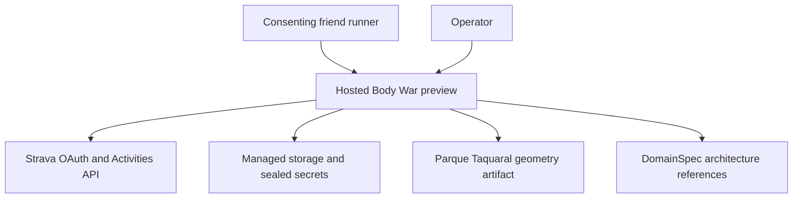
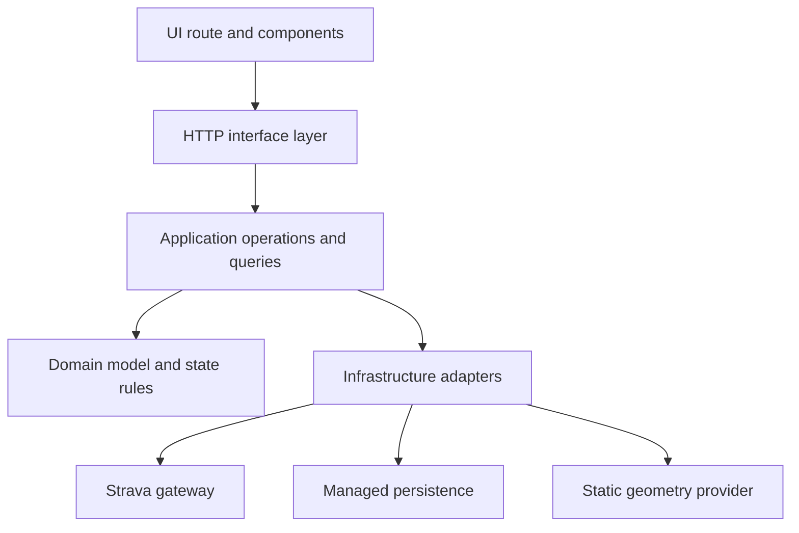
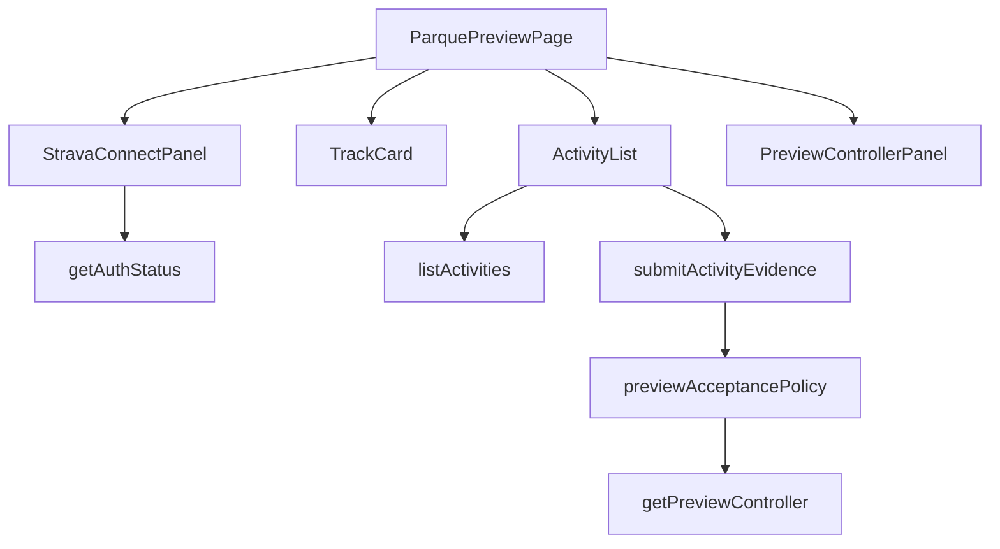
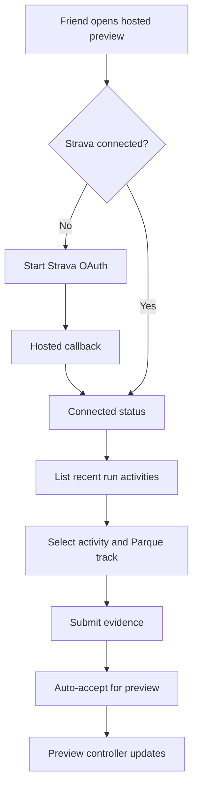
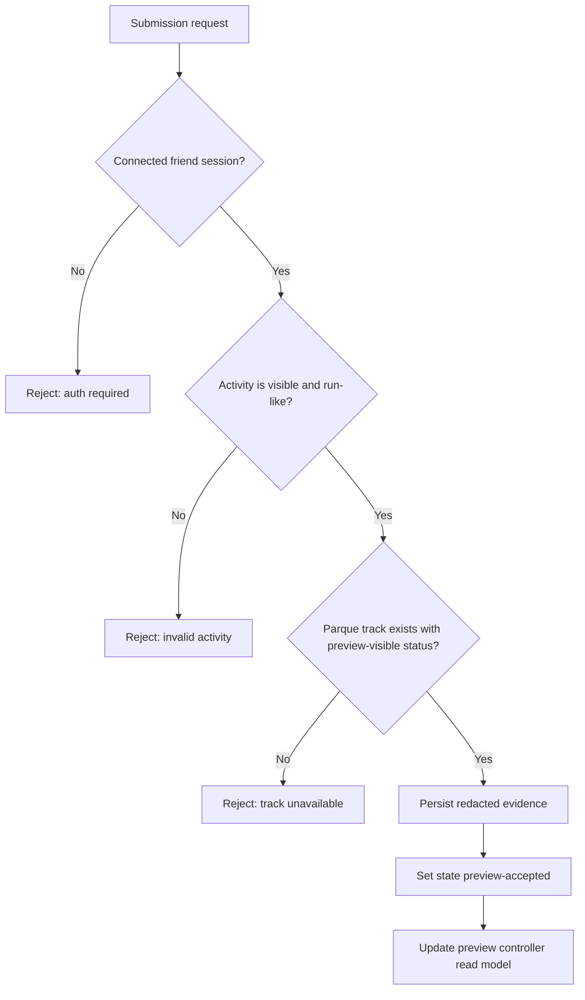
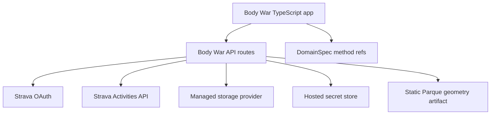

# Design: Parque Taquaral Online MVP

## Design Intent

Build a Body War-owned TypeScript hosted preview that lets one consenting friend
connect Strava, see real activity data, submit an activity to the Parque
Taquaral pilot track, and see the preview controller update. The design must
not claim pilot readiness, engineering readiness, anti-cheat readiness, or final
GPS validation.

## Inputs

| Source | Role |
| --- | --- |
| `docs/decisions/parque-taquaral-online-mvp-oneshot.md` | Selected product and architecture decisions. |
| `PILOT-DOMAINSPEC-COVERAGE.md` | Missing spec coverage and lane synthesis. |
| `PILOT-DOMAINSPEC-BACKLOG.md` | Ordered P0 spec backlog and implementation-contract gaps. |
| `ARCHITECTURE-AUDIT.md` | TypeScript app and DomainSpec reference boundary. |
| `DISCOVERY.md` | Earlier product loop and open gap context. |
| `MVP-ONESHOT-FORECAST.md` | Pre-decision forecast; superseded where it conflicts with final decisions. |
| `docs/features/strava-linked-pilot/SPEC.md` | Python prototype reference only. |
| `app/data/tracks.json` | Safe static placeholder track metadata. |

## Required View Set

### 1. Context View

### 2. High-Level Structure View

### 3. Low-Level Components View

## Component Responsibilities

| Component | Responsibility | Primary Contract |
| --- | --- | --- |
| `ParquePreviewPage` | Single compact hosted page for friend login, track, activity, submission, and controller state. | `ui-spec.md` |
| Auth routes | Start/callback Strava OAuth and expose connected status. | `interfaces.md` |
| Activity query | List real consenting friend activities and zero/error states. | `queries.md` |
| Submission operation | Store redacted activity evidence and mark preview acceptance. | `operations.md` |
| Controller query | Compute/read current preview controller state. | `queries.md` |
| Strava gateway | Isolate OAuth, token refresh, and activity API details. | `mappings.md`, `DEPLOYMENT-SECURITY.md` |
| Managed storage adapter | Persist token references, submissions, controller state, and audit metadata. | `DEPLOYMENT-SECURITY.md` |
| Geometry provider | Serve source-backed Parque Taquaral track metadata and geometry. | `TRACK-GEOMETRY.md` |

### 4. Workflow Process View

### 5. Decision Flow View

### 6. Dependency Interface View

## Source Contracts

| Contract | Status | Notes |
| --- | --- | --- |
| Product decision record | pass | Product blockers are closed. |
| DomainSpec coverage synthesis | pass | Confirms missing P0 specs. |
| TypeScript boundary audit | pass | Architecture boundary selected, runtime not proven. |
| Formal define glossary | flag | No Invoke define glossary exists; use glossary consistency report as candidate vocabulary. |
| Hosted provider/storage choice | block-for-mutation | Category selected, provider/schema not selected. |
| Source-backed geometry | block-for-route-claim | Track target selected, geometry artifact missing. |

## Design Decisions

| ID | Decision | Status | Source |
| --- | --- | --- | --- |
| DES-001 | One compact hosted web page is the preview surface. | selected | Decision D-OS-007 assumption. |
| DES-002 | Visible runner data must be real Strava data from a consenting friend. | selected | D-OS-003. |
| DES-003 | Test fixtures are allowed only for tests and no-secret preflight, not visible friend preview claims. | selected | Parent synthesis. |
| DES-004 | `preview-accepted` is distinct from `verified`. | selected | D-OS-005 guardrail. |
| DES-005 | Python prototype becomes reference-only; TS app owns canonical `app/` during implementation. | selected | D-OS-002. |
| DES-006 | Hosted provider and managed storage schema must be chosen before app mutation. | blocked | P0 backlog. |
| DES-007 | Full Parque geometry must be source-backed before route/map claims. | blocked | D-OS-004 guardrail. |

## Open Risks

| Risk ID | Risk | Impact | Mitigation |
| --- | --- | --- | --- |
| R-DES-001 | Hosted storage provider remains unnamed. | high | Write `DEPLOYMENT-SECURITY.md` before TS scaffold. |
| R-DES-002 | Geometry source remains unidentified. | high | Write `TRACK-GEOMETRY.md` and add/link static geometry. |
| R-DES-003 | Preview acceptance may be mistaken for verification. | high | Use `preview-accepted` wording in states/UI/tests. |
| R-DES-004 | Friend data can leak into repo artifacts or logs. | high | Redaction/no-secret test matrix and storage contract. |
| R-DES-005 | Existing Python docs can mislead implementation. | medium | Mark old Strava feature as reference-only in new specs. |

## Planning Notes

- Direct implementation target remains `projects/body-war/app/`, but mutation is
  gated by W0 spec completion.
- The design uses DomainSpec references as architecture authority; it does not
  promote Body War project specs into canonical DomainSpec methods.
- The next plan should be medium complexity and split because the work includes
  hosted auth, durable storage, geometry, UI, validation, and app replacement.

## Handoff Targets

- `IMPLEMENTATION-LAYERING.md`
- `WORK-PACK.md`
- `EXECUTION-PACK.md`
- `work-pack/`

