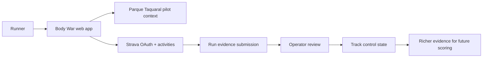

# Discovery - Body War Parque Taquaral Online MVP

> Summary document for reasoning about what we will build and how it should be built.
> This follows the Victor discovery model: plain-language orientation first, system shape
> second, engineer verdicts and blockers third. Every build claim is separated into
> decided, blocked, flagged, deferred, or not built.

Sibling / source docs:

- Craft state: `projects/body-war/.craft/ledger.yml`
- Human Craft view: `projects/body-war/CRAFT.md`
- Review/audit dispatch: `projects/body-war/development/dispatches/20260610-body-war-parque-taquaral-review-audit.dispatch.json`
- Review/audit spec: `projects/body-war/development/dispatches/20260610-body-war-parque-taquaral-review-audit.spec.md`
- Strava pilot spec: `projects/body-war/docs/features/strava-linked-pilot/SPEC.md`
- Strava pilot work-pack: `projects/body-war/docs/features/strava-linked-pilot/WORK-PACK.md`
- Product decisions: `projects/body-war/docs/PROJECT-DECISIONS.md`
- DomainSpec architecture source: `implementation/domainspec/architecture/ARCHITECTURE.md`

## Objective

Body War needs a showable MVP for a first physical pilot at Parque Taquaral, Campinas.
The MVP should explain the track-control loop, link to Strava through a real backend,
and preserve evidence for later review.

The current job is not to implement everything. The current job is to close enough
decisions and gaps that implementation can proceed without guessing the architecture,
evidence rules, or pilot boundaries.

## 1. Current Truth

**What Body War is.** Body War / TROQAR is a runner territory-control game. The first
candidate shape is selected parks with delimited tracks, not a city-wide hex map.
Source: `projects/body-war/docs/PROJECT-DECISIONS.md`, PD-007.

**What the first real-world pilot is becoming.** Parque Taquaral, Campinas is now the
intended physical MVP context. It is a place context, not yet a sourced track geometry.
The system must not claim official lap boundaries or automated GPS validation until a
track-boundary artifact exists. Source: `projects/body-war/.craft/ledger.yml`,
`GAP-TAQUARAL-GEOMETRY-001`.

**What the validation channel is.** The selected validation channel is an app/runtime-backed
MVP with Strava API linking and backend. The current prototype is a Python standard-library
backend with static UI, Strava OAuth, activity fetch, tracks, and local submissions.
Source: `projects/body-war/docs/PROJECT-DECISIONS.md`, PD-011;
`projects/body-war/docs/features/strava-linked-pilot/SPEC.md`.

**What has already passed.** Local smoke and Strava OAuth passed. The connected athlete
returned zero activities, so activity import and submission are still blocked. Source:
`projects/body-war/docs/features/strava-linked-pilot/WORK-PACK.md`.

**What Craft now owns.** Craft is the project-local state ledger. It records blockers,
gaps, decisions, route evidence, and recomposition. Its source of truth is
`projects/body-war/.craft/ledger.yml`; `projects/body-war/CRAFT.md` is only the human view.

## 2. The Product Shape

The MVP loop should be simple enough to explain in one pass:

1. A runner opens the Body War web app.
2. The app shows the Parque Taquaral pilot and the current control track concept.
3. The runner connects Strava.
4. The runner imports a recent run.
5. The runner submits that run as evidence for a track.
6. The operator can review submitted evidence.
7. The public controller metric is fastest verified time.
8. Richer evidence is preserved for later balancing and composite scoring.

The prototype can demonstrate parts of this loop, but the target architecture is not the
prototype. The future implementation should use a Body War-owned TypeScript workspace/app
with a DomainSpec path alias or explicit source references to DomainSpec architecture
guidance.



## 3. Given vs Optimized

Borrowing the Victor model, not every layer is a knob.

| Layer | Status | Rule |
| --- | --- | --- |
| Pilot place | Given for this slice | Parque Taquaral is the context. Geometry is not given yet. |
| Validation channel | Decided | App-backed Strava API link with backend. |
| Public controller | Decided | Fastest verified time. |
| Rich evidence | Decided | Composite score and activity metadata are captured for later analysis. |
| Architecture method | Decided | Body War-owned TypeScript workspace/app with DomainSpec path alias. |
| Strava evidence | Blocked | OAuth passed, but real activity import/submission has not passed. |
| Track geometry | Deferred | Needs sourced boundary/lap artifact before GPS claims. |
| Monetization | Deferred/open | Not part of this MVP build unless a later decision changes scope. |

## 4. Decision Inventory

Status legend: `resolved`, `open`, `block`, `deferred`.

| ID | Decision / stance | Verdict | Status | Authority |
| --- | --- | --- | --- | --- |
| D1 | Product brand | TROQAR brand, Body War project scaffold. | resolved | `PROJECT-DECISIONS.md`, PD-001..PD-002 |
| D2 | First candidate shape | Selected parks with delimited tracks, not city-wide hex zones. | resolved | `PROJECT-DECISIONS.md`, PD-007 |
| D3 | Craft pilot | Craft is the internal governance pilot context. | resolved | `PROJECT-DECISIONS.md`, PD-008..PD-009 |
| D4 | Public scoring | Fastest verified time publicly controls L0; richer evidence is recorded underneath. | resolved | `PROJECT-DECISIONS.md`, PD-010 |
| D5 | Validation channel | App-backed MVP with Strava API link and backend. | resolved | `PROJECT-DECISIONS.md`, PD-011 |
| D6 | Physical pilot context | Parque Taquaral, Campinas. | resolved-for-context | Craft ledger; operator instruction |
| D7 | Track geometry | No sourced route/lap geometry yet. | deferred | `GAP-TAQUARAL-GEOMETRY-001` |
| D8 | Architecture/import boundary | Body War-owned TypeScript workspace/app with DomainSpec path alias. | resolved | `architecture-import-boundary.md`; `ARCHITECTURE-AUDIT.md` |
| D9 | Strava evidence readiness | OAuth passed; real activity submission missing. | block | `BLK-STRAVA-ACTIVITY-001` |
| D10 | Monetization | Deferred/open; not in L0 build. | deferred | `mvp-readiness.md`, DG-006 |

## 5. Blockers And Gaps

| ID | Kind | Severity | Current status | Closure condition |
| --- | --- | --- | --- | --- |
| `BLK-STRAVA-ACTIVITY-001` | evidence blocker | block | active | Import and submit one real Strava run without exposing tokens. |
| `GAP-TAQUARAL-GEOMETRY-001` | product/evidence gap | flag | active/deferred | Add a sourced track-boundary or lap artifact before making geometry or GPS validation claims. |
| `DG-006` | scope decision | deferred | unresolved | Keep monetization out of MVP unless explicitly reopened. |

Resolved architecture items:

| ID | Kind | Resolution |
| --- | --- | --- |
| `BLK-ARCH-BOUNDARY-001` | architecture blocker | Closed by `ARCHITECTURE-AUDIT.md`. |
| `DEC-ARCH-BOUNDARY-001` | blocking decision | User selected Body War-owned TypeScript workspace with DomainSpec path alias. |
| `GAP-DOMAINSPEC-EXPORT-001` | architecture gap | Resolved for MVP by path-alias/source-reference consumption; shared typed package deferred. |

## 6. What We Will Build

The first build should be the smallest online MVP that proves the loop without pretending
all future systems exist.

Build target:

- A TypeScript web app surface for the Parque Taquaral MVP.
- A backend/API boundary for Strava status, activities, tracks, and submissions.
- A track-control page that makes the runner/operator flow obvious.
- A Strava connection state that is real, not decorative.
- Empty/error states for no activities, disconnected Strava, and pending evidence.
- A local evidence store or development database suitable for MVP review.
- Validation checks for architecture boundaries, API contracts, and user flow.

Do not build yet:

- Full mobile app.
- Sponsor economy, RunCoins, paid progression, or monetization hooks.
- Automated GPS polygon validation.
- Full anti-cheat system.
- Multi-park / city-wide territory map.
- Claims about official Parque Taquaral route geometry.

## 7. How It Should Be Built

Architecture should follow DomainSpec Functional TypeScript method boundaries through
a Body War-owned workspace/app and DomainSpec path alias:

- Domain layer: track, runner, activity evidence, control claim, submission status.
- Application layer: connect Strava, list activities, submit evidence, review evidence,
  compute public controller state.
- Infrastructure layer: Strava gateway, local persistence adapter, future map/geometry adapter.
- Interface layer: HTTP/API routes and web UI adapters.
- UI concepts: Page, Layout, Component, Hook, Guard, Adapter, State Indicator.

The architecture audit artifact is:

```text
projects/body-war/docs/features/parque-taquaral-online-mvp/ARCHITECTURE-AUDIT.md
```

Next planning artifact:

```text
projects/body-war/docs/features/parque-taquaral-online-mvp/WORK-PACK.md
```

## 8. Validation Route

Use Craft as the state ledger:

```text
projects/body-war/.craft/ledger.yml
```

Use `refine` to refine blockers and gaps into closure-ready artifacts:

- refine `BLK-STRAVA-ACTIVITY-001` only after the architecture audit is no longer blocking;
- keep `GAP-TAQUARAL-GEOMETRY-001` deferred until a track-boundary source exists.

Use `dispatch-spec` to validate route shape.

Use `decision-gate` only when a blocking choice has multiple viable options and no safe
default.

Use `task-session` only after architecture/import boundary and validation obligations are
ready.

## 9. Open Questions

1. Is the first online MVP allowed to include demo states, or must every visible run be real
   Strava data?
2. What exact track boundary at Parque Taquaral is acceptable for the first physical test?
3. Who is the first runner/operator pair for the pilot?
4. What is the minimum evidence needed to say the MVP loop works?

## 10. Current Verdict

Verdict: `ready-for-work-pack-planning`, `not-yet-runtime-ready`.

Reason:

- The Craft ledger exists and cleanly identifies the active blockers.
- The review/audit dispatch validates.
- The Strava prototype has real OAuth evidence.
- The architecture/import-boundary decision is closed.
- Strava activity submission remains blocked until a real run imports and submits.

Next move:

```text
Create WORK-PACK.md for the first bounded TypeScript MVP implementation slice.
```
