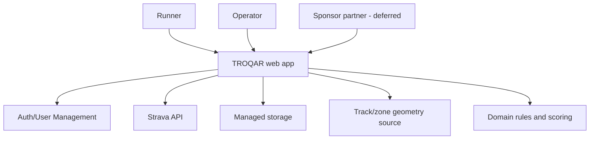
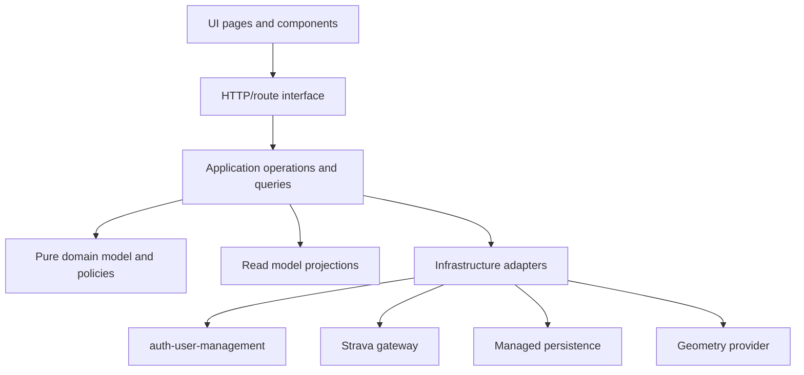
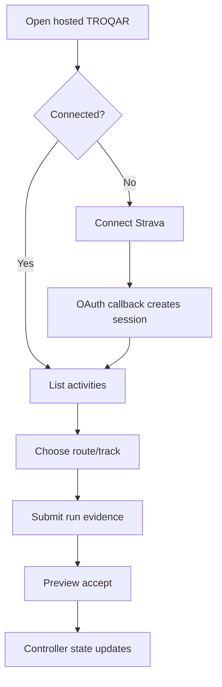
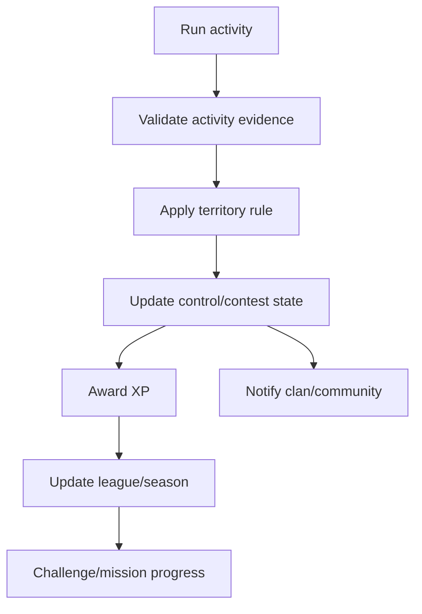

# Architecture: TROQAR Product Architecture

Status: `draft-pass`
Invoke mode: `design`
Architecture authority: DomainSpec Functional TypeScript layering

## Design Intent

TROQAR should become a Body War-owned TypeScript app that consumes DomainSpec
methods through explicit imports/path references and uses
`@domainspec/auth-user-management` for reusable principal, permission, session,
and token use cases. Body War owns the browser session adapter, CSRF/origin
guards, Strava provider adapter, profile records, and activity redaction. The
architecture must let the hosted Parque Taquaral preview ship first without
collapsing future territory, clan, challenge, season, and economy concepts into
the first slice.

## 1. Context View



## 2. High-Level Structure View



## 3. Low-Level Components View

| Layer | Module | Owns | Must Not Own |
| --- | --- | --- | --- |
| Domain | `identity`, `activity`, `territory`, `evidence`, `control`, `progression`, `community` | Types, invariants, state transitions, calculations. | HTTP, storage, provider SDKs. |
| Application | operations and queries from `operations.md` / `queries.md` | Use-case orchestration and read models. | Raw secrets, UI rendering. |
| Infrastructure | Strava gateway, persistence adapters, geometry provider, notification gateway. | External dependencies and durable storage. | Domain policy decisions. |
| Interface | HTTP routes and page actions. | Request parsing, auth guard calls, response shape. | Provider token custody or domain mutation rules. |
| UI | pages, components, hooks, forms, state indicators. | Runner/operator presentation and interaction. | Server authority or hidden client auth state. |

## 4. Workflow Process View

### Hosted Preview Loop



### Full Game Loop



## 5. Decision Flow View

| Decision | Rule | Blocking Status |
| --- | --- | --- |
| Can a runner submit? | Authenticated session, connected provider, eligible activity, selected territory. | Active. |
| Can submission update preview controller? | `preview-accepted` policy passes and territory is preview-visible. | Active. |
| Can submission become verified? | Operator or future validation path confirms evidence. | Future/pilot. |
| Can map claim GPS validation? | Geometry status is `validated`. | Blocked by `GAP-TAQUARAL-GEOMETRY-001`. |
| Can score replace fastest-time controller? | Product decision selects Zone Score or hybrid. | Future decision. |
| Can economy affect game state? | Monetization decision and fairness policy exist. | Deferred. |

## 6. Dependency Interface View

```mermaid
graph LR
  App[TROQAR app] --> Auth[@domainspec/auth-user-management]
  App --> DS[DomainSpec architecture refs]
  App --> Store[Managed storage]
  App --> Provider[Activity provider gateway]
  App --> Geo[Geometry source]
  App --> Notify[Notification provider]
```

## Architecture Decisions

| ID | Decision | Status | Notes |
| --- | --- | --- | --- |
| ARCH-TROQAR-001 | Use Body War-owned TypeScript app/package boundary. | selected | From `DEC-ARCH-BOUNDARY-001`. |
| ARCH-TROQAR-002 | Keep DomainSpec as source authority, not copied Body War method ownership. | selected | Use source references/import aliases. |
| ARCH-TROQAR-003 | Use reusable auth/user-management package for core auth; keep Body War-owned browser and Strava adapters. | selected | Prevents product/provider logic from leaking into the shared package. |
| ARCH-TROQAR-004 | Model `TerritoryUnit` generically so park tracks can precede hex zones. | selected | Keeps L0 small. |
| ARCH-TROQAR-005 | Separate preview acceptance from verification in domain and UI. | selected | Prevents false readiness claims. |
| ARCH-TROQAR-006 | Keep sponsor/economy modules deferred but named. | selected | Avoids scope creep while preserving product architecture. |

## Architecture Risks

| Risk | Impact | Mitigation |
| --- | --- | --- |
| App-wide packet overpowers L0 preview. | Implementation scope balloons. | Use Parque preview as first slice; keep work-pack separate. |
| Visual/game pages imply features not implemented. | Misleading preview. | Page status labels and deferred capability flags. |
| Geometry claims outrun evidence. | Product trust risk. | Geometry state machine and UI caveats. |
| Score model conflicts with fastest-time pilot. | Rule confusion. | ControllerMetric value object and explicit decision gate before replacement. |
| Legacy docs still mention Python. | Implementation drift. | Craft ledger and app docs should point to TypeScript auth boundary. |

## Recomposition Path

This architecture recomposes into:

1. Existing Parque Taquaral hosted-preview work as the first executable slice.
2. Future app-wide UI work-pack when the team is ready to build all pages.
3. Later scoring/clan/season/economy work once L0 evidence is collected.
