# Operations And Capabilities

Status: `draft-pass`
Priority: first-order catalog before page/domain design

## Capability Map

| Capability ID | Capability | Owns | First Page Consumers | Status |
| --- | --- | --- | --- | --- |
| CAP-AUTH | Auth And Consent | Login, Strava connection, consent, session, logout | `/connect`, `/`, `/profile/privacy` | active |
| CAP-ACTIVITY | Activity Import | Recent activities, run-like filtering, redaction | `/activities`, `/routes/:trackId` | active |
| CAP-TRACK | Track And Territory Catalog | Pilot tracks, future zones, route metadata, geometry status | `/routes`, `/map`, `/routes/:trackId` | active-with-geometry-gap |
| CAP-EVIDENCE | Evidence Submission | Submit activity evidence, preview acceptance, audit trail | `/routes/:trackId`, `/activities`, `/operator` | active |
| CAP-CONTROL | Control And Ownership | Current controller, defense state, contested state, transfer logic | `/`, `/map`, `/routes/:trackId` | preview-only |
| CAP-SCORE | Zone Score And XP | Composite score, XP awards, streaks, league progress | `/`, `/profile`, `/rankings` | draft |
| CAP-CHALLENGE | Challenges And Missions | Active challenge, route missions, event objectives | `/challenges`, `/` | draft |
| CAP-CLAN | Community And Clans | Clan membership, coordination, defense, clan ranking | `/community`, `/clans/:clanId` | draft |
| CAP-SEASON | Rankings And Seasons | League standings, seasonal snapshots, Hall of Fame | `/rankings`, `/profile` | draft |
| CAP-NOTIFY | Notifications | Defense alerts, challenge reminders, reward events | `/notifications`, all guarded pages | draft |
| CAP-OPERATOR | Pilot Operations | Review queue, controller audit, data-health checks | `/operator` | active-for-pilot |
| CAP-SPONSOR | Sponsored Zones | Brand-linked zones, rewards, voucher analytics | `/sponsor` | deferred |
| CAP-ECONOMY | RunCoins And Premium | RC, battle pass, boosts, monetization | `/profile/wallet`, `/store` | deferred |

## Operation Catalog

| Operation ID | Operation | Capability | Writes | Primary Invariants |
| --- | --- | --- | --- | --- |
| OP-AUTH-START-STRAVA | Start Strava OAuth | CAP-AUTH | OAuth state | State is single-use and expires. |
| OP-AUTH-CALLBACK | Complete Strava OAuth | CAP-AUTH | Principal, provider account, provider token, session | Tokens stay server-side. |
| OP-AUTH-LOGOUT | Revoke session | CAP-AUTH | Session status | Revoked sessions cannot authorize later operations. |
| OP-ACT-REFRESH | Refresh Strava activity list | CAP-ACTIVITY | Cached activity summaries | Redacted summaries only; no provider tokens in read models. |
| OP-TRACK-UPSERT | Publish track or zone metadata | CAP-TRACK | Track catalog, geometry status | Geometry claims require source-backed artifact. |
| OP-EVIDENCE-SUBMIT | Submit run evidence | CAP-EVIDENCE | Evidence submission, audit event | Requires authenticated runner and selected track/zone. |
| OP-EVIDENCE-AUTO-ACCEPT | Auto-accept preview evidence | CAP-EVIDENCE | Submission status | Produces `preview-accepted`, never `verified`. |
| OP-CONTROL-COMPUTE | Compute current controller | CAP-CONTROL | Controller read model | Public controller must cite the active metric. |
| OP-CONTROL-OPEN-INVASION | Open invasion or contested window | CAP-CONTROL | Ownership state, defense deadline | Requires validated or preview-accepted evidence by mode. |
| OP-CONTROL-DEFEND | Defend or reconquer | CAP-CONTROL | Ownership state, events | Defense window and actor eligibility must pass. |
| OP-SCORE-CALCULATE | Calculate zone score | CAP-SCORE | Score record | Pace 40%, distance 35%, frequency 25% while JSX formula remains selected. |
| OP-XP-AWARD | Award XP | CAP-SCORE | XP ledger, profile progress | Profile XP never resets. |
| OP-CHALLENGE-JOIN | Join challenge | CAP-CHALLENGE | Challenge entry | Challenge eligibility and consent required. |
| OP-CHALLENGE-COMPLETE | Complete challenge | CAP-CHALLENGE | Completion, reward event | Completion evidence must map to challenge rules. |
| OP-CLAN-CREATE | Create clan | CAP-CLAN | Clan aggregate | Creator becomes leader; membership caps apply. |
| OP-CLAN-JOIN | Join clan | CAP-CLAN | Membership | One active clan membership at a time unless policy changes. |
| OP-SEASON-SNAPSHOT | Close ranking snapshot | CAP-SEASON | Ranking, season event | Seasonal ranking resets; profile XP persists. |
| OP-NOTIFY-DISPATCH | Dispatch notification | CAP-NOTIFY | Notification delivery record | No private activity data in push payloads. |
| OP-OPERATOR-REVIEW | Review submitted evidence | CAP-OPERATOR | Submission status, audit decision | Operator review can verify or reject; preview acceptance remains distinct. |
| OP-SPONSOR-ACTIVATE | Activate sponsored zone | CAP-SPONSOR | Sponsored zone state | Deferred until sponsor policy exists. |
| OP-ECONOMY-PURCHASE | Purchase RC/premium item | CAP-ECONOMY | Payment/economy ledger | Deferred; must not affect L0 fairness. |

## Query Catalog

| Query ID | Query | Capability | Reads | Page Consumers |
| --- | --- | --- | --- | --- |
| Q-AUTH-STATUS | Auth and Strava connection status | CAP-AUTH | Principal, session, provider account | `/`, `/connect`, all guarded pages |
| Q-ACT-LIST | Recent redacted activities | CAP-ACTIVITY | Strava activity summaries | `/activities`, `/routes/:trackId` |
| Q-TRACK-LIST | Tracks and territory units | CAP-TRACK | Track catalog | `/routes`, `/map` |
| Q-TRACK-DETAIL | Track/zone detail | CAP-TRACK | Track, geometry status, controller | `/routes/:trackId` |
| Q-CONTROL-CURRENT | Current controller state | CAP-CONTROL | Controller read model | `/`, `/map`, `/routes/:trackId` |
| Q-EVIDENCE-LIST | Submitted evidence | CAP-EVIDENCE | Submissions | `/operator`, `/profile/activity` |
| Q-PROFILE-SUMMARY | Runner profile summary | CAP-SCORE | XP, league, badges, streaks | `/profile`, `/` |
| Q-CHALLENGE-ACTIVE | Active challenge list | CAP-CHALLENGE | Challenge catalog, entries | `/`, `/challenges` |
| Q-CLAN-SUMMARY | Clan/community summary | CAP-CLAN | Clan aggregate, member status | `/community`, `/clans/:clanId` |
| Q-RANKINGS | League and season rankings | CAP-SEASON | Ranking snapshots | `/rankings` |
| Q-NOTIFICATIONS | Notification inbox | CAP-NOTIFY | Delivery records | `/notifications` |
| Q-OPERATOR-QUEUE | Review queue | CAP-OPERATOR | Pending submissions, audit health | `/operator` |

## Capability Dependencies

```mermaid
graph TD
  Auth[CAP-AUTH] --> Activity[CAP-ACTIVITY]
  Auth --> Evidence[CAP-EVIDENCE]
  Track[CAP-TRACK] --> Evidence
  Activity --> Evidence
  Evidence --> Control[CAP-CONTROL]
  Control --> Score[CAP-SCORE]
  Score --> Season[CAP-SEASON]
  Score --> Challenge[CAP-CHALLENGE]
  Score --> Clan[CAP-CLAN]
  Control --> Notify[CAP-NOTIFY]
  Operator[CAP-OPERATOR] --> Evidence
  Sponsor[CAP-SPONSOR] --> Challenge
  Economy[CAP-ECONOMY] --> Sponsor
```

## Current Capability Gate

L0 may implement `CAP-AUTH`, `CAP-ACTIVITY`, `CAP-TRACK`, `CAP-EVIDENCE`, and
`CAP-CONTROL` for hosted preview only. `CAP-SCORE` and later social/economy
capabilities remain design-defined until the preview loop has real evidence.
