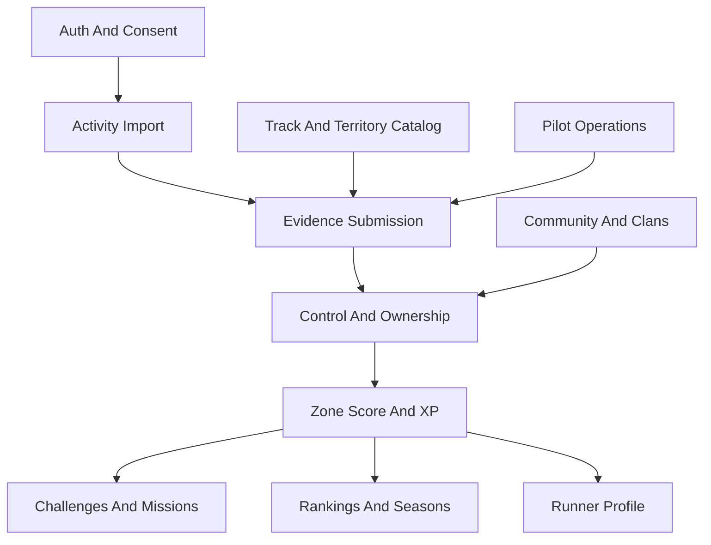

# TROQAR Product Architecture Spec

## What This Module Owns

This module owns the app-wide TROQAR product architecture: capabilities,
bounded domains, pages, backend contracts, and UI/UX definitions. It does not
own executable implementation. The Parque Taquaral hosted preview remains the
first concrete slice underneath this app-wide model.

## Module Map

## Capabilities

| Capability | What | Key Aspects | Detail |
| --- | --- | --- | --- |
| Auth And Consent | Let a runner connect safely and revoke access. | OAuth, session, CSRF, consent, privacy. | [CAP-AUTH](OPERATIONS-CAPABILITIES.md#capability-map) |
| Activity Import | Bring real run summaries into TROQAR. | Strava summaries, redaction, empty states. | [CAP-ACTIVITY](OPERATIONS-CAPABILITIES.md#capability-map) |
| Track And Territory Catalog | Represent pilot tracks now and zones later. | Geometry status, metadata, map display. | [CAP-TRACK](OPERATIONS-CAPABILITIES.md#capability-map) |
| Evidence Submission | Convert a run into claim evidence. | Preview acceptance, audit trail, operator review. | [CAP-EVIDENCE](OPERATIONS-CAPABILITIES.md#capability-map) |
| Control And Ownership | Show who controls a track or zone. | Controller state, contested windows, transfer. | [CAP-CONTROL](OPERATIONS-CAPABILITIES.md#capability-map) |
| Zone Score And XP | Reward speed, distance, frequency, and consistency. | Zone Score, XP, streaks, badges. | [CAP-SCORE](OPERATIONS-CAPABILITIES.md#capability-map) |
| Challenges And Missions | Give the runner an immediate reason to run. | Active challenge, mission progress, rewards. | [CAP-CHALLENGE](OPERATIONS-CAPABILITIES.md#capability-map) |
| Community And Clans | Coordinate social attack/defense. | Clan roles, membership, contribution. | [CAP-CLAN](OPERATIONS-CAPABILITIES.md#capability-map) |
| Rankings And Seasons | Make progress legible over time. | League, seasonal ranking, Hall of Fame. | [CAP-SEASON](OPERATIONS-CAPABILITIES.md#capability-map) |
| Pilot Operations | Keep preview evidence governable. | Review queue, audit, health checks. | [CAP-OPERATOR](OPERATIONS-CAPABILITIES.md#capability-map) |

## Domain Concepts

| Concept | Type | Key Constraints |
| --- | --- | --- |
| [Runner](domain.md#runner) | Entity | Must own consent and provider links separately from public profile. |
| [ProviderAccount](domain.md#provideraccount) | Entity | Server-owned token custody only. |
| [RunActivity](domain.md#runactivity) | Entity/Event | Redacted activity summary from Strava or future provider. |
| [TerritoryUnit](domain.md#territoryunit) | Entity | Park track now; hex zone later. |
| [TrackGeometry](domain.md#trackgeometry) | Value Object | Claims require source-backed status. |
| [EvidenceSubmission](domain.md#evidencesubmission) | Aggregate | Cannot become `verified` through preview auto-accept. |
| [ControllerState](domain.md#controllerstate) | State | Must cite metric and evidence basis. |
| [ZoneScore](domain.md#zonescore) | Calculation | Pace 40%, distance 35%, frequency 25% while selected. |
| [XP Ledger](domain.md#xpledger) | Ledger | Profile XP persists across seasons. |
| [Clan](domain.md#clan) | Aggregate | Membership and contribution policies are explicit. |
| [Season](domain.md#season) | Cycle | Ranking resets, profile XP does not. |

## Concept Registry

| Concept | ID | Type |
| --- | --- | --- |
| Runner | troqar.Runner | Entity |
| ProviderAccount | troqar.ProviderAccount | Entity |
| RunActivity | troqar.RunActivity | Entity/Event |
| TerritoryUnit | troqar.TerritoryUnit | Entity |
| TrackGeometry | troqar.TrackGeometry | ValueObject |
| EvidenceSubmission | troqar.EvidenceSubmission | Aggregate |
| ControllerState | troqar.ControllerState | State |
| ZoneScore | troqar.ZoneScore | Calculation |
| XP Ledger | troqar.XPLedger | Ledger |
| Clan | troqar.Clan | Aggregate |
| Season | troqar.Season | Cycle |
| StartStravaOAuth | troqar.StartStravaOAuth | Operation |
| SubmitRunEvidence | troqar.SubmitRunEvidence | Operation |
| CurrentController | troqar.CurrentController | Query |
| TroqarAppShell | ui.troqar.AppShell | Page/Layout |

## Feature Concept Graph

| From | Edge | To | Evidence | Notes |
| --- | --- | --- | --- | --- |
| troqar.ProviderAccount | enables | troqar.RunActivity | interfaces.md#strava-provider-boundary | Token custody is server-only. |
| troqar.RunActivity | supports | troqar.EvidenceSubmission | operations.md#op-evidence-submit | Activity is evidence input. |
| troqar.TerritoryUnit | scopes | troqar.EvidenceSubmission | domain.md#territoryunit | Track/zone determines claim context. |
| troqar.EvidenceSubmission | produces | troqar.ControllerState | operations.md#op-control-compute | Preview accepted submission can update preview controller. |
| troqar.ZoneScore | informs | troqar.ControllerState | operations.md#op-score-calculate | Later scoring must not overwrite L0 controller semantics silently. |
| ui.troqar.RouteDetailPage | consumes | troqar.TrackDetail | ui-spec.md#routestrackid--route-detail | Route detail is the core claim page. |

## Aspect Docs

| Aspect | Contains | Key Concepts |
| --- | --- | --- |
| [Operations And Capabilities](OPERATIONS-CAPABILITIES.md) | Operations, queries, dependencies, status | CAP-AUTH, CAP-EVIDENCE, CAP-CONTROL |
| [Domain](domain.md) | Entities, value objects, invariants | Runner, TerritoryUnit, EvidenceSubmission |
| [Operations](operations.md) | Mutations, policies, calculations | SubmitRunEvidence, ComputeController |
| [Queries](queries.md) | Read models and page consumers | HomeSummary, RouteDetail, Rankings |
| [States](states.md) | State machines and transitions | Auth, Submission, Controller |
| [Interfaces](interfaces.md) | API/internal contracts | HTTP routes, auth package, Strava |
| [Events](events.md) | Domain events | EvidenceSubmitted, ControllerUpdated |
| [Mappings](mappings.md) | Data transformation | Strava to RunActivity |
| [Architecture](ARCHITECTURE.md) | Six-view architecture bundle | DomainSpec TS boundary |
| [UI/UX Spec](ui-spec.md) | Pages, flows, components, accessibility | Home, Map, Routes, Profile |
| [Visual Definitions](VISUAL-DEFINITIONS.md) | Visual guide translation | palette, type, components |
| [Backend Spec](backend.md) | Backend modules, storage, API | auth, activity, evidence, control |

## Cross-Feature Dependencies

| Capability | Depends On | Via | Why |
| --- | --- | --- | --- |
| Auth And Consent | `@domainspec/auth-user-management` plus Body War adapters | package import + local app modules | Core auth use cases from package; browser cookies, CSRF, Strava OAuth, provider tokens, and profile read models owned by Body War. |
| Activity Import | Strava Activities API | gateway | Real consenting run summaries. |
| Track Catalog | Parque Taquaral MVP feature | source contract | First track/geometry proof. |
| Control And Ownership | Game Rules spec | domain rules | Controller and score semantics. |

## Produces For

| Consumer | Consumes Capability | Via | What |
| --- | --- | --- | --- |
| Parque Taquaral hosted preview | Auth, Activity, Track, Evidence, Control | Task Session/work-pack | First executable slice. |
| Future mobile app | App-wide pages/domain | UI/UX and backend specs | Product architecture baseline. |
| Sponsor/economy work | Sponsored zones and economy deferrals | gap ledger | Deferred scope with explicit boundary. |

## Change History

| Date | Change | Author |
| --- | --- | --- |
| 2026-06-21 | Initial app-wide TROQAR product architecture packet. | Codex |
