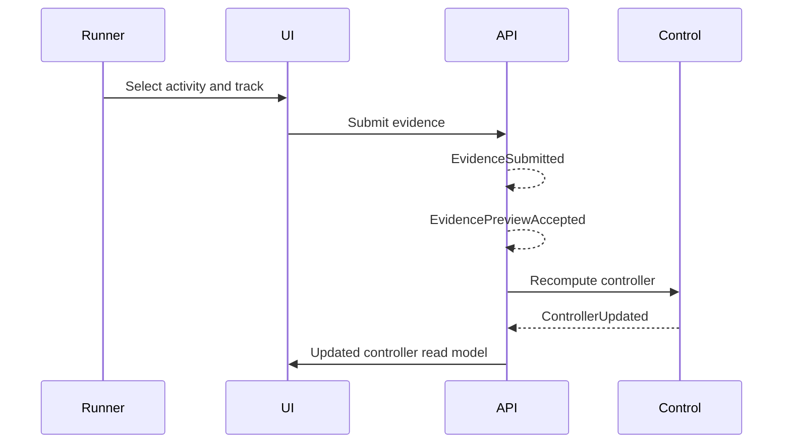

# Events

Status: `draft-pass`

## Domain Events

| Event ID | Event | Produced By | Consumed By |
| --- | --- | --- | --- |
| EVT-AUTH-CONNECTED | `ProviderConnected` | OP-AUTH-CALLBACK | Home, profile, audit |
| EVT-AUTH-REVOKED | `ProviderAccessRevoked` | OP-AUTH-LOGOUT / privacy action | Profile, audit |
| EVT-ACT-IMPORTED | `ActivitiesImported` | OP-ACT-REFRESH | Activity page, health checks |
| EVT-TRACK-PUBLISHED | `TerritoryPublished` | OP-TRACK-UPSERT | Map/routes pages |
| EVT-EVIDENCE-SUBMITTED | `EvidenceSubmitted` | OP-EVIDENCE-SUBMIT | Controller, operator queue |
| EVT-EVIDENCE-PREVIEW-ACCEPTED | `EvidencePreviewAccepted` | OP-EVIDENCE-AUTO-ACCEPT | Controller projection |
| EVT-EVIDENCE-VERIFIED | `EvidenceVerified` | OP-OPERATOR-REVIEW | Controller projection, XP |
| EVT-EVIDENCE-REJECTED | `EvidenceRejected` | OP-OPERATOR-REVIEW | UI, audit |
| EVT-CONTROLLER-UPDATED | `ControllerUpdated` | OP-CONTROL-COMPUTE | Home/map/route UI, notifications |
| EVT-INVASION-OPENED | `InvasionOpened` | OP-CONTROL-OPEN-INVASION | Notifications, defense UI |
| EVT-DEFENSE-SUCCEEDED | `DefenseSucceeded` | OP-CONTROL-DEFEND | XP, notifications |
| EVT-XP-AWARDED | `XPAwarded` | OP-XP-AWARD | Profile, rankings |
| EVT-CHALLENGE-COMPLETED | `ChallengeCompleted` | OP-CHALLENGE-COMPLETE | Rewards, profile |
| EVT-SEASON-SNAPSHOT | `SeasonSnapshotClosed` | OP-SEASON-SNAPSHOT | Rankings, profile |

## Event Payload Rules

- Event payloads can include IDs and redacted metrics.
- Event payloads must not include provider tokens, raw private activity maps, client secrets, or unredacted notes.
- Events that affect public UI must cite `basis`: `preview`, `verified`, or `manual`.

## Event Ordering

