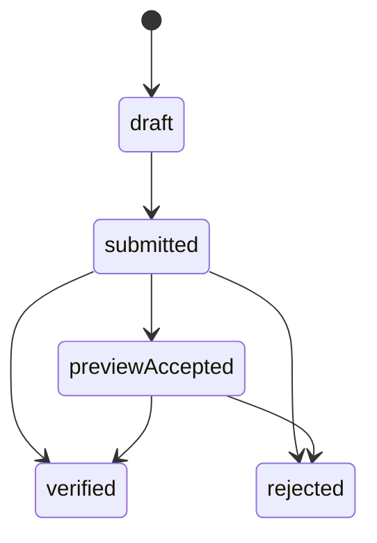

# States

Status: `draft-pass`

## Auth State

| State | Meaning | UI Treatment |
| --- | --- | --- |
| `unconfigured` | Provider env/client is absent. | Operator/dev warning; hide runner CTA. |
| `anonymous` | No server session. | Show connect Strava CTA. |
| `connected` | Session and provider account are active. | Show athlete summary and activity refresh. |
| `revoked` | Session or provider consent revoked. | Show reconnect flow and privacy copy. |
| `error` | Callback/session/provider failure. | Show recoverable error and support detail. |

## Activity State

| State | Meaning | UI Treatment |
| --- | --- | --- |
| `not-loaded` | No query attempted. | Neutral placeholder. |
| `loading` | Activity query in flight. | Skeleton rows. |
| `empty` | Provider returned no run-like activities. | Explain and offer refresh/reconnect. |
| `ready` | Run-like activity summaries available. | Activity picker and submit actions. |
| `provider-error` | Provider query failed. | Non-token error message. |

## Geometry State

| State | Meaning | UI Treatment |
| --- | --- | --- |
| `missing` | No geometry artifact exists. | No route shape; show caveat. |
| `placeholder` | Prototype metadata only. | Card/list only; no GPS claim. |
| `draft` | Draft route artifact exists. | Show draft label. |
| `source-backed` | Source-backed geometry exists. | Show route map with source note. |
| `validated` | Geometry has validation evidence. | Permit GPS validation language. |

## Submission State

| State | Meaning | Authority |
| --- | --- | --- |
| `draft` | UI has not submitted. | Browser only. |
| `submitted` | Server received evidence. | Backend. |
| `preview-accepted` | Accepted for hosted preview controller. | Backend preview policy. |
| `verified` | Operator or validated geometry confirmed. | Operator or validation system. |
| `rejected` | Evidence cannot count. | Operator or validation policy. |

Invariant: `preview-accepted` must never be displayed as `verified`.

## Controller State

| State | Meaning |
| --- | --- |
| `neutral` | No accepted evidence controls territory. |
| `preview-controlled` | Preview controller from preview-accepted evidence. |
| `verified-controlled` | Verified controller from validated evidence. |
| `contested` | Active invasion/defense window. |
| `expired` | Ownership lapsed by caducity policy. |

## Challenge State

| State | Meaning |
| --- | --- |
| `available` | Runner can join. |
| `active` | Runner enrolled and progress is open. |
| `complete` | Completion evidence accepted. |
| `rewarded` | Reward issued. |
| `expired` | Challenge window closed. |

## Season State

| State | Meaning |
| --- | --- |
| `preseason` | Rankings not open. |
| `active` | Runs affect seasonal ranking. |
| `closing` | Snapshot is being produced. |
| `closed` | Snapshot final, rewards issued. |
