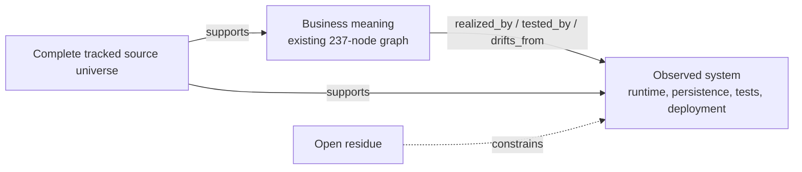

# Body War whole-system ontology

Status: `candidate-local` · Type: `business-system-bridge` · Authority effect: `none`

This package keeps the existing business ontology intact, adds an observed system branch, and connects them with evidence-backed bridge relations. The source universe covers every tracked Body War file at generation time; semantic nodes remain selective so the graph represents concepts instead of becoming a file browser.

## Coverage

- Imported business branch: **237 nodes**, **231 relations**
- Observed system branch: **39 nodes**, **45 relations**
- Business-system bridge: **25 relations**
- Tracked source universe: **1759 files**
- Open residue: **10 explicit gaps**

## Read the branches

## System layers

| Layer | Nodes |
| --- | ---: |
| Presentation | 1 |
| HTTP Interface | 13 |
| Application Adapters | 3 |
| Persistence | 10 |
| External Dependencies | 2 |
| Deployment | 3 |
| Verification And Gaps | 4 |

## System nodes

| Kind | Node | Meaning | Status |
| --- | --- | --- | --- |
| component | `body-war.system.component.browser-ui` | Browser-side interface for Strava connection, safe profile display, suggested tracks, activities, and preview evidence submission. | observed |
| component | `body-war.system.component.http-server` | Node HTTP composition root that constructs adapters, routes API requests, and serves the browser application. | observed |
| configuration | `body-war.system.configuration.runtime-configuration` | Environment-selected host, origin, session, provider, persistence, cookie, and redirect configuration. | observed |
| data_store | `body-war.system.data_store.json-prototype-store` | Local JSON files used for track and submission fixture persistence outside the auth repositories. | observed |
| data_store | `body-war.system.data_store.memory-repository` | In-process repository used by the local prototype and fake-provider test path. | observed |
| data_store | `body-war.system.data_store.postgres-repository` | Drizzle-backed implementation of the Body War repository port. | observed |
| deployment_unit | `body-war.system.deployment_unit.app-container` | Production application service with explicit runtime configuration and health check. | observed |
| deployment_unit | `body-war.system.deployment_unit.caddy-edge` | TLS-capable reverse proxy forwarding the public origin to the Body War application service. | observed |
| deployment_unit | `body-war.system.deployment_unit.postgres-service` | Internal persistent database service with a health check and durable volume. | observed |
| endpoint | `body-war.system.endpoint.activities` | Lists redacted Strava activity summaries for an authenticated connected runner. | observed |
| endpoint | `body-war.system.endpoint.logout` | Revokes the active session and clears browser authentication cookies. | observed |
| endpoint | `body-war.system.endpoint.profile` | Returns the authenticated runner's safe Body War profile projection. | observed |
| endpoint | `body-war.system.endpoint.status` | Returns configuration-safe authentication and provider connection status. | observed |
| endpoint | `body-war.system.endpoint.strava-callback` | Completes Strava OAuth and creates the browser session binding. | observed |
| endpoint | `body-war.system.endpoint.strava-start` | Starts the Strava OAuth flow and sets bounded state. | observed |
| endpoint | `body-war.system.endpoint.submissions` | Lists fixture submissions or creates authenticated preview evidence submissions guarded by CSRF and origin checks. | observed |
| endpoint | `body-war.system.endpoint.suggested-track-detail` | Returns one suggested track and its current evidence summary. | observed |
| endpoint | `body-war.system.endpoint.suggested-track-evidence` | Attaches a consent-acknowledged redacted activity candidate to a suggested track. | observed |
| endpoint | `body-war.system.endpoint.suggested-tracks` | Lists suggested tracks or creates a runner suggestion in needs-evidence state. | observed |
| endpoint | `body-war.system.endpoint.tracks` | Returns the prototype track catalog from the local JSON store. | observed |
| external_dependency | `body-war.system.external_dependency.shared-auth-package` | Imported shared package supplying principal, permission, session, access-token, and authorization use cases. | observed |
| external_dependency | `body-war.system.external_dependency.strava-api` | External activity provider reached only through the server-side Strava adapter. | observed |
| gap | `body-war.system.gap.geometry-score-gap` | The current runtime deliberately reports route geometry as deferred or not claimed and does not calculate the business score preview. | gap |
| interface | `body-war.system.interface.body-war-repository-port` | Application-owned persistence interface for profiles, provider records, suggested tracks, and activity evidence candidates. | observed |
| interface | `body-war.system.interface.http-api` | Request boundary exposing the currently implemented Body War JSON endpoints. | observed |
| job | `body-war.system.job.migration-runner` | Checksum-bound migration runner for shared authentication and Body War database schemas. | observed |
| module | `body-war.system.module.browser-session-adapter` | Adapter that binds package authentication to secure cookies, CSRF checks, origin checks, session creation, authentication, and logout. | observed |
| module | `body-war.system.module.postgres-database` | SQL client and Drizzle database construction boundary selected by runtime configuration. | observed |
| module | `body-war.system.module.static-asset-server` | Server path that publishes the Body War browser shell and its local assets. | observed |
| module | `body-war.system.module.strava-oauth-adapter` | Body War-owned provider adapter for OAuth state, token exchange and custody, provider profile, and redacted activity summaries. | observed |
| table | `body-war.system.table.activity-evidence-candidates` | Stores consent-bound redacted activity evidence candidate records for suggested tracks. | observed |
| table | `body-war.system.table.oauth-states` | Stores single-use expiring provider OAuth state. | observed |
| table | `body-war.system.table.provider-accounts` | Stores provider identity and connection status without exposing provider tokens to the browser. | observed |
| table | `body-war.system.table.provider-tokens` | Stores protected provider access and refresh token ciphertext on the server. | observed |
| table | `body-war.system.table.runner-profiles` | Stores Body War runner display/profile data keyed to the shared principal. | observed |
| table | `body-war.system.table.suggested-tracks` | Stores suggestion metadata, workflow status, and geometry authority marker. | observed |
| test | `body-war.system.test.api-e2e-tests` | End-to-end HTTP test of login, activities, suggested tracks, evidence candidates, submissions, and logout. | observed |
| test | `body-war.system.test.auth-consumer-tests` | Node tests covering fake-Strava authentication, cookie safety, profile projection, activity authority ceiling, and suggested-track behavior. | observed |
| test | `body-war.system.test.browser-e2e-tests` | Playwright tests for anonymous login, safe connected profile, suggested-track creation, preview evidence submission, logout, and narrow viewports. | observed |

## Relations as sentences

- **body-war.system.endpoint.activities** — `calls` → **body-war.system.module.strava-oauth-adapter**.
- **body-war.system.interface.http-api** — `contains` → **body-war.system.endpoint.activities**.
- **body-war.system.interface.http-api** — `contains` → **body-war.system.endpoint.logout**.
- **body-war.system.interface.http-api** — `contains` → **body-war.system.endpoint.profile**.
- **body-war.system.interface.http-api** — `contains` → **body-war.system.endpoint.status**.
- **body-war.system.interface.http-api** — `contains` → **body-war.system.endpoint.strava-callback**.
- **body-war.system.interface.http-api** — `contains` → **body-war.system.endpoint.strava-start**.
- **body-war.system.interface.http-api** — `contains` → **body-war.system.endpoint.submissions**.
- **body-war.system.interface.http-api** — `contains` → **body-war.system.endpoint.suggested-track-detail**.
- **body-war.system.interface.http-api** — `contains` → **body-war.system.endpoint.suggested-track-evidence**.
- **body-war.system.interface.http-api** — `contains` → **body-war.system.endpoint.suggested-tracks**.
- **body-war.system.interface.http-api** — `contains` → **body-war.system.endpoint.tracks**.
- **body-war.system.test.api-e2e-tests** — `tests` → **body-war.system.interface.http-api**.
- **body-war.system.deployment_unit.app-container** — `depends_on` → **body-war.system.deployment_unit.postgres-service**.
- **body-war.system.deployment_unit.app-container** — `runs` → **body-war.system.component.http-server**.
- **body-war.system.test.browser-e2e-tests** — `tests` → **body-war.system.component.browser-ui**.
- **body-war.system.deployment_unit.caddy-edge** — `routes_to` → **body-war.system.deployment_unit.app-container**.
- **body-war.system.gap.geometry-score-gap** — `constrains` → **body-war.system.component.http-server**.
- **body-war.system.data_store.memory-repository** — `implements` → **body-war.system.interface.body-war-repository-port**.
- **body-war.system.job.migration-runner** — `migrates` → **body-war.system.module.postgres-database**.
- **body-war.system.data_store.postgres-repository** — `implements` → **body-war.system.interface.body-war-repository-port**.
- **body-war.system.data_store.postgres-repository** — `uses` → **body-war.system.module.postgres-database**.
- **body-war.system.interface.body-war-repository-port** — `writes` → **body-war.system.table.activity-evidence-candidates**.
- **body-war.system.interface.body-war-repository-port** — `writes` → **body-war.system.table.oauth-states**.
- **body-war.system.interface.body-war-repository-port** — `writes` → **body-war.system.table.runner-profiles**.
- **body-war.system.interface.body-war-repository-port** — `writes` → **body-war.system.table.provider-accounts**.
- **body-war.system.interface.body-war-repository-port** — `writes` → **body-war.system.table.provider-tokens**.
- **body-war.system.interface.body-war-repository-port** — `writes` → **body-war.system.table.suggested-tracks**.
- **body-war.system.component.http-server** — `configured_by` → **body-war.system.configuration.runtime-configuration**.
- **body-war.system.component.http-server** — `exposes` → **body-war.system.interface.http-api**.
- **body-war.system.component.http-server** — `serves` → **body-war.system.component.browser-ui**.
- **body-war.system.component.http-server** — `uses` → **body-war.system.interface.body-war-repository-port**.
- **body-war.system.component.http-server** — `uses` → **body-war.system.module.browser-session-adapter**.
- **body-war.system.component.http-server** — `uses` → **body-war.system.module.static-asset-server**.
- **body-war.system.component.http-server** — `uses` → **body-war.system.module.strava-oauth-adapter**.
- **body-war.system.module.browser-session-adapter** — `depends_on` → **body-war.system.external_dependency.shared-auth-package**.
- **body-war.system.module.static-asset-server** — `serves` → **body-war.system.component.browser-ui**.
- **body-war.system.endpoint.strava-callback** — `calls` → **body-war.system.module.strava-oauth-adapter**.
- **body-war.system.module.strava-oauth-adapter** — `calls` → **body-war.system.external_dependency.strava-api**.
- **body-war.system.module.strava-oauth-adapter** — `depends_on` → **body-war.system.external_dependency.shared-auth-package**.
- **body-war.system.endpoint.strava-start** — `calls` → **body-war.system.module.strava-oauth-adapter**.
- **body-war.system.endpoint.submissions** — `persists_to` → **body-war.system.data_store.json-prototype-store**.
- **body-war.system.endpoint.tracks** — `reads` → **body-war.system.data_store.json-prototype-store**.
- **body-war.system.test.auth-consumer-tests** — `tests` → **body-war.system.component.http-server**.
- **body-war.system.interface.http-api** — `protects_with` → **body-war.system.module.browser-session-adapter**.

## Business-system bridges

- **body-war.business.operation.import-activities** — `realized_by` → **body-war.system.endpoint.activities** (supported). The endpoint returns redacted activity summaries for a connected runner.
- **body-war.business.query.activity-list** — `realized_by` → **body-war.system.endpoint.activities** (supported). The activity query is implemented through the same endpoint.
- **body-war.business.capability.auth-consent** — `realized_by` → **body-war.system.module.browser-session-adapter** (supported). The adapter implements browser-session and request guard concerns for the prototype.
- **body-war.business.query.auth-status** — `realized_by` → **body-war.system.endpoint.status** (supported). The runtime provides a configuration-safe status projection.
- **body-war.business.capability.auth-consent** — `tested_by` → **body-war.system.test.auth-consumer-tests** (supported). The unit/consumer suite tests the fake-provider authentication boundary.
- **body-war.business.workflow.suggested-track-expansion** — `tested_by` → **body-war.system.test.browser-e2e-tests** (supported). The browser test covers the user-visible candidate flow.
- **body-war.business.operation.attach-activity-evidence-candidate** — `realized_by` → **body-war.system.endpoint.suggested-track-evidence** (supported). The endpoint records explicit consent and a redacted evidence candidate.
- **body-war.business.entity.activity-evidence-candidate** — `realized_by` → **body-war.system.table.activity-evidence-candidates** (supported). Candidate evidence and consent fields have a durable schema.
- **body-war.business.operation.submit-evidence** — `realized_by` → **body-war.system.endpoint.submissions** (partial). Submission is implemented as prototype evidence and does not become verified evidence or territory authority.
- **body-war.business.operation.derive-geometry-candidate** — `drifts_from` → **body-war.system.gap.geometry-score-gap** (gap). Attaching activity evidence does not derive or promote geometry.
- **body-war.business.operation.fetch-selected-activity-geometry** — `drifts_from` → **body-war.system.gap.geometry-score-gap** (gap). No source-authorized route geometry acquisition is present in the current runtime.
- **body-war.business.interface.http-api** — `realized_by` → **body-war.system.interface.http-api** (supported). The current server exposes the implemented HTTP boundary, not every design-time route.
- **body-war.business.workflow.login-to-score-preview** — `realized_by` → **body-war.system.component.browser-ui** (partial). Login through evidence candidate submission is visible; geometry derivation and explained score projection remain absent.
- **body-war.business.operation.complete-strava-oauth** — `realized_by` → **body-war.system.endpoint.strava-callback** (supported). The endpoint completes the fake or configured provider callback and binds a session.
- **body-war.business.operation.start-strava-oauth** — `realized_by` → **body-war.system.endpoint.strava-start** (supported). The endpoint starts the provider flow.
- **body-war.business.query.profile-summary** — `realized_by` → **body-war.system.endpoint.profile** (partial). The current profile endpoint is safe but does not yet project full score, XP, league, badge, or streak state.
- **body-war.business.entity.provider-account** — `realized_by` → **body-war.system.table.provider-accounts** (supported). Provider identity and connection status have a durable schema.
- **body-war.business.operation.calculate-score-preview** — `drifts_from` → **body-war.system.gap.geometry-score-gap** (gap). The runtime explicitly leaves composite scoring pending.
- **body-war.business.interface.strava-provider-boundary** — `realized_by` → **body-war.system.module.strava-oauth-adapter** (supported). Provider tokens remain in the server-side adapter and repositories.
- **body-war.business.operation.create-suggested-track** — `realized_by` → **body-war.system.endpoint.suggested-tracks** (supported). The endpoint creates a needs-evidence candidate only.
- **body-war.business.query.get-suggested-track-detail** — `realized_by` → **body-war.system.endpoint.suggested-track-detail** (supported). The endpoint joins one suggestion to its evidence summary.
- **body-war.business.query.list-suggested-tracks** — `realized_by` → **body-war.system.endpoint.suggested-tracks** (supported). The endpoint returns default and runner-created suggestions.
- **body-war.business.entity.suggested-track** — `realized_by` → **body-war.system.table.suggested-tracks** (supported). Suggested-track candidates have a durable schema.
- **body-war.business.workflow.suggested-track-expansion** — `tested_by` → **body-war.system.test.api-e2e-tests** (supported). The HTTP E2E flow exercises suggestion creation and candidate attachment.
- **body-war.business.query.track-list** — `realized_by` → **body-war.system.endpoint.tracks** (partial). The current catalog is a JSON-backed prototype fixture.

## Open gaps

- **BW-WS-GAP-001 — Real Strava activity import absent:** Both memory and Postgres repositories return deterministic synthetic activity summaries; OAuth connectivity does not prove activity ownership or live import.
- **BW-WS-GAP-002 — Visible evidence consent control absent:** The browser submits a constant affirmative consent value; the user-visible unchecked consent contract remains unresolved.
- **BW-WS-GAP-003 — Geometry and explained score absent:** The runtime stops at redacted evidence and explicitly leaves route geometry unclaimed and composite scoring pending.
- **BW-WS-GAP-004 — Legacy and repository evidence paths coexist:** The JSON-backed /api/submissions path and repository-backed SuggestedTrack evidence-candidate path have different validation and authority semantics.
- **BW-WS-GAP-005 — Documented and implemented HTTP surfaces drift:** Design documentation names future routes and /api/profile/me while the observed router exposes a smaller and different surface.
- **BW-WS-GAP-006 — Database foreign-key constraints are not declared:** Cross-record ownership and identity integrity is currently enforced by application behavior rather than declared database foreign keys.
- **BW-WS-GAP-007 — Production compose variants diverge:** The Caddy production compose omits the separate token-protection secret and names a runtime auth-store variable not consumed by the inspected server.
- **BW-WS-GAP-008 — Structured observability absent:** Named product signals are design intent; observed runtime surfaces are status, health checks, startup console output, deployment receipts, and smoke scripts.
- **BW-WS-GAP-009 — Operator promotion path absent:** Review and source-backed states exist in business and storage models, but no observed operator endpoint implements promotion.
- **BW-WS-GAP-010 — SuggestedTrack proof identifiers differ from business graph identifiers:** The proof ontology and complete business ontology must remain explicitly bridged instead of being merged by similar labels.

## Source coverage

| Evidence class | Files |
| --- | ---: |
| bridge-proof | 34 |
| business | 311 |
| business-evidence | 112 |
| development-evidence | 1077 |
| project-context | 111 |
| specification | 61 |
| system | 53 |

See `source-universe.json` for every path, byte count, class, and SHA-256 digest. See `context/context-pack.md` for a strict login-to-score implementation selection.
