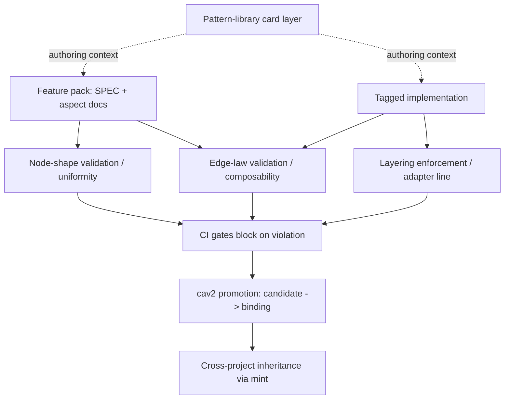

# Architecture-Pattern Enforcement (APE)

## What This Program Owns

The discipline and tooling that **validate and enforce DomainSpec architecture patterns** —
node-shape (*uniformity*), edge-law (*composability*), and layer boundaries (*layering*) — over a
project's spec **and** its implementation, and that **carry the same discipline across projects**
via the shared substrate a mint copies. It owns the *authoring* layer (concept/relationship cards),
the *checking* layer (validators + engine), and the *governance* layer (candidate → owner-promoted →
binding). It does **not** own the meta-type or edge-law *definitions* (definitions-governance / R2 /
R3) nor the authority *promotion decisions* (cav2) — it consumes and routes to them.

> This is a **meta / infrastructure** spec: its "concepts" are the program's own building blocks
> (schemas, validators, cards, gates), not a business domain. DS-D1 typing is applied loosely.

## Module Map

## Capabilities

Primary navigation is capability-driven. Each capability names its **owned handle**, its
**start-now vs blocked** status (from the findings), and the **promotion it owes**.

| Capability | What | Owned handle (evidence) | Status |
| --- | --- | --- | --- |
| **C-A Uniformity** (node-shape) | every concept instance matches its meta-type schema criterion | `validate-content.ts`, `instances.ts validate`, engine `lint` (C10); 13 backend `.schema.yml` | **witnessed** on financial-settlement; needs repeatability over a second pack |
| **C-B Composability** (edge-law) | declared/coded edges use legal verbs + endpoint signatures | root DS-D8 authority, `validate-relationships.ts`, `validate-content.ts`, dynamic `check-code-tag-composability.ts` | static spec graph **witnessed**; bounded dynamic enforcement consumes all 30 active signatures, with 9 mapped code-call rules and 26 explicit unsupported-call-semantics coverage gaps |
| **C-C Layering** (adapter line) | forbidden cross-layer dependencies cannot be constructed | C6 + AXIOMS A2; v1 DEPENDENCY-RULES / LAYERING-REFERENCE; `containment.ts` (write-path analogy) | **law exists**; post-hoc flagging today, unconstructibility deferred (findings W1) |
| **C-D Card layer** (authoring) | one concept card per meta-type + one relationship card per edge, as selective context | v1 `architecture/pattern-library/` (25 concept cards + 29 relationship cards + context packs) | **owned, not triaged** — "largest build-from-owned opportunity not yet triaged" (findings E2) |
| **C-E Promotion** (authority) | move a candidate handle to binding via its owner route | cav2 promotion lifecycle; "has a tree ≠ authority" | **discipline exists**; no v2 pattern has completed the path (findings E1) |
| **C-F Inheritance** (cross-project) | the substrate (meta-types + edge-law + validators + engine) travels to a new repo; each project authors its own nodes | `mint` skill; substrate/spec split | **design-stage**; depends on C-A/C-B stable |
| **C-G Drift** (convergence) | critical drift trends down over time, not a single check | C7; `compare-code-tag-drift.ts`; DRIFT-CONVERGENCE.md | **deferred** — needs a committed baseline series (findings W3) |

## Domain Concepts (the program's own artifacts)

| Concept | Type (loose) | Key Constraints |
| --- | --- | --- |
| Meta-type schema | Value Object | decidable criterion per meta-type; one `.schema.yml` per type; format binding (delta D2) pending |
| Edge-law | Value Object | 30 active root signatures plus generated/deprecated/deferred sections; owned by `definitions/relationships/relationships.yml`; **R3A landed** |
| Content validator | Operation | reads an aspect file / feature pack, checks each concept vs criterion + each edge vs signature |
| Concept card / Relationship card | Entity | human/agent-facing authoring voice of a meta-type / edge; **Evidence** for its definition |
| Feature pack | Entity | a real domain slice (SPEC + aspect docs + tagged code) — the *fuel* that makes validators non-vacuous |
| Promotion gate | Rule | blocks candidate → binding until owner-route + evidence clear ("has a tree ≠ authority") |
| Substrate | Entity | the project-independent set {meta-types, edge-law, validators, engine} a mint carries |

## Concept Registry

| Concept | ID | Type |
| --- | --- | --- |
| MetaTypeSchema | APE.MetaTypeSchema | Value Object |
| EdgeLaw | APE.EdgeLaw | Value Object |
| ContentValidator | APE.ContentValidator | Operation |
| InstanceValidator | APE.InstanceValidator | Operation |
| ConceptCard | APE.ConceptCard | Entity |
| RelationshipCard | APE.RelationshipCard | Entity |
| FeaturePack | APE.FeaturePack | Entity |
| PromotionGate | APE.PromotionGate | Rule |
| Substrate | APE.Substrate | Entity |
| DriftBaseline | APE.DriftBaseline | Entity |

## Feature Concept Graph (typed edges)

| From | Edge | To | Evidence | Notes |
| --- | --- | --- | --- | --- |
| APE.ContentValidator | enforces | APE.MetaTypeSchema | findings C-A | uniformity gate |
| APE.ContentValidator | enforces | APE.EdgeLaw | findings C-B + R3A + `SWU-R3C-001..003` | composability gate; bounded dynamic authority consumption implemented, evidence breadth pending |
| APE.FeaturePack | contains | APE.ConceptCard | v1 pattern-library | cards are selective context for authoring |
| APE.PromotionGate | enforces | APE.MetaTypeSchema | cav2 lifecycle | candidate → binding |
| APE.Substrate | contains | APE.EdgeLaw | mint substrate/spec split | edge-law travels; nodes are per-project |
| APE.ContentValidator | produces | APE.DriftBaseline | findings W3 | baseline for C-G convergence trend |

## Aspect Docs

| Aspect | Contains |
| --- | --- |
| [Architecture](architecture-bundle.md) | the six-view design of the program |
| [Glossary](GLOSSARY.md) | distilled definitions for the program's concepts |
| [Layering](implementation-layering.md) | L0–L3 decision model |
| [Execution](execution-pack.md) · [Work-pack](WORK-PACK.md) | plan + SWUs |

## Cross-Feature Dependencies

| Capability | Depends On | Via | Why |
| --- | --- | --- | --- |
| C-B Composability | active root DS-D8 authority | `definitions/relationships/relationships.yml` + dynamic checker | `TASK-R3C-EDGE` now consumes all active signatures dynamically; real-pack breadth and unsupported code-call semantics remain evidence gaps |
| C-A Uniformity | R2 / backend meta-type promotion | `.schema.yml` criteria | criteria exist; promotion is definitions-governance |
| C-C Layering (unconstructible) | meta-type formalism (moving) | typed catalog-construction layer | C6 unconstructibility can't be built while formalism moves (findings W1) |
| C-F Inheritance | C-A + C-B stable | mint substrate | can't replicate an unsettled discipline |

## Produces For

| Consumer | Consumes Capability | Via | What |
| --- | --- | --- | --- |
| Any new domainspec repo | C-F Inheritance | mint | inherits the validators + edge-law + engine |
| definitions-governance | C-A / C-B | Evidence links | concept/relationship cards as definition Evidence |
| cav2 authority | C-E Promotion | promotion requests | candidate handles seeking binding status |
