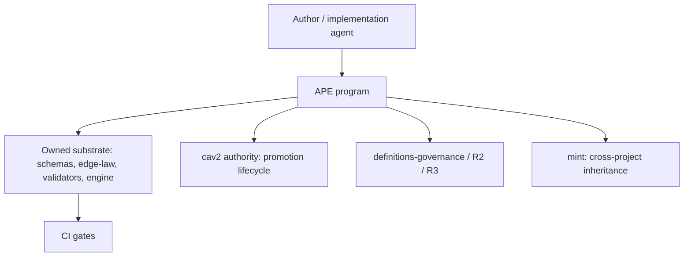
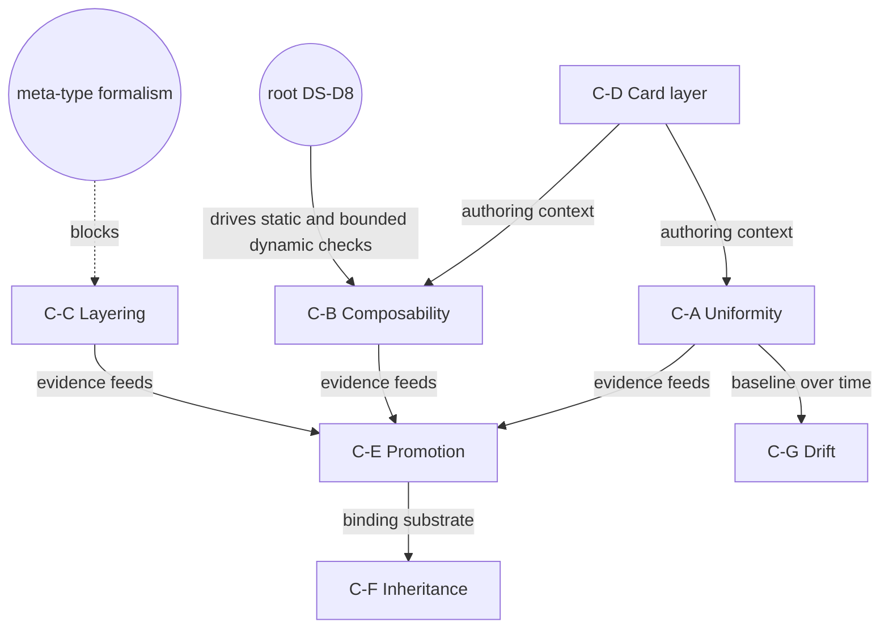
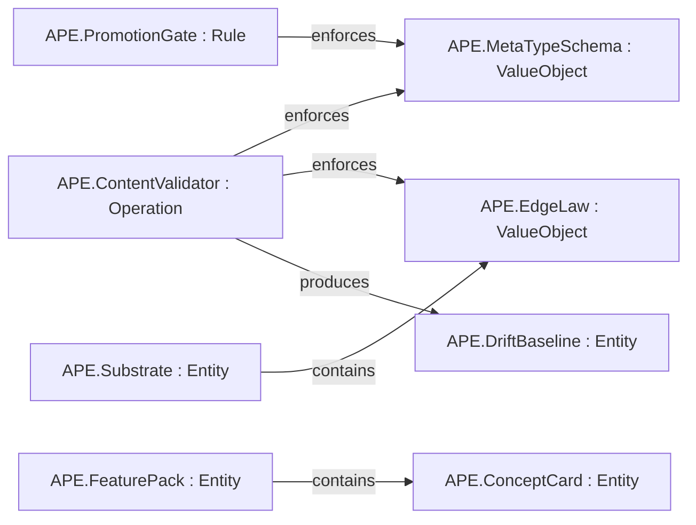

# Architecture Bundle: Architecture-Pattern Enforcement

Design-stage companion to [SPEC.md](SPEC.md). Translates the approved capabilities into structural
and process views. Adds views; does not redefine the spec. Every view references SPEC Concept
Registry IDs (`APE.*`) and the findings evidence.

## Design Intent

Make DomainSpec's architecture patterns **enforceable as running gates**, not prose — by treating a
project as a typed graph (nodes = meta-types, edges = edge-law) and validating both the spec and the
tagged implementation against that graph. Keep the guarantee **honest**: gates produce evidence, not
authority, until owner-promoted. Keep it **portable**: the checking substrate is project-independent
so a mint carries it to any new domain. Static node and edge checks run today; bounded dynamic
code-tag consumption of root DS-D8 is implemented through `TASK-R3C-EDGE`, while broader
code-call semantics, evidence breadth, and unconstructibility remain open.

## The load-bearing design decision

**Split the model into two planes and gate them independently.**

- **Node plane (uniformity)** — depends only on the meta-type `.schema.yml` set, which is *stable
  and owned*. Enforceable NOW. Edge-independent → churn-resilient.
- **Edge plane (composability + layering)** — spec-level endpoint checks and the bounded dynamic
  code-tag checker consume active root DS-D8 today. Additional code-call semantics and
  unconstructibility remain gated by evidence and meta-type formalism respectively.

This split is why "start now, adjust later" is real and not a slogan: the node plane doesn't wait on
the edge plane. It is the single most important structural stance in this design.

## Required View Set

### 1. Context View



### 2. Capability View

Nodes = SPEC capabilities; edges = the dependency/derivation relations between them.



### 3. Concept / Type View

The SPEC Concept Registry as a typed graph. Nodes carry their loose DS-D1 type; edges carry DS-D2
verbs and must satisfy the active root DS-D8 endpoint signatures.



Forbidden-edge note: a spec edge whose endpoints violate a root DS-D8 signature is **flagged, not
drawn**. The code-tag checker now loads root authority dynamically. Its remaining C-B gaps are
second-corpus evidence and 26 active signatures without an owned code-call-semantics mapping.

### 4. Operation / Flow View — the validate-and-enforce loop

For the core operation `APE.ContentValidator` (mirrors SPEC Module Map), one real feature pack:

```
inputs:  a feature pack (SPEC + aspect docs + tagged code)
  → rule:  each concept's meta-type resolved from the Concept Registry
  → check: each concept satisfies its .schema.yml criterion        [C-A, runs now]
  → check: each declared/coded edge ∈ edge-law + endpoint signature [C-B, bounded dynamic enforcement implemented]
  → check: no code edge crosses the adapter line                    [C-C, post-hoc today]
  → derive: engine emits test obligations from the spec
  → postcondition: all gates pass → merge allowed; any fail → exit non-zero (enforcement)
  → produces: a drift datapoint appended to the baseline series      [C-G, deferred]
```

The **write-side obligation** each transition creates downstream is a gate; the engine's derived
tests are the behavioral obligations. "Enforcement" = the non-zero exit wired into CI.

### 5. State View — the promotion lifecycle of a handle

Every validator/card/rule is a candidate moving through cav2's lifecycle. States + transitions
(one transition = one governance obligation):

| State | Meaning | Transition to next | Guard |
| --- | --- | --- | --- |
| `candidate` | authored, runs, produces evidence | `exercised` | ran on a real feature pack (non-vacuous) |
| `exercised` | witnessed on ≥1 real domain | `evidence-set` | reproduced on ≥2 contexts |
| `evidence-set` | enough evidence to request promotion | `owner-review` | owner route named + challenge contract attached |
| `owner-review` | at the owner gate | `binding` \| `deferred` | claim ≤ evidence (CAV2-D38) |
| `binding` | promoted to Definition/Constitution | (drift-watched) | constitution-governance amended |

The node-plane handle is now at least `exercised` on financial-settlement; broader evidence still needs L1
repeatability and owner-route promotion before anything becomes `binding`.

### 6. Dependency / Interface View

| Boundary | Interface | Owned handle | Contract |
| --- | --- | --- | --- |
| spec → node check | aspect-file table format | `validate-content.ts` | reads Concept Registry + per-concept tables |
| spec → edge check | root edge-law authority | `validate-relationships.ts`, `validate-content.ts`, dynamic `check-code-tag-composability.ts` | 30 active DS-D8 root signatures; 9 mapped code-call rules; unsupported mappings reported explicitly |
| code → spec | code tags | `extract-code-tags.ts` | `domainspec.concept` / `domainspec.edges` |
| spec → tests | engine CLI | `test-derivation-engine lint`/`roundtrip` | explicit path arg; **not** the v1 poker default |
| substrate → new repo | mint | `mint` skill | copies {schemas, edge-law, validators, engine}; project authors its own nodes |
| candidate → binding | promotion request | cav2 owner routes | definitions-governance / constitution-governance |

## Design Rules (applied)

- Every view uses only SPEC Concept Registry IDs — no concept invented at design stage.
- Node plane and edge plane are gated independently; the node plane remains shippable while edge-plane
  evidence broadens.
- Forbidden edges are flagged, not drawn; the remaining C-B coverage gaps are explicit, not hidden.
- The aspect-doc / feature-pack contract is stable; design adds views, it doesn't redefine the spec.
- Two must-fix defects remain **preconditions** to CI/repeatability claims:
  reset `code-tag-waivers.yaml` to empty (4 stale AEO entries), fix the `docs/features`→`spec/features`
  anchors. They do not invalidate the current static endpoint-signature checks.

## Output

A six-view design the `plan` stage consumes without reopening discovery. Glossary consistency:
every term used here is in [GLOSSARY.md](GLOSSARY.md). Six-view coverage: complete (context,
capability, concept, flow, state, dependency).
