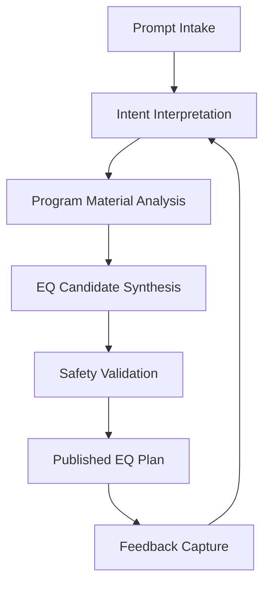

# NL to EQ Translation

## What This Module Owns

This module owns the end-to-end conversion of natural-language tonal intent into safe, explainable EQ plans. It separates interpretation, synthesis, and safety validation so quality and control can evolve independently. It also owns feedback capture needed to improve mappings over time.

## Module Map

## Capabilities

| Capability | What | Key Aspects | Detail |
| --- | --- | --- | --- |
| Prompt to EQ Plan | Convert user prompt and context into ranked EQ recommendation | operations, workflows, mappings, states | 3 operations, 2 queries, 1 workflow |
| Plan Safety Validation | Enforce hard boundaries before publication | rules, policy checks | 1 operation, 1 policy |
| Explainable Output | Return recommendation plus rationale and confidence | interfaces, mappings | 2 external interfaces |
| Feedback Learning Loop | Capture acceptance and edits for model improvement | events, workflows | 2 events, 1 operation |

### Prompt to EQ Plan

Converts subjective language into measurable intent and then into constrained filter parameters.

| Aspect | Concept | Summary |
| --- | --- | --- |
| Operation | [TranslatePromptToEqPlan](operations.md#translateprompttoeqplan) | Creates ranked EQ plan candidates |
| Query | [SimulateEqPlanImpact](queries.md#simulateeqplanimpact) | Estimates impact before user commitment |
| Interface | [POST /api/v1/eq/translate](interfaces.md#post-apiv1eqtranslate) | Public entry point for translation |
| Mapping | [PromptToIntentVector](mappings.md#prompttointentvector) | Normalizes language into weighted intent |
| State/Event | [TranslationRequestState](states.md#translationrequeststate) | Tracks lifecycle from intake to publish |

### Feedback Learning Loop

Captures user decisions to improve recommendation quality and calibration.

| Aspect | Concept | Summary |
| --- | --- | --- |
| Operation | [CapturePlanFeedback](operations.md#captureplanfeedback) | Stores accept/reject/edit outcomes |
| Query | [GetEqPlanByRequest](queries.md#geteqplanbyrequest) | Retrieves plan details and outcome |
| Interface | [POST /api/v1/eq/feedback](interfaces.md#post-apiv1eqfeedback) | Public endpoint for loop closure |
| Mapping | [FeedbackToTrainingSignal](mappings.md#feedbacktotrainingsignal) | Converts outcomes to retraining features |
| State/Event | [FeedbackCaptured](events.md#feedbackcaptured) | Event for downstream learning pipeline |

## Domain Concepts

| Concept | Type | Key Constraints |
| --- | --- | --- |
| [TranslationRequest](domain.md#translationrequest) | Entity | Immutable input prompt, explicit context, traceable status |
| [EqPlan](domain.md#eqplan) | Entity | Band count and parameter bounds must pass safety policy |
| [EqBand](domain.md#eqband) | Value Object | Gain, Q, and frequency within allowed ranges |
| [IntentVector](domain.md#intentvector) | Value Object | Normalized weights sum to 1.0 +/- tolerance |
| [DescriptorToken](domain.md#descriptortoken) | Enum | Must be in controlled vocabulary or alias table |

## Concept Registry

| Concept | ID | Type |
| --- | --- | --- |
| [TranslationRequest](domain.md#translationrequest) | nlEqTranslation.TranslationRequest | Entity |
| [EqPlan](domain.md#eqplan) | nlEqTranslation.EqPlan | Entity |
| [TranslatePromptToEqPlan](operations.md#translateprompttoeqplan) | nlEqTranslation.TranslatePromptToEqPlan | Operation |
| [ValidateEqPlanSafety](operations.md#validateeqplansafety) | nlEqTranslation.ValidateEqPlanSafety | Operation |
| [GetEqPlanByRequest](queries.md#geteqplanbyrequest) | nlEqTranslation.GetEqPlanByRequest | Query |
| [POST /api/v1/eq/translate](interfaces.md#post-apiv1eqtranslate) | nlEqTranslation.TranslateApi | Interface |
| [NlToEqTranslationWorkflow](workflows.md#nltoeqtranslationworkflow) | nlEqTranslation.NlToEqTranslationWorkflow | Workflow |
| [TranslationRequestState](states.md#translationrequeststate) | nlEqTranslation.TranslationRequestState | StateMachine |
| [EqPlanPublished](events.md#eqplanpublished) | nlEqTranslation.EqPlanPublished | Event |

## Aspect Docs

| Aspect | Contains | Key Concepts |
| --- | --- | --- |
| [Domain](domain.md) | Entities, value objects, enums | TranslationRequest, EqPlan, EqBand |
| [Operations](operations.md) | Mutations, rules, calculations | TranslatePromptToEqPlan, ValidateEqPlanSafety |
| [Interfaces](interfaces.md) | External and internal contracts | translate API, validate API, feedback API |
| [Queries](queries.md) | Read models | GetEqPlanByRequest, SimulateEqPlanImpact |
| [Mappings](mappings.md) | Data transformations | PromptToIntentVector, IntentAndFeaturesToEqBands |
| [Workflows](workflows.md) | Orchestrations and policy choices | NlToEqTranslationWorkflow, DeviceAwareRankingPolicy |
| [States](states.md) | Lifecycle transitions | TranslationRequestState |
| [Events](events.md) | Domain event contracts | EqPlanPublished, FeedbackCaptured |

## Cross-Feature Dependencies

| Capability | Depends On | Via | Why |
| --- | --- | --- | --- |
| Prompt to EQ Plan | equalizator research definitions | Mapping and policy constants | Uses established tonal pillars and measurable proxies |

## Produces For

| Consumer | Consumes Capability | Via | What |
| --- | --- | --- | --- |
| Equalizator UI | Prompt to EQ Plan | Interface | Ranked EQ recommendation with explanation |
| Audio Engine Integration | Plan Safety Validation | Interface | Safe parametric filter parameter set |
| Learning Pipeline | Feedback Learning Loop | Event | Labeled outcome records for model updates |

## Stories

See [User Stories](STORIES.md) for acceptance scenarios and behavior coverage.

## Change History

See [Changelog](CHANGELOG.md) for feature-level domain evolution notes.