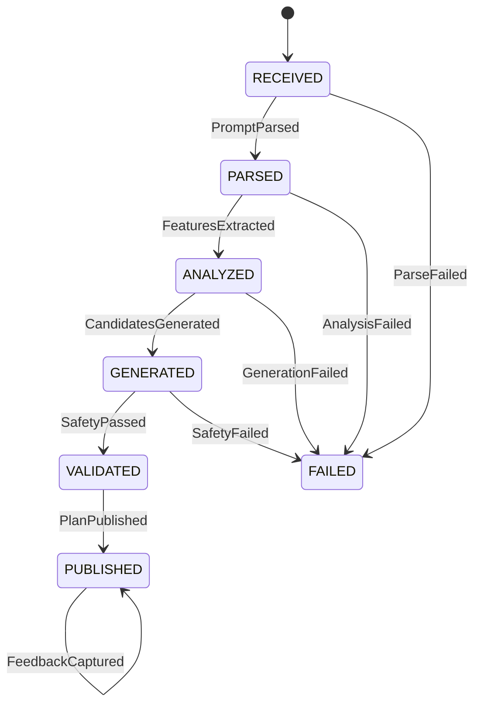

# State Machines: NL to EQ Translation

## TranslationRequestState

### Transition Table

| From | Event | To | Guard | Effect |
| --- | --- | --- | --- | --- |
| RECEIVED | PromptParsed | PARSED | parser_success | intentVector attached |
| RECEIVED | ParseFailed | FAILED | parser_failure | error code recorded |
| PARSED | FeaturesExtracted | ANALYZED | feature_snapshot_ready | analysis metadata attached |
| PARSED | AnalysisFailed | FAILED | extractor_failure | failure reason stored |
| ANALYZED | CandidatesGenerated | GENERATED | candidate_count > 0 | candidate set persisted |
| ANALYZED | GenerationFailed | FAILED | candidate_count = 0 | no_candidate reason stored |
| GENERATED | SafetyPassed | VALIDATED | all_rules_pass | safety report attached |
| GENERATED | SafetyFailed | FAILED | rule_failed | violation report stored |
| VALIDATED | PlanPublished | PUBLISHED | confidence >= threshold | response emitted |
| PUBLISHED | FeedbackCaptured | PUBLISHED | feedback_payload_valid | feedback linked |

### Invariants

| ID | Invariant | Formal |
| --- | --- | --- |
| I1 | Terminal states are immutable except feedback append on PUBLISHED | state in {FAILED, PUBLISHED} => no backward transition |
| I2 | A request cannot be PUBLISHED unless VALIDATED was reached | PUBLISHED => previously VALIDATED |
| I3 | Every FAILED state has a machine-readable reason | state = FAILED => failureReason != null |