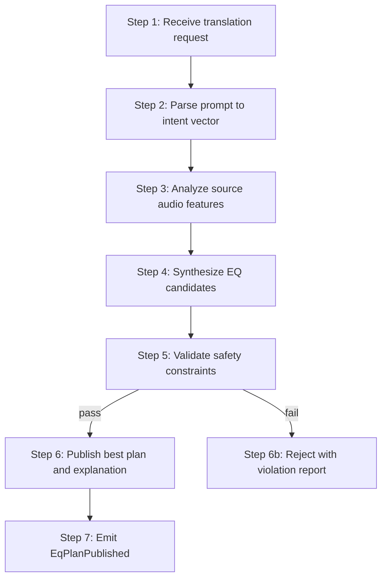

# Workflows: NL to EQ Translation

## NlToEqTranslationWorkflow

**Type:** Workflow
**Triggers:** POST /api/v1/eq/translate request
**Orchestrates:** [TranslatePromptToEqPlan](operations.md#translateprompttoeqplan), [ValidateEqPlanSafety](operations.md#validateeqplansafety)
**Compensation Strategy:** notify-only
**Idempotency:** conditional: idempotent when requestId is reused

### Steps

### Step Table

| # | Step | Actor | Operation | On Success | On Failure | Compensation |
| --- | --- | --- | --- | --- | --- | --- |
| 1 | Intake request | API layer | [TranslatePromptToEqPlan](operations.md#translateprompttoeqplan) | Go to step 2 | reject invalid payload | none |
| 2 | Generate and score candidates | Recommendation engine | [TranslatePromptToEqPlan](operations.md#translateprompttoeqplan) | Go to step 3 | mark request failed | none |
| 3 | Validate best candidate | Policy engine | [ValidateEqPlanSafety](operations.md#validateeqplansafety) | Go to step 4 | return safety violation report | none |
| 4 | Publish result | API layer | [TranslatePromptToEqPlan](operations.md#translateprompttoeqplan) | emit event and return response | return low confidence failure | none |

### Invariants

| ID | Invariant | Formal |
| --- | --- | --- |
| I1 | No unsafe plan can be published | published => safetyPassed = true |
| I2 | Every published plan has explanation | published => len(explanation) > 0 |
| I3 | Workflow traceability is preserved | exists(requestId, planId, status_history) |

---

## DeviceAwareRankingPolicy

**Type:** Policy
**Applies To:** NlToEqTranslationWorkflow step 2
**Trigger Conditions:** listening context includes recognized device profile

### Decision Table

| Condition | Selected Behavior | Notes |
| --- | --- | --- |
| device profile known and confidence high | apply device prior weighting | preserves user intent while adapting ranking |
| device profile missing | use neutral ranking profile | fallback mode |
| device profile known and confidence low | blend neutral and device prior | avoid overfitting noisy context |

### Formula (if applicable)

score_final = alpha * score_neutral + (1 - alpha) * score_device_prior

where alpha is derived from context confidence and defaults to 0.7.

### Configuration Parameters

| Parameter | Type | Default | Description |
| --- | --- | --- | --- |
| alphaDefault | number | 0.7 | Blend weight for neutral score |
| minContextConfidence | number | 0.6 | Minimum confidence to apply full device prior |
| devicePriorTableVersion | string | v1 | Versioned lookup source |