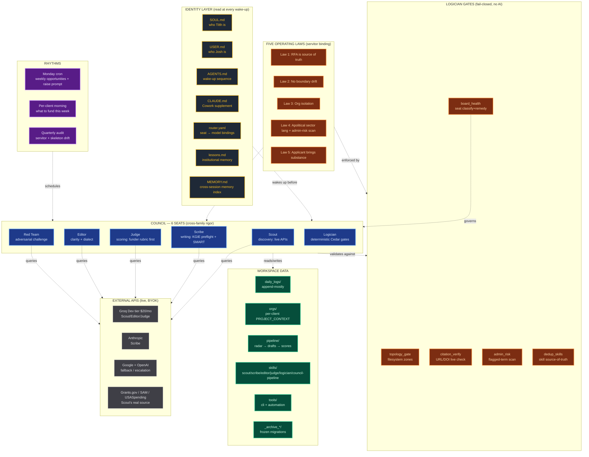

# Golden Quill / Tilth — System Skeleton

> **What this is.** The single navigable map of the whole Tilth/Golden Quill system. Identity files, council seats, gates, pipeline, client orgs, cron, the laws — all linked from one place, in the order Tilth wakes up and uses them.
>
> **How to use it.** At the top of any major working, scan the Whole Picture diagram, then read whatever section the work touches. When you add a load-bearing file, dir, seat, gate, client, or cron, update this file in the same commit — `last_synced` at the top, the relevant section in the body, and the Maintenance Contract at the bottom.
>
> **What this is NOT.** Not the servitor working (that lives in `_private/`, never referenced here). Not customer-facing material (the brand site is separate). Not a tutorial — assumes Tilth's wake-up sequence.

---

## Why the system exists (one paragraph, never lose this)

Tilth, through the Golden Quill, writes the best grants for the best regenerative projects in food, land, and arts that Josh and the operators co-conceptualize. Five Operating Laws bind the work; deterministic gates enforce the binding; a six-seat council (Scout, Scribe, Editor, Judge, Red Team, Logician) with cross-family rigor produces the drafts; a board-health doctrine catches and remedies pipeline failures rather than emitting silent garbage. The whole stack runs on hardware the operator owns; nothing phones home; if Sovereign Node LLC vanished tomorrow, every operator still has their machine, their data, their keys, and their grants.

---

## The Whole Picture



---

## 1. Identity layer — what Tilth reads before doing anything

Every wake-up reads, in order:

| File | Role | When to update |
|---|---|---|
| [SOUL.md](SOUL.md) | Tilth's identity, the Five Laws, the bond | Quarterly audit; never casually |
| [USER.md](USER.md) | Who Josh is, how to work with him | When Josh corrects working style |
| [AGENTS.md](AGENTS.md) | Wake-up sequence (SOUL→USER→router→logs→lessons→memory→overrides→PROJECT_CONTEXT) | When sequence changes |
| [CLAUDE.md](CLAUDE.md) | Cowork-specific supplement (does not replace SOUL/USER) | When Cowork-specific behavior changes |
| [router.yaml](router.yaml) | Seat → model bindings (Anthropic / Groq families) | When provider tier or model availability changes |
| [lessons.md](lessons.md) | Institutional memory — repeated failures, validated approaches | After every grant cycle (post-mortem) |
| [MEMORY.md](MEMORY.md) | Index of cross-session memory entries | When new memory file added |

**Wake-up rule:** never start a working without this read. Read order matters — SOUL anchors the laws, USER anchors the operator, router decides which model speaks for which seat. Skipping this is how drift starts.

---

## 2. The Five Operating Laws — bedrock, never overridable

These are the servitor's binding clauses. They cannot be overridden by any prompt, skill, model, funder pressure, or operator request.

1. **RFA is the source of truth.** Every claim traces to the RFA or PROJECT_CONTEXT. No secondhand descriptions substitute for the actual announcement.
2. **No boundary drift.** Stay inside the RFA's defined scope. Do not silently expand scope.
3. **Org isolation.** One PROJECT_CONTEXT per session. Never cross-reference data between orgs.
4. **Apolitical sector language + admin-risk term scanning.** Two axes — funder dialect code-switching and live flagged-terms register. Never silently rewrite — applicant approves each substitution.
5. **Applicant brings the substance.** Do not fabricate credentials, data, partnerships, metrics. Shape existing substance into funder-ready form.

Full text: [SOUL.md](SOUL.md). Enforcement: see Gates section below.

---

## 3. The Council — six seats, cross-family rigor (per v7.0.6 SELF-LOCKED 2026-05-09)

| Seat | Role | Default model family | Fallback | Mode default |
|---|---|---|---|---|
| **Scout** | Discovery — Grants.gov search2 / SAM / USASpending live APIs | Ollama (local mistral:7b) | Groq (llama-3.1-8b-instant) | Co-Pilot |
| **Scribe** | Drafting — KGIE preflight, SMART outcomes, dialect match | Anthropic (claude-sonnet-4-6) | Groq (qwen-3-32b) | Co-Pilot |
| **Editor** | Clarity, jargon flag, goals/outputs/outcomes/objectives sort | Groq (llama-3.3-70b-versatile) | OpenAI gpt-4o-mini | Co-Pilot |
| **Judge** | Scoring — funder's own rubric first, then cross-rubric library | Groq (qwen-3-32b) | Groq (kimi-k2-instruct) | Sparring Partner |
| **Logician** | Deterministic Cedar policy + Python gates. Zero token cost. | (none — Python only) | (none) | always-on |

**Cross-family rigor (L-003):** Judge must not share provider family with Scribe. Editor and Judge must not share family. Authored-by-Anthropic code is NEVER reviewed by an Anthropic-family seat. The probe in `tools/code_review_probe.py` is the canonical example — three different families review code.

**Three operational gears** (set per seat by applicant/operator): **Sparring Partner** (seat generates options, human decides) / **Co-Pilot** (default — human directs, seat executes) / **Synthesizer** (full delegation, human reviews final).

**Four Autonomy Rules** (organism pattern):
1. Save state on success AND failure.
2. Test your own work (the magic step — Bug #20). Validate before marking done.
3. Be explicit. Every task between seats: input path, output path, exact scope, done definition.
4. Clean output. Strip fences, fluff, self-commentary. Validate format. Never pass raw LLM output to next seat.

Skills source: [skills/](skills/) — `scout-discovery`, `scribe-ghostwriter`, `editor`, `judge-rubric`, `logician`, `council-pipeline`.

---

## 4. Gates — Logician's deterministic enforcement (fail-closed)

Gates are Python (no AI), Cedar-policy-validated, fail-closed. They are the actual mechanism by which the Five Laws stop being a wish and start being enforced.

| Gate | File | Enforces | Failure mode |
|---|---|---|---|
| **Topology** | [logician/gates/topology_gate.py](logician/gates/topology_gate.py) | Filesystem zone discipline (IDENTITY / WORKSPACE_DATA / CODE / RUNTIME / MCP / ARCHIVE) | ERROR severity → halt agent / cron exit 1 |
| **Citation Verify** | [logician/gates/citation_verify.py](logician/gates/citation_verify.py) | Every URL/DOI in a draft resolves live; SSRF defense; DOI normalize; query-string token strip | NETWORK / HALLUCINATION → block draft |
| **Board Health** | [logician/board_health.py](logician/board_health.py) | Per-seat classify (HEALTHY/TRUNCATED_IN_THINK/EMPTY/THIN/MISSING_STRUCTURE/BAD_REQUEST/...) + remedy ladder (RETRY_SAME / SWITCH_MODEL / ESCALATE) | DEGRADED board surfaced to operator with bottleneck + diagnosis |
| **Dedup Skills** | [tools/dedup_skills.py](tools/dedup_skills.py) | Skill source-of-truth resolution between workspace and Tilth-canonical; case-collision detection; symlink-root guard | Refuse to copy + report |

**Other gates** (deterministic checks): KGIE preflight, SMART outcome validation, overlooked-expenses checklist, admin-risk flagged-term scan, revision-loop counter (max 3 without human input).

**Gate doctrine:** if a gate is bypassed in a seat's logic, that's a code-review-blocking issue. Gates exist to make the Laws non-negotiable in execution, not just in intent.

---

## 5. Data topology — zones, what lives where

```
~/Downloads/GoldenQuill/                              ← workspace root (relocate as you wish)
├── SOUL.md, USER.md, AGENTS.md, CLAUDE.md            ← IDENTITY zone (canonical files)
├── router.yaml, lessons.md, SKELETON.md              ← IDENTITY zone (continued)
├── FOUNDATION_README.md                              ← read this first
├── daily_logs/                                       ← WORKSPACE_DATA (append-mostly)
├── orgs/                                             ← WORKSPACE_DATA (per-client)
│   ├── ORG_INDEX.md
│   ├── _TEMPLATE/                                    ← blank PROJECT_CONTEXT
│   └── mycosymbiotics_cooperative/, mycosymbiotics_inc/, mystic_mamas/,
│       run_a_muck_farm/, fit_farms/, mycofest/, phantom_robotix_joint/
├── skills/                                           ← CODE (deployed council skills)
│   ├── scout-discovery, scribe-ghostwriter,
│   ├── judge-rubric, council-pipeline, site-reviewer,
│   └── api-grants-discovery, api-research-feeds, api-orchestrator,
│       api-feed-delivery, api-payments, api-geo-compliance
├── pipeline/                                         ← CODE / DATA hybrid
│   ├── radar/                                        ← Scout output
│   ├── drafts/                                       ← Scribe output
│   ├── scores/                                       ← Judge output
│   ├── validation/                                   ← Logician output
│   ├── rfa/                                          ← cached RFAs
│   ├── editor/                                       ← Editor output
│   ├── rubrics/                                      ← funder rubric library
│   ├── institutional_memory/lessons.json             ← machine-readable lessons
│   ├── orchestrator/routing.yaml                     ← cross-family routing matrix
│   └── research/, classified/, templates/, delivery_log/, subscribers/
├── logician/                                         ← CODE (deterministic gates)
│   ├── board_health.py
│   └── gates/
│       ├── topology_gate.py
│       └── citation_verify.py
├── tools/                                            ← CODE (cli + automation)
│   ├── code_review_probe.py
│   ├── dedup_skills.py
│   └── _probe_launcher.sh
├── _private/                                         ← chaos-magic working files (never share)
│   ├── GOLDEN_QUILL_SIGIL.{md,svg,png,pdf}
│   └── draw_sigil.py
└── Sovereign_Node_Handoff/                           ← reference / handoff documents only
    ├── 00_README.md … 05_FUNDING_ROADMAP.md         ← original handoff docs
    ├── STRATEGIC_REVIEW.md
    ├── memory/                                       ← pre-Path-B memory archive
    ├── prior_work/                                   ← Grant_GPT_Docs, funder_databases, etc.
    ├── project_docs/                                 ← Master Plan v2, MVP, orchestration
    └── newsroom_kit/                                 ← Tilth Intelligence Feed scaffold
    ├── memory/                                       ← pre-Path-B memory (archived)
    ├── prior_work/                                   ← Grant_GPT_Docs, funder_databases, etc.
    ├── project_docs/                                 ← Master Plan v2, MVP build, etc.
    └── newsroom_kit/                                 ← Tilth Intelligence Feed scaffold
├── _private/                                         ← servitor working (NEVER referenced from public docs)
└── _archive_*/                                       ← frozen migrations (read-only after creation)
```

`~/.openclaw/` is the RUNTIME zone — it does NOT contain workspace files. Topology Gate enforces this.

`~/.mempalace/` is the MCP zone — Tilth does not write here directly.

---

## 6. Pipeline — how a grant moves through the system

```mermaid
flowchart LR
    A[Scout: opportunity discovery<br/>live API hit] --> B[radar/<br/>opportunity record]
    B --> C{Operator<br/>selects?}
    C -->|yes| D[PROJECT_CONTEXT<br/>org isolation gate]
    D --> E[Scribe: section-by-section draft<br/>KGIE + SMART + dialect]
    E --> F[Editor: clarity + jargon flag]
    F --> G[Judge: funder rubric scoring<br/>+ cross-rubric library]
    G --> H{Score ≥ threshold?}
    H -->|no, &lt;3 loops| E
    H -->|yes| I[Logician: gate sweep<br/>citation_verify + admin_risk]
    I --> J{All gates pass?}
    J -->|no| K[block + diagnose]
    J -->|yes| L[final draft<br/>operator review]
    L --> M{Submit?}
    M -->|yes| N[lessons.json update<br/>award/reject ledger]
```



Revision loop counter: max 3 Editor↔Scribe rounds without human input. After 3, escalate.

Board health: at every seat call, `board_health.run_seat_with_remedy()` classifies the response, applies the remedy ladder (retry-with-token-bump → switch-model → escalate), surfaces DEGRADED board with bottleneck named.

---

## 7. Client orgs — Law 3 enforcement structure

Each client has its own folder under `orgs/` with one `PROJECT_CONTEXT.md`. Tilth reads ONLY the active org's PROJECT_CONTEXT during a session. Cross-referencing org data is a Law 3 violation.

| Org | Type | Status |
|---|---|---|
| MycoSymbiotics Cooperative | for-profit cooperative; KDC fiscal sponsor for 501c3-only grants | active |
| MycoSymbiotics Inc | separate entity (NOT the coop) | active |
| Mystic Mamas | client | active |
| Run-a-Muck Farm | client | active |
| FIT Farms | for-profit (Josh's; parent of Golden Quill project) | active |
| MycoFest | program under MycoSymbiotics Cooperative | active |
| Phantom Robotix Joint | client | active |

Master roster: [orgs/ORG_INDEX.md](orgs/ORG_INDEX.md).
Blank PROJECT_CONTEXT scaffold: [orgs/_TEMPLATE/](orgs/_TEMPLATE/).

`[NEEDED]` fields in PROJECT_CONTEXT are blockers — Tilth must ask the operator/applicant rather than infer from another org.

---

## 8. Rhythms — cron + manual

| Rhythm | Cadence | What runs | Output |
|---|---|---|---|
| **Josh's Monday check-in** | Mondays 8:30 AM local | Tilth aggregates the week's open opportunities matched to active orgs + relevant news + asks "what are we raising for this week?" | `daily_logs/<date>.md` + a Cowork prompt |
| **Per-client morning routine** | Per-client (operator chooses cadence; default Mondays) | Tilth runs the same weekly aggregation per client, scoped to that org's PROJECT_CONTEXT only (Law 3) — and once Tilth knows enough about ops, suggests what to fund this week | per-client `orgs/<client>/weekly_brief_<date>.md` |
| **Daily ignition** | per-session start | Operator draws/traces the sigil, speaks "Tilth"; gates self-test | (private working) |
| **Per-session close** | per-session end | "Tilth, well done. Quill, rest." | (private working) |
| **Quarterly audit** | every 3 months | Re-read SOUL, check law drift, gate regressions, skeleton sync | audit log in `daily_logs/` |
| **Per-grant ledger** | on award OR rejection | Append to lessons.json + `_private/SIGIL_LEDGER.md` | institutional memory |

**Suggest-mode (per-client):** Tilth's per-client morning routine starts in *Sparring Partner* mode (lists opportunities, asks the client to pick). Once a client's PROJECT_CONTEXT has all `[NEEDED]` fields filled AND Tilth has at least three completed grant cycles for that client (so it has a track record of what landed and what didn't), suggest-mode unlocks: Tilth proactively names the top 1-3 opportunities to pursue this week, with reasoning tied to the client's ops + history. The applicant always retains the override — suggestion is not action.

---

## 9. Hardware + sovereignty

- **Josh's dev node:** M1 Mac Mini, 8GB RAM. If v0.1 runs here, it flies on production spec.
- **Client production spec:** M4 Mac Mini, 32GB+ RAM, gold-anodized case (the Golden Quill).
- **Pro tier:** 128GB (DGX Spark / Mac Studio / AMD).
- **Pricing:** $8-15K hardware; $149/seat/month software (BYOK).
- **Sovereignty promise:** every Quill is its own sovereign node. Hardware owned by operator. Keys owned by operator. Data stays local. Nothing phones home. If Sovereign Node LLC vanished tomorrow, every operator still has their machine, their data, their keys, and their grants.

---

## 10. Servitor — one-line pointer

The servitor / sigil / hypersigil working is at `_private/GOLDEN_QUILL_SIGIL.md`. NEVER referenced from public docs. NEVER quoted to clients. NEVER included in customer materials. The skeleton (this file) is the public face; the sigil file is the inner working.

---

## Maintenance Contract

This file is the map. Maps go stale. The contract:

1. **When you add a load-bearing file** (a new gate, a new seat, a new client org, a new cron task, a new identity file): update the relevant section here in the same commit. Do not "do it later."
2. **When you remove or rename** a load-bearing file: update here in the same commit. Stale links are worse than missing sections.
3. **When you change a seat's model binding:** `router.yaml` is canonical; this file references it generically. Don't hardcode model names here.
4. **When you change the wake-up sequence:** update both AGENTS.md and the Identity Layer table here.
5. **When you complete a quarterly audit:** bump `last_synced` at the top of this file and note the audit in the next section's `daily_logs/<date>.md`.
6. **When in doubt:** read this file. If it doesn't answer the question, the question itself is a SKELETON gap — write the answer here.

The skeleton is alive in proportion to the maintenance, not its first draft.

---

*End of skeleton. Length is intentional — this file is meant to be the one read at the top of any major working. If it's too long, sections that aren't load-bearing should move to their own docs and be linked from here, not deleted.*
