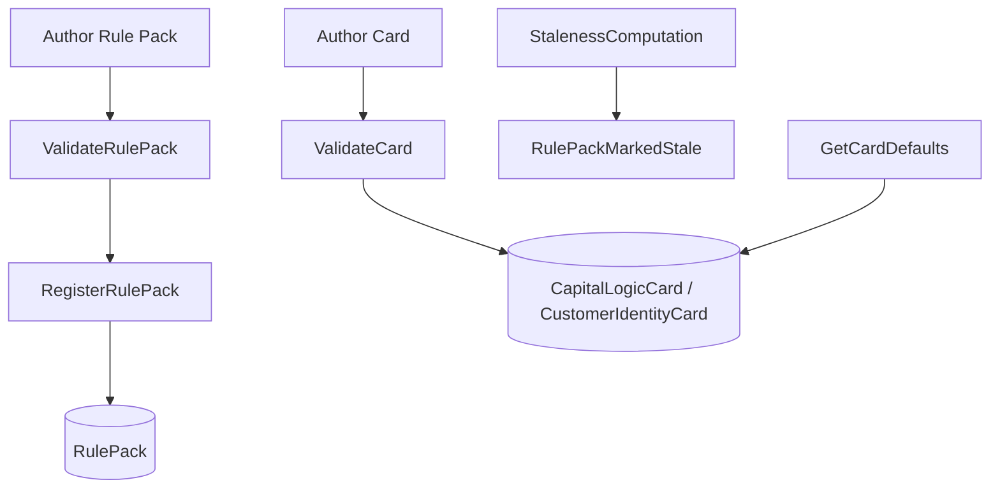

# Capital Logic Library

## What This Module Owns

The Capital Logic Library owns the **structured, machine-readable, governed representation of the canonical Capital Logic Cards (CLC) and Customer Identity Cards (CIC)** plus the **rule-pack schema** for codified funder requirements. It is a funder-side / archetype-side **public** library: no client data, no `orgs/` reads (Law 3). It defines what a card and a rule pack *are*, how they validate, how staleness is computed, and the closed sets they must conform to. CIC and CLC are **orthogonal axes**; this module structurally forbids any design-time CIC→CLC binding (`F-CIC-CLC-COUPLING-VIOLATION`).

## Module Map

## Capabilities

| Capability        | What                                                          | Key Aspects                                                                 | Detail                          |
| ----------------- | ------------------------------------------------------------- | --------------------------------------------------------------------------- | ------------------------------- |
| Card Governance   | Validate + serve canonical CLC/CIC cards under closed sets    | ValidateCard, GetCardDefaults, CardLifecycle; AntiCouplingRule, ClosedSetRule | 8 CLC + 6 CIC closed sets       |
| Rule-Pack Library | Validate, register, and age funder rule packs with provenance | ValidateRulePack, RegisterRulePack, StalenessComputation, RulePackLifecycle  | per-cycle decay, fail-closed    |

### Card Governance (inline variant)

Validates a CLC or CIC card against its closed set and the anti-coupling invariant, then serves its archetype-level defaults to downstream Tilth components.

| Aspect      | Concept                                                | Summary                                              |
| ----------- | ------------------------------------------------------ | ---------------------------------------------------- |
| Operation   | [ValidateCard](operations.md#validatecard)             | Validates a card's envelope, body, closed-set, anti-coupling |
| Query       | [GetCardDefaults](queries.md#getcarddefaults)          | Reads archetype-level operational-primitive defaults |
| State/Event | [CardLifecycle](states.md#cardlifecycle)               | draft → in_authoring → validated_v1 → superseded     |

### Rule-Pack Library (inline variant)

Validates and registers a funder-program rule pack with mandatory provenance, then computes deterministic staleness from the maintenance block.

| Aspect      | Concept                                                          | Summary                                       |
| ----------- | --------------------------------------------------------------- | --------------------------------------------- |
| Operation   | [ValidateRulePack](operations.md#validaterulepack)              | Validates pack + requirements + provenance    |
| Operation   | [RegisterRulePack](operations.md#registerrulepack)              | Admits a validated pack into the library      |
| State/Event | [RulePackLifecycle](states.md#rulepacklifecycle)                | draft → active → stale → retired              |

## Domain Concepts

| Concept                                                       | Type         | Key Constraints                                                   |
| ------------------------------------------------------------- | ------------ | ----------------------------------------------------------------- |
| [CapitalLogicCard](domain.md#capitallogiccard)                | Entity       | `clc_id` ∈ closed 8; no `cic_binding` field (forbidden)           |
| [CustomerIdentityCard](domain.md#customeridentitycard)        | Entity       | `cic_id` ∈ closed 6; five primitives; no CLC-subset enumeration   |
| [RulePack](domain.md#rulepack)                                | Entity       | per-cycle; mandatory provenance; no CIC coupling field            |
| [CardEnvelope](domain.md#cardenvelope)                        | Value Object | shared header; `card_family` ∈ {clc, cic}                         |
| [OperationalPrimitive](domain.md#operationalprimitive)        | Value Object | one of five; `capital_logic_activation` is config, not a CLC list |
| [FourQuadrantProfile](domain.md#fourquadrantprofile)          | Value Object | four required quadrant keys                                       |
| [FunderRequirement](domain.md#funderrequirement)             | Value Object | typed check_shape; mandatory evidence_ref; no `clc_binding`       |
| [SourceProvenance](domain.md#sourceprovenance)                | Value Object | source_type, url_or_handle, retrieved_date, quote                 |
| [MaintenanceBlock](domain.md#maintenanceblock)                | Value Object | review_cadence, next_review_due drive staleness                   |
| [CardFamily](domain.md#cardfamily)                            | Enum         | clc \| cic                                                        |
| [CardStatus](domain.md#cardstatus)                            | Enum         | draft \| in_authoring \| validated_v1 \| superseded               |
| [CLCIdentifier](domain.md#clcidentifier)                      | Enum         | exactly 8 (TILTH-CLC-00)                                          |
| [CICIdentifier](domain.md#cicidentifier)                      | Enum         | exactly 6 (TILTH-CIC-REVIEW-01)                                  |
| [RequirementKind](domain.md#requirementkind)                  | Enum         | eligibility \| format \| deadline \| attachment \| limit \| match_cost_share \| registration \| other |
| [CheckShape](domain.md#checkshape)                            | Enum         | boolean \| numeric_bound \| date \| set_membership \| presence    |
| [RequirementSeverity](domain.md#requirementseverity)          | Enum         | hard_fail \| warn                                                 |
| [RulePackStatus](domain.md#rulepackstatus)                    | Enum         | draft \| active \| stale \| retired                               |

## Concept Registry

| Concept                                                            | ID                                                  | Type          |
| ------------------------------------------------------------------ | --------------------------------------------------- | ------------- |
| [CapitalLogicCard](domain.md#capitallogiccard)                     | capital-logic-library.CapitalLogicCard              | Entity        |
| [CustomerIdentityCard](domain.md#customeridentitycard)             | capital-logic-library.CustomerIdentityCard          | Entity        |
| [RulePack](domain.md#rulepack)                                     | capital-logic-library.RulePack                      | Entity        |
| [CardEnvelope](domain.md#cardenvelope)                             | capital-logic-library.CardEnvelope                  | Value Object  |
| [OperationalPrimitive](domain.md#operationalprimitive)             | capital-logic-library.OperationalPrimitive          | Value Object  |
| [FourQuadrantProfile](domain.md#fourquadrantprofile)               | capital-logic-library.FourQuadrantProfile           | Value Object  |
| [FunderRequirement](domain.md#funderrequirement)                   | capital-logic-library.FunderRequirement             | Value Object  |
| [SourceProvenance](domain.md#sourceprovenance)                     | capital-logic-library.SourceProvenance              | Value Object  |
| [MaintenanceBlock](domain.md#maintenanceblock)                     | capital-logic-library.MaintenanceBlock              | Value Object  |
| [CardFamily](domain.md#cardfamily)                                 | capital-logic-library.CardFamily                    | Enum          |
| [CardStatus](domain.md#cardstatus)                                 | capital-logic-library.CardStatus                    | Enum          |
| [CLCIdentifier](domain.md#clcidentifier)                           | capital-logic-library.CLCIdentifier                 | Enum          |
| [CICIdentifier](domain.md#cicidentifier)                           | capital-logic-library.CICIdentifier                 | Enum          |
| [RequirementKind](domain.md#requirementkind)                       | capital-logic-library.RequirementKind               | Enum          |
| [CheckShape](domain.md#checkshape)                                 | capital-logic-library.CheckShape                    | Enum          |
| [RequirementSeverity](domain.md#requirementseverity)               | capital-logic-library.RequirementSeverity           | Enum          |
| [RulePackStatus](domain.md#rulepackstatus)                         | capital-logic-library.RulePackStatus                | Enum          |
| [ValidateCard](operations.md#validatecard)                         | capital-logic-library.ValidateCard                  | Operation     |
| [ValidateRulePack](operations.md#validaterulepack)                 | capital-logic-library.ValidateRulePack              | Operation     |
| [RegisterRulePack](operations.md#registerrulepack)                 | capital-logic-library.RegisterRulePack              | Operation     |
| [StalenessComputation](operations.md#stalenesscomputation)         | capital-logic-library.StalenessComputation          | Calculation   |
| [AntiCouplingRule](operations.md#anticouplingrule)                 | capital-logic-library.AntiCouplingRule              | Rule          |
| [ClosedSetRule](operations.md#closedsetrule)                       | capital-logic-library.ClosedSetRule                 | Rule          |
| [ProvenanceRequiredRule](operations.md#provenancerequiredrule)     | capital-logic-library.ProvenanceRequiredRule        | Rule          |
| [GetCardDefaults](queries.md#getcarddefaults)                      | capital-logic-library.GetCardDefaults               | Query         |
| [CapitalLogicLibraryModule](interfaces.md#capitallogiclibrarymodule) | capital-logic-library.CapitalLogicLibraryModule  | Interface     |
| [RulePackMarkedStale](events.md#rulepackmarkedstale)               | capital-logic-library.RulePackMarkedStale           | Event         |
| [CardLifecycle](states.md#cardlifecycle)                           | capital-logic-library.CardLifecycle                 | State Machine |
| [RulePackLifecycle](states.md#rulepacklifecycle)                   | capital-logic-library.RulePackLifecycle             | State Machine |

## Feature Concept Graph

| From                                       | Edge         | To                                         | Evidence                              | Notes                                       |
| ------------------------------------------ | ------------ | ------------------------------------------ | ------------------------------------- | ------------------------------------------- |
| capital-logic-library.CapitalLogicCard     | performs     | capital-logic-library.ValidateCard         | operations.md#validatecard            | Card actor validates itself                 |
| capital-logic-library.RulePack             | performs     | capital-logic-library.ValidateRulePack     | operations.md#validaterulepack        | Pack actor validates                        |
| capital-logic-library.RulePack             | performs     | capital-logic-library.RegisterRulePack     | operations.md#registerrulepack        | Pack admitted to library                    |
| capital-logic-library.AntiCouplingRule     | enforces     | capital-logic-library.ValidateCard         | operations.md#validatecard            | No CIC↔CLC design-time binding              |
| capital-logic-library.ClosedSetRule        | enforces     | capital-logic-library.ValidateCard         | operations.md#validatecard            | 8 CLC / 6 CIC closed sets                   |
| capital-logic-library.AntiCouplingRule     | enforces     | capital-logic-library.ValidateRulePack     | operations.md#validaterulepack        | No CIC coupling field in requirements       |
| capital-logic-library.ProvenanceRequiredRule | enforces   | capital-logic-library.ValidateRulePack     | operations.md#validaterulepack        | Law 1 / Law 5 provenance                    |
| capital-logic-library.StalenessComputation | calculates   | capital-logic-library.RegisterRulePack     | operations.md#registerrulepack        | Sets next_review_due-based status           |
| capital-logic-library.RegisterRulePack     | produces     | capital-logic-library.RulePackMarkedStale  | operations.md#registerrulepack        | Emitted when computed status is stale       |
| capital-logic-library.RulePackMarkedStale  | transitions  | capital-logic-library.RulePackLifecycle    | events.md#rulepackmarkedstale         | active → stale                              |
| capital-logic-library.GetCardDefaults      | queries      | capital-logic-library.CustomerIdentityCard | queries.md#getcarddefaults            | Reads archetype defaults                    |
| capital-logic-library.CapitalLogicLibraryModule | exposes | capital-logic-library.ValidateCard         | interfaces.md#capitallogiclibrarymodule | Library contract                         |
| capital-logic-library.CapitalLogicLibraryModule | exposes | capital-logic-library.GetCardDefaults      | interfaces.md#capitallogiclibrarymodule | Library contract                         |
| capital-logic-library.CapitalLogicCard     | contains     | capital-logic-library.CardEnvelope         | domain.md#cardenvelope                | Shared header                               |
| capital-logic-library.CustomerIdentityCard | contains     | capital-logic-library.OperationalPrimitive | domain.md#operationalprimitive        | Five primitives                             |
| capital-logic-library.CustomerIdentityCard | contains     | capital-logic-library.FourQuadrantProfile  | domain.md#fourquadrantprofile         | Four-quadrant profile                       |
| capital-logic-library.RulePack             | contains     | capital-logic-library.FunderRequirement    | domain.md#funderrequirement           | Codified requirements                       |
| capital-logic-library.RulePack             | contains     | capital-logic-library.SourceProvenance     | domain.md#sourceprovenance            | Mandatory provenance                        |
| capital-logic-library.RulePack             | contains     | capital-logic-library.MaintenanceBlock     | domain.md#maintenanceblock            | Decay metadata                              |
| capital-logic-library.RulePack             | emits        | capital-logic-library.RulePackMarkedStale  | domain.md#rulepack                    | Source of staleness event                   |

## Aspect Docs

| Aspect                      | Contains                                        | Key Concepts                                          |
| --------------------------- | ----------------------------------------------- | ----------------------------------------------------- |
| [Domain](domain.md)         | Entities, value objects, enums                  | CapitalLogicCard, CustomerIdentityCard, RulePack      |
| [Operations](operations.md) | Validation, registration, staleness, the rules  | ValidateCard, ValidateRulePack, AntiCouplingRule      |
| [Queries](queries.md)       | Read models                                     | GetCardDefaults                                       |
| [Interfaces](interfaces.md) | Library module contract                         | CapitalLogicLibraryModule                             |
| [Events](events.md)         | Domain events                                   | RulePackMarkedStale                                   |
| [States](states.md)         | Card + rule-pack lifecycles                     | CardLifecycle, RulePackLifecycle                      |

## Cross-Feature Dependencies

| Capability        | Depends On | Via | Why                                                                 |
| ----------------- | ---------- | --- | ------------------------------------------------------------------- |
| Card Governance   | (none)     | —   | Self-contained public library; canonical naming lives in `CLAUDE.md` (owner-boundary, not depended on at runtime). |
| Rule-Pack Library | (none)     | —   | Funder-side artifacts only; never reads `orgs/` (Law 3).            |

## Produces For

| Consumer          | Consumes Capability | Via       | What                                                       |
| ----------------- | ------------------- | --------- | ---------------------------------------------------------- |
| Tilth classification chain | Card Governance | Query     | Card-level archetype defaults (layer 1 of Card→operator→SP0) |
| Logician (deterministic gates) | Rule-Pack Library | Interface | Codified funder requirements for hard-requirement checks   |

## Stories

See [User Stories](STORIES.md) for acceptance scenarios and BDD coverage.

## Change History

See [Changelog](CHANGELOG.md) for a dated record of domain-level changes to this feature.

## References

- Build spec: `BUILD-SPEC.md` (this directory) — Define→Design→Plan source
- Canonical CIC/CLC architecture: project `CLAUDE.md` (owner-boundary; consumed, not mutated)
- Anti-coupling enforcement: `F-CIC-CLC-COUPLING-VIOLATION` (architecture v7.0.8)
