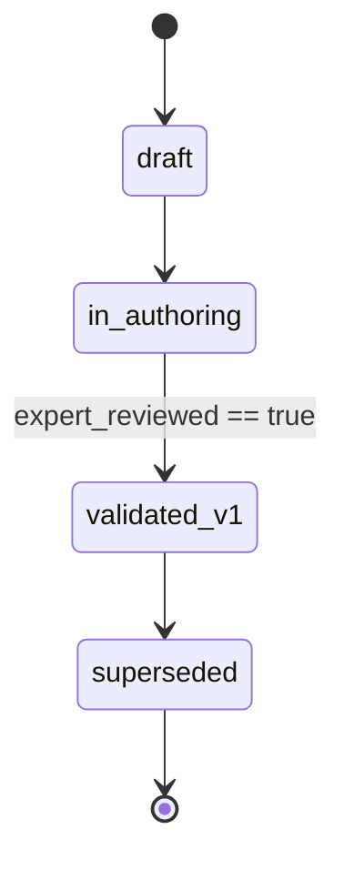
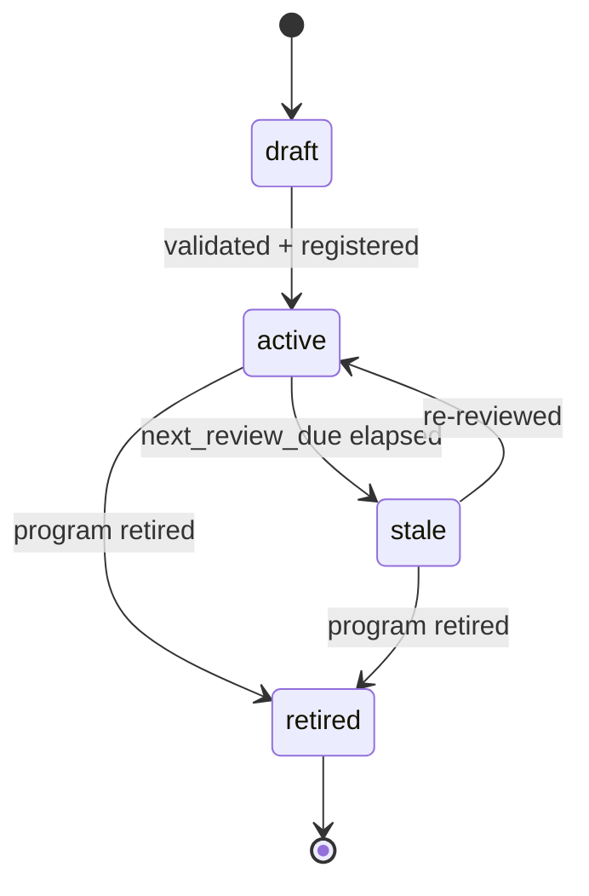

# States: Capital Logic Library

## CardLifecycle

The governed lifecycle of a CLC or CIC card. A card cannot reach `validated_v1` without
recorded expert review for its segment (Farmer exempt — already v1), making the
domain-expert engagement a structural gate.

### States

| State        | Terminal? | Description                                   |
| ------------ | --------- | --------------------------------------------- |
| draft        | no        | Skeleton authored                             |
| in_authoring | no        | Under authoring / expert review               |
| validated_v1 | no        | Expert-reviewed and validated                 |
| superseded   | yes       | Replaced by a newer version                   |

### Transitions

| From         | Event                  | To           | Guard                                    | Effect                       |
| ------------ | ---------------------- | ------------ | ---------------------------------------- | ---------------------------- |
| draft        | begin authoring        | in_authoring | —                                        | —                            |
| in_authoring | validate               | validated_v1 | `governance.expert_reviewed == true`     | Card servable as canonical   |
| validated_v1 | supersede              | superseded   | new version registered                   | Old card frozen              |

### Invalid Transitions

| From       | To           | Why                                              |
| ---------- | ------------ | ------------------------------------------------ |
| draft      | validated_v1 | Must pass through authoring + expert review      |
| superseded | validated_v1 | Terminal state                                   |

### Invariants

| ID        | Expression                                                         |
| --------- | ------------------------------------------------------------------ |
| CL-INV-1  | `validated_v1` requires `expert_reviewed == true` (Farmer exempt)  |
| CL-INV-2  | Card identifier never changes across transitions                   |

---

## RulePackLifecycle

The lifecycle of a funder rule pack. The `active → stale` transition is driven solely by
[RulePackMarkedStale](events.md#rulepackmarkedstale), itself produced by deterministic
[StalenessComputation](operations.md#stalenesscomputation).

### States

| State   | Terminal? | Description                                   |
| ------- | --------- | --------------------------------------------- |
| draft   | no        | Authored, not yet registered                  |
| active  | no        | Current; `next_review_due` in the future      |
| stale   | no        | `next_review_due` elapsed; needs re-review     |
| retired | yes       | Program retired; pack no longer applies        |

### Transitions

| From   | Event                | To      | Guard                          | Effect                          |
| ------ | -------------------- | ------- | ------------------------------ | ------------------------------- |
| draft  | register             | active  | validation passed              | Pack admitted to library        |
| active | mark stale           | stale   | `next_review_due < now`        | Emits RulePackMarkedStale       |
| stale  | re-review            | active  | new `next_review_due` set      | Maintenance block refreshed     |
| active | retire               | retired | program ended                  | Pack frozen                     |
| stale  | retire               | retired | program ended                  | Pack frozen                     |

### Invalid Transitions

| From    | To     | Why                              |
| ------- | ------ | -------------------------------- |
| draft   | stale  | Must register (become active) first |
| retired | active | Terminal state                   |

### Invariants

| ID         | Expression                                                  |
| ---------- | ---------------------------------------------------------- |
| RPL-INV-1  | Staleness is computed from `next_review_due`, never asserted |
| RPL-INV-2  | A pack carries provenance in every non-terminal state       |
